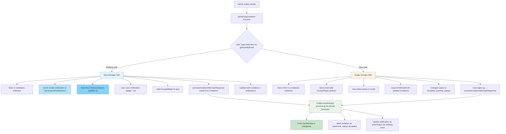
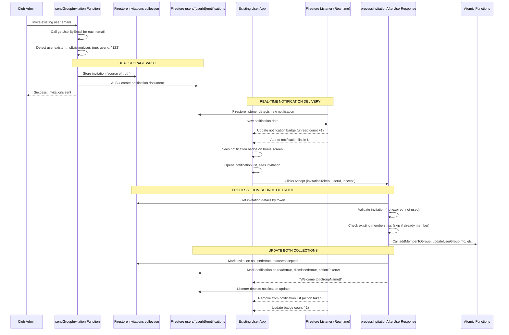
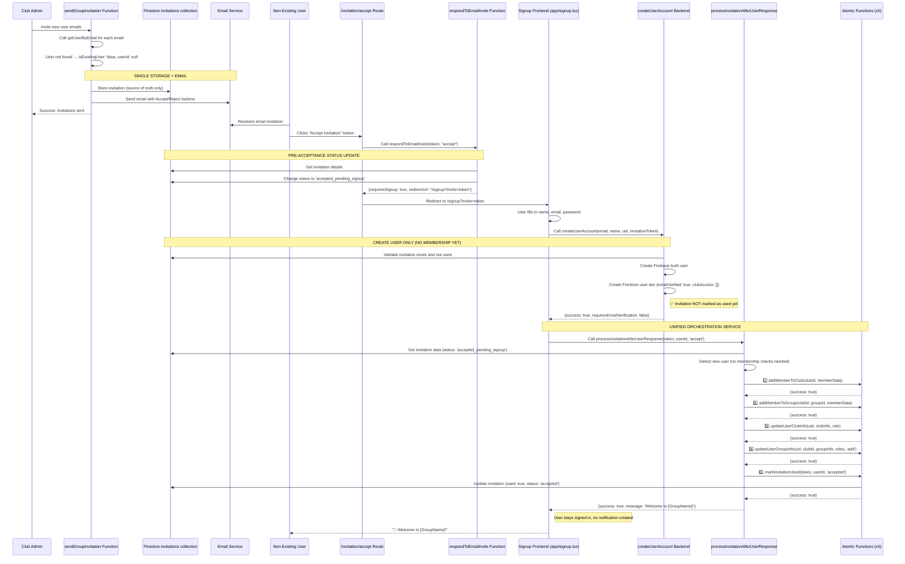
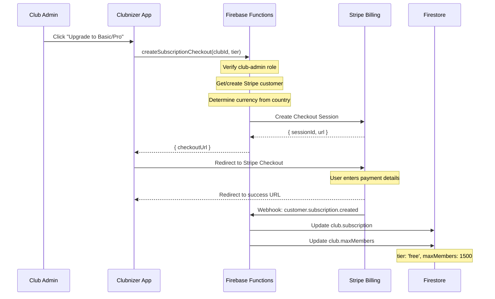
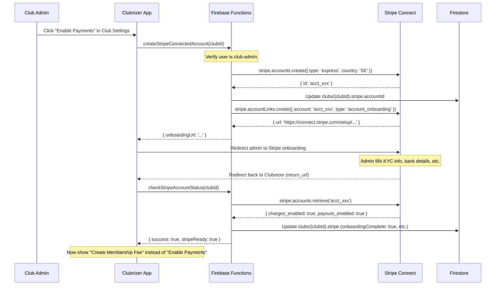
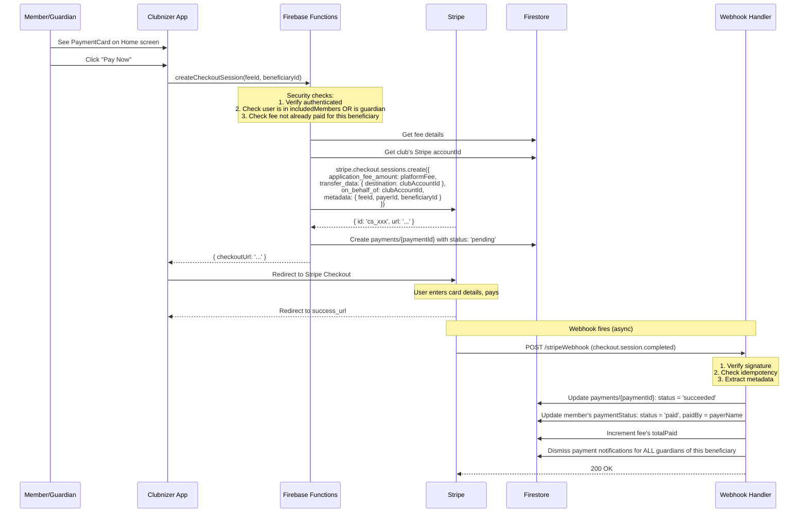

# 🏗️ Clubnizer Architecture Documentation

## Table of Contents

- [Overview](#overview)
- [Core Architecture Principles](#core-architecture-principles)
- [Authentication & User Management](#authentication--user-management)
- [New User Onboarding & Club Creation](#new-user-onboarding--club-creation)
- [Group Invitation Flow](#group-invitation-flow)
- [Frontend Context Architecture](#frontend-context-architecture)
- [Firebase Functions Structure](#firebase-functions-structure)
- [Client-Side Services Structure](#client-side-services-structure)
- [Member Invitation Validation Service](#-member-invitation-validation-service)
- [Role Management System](#-role-management-system)
- [Member Management & Document Synchronization](#member-management--document-synchronization)
- [Member Removal Architecture](#️-member-removal-architecture)
- [Usage Limits & Subscription System](#usage-limits--subscription-system)
- [Group & Club Deletion Architecture](#️-group--club-deletion-architecture)
- [Event Management & Attendance Statistics](#-event-management--attendance-statistics)
- [Event Cancellation & Recurring Events](#-event-cancellation--recurring-events)
- [LOK-stöd & RF Integration (Swedish Clubs)](#-lok-stöd--rf-integration-swedish-clubs)
- [News System](#-news-system)
- [Data Model Conventions](#data-model-conventions)
- [Development Conventions](#development-conventions)
- [Features Implementation Plan](#features-implementation-plan)
- [File Naming and Organization](#file-naming-and-organization)
- [Documentation Requirements](#documentation-requirements)
- [Frontend/UI Architecture](#frontendui-architecture)
- [Firestore Security Rules & Access Control](#-firestore-security-rules--access-control)
- [Stripe Connect & Payment System](#-stripe-connect--payment-system)
- [Legal & Compliance System](#-legal--compliance-system)
- [Internationalization (i18n)](#-internationalization-i18n)
- [Implementation Notes](#implementation-notes)

---

## Overview

Clubnizer is a React Native Expo application with Firebase backend for managing sports groups, events, and member invitations. The architecture follows a 3-layer pattern:

1. **UI Layer**: React Native screens and components
2. **Service Layer**: Client-side services for auth, data management
3. **Backend Layer**: Firebase Cloud Functions (atomic functions pattern)

**Clubnizer is an Expo Universal App** targeting **Web, Android, and iOS** platforms simultaneously. All architectural decisions and implementations must consider cross-platform compatibility.

## Core Architecture Principles

### 1. Atomic Firebase Functions

- **One function per operation per document type**
- Each function has a single, specific responsibility
- Functions are stateless and idempotent where possible
- All Firestore operations happen in Firebase Functions (backend)

### 2. Three-Layer Architecture

```
┌─────────────────┐
│   UI/Frontend   │ ← React Native/Expo components
│                 │
├─────────────────┤
│   Client        │ ← Services that orchestrate function calls
│   Services      │
│                 │
├─────────────────┤
│   Firebase      │ ← Atomic functions for Firestore operations
│   Functions     │
└─────────────────┘
```

## Authentication & User Management

### Auth System Overview

The app uses **Firebase Authentication for login/logout** combined with **custom email verification system**:

#### Firebase Auth vs Custom User System:

- **Firebase Authentication**: Handles login/logout, password management, session tokens
- **Custom User Documents**: Store app-specific data like club access, group memberships, events
- **Custom Email Verification**: Own verification system using `functions/src/auth/`

#### Auth Functions (DO NOT MODIFY - Working System):

```
functions/src/auth/
├── createUserAccount.ts      # Creates Firestore user profile + sends verification email
├── verifyEmail.ts            # Email verification via URL link (HTTP endpoint)
├── getUserProfile.ts         # Retrieves user profile data
├── sendEmailVerification.ts  # Sends verification email with token
├── resendVerificationEmail.ts # Resends verification for unverified users
├── revokeUserTokens.ts       # Revokes all refresh tokens (Admin SDK)
├── requestEmailChange.ts     # Sends email change verification to new address
└── verifyEmailChange.ts      # HTTP endpoint — confirms email change + syncs data
```

#### Auth Flow:

1. **User Registration**:
   - **Regular Users**: Firebase Auth creates account → Custom user document created → Email verification required
   - **Invited Users**: Firebase Auth creates account → Custom user document created → **Email verification skipped** (pre-verified)
2. **Email Verification**:
   - **Regular Users**: Custom verification system sends email → user clicks link → `verifyEmail` activates account
   - **Invited Users**: Account immediately activated with `emailVerified: true` and `verificationStatus: 'verified'`
3. **Login**: Firebase Auth handles authentication → app fetches user profile via `getUserProfile`
4. **User Data**: All club/group access stored in custom `/users/{userId}` documents

#### Email Verification Strategy:

- **Regular Signup**: Requires email verification to prevent spam and ensure valid emails
- **Invitation Signup**: Skips email verification since:
  - Email was already validated when invitation was sent
  - User clicked invitation link, confirming email ownership
  - Reduces friction for legitimate invited users
  - Invitation token acts as email validation proof

#### Email & Password Change:

##### Password Change Flow

```
Client (profile.tsx)
  │
  ├── 1. reauthenticateWithCredential(currentPassword)
  ├── 2. updatePassword(newPassword)           ← Firebase Auth client SDK
  ├── 3. revokeUserTokens CF                   ← Admin SDK (server-side)
  └── 4. signOut → redirect to /login
```

- **Re-authentication** required to prevent stale-session attacks.
- **Token revocation** via Cloud Function (`revokeUserTokens`) invalidates ALL
  sessions across devices — only `admin.auth().revokeRefreshTokens()` can do this.
- User is signed out and must log in with the new password.

##### Email Change Flow

```
Client (profile.tsx)
  │
  ├── 1. requestEmailChange CF → validates new email not taken
  │      → stores token in emailChangeRequests/{token}
  │      → sends SMTP verification email to NEW address
  └── 2. signOut → redirect to /login

User clicks link in email
  │
  └── verifyEmailChange HTTP endpoint
        ├── 1. Validates token (exists, not expired, not used)
        ├── 2. admin.auth().updateUser(uid, { email: newEmail })
        ├── 3. Updates users/{uid}.email in Firestore
        ├── 4. syncEmailToMemberArrays() — updates email in:
        │      ├── allMembers arrays (club/group/subgroup)
        │      ├── members[].guardians[].guardianEmail
        │      └── users/{youthUid}.guardians[].guardianEmail
        ├── 5. admin.auth().revokeRefreshTokens(uid)
        └── 6. Redirects to /login?emailChanged=success
```

- Verification sent to the **new** address to prove ownership.
- `syncEmailToMemberArrays()` in `functions/src/utils/emailSync.ts` updates
  all denormalized email references (same collectionGroup pattern as
  `syncProfileToMemberArrays` in `updateUserProfile.ts`).
- Both Auth and Firestore are updated atomically before the redirect.

##### Denormalized Email Locations Updated:

| Location                             | Field                                 |
| ------------------------------------ | ------------------------------------- |
| `users/{uid}`                        | `email`                               |
| `clubs/{cid}/allMembers/members`     | `members[].email`                     |
| `groups/{gid}/allMembers/members`    | `members[].email`                     |
| `subgroups/{sid}/allMembers/members` | `members[].email`                     |
| `allMembers/members` (any level)     | `members[].guardians[].guardianEmail` |
| `users/{youthUid}`                   | `guardians[].guardianEmail`           |

#### User Document Creation:

When user account is created, it creates:

```typescript
// /users/{userId}
{
  uid: string;
  email: string;
  displayName: string;
  emailVerified: boolean; // true for invited users, false for regular users
  verificationStatus: string; // 'verified' for invited users, 'pending' for regular users
  clubAccess: []; // Initially empty
  // ... other fields
}
```

## New User Onboarding & Club Creation

### Initial User State & Welcome Flow

When a new user first opens the application, they encounter a structured onboarding flow based on their authentication and club membership status:

#### Three User States

```
┌─────────────────────────────────────────────────────────────┐
│                    USER STATE DETECTION                      │
├─────────────────────────────────────────────────────────────┤
│                                                              │
│  1. NOT AUTHENTICATED                                        │
│     → Show Welcome Screen (/welcome)                         │
│     → Options: "Create Your Club" or "Sign In"              │
│                                                              │
│  2. AUTHENTICATED + NO CLUBS (clubAccess.length === 0)      │
│     → Redirect to Create Club Form (/create-club-form)      │
│     → User must create a club to proceed                    │
│                                                              │
│  3. AUTHENTICATED + HAS CLUBS (clubAccess.length > 0)       │
│     → Show Main App (/(tabs))                                │
│     → Normal app navigation                                  │
│                                                              │
└─────────────────────────────────────────────────────────────┘
```

#### Welcome Screen Flow (Not Authenticated)

```
app/welcome.tsx
├── Logo: Clubnizer logo image
├── Tagline: "Organize teams. Schedule events. Stay connected."
├── Main CTA: "Create Your Club" button
│   ├── If not authenticated → /signup?action=createClub
│   └── If authenticated but no clubs → /create-club-form
├── Secondary Action: "Sign In" link → /login
└── Features List: Checkmarks with key benefits
```

**Routing Logic** (in `app/(tabs)/_layout.tsx`):

```typescript
if (!user) {
  return <Redirect href="/welcome" />;
}
if (!userProfile?.clubAccess || userProfile.clubAccess.length === 0) {
  return <Redirect href="/create-club-form" />;
}
// Otherwise show tabs
```

#### Signup with Club Creation Intent

When user clicks "Create Your Club" from welcome screen:

1. **Not Authenticated**: Routes to `/signup?action=createClub`
2. **Signup Process**:
   - User fills form (name, email, password)
   - `createUserAccount` function creates Firebase Auth user
   - Creates user document with empty `clubAccess: []`
   - Sends email verification
   - **Important**: User document exists but has no clubs yet
3. **Post-Signup Message**:

   ```
   "Account created successfully!

   Please check your email inbox and click the verification link
   to activate your account. You must verify your email before
   you can sign in.

   After verifying your email and logging in, you'll be able to
   create your club."
   ```

4. **Redirects to**: `/login` (not to create-club-form yet)

#### Email Verification & Login Flow

1. **User verifies email** via link in inbox
2. **User logs in** at `/login`
3. **After successful login**:
   - Login navigates to `/(tabs)`
   - Tabs layout detects: `authenticated` BUT `clubAccess.length === 0`
   - **Automatically redirects** to `/create-club-form`
4. **User creates club** (see 3-Step Club Creation below)
5. **After club creation**: Redirects to `/(tabs)` with club visible

#### 3-Step Club Creation Flow

The club creation process executes three atomic Firebase Functions in sequence:

```typescript
// app/create-club-form.tsx - handleCreateClub()

// Step 1: Create Club Document
const createClubFn = httpsCallable(functions, "createClub");
const response = await createClubFn({
  clubData: {
    name: clubName,
    description: description,
    location: location,
  },
});
const clubId = response.clubId;

// Step 2: Update User Document (Add to clubAccess[])
const updateUserClubInfoFn = httpsCallable(functions, "updateUserClubInfo");
await updateUserClubInfoFn({
  uid: user.uid,
  clubInfo: {
    clubId,
    clubName: clubName,
    role: "club-admin", // Permission level
    joinedAt: new Date(),
    lastModifiedAt: new Date(),
  },
  role: "club-admin",
});

// Step 3: Add to Club Member List
const addMemberToClubFn = httpsCallable(functions, "addMemberToClub");
await addMemberToClubFn({
  clubId,
  memberData: {
    userId: user.uid,
    roles: ["club-admin"], // Operational level
    name: user.displayName || user.email?.split("@")[0] || "User",
    email: user.email || "",
    photoURL: user.photoURL || "",
    addedBy: user.uid,
    joinedAt: new Date(),
    lastModifiedAt: new Date(),
    needsGuardian: false,
    guardiansContacts: [],
  },
});

// UserContext's onSnapshot listener auto-detects the user document change
// No manual refresh needed — new club appears automatically

// Navigate to home with club visible
router.replace("/(tabs)");
```

**Why 3 Steps?**

1. **Separation of Concerns**: Each function has one responsibility
2. **Atomic Operations**: Each step can be validated independently
3. **Consistent with Other Flows**: Same functions used for invitations
4. **Two-Level Role Storage**:
   - Permission level: `clubAccess[].role = 'club-admin'`
   - Operational level: `roles[] = ['club-admin']`

**Future Enhancement:**  
Currently, only new users without clubs can create clubs via this flow. In the future, this feature may be extended to allow existing users to create additional clubs, enabling users to manage multiple organizations (e.g., a coach managing both a youth club and an adult league).

#### Authentication Required Handling

If an unauthenticated user somehow reaches `/create-club-form`:

```typescript
if (!user) {
  setModal({
    visible: true,
    title: "Authentication Required",
    message: "Please sign in to create a club",
    type: "error",
  });
  // On modal confirm: redirect to /login
  return;
}
```

#### Club Display on Home Screen

After club creation, the home screen (`app/(tabs)/index.tsx`) shows:

```
┌─────────────────────────────────────────────────────┐
│  [🏆] Springfield Soccer Club                       │
│       ✓ Admin • Tap to manage               →      │
└─────────────────────────────────────────────────────┘
```

**Features**:

- Only visible if `userProfile.clubAccess.length > 0`
- Shows club name with trophy icon
- **Clickable only if**: `club.role === 'club-admin'`
- **Clicking navigates to**: `/manage-club?clubId=${clubId}`
- Regular members see the club but cannot click it

#### Race Condition Handling

During signup, there's a brief moment where:

1. Firebase Auth user exists
2. User document is being created
3. `fetchUserProfile` is called

**Solution**: Retry logic with exponential backoff

```typescript
// services/fetchUserAccess.ts
if (error.code === "functions/not-found" && retryCount < MAX_RETRIES) {
  const delayMs = RETRY_DELAY_MS * Math.pow(2, retryCount);
  console.log(`⏳ User profile not found, retrying in ${delayMs}ms`);
  await new Promise((resolve) => setTimeout(resolve, delayMs));
  return fetchUserProfile(userId, retryCount + 1);
}
```

**Expected behavior**:

- First attempt: Fails with "User profile not found"
- Waits 1 second
- Second attempt: Usually succeeds
- Logs are informational, not errors

#### Key Files

```
Frontend:
├── app/welcome.tsx              # Welcome screen for new users
├── app/create-club-form.tsx     # Club creation form with 3-step flow
├── app/signup.tsx               # Handles ?action=createClub parameter
├── app/login.tsx                # Login with post-login redirect logic
├── app/(tabs)/_layout.tsx       # Routes based on auth + club status
└── app/(tabs)/index.tsx         # Home screen with club container

Backend Functions:
├── functions/src/clubs/createClub.ts              # Step 1: Create club doc
├── functions/src/members/updateUserClubInfo.ts    # Step 2: Update user doc
└── functions/src/members/addMemberToClub.ts       # Step 3: Add to member list
```

### Club Creation Limits & Constraints

**Current Behavior**: Users can create unlimited clubs (no enforcement)

**Planned Constraint**: One club per user maximum

- Rationale: Simplifies user experience and club management
- Implementation: Add validation in `createClub` function
- Check: Query user document for existing `clubAccess` entries
- **Important Consideration**: See "Multi-Club Scenarios" section below

#### Multi-Club Scenarios to Consider

**Scenario 1: User Creates Club Then Gets Invited to Another**

```
Timeline:
1. User creates "Springfield Soccer Club" → role: 'club-admin'
2. User is invited to "Metro Basketball League" → role: 'member'

Question: Should invitation be blocked because user has a club?
Answer: NO - User should be able to JOIN other clubs as member
Constraint: User can CREATE only 1 club, but can JOIN unlimited clubs
```

**Scenario 2: User Is Invited First, Then Wants to Create**

```
Timeline:
1. User is invited to "Metro Basketball League" → role: 'member'
2. User tries to create "Springfield Soccer Club"

Question: Should creation be blocked because user is in a club?
Answer: DEPENDS on business rules:
  Option A: Allow - user can be member of one club and admin of another
  Option B: Block - enforce strict "one club total" rule

Recommendation: Option A (allow creation even if member elsewhere)
```

**Scenario 3: User Tries to Create Second Club as Admin**

```
Timeline:
1. User creates "Springfield Soccer Club" → role: 'club-admin'
2. User tries to create "Metro Basketball League"

Question: Should this be blocked?
Answer: YES - Enforce "one club as admin" rule
Check: Does clubAccess[] contain ANY entry with role: 'club-admin'?
```

**Scenario 4: User Leaves Club as Admin, Then Creates New One**

```
Timeline:
1. User creates "Springfield Soccer Club" → role: 'club-admin'
2. User deletes/leaves the club → clubAccess[] updated or entry removed
3. User tries to create "Metro Basketball League"

Question: Should this be allowed?
Answer: YES - If user is no longer admin of ANY club
Check: Filter clubAccess[] for active club-admin roles
```

#### Recommended Validation Logic

```typescript
// functions/src/clubs/createClub.ts

// Before creating club, check if user is already a club admin
const userDoc = await admin
  .firestore()
  .collection("users")
  .doc(request.auth.uid)
  .get();

const userData = userDoc.data();
const clubAccess = userData?.clubAccess || [];

// Check if user is already admin of any active club
const isClubAdmin = clubAccess.some(
  (club: any) => club.role === "club-admin" && club.isActive !== false, // Handle soft-deleted clubs
);

if (isClubAdmin) {
  return {
    success: false,
    error:
      "You can only create one club. You are already an admin of another club.",
  };
}

// Proceed with club creation...
```

#### UI Enforcement

Hide "Create Your Club" option if:

```typescript
// Check in welcome screen or navigation
const userProfile = useUser();
const canCreateClub = !userProfile?.clubAccess?.some(
  (club) => club.role === "club-admin" && club.isActive !== false,
);

// If canCreateClub is false:
// - Don't show "Create Your Club" button on welcome screen
// - Show message: "You are already a club administrator"
// - Redirect authenticated users directly to their existing club
```

#### Edge Cases to Handle

1. **Concurrent Creation Attempts**
   - Two browser tabs trying to create clubs simultaneously
   - Solution: Firebase transaction or check-then-create pattern

2. **Soft-Deleted Clubs**
   - User was admin of club that got soft-deleted (isActive: false)
   - Should they be able to create a new club?
   - Recommendation: Yes, treat soft-deleted as "no longer admin"

3. **Role Changes**
   - User was club-admin, demoted to member
   - Should they be able to create a new club now?
   - Recommendation: Yes, check only current role in clubAccess[]

4. **Invitation Race Condition**
   - User being invited to club while creating their own
   - Solution: Lock or queue operations, use Firestore transactions

#### Summary of Constraints

| Scenario                                  | Allowed? | Reason                                  |
| ----------------------------------------- | -------- | --------------------------------------- |
| Create 1st club as new user               | ✅ Yes   | Primary use case                        |
| Create 2nd club as admin                  | ❌ No    | One club admin limit                    |
| Join other clubs as member                | ✅ Yes   | Can be member of multiple clubs         |
| Create club after being invited as member | ✅ Yes\* | User can admin one, be member of others |
| Create club after leaving previous club   | ✅ Yes   | No longer admin of any club             |
| Create club with soft-deleted club        | ✅ Yes   | Deleted club doesn't count              |

\*Depends on business preference - set constraint as `role === 'club-admin'` check only

## Group Invitation Flow ✨ **DUAL-STORAGE ARCHITECTURE - Version 3.0**

### 🎯 **Dual-Storage Invitation & Notification System**

Clubnizer implements a sophisticated dual-storage architecture that separates **source of truth** (invitations collection) from **UI notifications** (user notifications subcollection). This enables consistent invitation processing while providing real-time notification updates for existing users.

**Core Principle**: The `invitations` collection serves as the **single source of truth** for all invitation data and processing, while the `users/{userId}/notifications` subcollection provides a **lightweight UI layer** for real-time notification delivery to existing users.

### **Dual-Storage Architecture Overview**

```
┌─────────────────────────────────────────────────────────────┐
│                   INVITATIONS COLLECTION                     │
│              (Source of Truth - All Users)                   │
├─────────────────────────────────────────────────────────────┤
│ invitations/{invitationToken}                                │
│ - Complete invitation data                                   │
│ - Processing logic (accept/reject)                           │
│ - Status tracking                                            │
│ - Expiration handling                                        │
│ - Works for BOTH existing and non-existing users            │
└─────────────────────────────────────────────────────────────┘
                            │
                            │ For Existing Users Only
                            ▼
┌─────────────────────────────────────────────────────────────┐
│              NOTIFICATIONS SUBCOLLECTION                     │
│           (UI Layer - Existing Users Only)                   │
├─────────────────────────────────────────────────────────────┤
│ users/{userId}/notifications/{notificationId}                │
│ - Lightweight notification record                            │
│ - Real-time updates via Firestore listener                   │
│ - Badge counts and unread tracking                           │
│ - Links to source invitation via invitationToken             │
│ - Future: announcements, events, polls, etc.                 │
└─────────────────────────────────────────────────────────────┘
```

### **Data Model Schemas**

#### **Invitations Collection (Source of Truth)**

```typescript
// invitations/{invitationToken}
{
  // Core invitation data
  email: string;
  clubId: string;
  clubName: string;
  groupId: string;
  groupName: string;
  inviterName: string;
  inviterUid: string;
  type: 'group_invitation';

  // Timestamps
  createdAt: Timestamp;
  expiresAt: Timestamp;
  respondedAt?: Timestamp;

  // Status tracking
  status: 'pending' | 'accepted_pending_signup' | 'accepted' | 'rejected';
  used: boolean;
  userResponse?: 'accept' | 'reject';

  // User type identification
  isExistingUser: boolean;       // true = has account, false = new user
  userId: string | null;         // userId if existing user, null if new

  // Version tracking
  workflowVersion: '3.0';
}
```

````

#### **Notifications Subcollection (UI Layer - Existing Users Only)**

```typescript
// users/{userId}/notifications/{notificationId}
{
  // Notification metadata
  type: 'group_invitation' | 'announcement' | 'event' | 'poll';  // Extensible for future types
  title: string;              // e.g., "Group Invitation"
  message: string;            // e.g., "You've been invited to join [GroupName]"

  // Source reference (links back to source of truth)
  invitationToken?: string;   // For group invitations
  sourceId?: string;          // Generic reference to source document
  sourceCollection?: string;  // 'invitations' | 'announcements' | etc.

  // UI state
  read: boolean;              // Has user seen this notification?
  dismissed: boolean;         // Has user dismissed without action?

  // Context data (minimal, for display only)
  clubId: string;
  clubName: string;
  groupId?: string;
  groupName?: string;

  // Timestamps
  createdAt: Timestamp;
  readAt?: Timestamp;
  actionTakenAt?: Timestamp;

  // Future extensibility
  priority?: 'low' | 'normal' | 'high';
  actionUrl?: string;         // Deep link for notification action
}
````

### **Two-Path User Experience**



### **Key Architectural Benefits**

#### **Why Dual Storage?**

1. **Single Source of Truth**: The `invitations` collection maintains all business logic
   - Invitation processing (accept/reject) always reads from invitations
   - Status tracking, expiration, token validation all in one place
   - Consistent data model for both user types

2. **Real-Time UI Updates**: The `notifications` subcollection enables instant updates
   - Firestore listeners provide real-time notification delivery
   - Badge counts and unread tracking without polling
   - Lightweight data structure optimized for UI rendering

3. **Unified Processing**: Same acceptance flow for all users
   - `processInvitationAfterUserResponse` always queries invitations collection
   - Email invitation tokens and in-app tokens are identical
   - No branching logic based on storage location

4. **Future Extensibility**: Notifications system supports multiple types
   - Ready for announcements, events, polls, etc.
   - Generic notification structure with type-specific fields
   - Centralized notification management for users

5. **Clean Separation of Concerns**:
   - **invitations**: Business logic, processing, source of truth
   - **notifications**: UI layer, real-time updates, user experience

### **Complete Flow Details**

#### **Path 1: Existing Users (Dual Storage + Real-Time Notifications)**



#### **Path 2: New Users (Single Storage + Email Invitations + Frontend Atomic Functions)**



### **Key Implementation Components**

### **Key Implementation Components**

#### **1. Core Invitation Creation (Backend)**

```typescript
// functions/src/invitations/sendGroupInvitation.ts
Input: {
  emails: string[];
  clubId: string;
  clubName: string;
  groupId: string;
  groupName: string;
  inviterName: string;
  inviterUid: string;
}

Processing Flow:
1. For each email:
   a. Call getUserByEmail(email) to detect existing user
   b. If user exists:
      - Create invitation in invitations collection (isExistingUser: true, userId: userDoc.id)
      - ALSO create notification in users/{userId}/notifications (dual write)
      - Do NOT send email
   c. If user not found:
      - Create invitation in invitations collection (isExistingUser: false, userId: null)
      - Send email with Accept/Reject buttons
      - Do NOT create notification (no user to notify)

2. Return results with success/failure per email

Output: {
  successful: Array<{email, token, isExistingUser}>;
  failed: Array<{email, reason}>;
}
```

#### **2. Notification Creation Helper (Backend)**

```typescript
// functions/src/notifications/createNotification.ts
// NEW ATOMIC FUNCTION for creating user notifications

Input: {
  userId: string;
  type: 'group_invitation' | 'announcement' | 'event' | 'poll';
  title: string;
  message: string;
  invitationToken?: string;    // For invitations
  sourceId?: string;           // Generic source reference
  sourceCollection?: string;   // Source collection name
  clubId: string;
  clubName: string;
  groupId?: string;
  groupName?: string;
  priority?: 'low' | 'normal' | 'high';
  actionUrl?: string;
}

Processing:
- Create document in users/{userId}/notifications with auto-generated ID
- Set read: false, dismissed: false
- Add timestamps (createdAt)
- Return notification ID

Output: {
  notificationId: string;
  success: boolean;
}
```

#### **3. Fetch User Notifications (Frontend Service)**

```typescript
// services/fetchNotifications.ts
// NEW SERVICE for real-time notification fetching

// Real-time listener for all user notifications
export const subscribeToUserNotifications = (
  userId: string,
  onNotificationsUpdate: (notifications: Notification[]) => void,
  onError?: (error: Error) => void,
) => {
  const notificationsRef = collection(db, "users", userId, "notifications");

  const q = query(
    notificationsRef,
    where("dismissed", "==", false), // Only active notifications
    orderBy("createdAt", "desc"),
  );

  return onSnapshot(
    q,
    (snapshot) => {
      const notifications = snapshot.docs.map((doc) => ({
        id: doc.id,
        ...doc.data(),
      }));
      onNotificationsUpdate(notifications);
    },
    (error) => {
      console.error("Notification listener error:", error);
      onError?.(error);
    },
  );
};

// Get unread count for badge
export const getUnreadNotificationCount = async (
  userId: string,
): Promise<number> => {
  const notificationsRef = collection(db, "users", userId, "notifications");
  const q = query(
    notificationsRef,
    where("read", "==", false),
    where("dismissed", "==", false),
  );

  const snapshot = await getDocs(q);
  return snapshot.size;
};

// Mark notification as read
export const markNotificationAsRead = async (
  userId: string,
  notificationId: string,
): Promise<void> => {
  const notificationRef = doc(
    db,
    "users",
    userId,
    "notifications",
    notificationId,
  );
  await updateDoc(notificationRef, {
    read: true,
    readAt: serverTimestamp(),
  });
};
```

#### **4. Legacy Invitation Query (Backwards Compatibility)**

```typescript
// services/fetchGroupInvites.ts
// DEPRECATED: This service is kept for backwards compatibility
// New implementations should use subscribeToUserNotifications instead

// Old polling-based invitation fetch
export const fetchGroupInvites = async () => {
  // Query invitations collection by email OR userId
  // Filter for status='pending'
  // Return pending invitations
  // NOTE: This is less efficient than real-time notifications
  // Gradually migrate UI components to use notifications subcollection
};

// Accept/Reject still work via orchestration service
export const acceptGroupInvite = async (invitationToken: string) => {
  // Calls processInvitationAfterUserResponse('accept')
  // Processes from invitations collection (source of truth)
};

export const rejectGroupInvite = async (invitationToken: string) => {
  // Calls processInvitationAfterUserResponse('reject')
  // Processes from invitations collection (source of truth)
};
```

#### **5. Unified Orchestration Service (Frontend)**

```typescript
// services/orchestration/addRegularMemberToGroup.ts
// NOTE: This is used for BOTH user types - unified architecture
// - Existing users: Accept in-app notifications
// - New users: Called from signup.tsx after account creation

export const addRegularMemberToGroupService = {
  // Main invitation sender
  async inviteUsersToGroup(
    data: GroupInvitationData,
  ): Promise<InvitationResult> {
    // Calls sendGroupInvitation Firebase Function
    // Function handles dual storage automatically
  },

  // UNIFIED acceptance/rejection processor for BOTH user types
  async processInvitationAfterUserResponse(
    invitationToken: string,
    userId: string,
    action: "accept" | "reject" = "accept",
  ): Promise<AcceptRejectResult> {
    // 1. Get invitation from invitations collection (source of truth)
    const invitation = await getInvitationByToken(invitationToken);

    // 2. Handle rejection (simple path)
    if (action === "reject") {
      // Update invitation status to 'rejected'
      // If user has notification, mark as dismissed
      return { success: true, message: "Invitation rejected" };
    }

    // 3. For acceptance - CONDITIONAL LOGIC based on invitation type:
    //
    //    a. GUARDIAN INVITATION (invitationType='guardian'):
    //       - Calls addGuardianToYouth CF with guardianData from invitation
    //       - Links guardian to youth member in all relevant docs
    //       - Then calls finalizeInvitation() to mark invitation used
    //
    //    b. CLUB-ADMIN INVITATION (invitationType='club_admin'):
    //       - Calls addClubAdmin + addMemberToClub + updateUserClubInfo
    //       - No group membership created (club-level only)
    //
    //    c. ALL OTHER ROLES (player, coach, admin, youth):
    //       - Uses unified executeAtomicOperations() method
    //       - Config flags determine behavior:
    //         * needsYouthFlow: calls createYouthMemberDocument CF internally
    //         * needsMembershipCheck: checks for existing memberships (existing users)
    //       - Atomic operations: addMemberToClub, addMemberToGroup,
    //         updateUserClubInfo, updateUserGroupInfo, markInvitationUsed
    //       - Youth flow (player-underage) is now handled INSIDE this method
    //         via createYouthMemberDocument CF (no separate call needed)

    // 4. Return success with group details
  },
};
```

#### **6. New User Signup Integration (Frontend)**

```typescript
// app/signup.tsx
// NOTE: New users call the SAME orchestration service after account creation
// This creates a unified architecture for both user types

import { addRegularMemberToGroupService } from "../services/orchestration/addRegularMemberToGroup";

// After createUserAccount succeeds:
try {
  // Use unified orchestration service
  const invitationResult =
    await addRegularMemberToGroupService.processInvitationAfterUserResponse(
      invitationToken, // From URL params
      newUserId, // From createUserAccount result
      "accept", // Action
    );

  if (!invitationResult.success) {
    throw new Error(invitationResult.error);
  }

  // Show welcome message
  showSuccessMessage(invitationResult.message);
} catch (error) {
  // Handle error - account created but membership failed
  showPartialSuccessMessage();
}

// Key architectural benefits:
// ✅ Single source of truth for membership logic
// ✅ Consistent behavior between user types
// ✅ Easier to maintain and test
// ✅ Automatic handling of edge cases (duplicates, etc.)
```

### **Frontend UI Implementation**

#### **Notification Badge & List Component**

```typescript
// components/NotificationBell.tsx
// NEW COMPONENT for displaying notification badge and list

export const NotificationBell = () => {
  const { user } = useAuth();
  const [notifications, setNotifications] = useState<Notification[]>([]);
  const [unreadCount, setUnreadCount] = useState(0);

  useEffect(() => {
    if (!user) return;

    // Real-time listener for notifications
    const unsubscribe = subscribeToUserNotifications(
      user.uid,
      (newNotifications) => {
        setNotifications(newNotifications);
        const unread = newNotifications.filter(n => !n.read).length;
        setUnreadCount(unread);
      },
      (error) => {
        console.error('Notification error:', error);
      }
    );

    return () => unsubscribe();
  }, [user]);

  const handleNotificationClick = async (notification: Notification) => {
    // Mark as read
    await markNotificationAsRead(user.uid, notification.id);

    // Handle based on type
    if (notification.type === 'group_invitation') {
      // Show invitation modal or navigate to invitation screen
      // Use notification.invitationToken to process acceptance
    }
  };

  return (
    <View>
      {/* Bell icon with badge */}
      <TouchableOpacity onPress={openNotificationList}>
        <Icon name="bell" />
        {unreadCount > 0 && (
          <Badge value={unreadCount} />
        )}
      </TouchableOpacity>

      {/* Notification list */}
      {showList && (
        <NotificationList
          notifications={notifications}
          onNotificationClick={handleNotificationClick}
        />
      )}
    </View>
  );
};
```

#### **Updated Home Screen Implementation**

```typescript
// app/(tabs)/index.tsx
// UPDATED to use new notification system

export default function HomeScreen() {
  const { user } = useAuth();
  const [notifications, setNotifications] = useState<Notification[]>([]);
  const [showInvitationModal, setShowInvitationModal] = useState(false);
  const [currentInvitation, setCurrentInvitation] = useState<Notification | null>(null);

  useEffect(() => {
    if (!user) return;

    // Real-time notification listener (replaces old polling)
    const unsubscribe = subscribeToUserNotifications(
      user.uid,
      (newNotifications) => {
        setNotifications(newNotifications);

        // Auto-show first unread group invitation
        const firstInvite = newNotifications.find(
          n => n.type === 'group_invitation' && !n.read
        );
        if (firstInvite && !currentInvitation) {
          setCurrentInvitation(firstInvite);
          setShowInvitationModal(true);
        }
      }
    );

    return () => unsubscribe();
  }, [user]);

  const handleAcceptInvite = async () => {
    if (!currentInvitation?.invitationToken) return;

    try {
      // Process via orchestration service (reads from invitations collection)
      const result = await acceptGroupInvite(currentInvitation.invitationToken);

      // Notification automatically updated by backend
      // Listener will remove it from the list

      setShowInvitationModal(false);
      Alert.alert('Success', result.message);
    } catch (error) {
      Alert.alert('Error', error.message);
    }
  };

  const handleRejectInvite = async () => {
    if (!currentInvitation?.invitationToken) return;

    try {
      await rejectGroupInvite(currentInvitation.invitationToken);
      setShowInvitationModal(false);
    } catch (error) {
      Alert.alert('Error', error.message);
    }
  };

  return (
    <View>
      {/* Notification bell in header */}
      <NotificationBell />

      {/* Invitation modal */}
      <InvitationModal
        visible={showInvitationModal}
        invitation={currentInvitation}
        onAccept={handleAcceptInvite}
        onReject={handleRejectInvite}
        onClose={() => setShowInvitationModal(false)}
      />

      {/* Rest of home screen */}
    </View>
  );
}
```

### **Status Flow & State Management**

#### **Invitation Status Progression**

```
NEW USER:
'pending' → 'accepted_pending_signup' → 'accepted'
   ↓              ↓                          ↓
Email sent   Email accepted           Signup complete + membership added

EXISTING USER:
'pending' → 'accepted'
   ↓            ↓
Notification  In-app acceptance + membership added

REJECTION (BOTH):
'pending' → 'rejected'
   ↓            ↓
Any state    User declines
```

#### **Notification State Management**

```
Notification Created: read=false, dismissed=false
User Views: read=true (badge count decreases)
User Accepts/Rejects: dismissed=true, actionTakenAt=timestamp (removed from list)
User Ignores: remains in list as read=true, dismissed=false
```

### **Data Synchronization Strategy**

#### **Write Operations**

1. **Existing User Invitation**:
   - Write to invitations collection (source of truth)
   - Write to users/{userId}/notifications (UI layer)
   - Both writes happen in single transaction when possible

2. **Invitation Acceptance**:
   - Update invitations collection: used=true, status='accepted'
   - Update notifications subcollection: dismissed=true, actionTakenAt
   - Add membership via atomic functions

3. **Invitation Rejection**:
   - Update invitations collection: status='rejected'
   - Update notifications subcollection: dismissed=true, actionTakenAt

#### **Read Operations**

1. **Notification Display**:
   - Read from users/{userId}/notifications via Firestore listener
   - Real-time updates, lightweight data

2. **Invitation Processing**:
   - Read from invitations collection (source of truth)
   - Complete invitation data for validation and membership logic

3. **Badge Counts**:
   - Query notifications subcollection: where read=false AND dismissed=false
   - Efficient query for UI indicators

### **Security Rules**

#### **Invitations Collection Rules**

```javascript
// firestore.rules
match /invitations/{invitationToken} {
  // Anyone can read their own invitation by token (needed for email links)
  allow read: if true;  // Token acts as access key

  // Only authenticated users with club admin role can create
  allow create: if request.auth != null
                && hasClubAdminRole(request.auth.uid, request.resource.data.clubId);

  // Only the invited user can update (accept/reject)
  allow update: if request.auth != null
                && (request.auth.token.email == resource.data.email
                    || request.auth.uid == resource.data.userId);

  // No deletion allowed (keep audit trail)
  allow delete: if false;
}
```

#### **Notifications Subcollection Rules**

```javascript
// firestore.rules
match /users/{userId}/notifications/{notificationId} {
  // User can only read their own notifications
  allow read: if request.auth != null && request.auth.uid == userId;

  // Only backend functions can create notifications
  allow create: if false;  // Backend only via Admin SDK

  // User can update their own notifications (mark as read/dismissed)
  allow update: if request.auth != null
                && request.auth.uid == userId
                && onlyAllowedFields(['read', 'readAt', 'dismissed', 'actionTakenAt']);

  // Users cannot delete notifications (soft delete via dismissed flag)
  allow delete: if false;
}

function onlyAllowedFields(allowedFields) {
  return request.resource.data.diff(resource.data).affectedKeys()
    .hasOnly(allowedFields);
}
```

### **Error Handling & Edge Cases**

#### **Common Scenarios**

1. **User Already Member**:
   - Check membership before calling atomic functions
   - Return friendly message: "Already a member of this group"
   - Mark invitation as accepted but skip membership operations

2. **Expired Invitation**:
   - Validate expiresAt timestamp in processInvitationAfterUserResponse
   - Return error: "Invitation has expired"
   - Frontend shows expired state in notification list

3. **Invitation Already Processed**:
   - Check used=true or status='accepted'/'rejected'
   - Return appropriate message based on status
   - Frontend can filter out processed invitations

4. **User Deleted During Pending Invitation**:
   - Notification subcollection deleted with user document (Firestore cascade)
   - Invitation remains in main collection (audit trail)
   - No error, invitation just not accessible anymore

5. **Network Interruption During Processing**:
   - Use Firestore transactions for critical updates
   - Idempotent operations (can retry safely)
   - Frontend shows loading state until confirmation

6. **Duplicate Notification Creation**:
   - Backend checks if notification already exists for invitation token
   - Skip creation if duplicate detected
   - Prevents multiple notifications for same invitation

### **Performance Considerations**

#### **Optimization Strategies**

1. **Firestore Listener Efficiency**:
   - Only listen to notifications where dismissed=false
   - Limit to recent notifications (e.g., last 30 days)
   - Use orderBy with limit for large notification lists

2. **Badge Count Query**:
   - Separate lightweight query for just counting
   - Use composite index: (dismissed, read, createdAt)
   - Cache count locally with short TTL

3. **Notification Cleanup**:
   - Scheduled function to auto-dismiss old notifications (>30 days)
   - Keeps subcollection size manageable
   - Maintains audit trail in invitations collection

4. **Batch Operations**:
   - When admin invites multiple users, batch notification creation
   - Use Firestore batch writes (up to 500 operations)
   - Single transaction for consistency

### **Migration Strategy from Version 2.0**

#### **Backwards Compatibility**

1. **Existing Invitations**:
   - Version 2.0 invitations remain in invitations collection
   - No notifications subcollection for old invitations
   - processInvitationAfterUserResponse handles both versions

2. **Gradual UI Migration**:
   - Keep fetchGroupInvites service for legacy components
   - New components use subscribeToUserNotifications
   - Both work simultaneously during transition

3. **Data Backfill (Optional)**:
   - One-time script to create notifications for pending invitations
   - Only for existing users with status='pending'
   - Links to existing invitation via invitationToken

#### **Testing Checklist**

- [ ] Existing user receives notification immediately
- [ ] New user receives only email (no notification)
- [ ] Real-time listener updates badge count correctly
- [ ] Accept/reject updates both collections
- [ ] Email invitation flow unchanged for new users
- [ ] Expired invitations handled gracefully
- [ ] Already-member scenario works correctly
- [ ] Notification dismissal works
- [ ] Badge count accurate after actions
- [ ] Security rules prevent unauthorized access

### **Future Extensibility**

#### **Notification Types Roadmap**

The notifications subcollection is designed to support multiple notification types:

```typescript
// Future notification types
type NotificationType =
  | "group_invitation" // Current implementation
  | "announcement" // Club/group announcements
  | "event_reminder" // Upcoming event reminders
  | "poll_created" // New poll available
  | "role_changed" // User role updated
  | "member_joined" // New member notification
  | "event_cancelled" // Event cancellation
  | "custom"; // Admin-defined notifications
```

Each type can have type-specific fields while maintaining common notification structure.

---

_This completes the dual-storage invitation and notification system documentation. The architecture separates source of truth (invitations) from UI layer (notifications) while maintaining unified processing logic for both existing and new users._
Route->>Respond: Call respondToEmailInvite(token, "accept")
Respond->>DB: Change status to 'accepted_pending_signup'
Respond-->>Route: {requiresSignup: true, redirectUrl: "/signup?invite=token"}

    Route->>Signup: Redirect to signup with invitation context
    Signup->>Signup: User completes account creation via createUserAccount
    Note right of Signup: createUserAccount detects invitation and marks user as emailVerified: true

    Signup->>Process: Call processInvitationAfterUserResponse(token, newUserId, 'accept')
    Process->>DB: Get invitation details (status: 'accepted_pending_signup')
    Process->>Process: New user logic - skip membership checks
    Process->>Atomic: Call addMemberToGroup, updateUserGroupInfo, etc.
    Process->>DB: Mark invitation as 'accepted' and used: true
    Process-->>Signup: "Welcome to [GroupName]!"

```

### **Key Implementation Details**

#### **Unified Storage Benefits**
- ✅ **Single source of truth** for all invitations
- ✅ **Consistent querying** across both user types
- ✅ **Unified orchestration** service handles both flows
- ✅ **Status-based processing** enables proper flow control
- ✅ **Atomic operations** ensure data consistency

#### **Status Flow**
```

NEW USER: 'pending' → 'accepted_pending_signup' → 'accepted'
EXISTING: 'pending' → 'accepted'
REJECTION: 'pending' → 'rejected'

```

---

## Usage Limits & Subscription System

### Overview

> **STATUS: Subscriptions are PARKED.** The app is 100% free.
> All clubs get up to **1,500 members**. If a club needs more,
> they should contact **support@clubnizer.com**.
>
> The previous subscription tiers (Basic, Pro, Enterprise) and Stripe Billing
> integration are preserved in the codebase for potential future reactivation.
> **Stripe Connect (membership fees)** remains fully active and is unaffected.

Clubnizer enforces member limits at the **CLUB level** (not group level), allowing clubs essentially unlimited groups but restricting total members to **1,500** per club.

**Design Philosophy**:
- **Club-level member limits**: Total members across all groups count against the club's limit
- **Unlimited groups**: All clubs allow up to 99 groups (essentially unlimited)
- **1,500 member safety cap**: Prevents abuse; contact support for a higher limit
- **Stripe Connect active**: Clubs can still collect membership fees from members (1.5% platform fee)
- **Stripe Billing parked**: Subscription checkout UI hidden; tier config mapped to free

### Current Limits (Free for All)

```

┌─────────────────────────────────────────────────────┐
│ CURRENT LIMITS (app is free) │
├─────────────────┬───────────────────────────────────┤
│ Members/club │ 1,500 (contact support for more) │
│ Groups/club │ 99 │
│ Clubs (admin) │ 1 │
│ Price │ Free │
└─────────────────┴───────────────────────────────────┘

````

### Parked Subscription Tiers (for future reactivation)

The following tiers exist in `subscriptionConfig.ts` and `limits.ts` but are
currently all mapped to the same 1,500-member limit except Enterprise:

| Tier       | Was       | Now (Parked)                          |
|------------|-----------|---------------------------------------|
| Free       | 50 members| 1,500 members                         |
| Basic      | 500       | 1,500 (same as free while parked)     |
| Pro        | 2,000     | 1,500 (same as free while parked)     |
| Enterprise | Unlimited | Unlimited (contact support)           |

**To reactivate subscriptions**: Restore the original tier limits in `limits.ts`
and `subscriptionConfig.ts`, uncomment the Subscription menu in `club-settings.tsx`,
and update this section of ARCHITECTURE.md.

### Data Model

#### Club Document - Subscription Fields

```typescript
interface ClubData {
  // ... existing fields ...

  // Total member count (used for subscription limits)
  totalCounts: number;           // Total members across all groups in the club

  // Group limits (essentially unlimited now)
  activeGroupCount?: number;     // Count of groups with isActive=true
  maxGroups?: number;            // Maximum groups allowed (default: 99)

  // Member limit based on subscription tier
  maxMembers?: number;           // Maximum members in club (50/500/2000/unlimited)

  // Subscription to Clubnizer platform
  subscription?: {
    tier: 'free' | 'basic' | 'pro' | 'enterprise';
    status: 'active' | 'past_due' | 'cancelled' | 'trialing';
    stripeCustomerId: string | null;
    stripeSubscriptionId: string | null;
    stripePriceId: string | null;
    currentPeriodStart: Timestamp | null;
    currentPeriodEnd: Timestamp | null;
    cancelAtPeriodEnd: boolean;
    paymentFailedAt: Timestamp | null;  // For 14-day grace period tracking
  };
}
````

**Default Values** (Free — all clubs):

```typescript
{
  totalCounts: 0,
  maxGroups: 99,
  maxMembers: 1500,
  subscription: {
    tier: 'free',
    status: 'active',
    stripeCustomerId: null,
    stripeSubscriptionId: null,
    stripePriceId: null,
    currentPeriodStart: null,
    currentPeriodEnd: null,
    cancelAtPeriodEnd: false,
    paymentFailedAt: null,
  }
}
```

#### Group Document - No Member Limits

```typescript
interface GroupData {
  // ... existing fields ...
  // REMOVED: maxMembers (member limits are now at club level)
  // Groups can have unlimited members as long as club total is within limit
}
```

### Validation Logic

#### Member Limit Check (Club Level)

**Function**: `functions/src/members/addMemberToClub.ts` and `addMemberToGroup.ts`

```typescript
import { checkClubMemberLimit, getClubSubscriptionTier } from "../utils/limits";

// Get club data
const clubData = clubDoc.data();
const currentTotalMembers = clubData?.totalCounts || 0;
const subscriptionTier = getClubSubscriptionTier(clubData);

// Check if club can add more members
const limitCheck = checkClubMemberLimit(currentTotalMembers, subscriptionTier);
if (!limitCheck.allowed) {
  throw new HttpsError("resource-exhausted", limitCheck.message);
}
```

### Subscription Functions

| Function                      | Purpose                                 | Security         |
| ----------------------------- | --------------------------------------- | ---------------- |
| `createSubscriptionCheckout`  | Create Stripe Checkout for subscription | club-admin only  |
| `createCustomerPortalSession` | Open Stripe billing portal              | club-admin only  |
| `getSubscriptionStatus`       | Get current tier, usage, warnings       | club member      |
| `subscriptionWebhookHandler`  | Handle Stripe webhook events            | Stripe signature |

#### File Structure

```
functions/src/
├── config/
│   └── subscriptionConfig.ts    # Tier definitions, Stripe price IDs
├── subscriptions/
│   ├── createSubscriptionCheckout.ts
│   ├── createCustomerPortalSession.ts
│   ├── getSubscriptionStatus.ts
│   └── subscriptionWebhookHandler.ts
└── utils/
    └── limits.ts                # Validation functions (updated)
```

### Subscription Flow



> **Note:** The subscription flow above is currently **parked**. The Subscription
> menu in club-settings.tsx is commented out, so users cannot initiate a checkout.
> All clubs operate on the free tier with 1,500 members.

### Grace Period & Access Restriction

```
Payment Failed Timeline:
├── Day 0:  Payment fails → status = 'past_due', paymentFailedAt set
├── Day 1-14: Grace period → Club can still add members (warning shown)
├── Day 14+: Restricted → Cannot add new members until payment resolved
└── Payment recovered: status = 'active', paymentFailedAt cleared
```

### Configuration

**Location**: `functions/src/config/subscriptionConfig.ts`

```typescript
// Stripe Price IDs (TEST MODE - replace for production)
export const STRIPE_PRICE_IDS = {
  basic: {
    sek: "price_1T3yb5C7tKPlBo5y5fJVJQPM",
    nok: "price_1T3zRGC7tKPlBo5yDn7VPVig",
    dkk: "price_1T3zRGC7tKPlBo5yEjtlvf9o",
    eur: "price_1T3zRGC7tKPlBo5y3y4wTkjF",
  },
  pro: {
    sek: "price_1T3yf2C7tKPlBo5yf859iboF",
    eur: "price_1T3zZDC7tKPlBo5yEOQc2V7H",
    nok: "price_1T3zZDC7tKPlBo5yhrJCPJ6W",
    dkk: "price_1T3zZDC7tKPlBo5y6vuMWZf1",
  },
};

// Country to currency mapping (prevents arbitrage)
export const COUNTRY_CURRENCY_MAP = {
  SE: "sek", // Sweden
  NO: "nok", // Norway
  DK: "dkk", // Denmark
  // All other countries default to EUR
};

// Warning threshold (80%)
export const UPGRADE_WARNING_THRESHOLD = 0.8;

// Grace period (14 days)
export const PAYMENT_GRACE_PERIOD_DAYS = 14;
```

### Migration Notes

For existing clubs, the subscription system is parked (app is free with 1,500 member limit).
No migration needed for existing data. If reactivating subscriptions in the future:

```typescript
{
  maxGroups: 99,
  maxMembers: 1500,  // Current free limit
  subscription: {
    tier: 'free',
    status: 'active',
    // ... other fields null
  }
}
```

**Important Notes**:

- `maxMembers` is a static limit, not a counter
- Compared against `memberCount` from `/clubs/{clubId}/groups/{groupId}/allMembers/members`
- Check: `memberCount < maxMembers` before adding member
- No reactivation concern (members don't get soft-deleted individually)

### Validation Logic

#### 1. Club Creation Limit

**Function**: `functions/src/clubs/createClub.ts`

```typescript
// Check user's active club count against limit
const userDoc = await admin
  .firestore()
  .collection("users")
  .doc(request.auth.uid)
  .get();

const userData = userDoc.data();
const activeClubsAsAdmin = userData?.activeClubsAsAdmin || 0;
const maxClubsAsAdmin =
  userData?.maxClubsAsAdmin || DEFAULT_LIMITS.maxClubsAsAdmin;

if (activeClubsAsAdmin >= maxClubsAsAdmin) {
  throw new HttpsError(
    "resource-exhausted",
    `Cannot create club. You have reached your limit of ${maxClubsAsAdmin} active club(s). ` +
      `Please contact support@clubnizer.com to upgrade.`,
  );
}

// Create club...

// Increment counter after successful creation
await userRef.update({
  activeClubsAsAdmin: admin.firestore.FieldValue.increment(1),
});
```

**Edge Case - Reactivation**:
If a deleted club (`isActive=false`) is being reactivated:

```typescript
// In reactivation logic (if we add this feature):
if (activeClubsAsAdmin >= maxClubsAsAdmin) {
  throw new HttpsError(
    "resource-exhausted",
    `Cannot reactivate club. Maximum of ${maxClubsAsAdmin} active clubs reached. ` +
      `Please delete an active club first or contact support@clubnizer.com.`,
  );
}
```

#### 2. Group Creation Limit

**Function**: `functions/src/groups/createGroup.ts`

```typescript
// Check club's active group count against limit
const clubDoc = await admin.firestore().collection("clubs").doc(clubId).get();

const clubData = clubDoc.data();
const activeGroupCount = clubData?.activeGroupCount || 0;
const maxGroups = clubData?.maxGroups || DEFAULT_LIMITS.maxGroups;

if (activeGroupCount >= maxGroups) {
  throw new HttpsError(
    "resource-exhausted",
    `Cannot create group. This club has reached its limit of ${maxGroups} active groups. ` +
      `Please contact support@clubnizer.com to upgrade.`,
  );
}

// Create group...

// Increment counter after successful creation
await clubRef.update({
  activeGroupCount: admin.firestore.FieldValue.increment(1),
});
```

**Edge Case - Reactivation**:
This is the **CRITICAL case** you identified:

```typescript
// Scenario: activeGroupCount = 19, maxGroups = 20
// User creates new group → allowed (19 + 1 = 20)
// User tries to reactivate deleted group → BLOCKED (would make it 21)

// In reactivation logic (inside createGroup or separate reactivateGroup function):
if (existingGroup && existingGroup.isActive === false) {
  // This is a reactivation attempt

  // MUST check limit again (same as creation)
  if (activeGroupCount >= maxGroups) {
    throw new HttpsError(
      "resource-exhausted",
      `Cannot reactivate group. This club has reached its limit of ${maxGroups} active groups. ` +
        `Please delete an active group first or contact support@clubnizer.com.`,
    );
  }

  // Reactivate group + increment counter
  await groupRef.update({
    isActive: true,
    deletionScheduledAt: admin.firestore.FieldValue.delete(),
    deletedBy: admin.firestore.FieldValue.delete(),
    deletedAt: admin.firestore.FieldValue.delete(),
    lastModifiedAt: admin.firestore.FieldValue.serverTimestamp(),
  });

  await clubRef.update({
    activeGroupCount: admin.firestore.FieldValue.increment(1),
  });
}
```

**Expected Behavior**:

- Creation and reactivation are treated identically
- Both check: `activeGroupCount < maxGroups`
- User must delete an active group before reactivating another

#### 3. Group Member Limit

**Function**: `functions/src/members/addMemberToGroup.ts`

```typescript
// Check group's member count against limit
const groupDoc = await admin
  .firestore()
  .collection("clubs")
  .doc(clubId)
  .collection("groups")
  .doc(groupId)
  .get();

const groupData = groupDoc.data();
const maxMembers = groupData?.maxMembers || DEFAULT_LIMITS.maxMembers;

// Get current member count from allMembers document
const allMembersDoc = await admin
  .firestore()
  .collection("clubs")
  .doc(clubId)
  .collection("groups")
  .doc(groupId)
  .collection("allMembers")
  .doc("members")
  .get();

const memberCount = allMembersDoc.data()?.memberCount || 0;

if (memberCount >= maxMembers) {
  throw new HttpsError(
    "resource-exhausted",
    `Cannot add member. This group has reached its limit of ${maxMembers} members. ` +
      `Please contact support@clubnizer.com to upgrade.`,
  );
}

// Add member...
// memberCount increments automatically in addMemberToClub logic
```

**No Reactivation Concern**:

- Members don't have `isActive` field (only clubs and groups do)
- Once removed, they're gone from the array
- Re-adding a removed member is same as adding a new one

### Counter Management

#### Increment Operations

```typescript
// When resource is created
await docRef.update({
  activeClubsAsAdmin: admin.firestore.FieldValue.increment(1), // User doc
  activeGroupCount: admin.firestore.FieldValue.increment(1), // Club doc
  memberCount: admin.firestore.FieldValue.increment(1), // AllMembers doc
});
```

#### Decrement Operations

```typescript
// When resource is deleted (soft or hard)
await docRef.update({
  activeClubsAsAdmin: admin.firestore.FieldValue.increment(-1), // User doc
  activeGroupCount: admin.firestore.FieldValue.increment(-1), // Club doc
  memberCount: admin.firestore.FieldValue.increment(-1), // AllMembers doc
});
```

**Critical**: Decrements must happen in:

- `functions/src/clubs/deleteClub.ts` (for `activeClubsAsAdmin`)
- `functions/src/groups/deleteGroup.ts` (for `activeGroupCount`)
- Member removal functions (for `memberCount`)

### Default Limits Constants

**Location**: `functions/src/utils/limits.ts` (new file)

```typescript
export const DEFAULT_LIMITS = {
  // Free tier defaults
  maxClubsAsAdmin: 1,
  maxGroups: 10,
  maxMembers: 30,
};

export const PREMIUM_LIMITS = {
  // Premium tier (future implementation)
  maxClubsAsAdmin: 3,
  maxGroups: 50,
  maxMembers: 100,
};

export const ENTERPRISE_LIMITS = {
  // Enterprise tier (future implementation)
  maxClubsAsAdmin: -1, // -1 means unlimited
  maxGroups: -1,
  maxMembers: -1,
};

// Validation helper function
export function checkResourceLimit(
  currentCount: number,
  maxLimit: number,
  resourceName: string,
): { allowed: boolean; message: string } {
  if (maxLimit === -1) {
    // Unlimited tier
    return { allowed: true, message: "" };
  }

  if (currentCount >= maxLimit) {
    return {
      allowed: false,
      message:
        `Cannot create ${resourceName}. You have reached your limit of ${maxLimit}. ` +
        `Please contact support@clubnizer.com to upgrade.`,
    };
  }

  return { allowed: true, message: "" };
}
```

### Error Handling

#### Backend Error Codes

All limit-related errors use `resource-exhausted` error code:

```typescript
throw new HttpsError("resource-exhausted", message);
```

**Why `resource-exhausted`?**

- Standard gRPC error code for quota/limit violations
- Clear semantic meaning
- Easy to catch in frontend

#### Frontend Error Handling

```typescript
// app/create-club-form.tsx
try {
  await createClubFn({ clubData });
} catch (error: any) {
  if (error.code === "functions/resource-exhausted") {
    setModal({
      visible: true,
      title: "Club Limit Reached",
      message: error.message, // Backend message with upgrade info
      type: "error",
    });
  } else {
    // Other errors...
  }
}
```

**User-Friendly Messages**:

- Clear explanation of the limit
- Current limit value
- Upgrade path (contact support@clubnizer.com)
- No technical jargon

### Migration Strategy

#### Step 1: Backfill Existing Users

```typescript
// scripts/backfillUserLimits.ts (run once)
const users = await admin.firestore().collection("users").get();

for (const userDoc of users.docs) {
  const clubAccess = userDoc.data().clubAccess || [];
  const activeClubsAsAdmin = clubAccess.filter(
    (club: any) => club.role === "club-admin" && club.isActive !== false,
  ).length;

  await userDoc.ref.update({
    activeClubsAsAdmin,
    maxClubsAsAdmin: DEFAULT_LIMITS.maxClubsAsAdmin,
  });
}
```

#### Step 2: Backfill Existing Clubs

```typescript
// scripts/backfillClubLimits.ts (run once)
const clubs = await admin.firestore().collection("clubs").get();

for (const clubDoc of clubs.docs) {
  const clubId = clubDoc.id;
  const groups = await admin
    .firestore()
    .collection("clubs")
    .doc(clubId)
    .collection("groups")
    .where("isActive", "==", true)
    .get();

  await clubDoc.ref.update({
    activeGroupCount: groups.size,
    maxGroups: DEFAULT_LIMITS.maxGroups,
  });
}
```

#### Step 3: Backfill Existing Groups

```typescript
// scripts/backfillGroupLimits.ts (run once)
const clubs = await admin.firestore().collection("clubs").get();

for (const clubDoc of clubs.docs) {
  const groups = await clubDoc.ref.collection("groups").get();

  for (const groupDoc of groups.docs) {
    await groupDoc.ref.update({
      maxMembers: DEFAULT_LIMITS.maxMembers,
    });
  }
}
```

### Future Enhancements

#### 1. Premium Subscription Detection

```typescript
// functions/src/utils/subscriptionTier.ts (future)
export async function getUserSubscriptionTier(
  userId: string,
): Promise<"free" | "premium" | "enterprise"> {
  // Check Stripe subscription status
  // Or check Firebase custom claims
  // Or check subscription document

  const userDoc = await admin.firestore().collection("users").doc(userId).get();
  return userDoc.data()?.subscriptionTier || "free";
}

// Use in limit checks:
const tier = await getUserSubscriptionTier(userId);
const limits = tier === "premium" ? PREMIUM_LIMITS : DEFAULT_LIMITS;
```

#### 2. Usage Analytics

```typescript
// Track usage for analytics
await admin
  .firestore()
  .collection("analytics")
  .doc("usage")
  .update({
    totalClubsCreated: admin.firestore.FieldValue.increment(1),
    totalGroupsCreated: admin.firestore.FieldValue.increment(1),
    freeUserLimitHits: admin.firestore.FieldValue.increment(1), // When limit is reached
  });
```

#### 3. Soft Limit Warnings

```typescript
// Warn user when approaching limit
if (activeGroupCount >= maxGroups * 0.8) {
  // Send notification: "You've used 8 of 10 groups. Consider upgrading."
}
```

### Key Design Decisions

#### Why Count Only Active Resources?

- **User Experience**: Deleted clubs shouldn't count against limit
- **Flexibility**: Users can delete and recreate within limits
- **Reactivation Control**: Prevents circumventing limits by soft-deleting

#### Why Check on Reactivation?

- **Consistency**: Same rules apply to creation and reactivation
- **Prevents Abuse**: Can't stockpile deleted resources and reactivate all at once
- **Clear Behavior**: User knows exactly what to expect

#### Why Separate Counters?

- **Performance**: No need to query child collections for counts
- **Reliability**: Counters stay in sync with operations
- **Simplicity**: Direct field comparison is faster than aggregation

#### Why Not Use Transactions Everywhere?

- **Simplicity**: Most operations are single-user, low-concurrency
- **Cost**: Transactions cost more and have higher latency
- **Pragmatism**: Field value increments are atomic by nature
- **Future**: Can add transactions if needed for concurrent operations

### Affected Functions Summary

**Must Update**:

1. `functions/src/users/createUserAccount.ts` - Initialize user limits
2. `functions/src/clubs/createClub.ts` - Check + increment user counter
3. `functions/src/clubs/deleteClub.ts` - Decrement user counter
4. `functions/src/groups/createGroup.ts` - Check + increment club counter
5. `functions/src/groups/deleteGroup.ts` - Decrement club counter
6. `functions/src/members/addMemberToGroup.ts` - Check member limit

**May Update** (if we add reactivation features): 7. Reactivation logic (currently in createGroup/createClub) - Check limits

**Frontend**: 8. `app/create-club-form.tsx` - Handle resource-exhausted errors 9. Group creation components - Handle resource-exhausted errors 10. Settings/profile screens - Display usage and limits

---

## Frontend Context Architecture

### React Context Overview

The app uses React Context for state management, implementing a clear separation between authentication and user data management.

### AuthContext.tsx

**Purpose**: Manages Firebase Authentication state (login/logout/session)

**Key Features**:

- Firebase Authentication integration
- Login/logout operations
- Password reset functionality
- Session persistence
- Authentication state monitoring

**Usage**: Import `useAuth` hook for authentication operations:

```typescript
const { user, login, logout, loading } = useAuth();
```

### UserContext.tsx

**Purpose**: READ-ONLY real-time user profile data via Firestore `onSnapshot` listener.

**Core Principle**: UserContext is **READ-ONLY** — it never writes to Firestore. It attaches a real-time `onSnapshot` listener to `/users/{uid}` so every screen always has the latest user profile without manual refreshes.

**Key Features**:

- **Real-time listener**: `onSnapshot` on `/users/{uid}` delivers instant updates when any field changes (roles, club memberships, group access, etc.)
- **Automatic lifecycle**: Listener attaches when `firebaseUser` authenticates, detaches on sign-out or unmount
- **Timestamp conversion**: Built-in `toDate()` helper converts Firestore `Timestamp` fields to JavaScript `Date` objects
- **Loading state**: `hasLoadedFreshData` flag distinguishes "still waiting for first snapshot" from "data received"
- **Global data provider**: All screens access user data through `useUser()` — no direct Firestore calls

**Data Flow**:

```
Firebase Auth login
  → onSnapshot(/users/{uid}) attached
    → snapshot fires immediately with current data
    → snapshot fires again on any server-side change
      → userProfile state updated → all consumers re-render
Firebase Auth logout / unmount
  → listener detached, userProfile cleared
```

**Usage**: Import `useUser` hook for READ-ONLY user profile data:

```typescript
const {
  firebaseUser,
  userProfile,
  isLoading,
  isAuthenticated,
  hasLoadedFreshData,
  clearUserData,
} = useUser();
// NOTE: NO write methods — UserContext is READ-ONLY
// userProfile updates automatically via onSnapshot — no manual refresh needed
```

**Context Integration**:

- AuthContext provides Firebase user authentication state
- UserContext provides Clubnizer app user profile data via real-time listener
- Both contexts work independently but complement each other
- Authentication state changes control listener lifecycle (attach on login, detach on logout)

### ClubDataContext.tsx

**Purpose**: Real-time Firestore listeners for club documents and admin-only club member data.

**Key Features**:

- Attaches `onSnapshot` listeners to `/clubs/{clubId}` for each club the user belongs to
- For club admins only: also listens to `/clubs/{clubId}/allMembers/*` (security-rule restricted)
- Listener lifecycle tied to `userProfile.clubAccess[]` — auto-attaches/detaches as memberships change
- Uses serialized `clubAccessKey` to avoid unnecessary listener re-attachment

**Key Exports**:

```typescript
const { clubs, clubMembers, isLoading, getClub, getClubMembers } =
  useClubData();
// clubs: Map<string, ClubData>
// clubMembers: Map<string, ClubMemberData[]> (admin-only, keyed by clubId)
// getClub(clubId): ClubData | undefined
// getClubMembers(clubId): ClubMemberData[]
```

**Security Constraint**: `allMembers` subcollection requires `club-admin` role. Non-admin screens needing club member lists must use Cloud Functions.

### GroupDataContext.tsx

**Purpose**: Real-time listeners for groups, group members, subgroup collections, and dynamic subgroup member listeners.

**Key Features**:

- Listens to groups and group members for each `groupAccess[]` entry in user profile
- Listens to subgroup collections and dynamically attaches subgroup member listeners
- Uses composite keys: `"clubId:groupId"` for group-level, `"clubId:groupId:subgroupId"` for subgroup-level

**Key Exports**:

```typescript
const {
  groups,
  groupMembers,
  subgroups,
  subgroupMembers,
  isLoading,
  getGroup,
  getGroupMembers,
  getSubgroups,
  getSubgroupMembers,
} = useGroupData();
// getGroup(clubId, groupId): GroupData | undefined
// getGroupMembers(clubId, groupId): GroupMemberData[]
// getSubgroups(clubId, groupId): SubgroupData[]
// getSubgroupMembers(clubId, groupId, subgroupId): GroupMemberData[]
```

### permissionHelpers.ts

**Purpose**: Pure synchronous permission check functions operating on `UserProfile` from context.

**Key Exports**:

```typescript
isClubAdmin(userProfile, clubId): boolean
canManageClub(userProfile, clubId): boolean
getUserClubRole(userProfile, clubId): "club-admin" | "member" | null
getGroupRoles(userProfile, clubId, groupId): string[]
canManageGroup(userProfile, clubId, groupId): boolean  // club-admin OR group admin/coach
isGroupMember(userProfile, clubId, groupId): boolean
getHighestRole(roles): string
getActiveClubIds(userProfile): string[]
getActiveGroups(userProfile, clubId): GroupAccess[]
```

### Provider Nesting Order

```
LanguageProvider > DataCacheProvider > UserProvider > ClubDataProvider > GroupDataProvider > EventProvider > NewsProvider > AuthProvider
```

**Migration Status**: All app screens have been migrated from manual `fetchGroupMembers()` / `fetchClubMembers()` / inline permission checks to use these context providers and permission helpers. Screens now receive real-time data updates via Firestore `onSnapshot` listeners instead of one-shot fetches.

## Firebase Functions Structure

### Directory Organization

```
functions/src/
├── auth/               # Authentication system (DO NOT MODIFY)
│   ├── createUserAccount.ts
│   ├── verifyEmail.ts
│   ├── getUserProfile.ts
│   ├── sendEmailVerification.ts
│   └── resendVerificationEmail.ts
├── clubs/              # Club document operations
│   ├── createClub.ts
│   ├── updateClub.ts
│   ├── deleteClub.ts
│   ├── getClub.ts
│   └── getClubMembers.ts
├── groups/             # Group document operations
│   ├── createGroup.ts
│   ├── updateGroup.ts
│   ├── deleteGroup.ts
│   ├── getGroup.ts
│   └── getGroupMembers.ts
├── events/             # Event document operations
│   ├── createEvent.ts
│   ├── updateEvent.ts
│   ├── deleteEvent.ts
│   └── getEvent.ts
├── members/            # Member management operations
│   ├── addGuardianToYouth.ts      # Links existing guardian user to existing youth member
│   ├── addMemberToClub.ts
│   ├── addMemberToGroup.ts
│   ├── removeGuardianFromYouth.ts  # Unlinks guardian from youth member
│   ├── removeMemberFromClub.ts
│   ├── removeMemberFromGroup.ts
│   ├── updateGuardianContactInfo.ts # Guardian/admin edits guardian phone number
│   ├── updateUserClubInfo.ts      # Updates user document club access
│   ├── updateUserGroupInfo.ts     # Updates user document group access
│   └── updateYouthProfile.ts      # Admin edits youth name/DOB with full sync
├── polls/              # Poll operations
│   ├── createPoll.ts
│   ├── updatePoll.ts
│   └── deletePoll.ts
├── announcements/      # Announcement operations
│   ├── createAnnouncement.ts
│   ├── updateAnnouncement.ts
│   └── deleteAnnouncement.ts
├── invitations/        # Invitation and email operations
│   ├── sendGroupInvitation.ts
│   ├── sendGuardianInvitations.ts
│   ├── generateShareableInvite.ts
│   ├── getInvitationDetails.ts
│   ├── getGuardianInvitationDetails.ts
│   ├── processInvitation.ts
│   ├── processGuardianInvitation.ts
│   └── respondToInvitation.ts
├── lok/                # LOK-stöd & RF integration (Swedish clubs)
│   ├── encryptPersonnummer.ts     # AES-256-GCM encryption + CRUD functions
│   ├── lokValidation.ts           # LOK eligibility rules engine (internal)
│   ├── lokReportService.ts        # Report lifecycle (generate/list/get/delete)
│   ├── rfApiService.ts            # RF API 2.0 via Gravitee (submit/status/settings)
│   └── kommunExport.ts            # Municipality attendance export (CSV/JSON)
├── types/              # TypeScript interfaces
├── utils/              # Shared utilities
└── index.ts           # Export all functions
```

### Function Naming Convention

- **Pattern**: `{operation}{DocumentType}`
- **Examples**: `createEvent`, `updateClub`, `deleteGroup`
- **Export name matches function name**

### Standard Function Structure

```typescript
import * as admin from "firebase-admin";
import { HttpsError, onCall } from "firebase-functions/v2/https";
import { config } from "../../utils/config";
import { validateRequiredFields } from "../../utils/validation";

export const createEvent = onCall(
  { region: config.region },
  async (
    request,
  ): Promise<{ success: boolean; eventId?: string; error?: string }> => {
    try {
      // 1. Validate authentication
      if (!request.auth) {
        throw new HttpsError("unauthenticated", "User must be authenticated");
      }

      // 2. Extract and validate parameters
      const { clubId, groupId, eventData } = request.data;
      validateRequiredFields(request.data, ["clubId", "eventData"]);

      // 3. Perform single atomic operation
      const db = admin.firestore();
      const eventRef = db
        .collection("clubs")
        .doc(clubId)
        .collection("events")
        .doc();

      await eventRef.set({
        ...eventData,
        id: eventRef.id,
        clubId,
        createdAt: admin.firestore.FieldValue.serverTimestamp(),
        createdBy: request.auth.uid,
        targetScope: groupId ? "group" : "club",
        targetMembers: [], // Will be populated by orchestration service
      });

      // 4. Return consistent response
      return {
        success: true,
        eventId: eventRef.id,
      };
    } catch (error) {
      console.error("Error in createEvent:", error);
      if (error instanceof HttpsError) throw error;
      throw new HttpsError("internal", "Failed to create event");
    }
  },
);
```

### Standard Response Format

```typescript
// Success Response
{
  success: true,
  [documentId]?: string,  // e.g., eventId, clubId
  [data]?: any,          // For get operations
  message?: string
}

// Error Response
{
  success: false,
  error: string,
  code?: string
}
```

### Parameter Validation Best Practices

#### Critical Rule: Client-Server Parameter Alignment

**ALL parameters required by Firebase Functions MUST be provided by the client-side code.**

#### Common Parameter Validation Issues:

```typescript
// ❌ COMMON ERROR: Function requires parameter not sent by client
// Function expects:
validateRequiredFields(request.data, [
  "emails",
  "clubId",
  "clubName",
  "groupId",
  "groupName",
]);

// But client sends:
await sendGroupInvitation({
  emails: validEmails,
  clubId: clubId,
  groupId: groupId,
  groupName: groupName,
  // ❌ Missing clubName - causes "Missing required fields" error
});

// ✅ CORRECT: All required parameters included
await sendGroupInvitation({
  emails: validEmails,
  clubId: clubId,
  clubName: clubName, // ✅ Included
  groupId: groupId,
  groupName: groupName,
  inviterName: user.displayName,
});
```

#### Parameter Validation Checklist:

1. **Define TypeScript interfaces** for all function requests in `types/interfaces.ts`
2. **Use validateRequiredFields()** for all mandatory parameters
3. **Match client calls exactly** to function parameter requirements
4. **Include all contextual data** (e.g., names for IDs, user info for invites)
5. **Test with actual function calls** to catch missing parameters early

#### Debugging Parameter Errors:

- Check Firebase Functions logs: `firebase functions:log`
- Look for "Missing required fields: [fieldName]" errors
- Verify client-side httpsCallable includes all required fields
- Ensure URL parameters are extracted in client components

### Version Management Pattern

#### Critical Implementation Rule

**ALL Firebase Functions that update documents with `version` fields MUST increment the version to ensure proper cache invalidation.**

#### Required Version Management:

```typescript
// ✅ CORRECT: All update operations must include version increment
await documentRef.update({
  // ... your field updates ...
  version: admin.firestore.FieldValue.increment(1),
  lastModified: admin.firestore.FieldValue.serverTimestamp(),
});

// ❌ INCORRECT: Missing version increment breaks cache invalidation
await documentRef.update({
  // ... field updates without version increment ...
});
```

#### Documents That Require Version Management:

1. **User Documents** (`/users/{userId}`):
   - ✅ **`updateUserClubInfo.ts`**: Updates `clubAccess[]` + increments version
   - ✅ **`updateUserGroupInfo.ts`**: Updates `groupAccess[]` + increments version

2. **Member Management Functions** (update club/group member collections):
   - ✅ **`addMemberToClub.ts`**: Updates member collections + increments version
   - ✅ **`addMemberToGroup.ts`**: Updates member collections + increments version
   - ✅ **`addMemberToSubGroup.ts`**: Updates member collections + increments version
   - ✅ **`removeMemberFromGroup.ts`**: Updates member collections + increments version
   - ✅ **`removeMemberFromSubGroup.ts`**: Updates member collections + increments version

3. **Club Documents** (`/clubs/{clubId}`):
   - ✅ **`updateClub.ts`**: Updates club data + increments version

4. **Group Documents** (`/clubs/{clubId}/groups/{groupId}`):
   - ✅ **`updateGroup.ts`**: Updates group data + increments version

5. **Event Documents** (`/clubs/{clubId}/events/{eventId}`):
   - ✅ **`updateEvent.ts`**: Updates event data + increments version

6. **Delete Functions** (soft delete - mark as inactive):
   - ✅ **`deleteClub.ts`**: Soft delete + increments version
   - ✅ **`deleteGroup.ts`**: Soft delete + increments version
   - ✅ **`deleteEvent.ts`**: Soft delete + increments version

#### Why Version Increment is Critical:

1. **Cache Invalidation**: UserContext uses version-based caching for performance
2. **Data Consistency**: Ensures frontend shows latest data after backend updates
3. **Orchestration Support**: Orchestrating services rely on cache invalidation to show updates
4. **Performance**: Prevents unnecessary Firestore reads while ensuring data freshness

#### Creation Functions Must Set Initial Version:

```typescript
// ✅ CORRECT: Creation functions set version: 1
await documentRef.set({
  // ... document fields ...
  version: 1,
  createdAt: admin.firestore.FieldValue.serverTimestamp(),
});
```

#### Functions That Set Initial Version:

- ✅ **`createClub.ts`**: Sets `version: 1` for new clubs and member documents
- ✅ **`createGroup.ts`**: Sets `version: 1` for new groups and member documents
- ✅ **`createEvent.ts`**: Sets `version: 1` for new events

#### Version Increment Consequences:

- **Missing Version Increment** → Cache shows stale data → User sees outdated information
- **Proper Version Increment** → Cache invalidated → Fresh data fetched → User sees updates

#### Recent Fixes Applied:

- ✅ **Fixed `updateUserClubInfo.ts`**: Added missing version increment (was causing cache issues)
- ✅ **Fixed `updateUserGroupInfo.ts`**: Added missing version increment (was causing cache issues)
- ✅ **All other functions verified**: Already properly increment version fields

### Member Document Initialization Pattern

#### Critical Implementation Rule

**All creation functions (`createClub`, `createGroup`) MUST initialize their respective `allMembers/members` document to prevent "document not found" errors.**

#### Pattern Implementation:

```typescript
// ✅ CORRECT: createClub.ts and createGroup.ts pattern
export const createClub = onCall(async (request) => {
  // ... validation and club creation ...

  // Create main club document
  await clubRef.set({
    /* club data */
  });

  // ✅ REQUIRED: Initialize empty members document
  const clubMemberRef = clubRef.collection("allMembers").doc("members");
  await clubMemberRef.set({
    members: [], // Empty array for future members
    memberCount: 0,
    lastUpdated: admin.firestore.FieldValue.serverTimestamp(),
    createdAt: admin.firestore.FieldValue.serverTimestamp(),
    version: 1,
  });
});
```

#### Why This Pattern is Required:

1. **Dependency Chain**: `addMemberToClub` and `addMemberToGroup` functions expect `allMembers/members` document to exist
2. **Document Access**: These functions use `.update()` operations which fail if document doesn't exist
3. **Error Prevention**: Without initialization, orchestrating services fail with "document not found" errors
4. **Consistency**: All club/group creation must follow same initialization pattern

#### Functions That Must Initialize Members Document:

- ✅ **`createClub.ts`**: Initializes `/clubs/{clubId}/allMembers/members`
- ✅ **`createGroup.ts`**: Initializes `/clubs/{clubId}/groups/{groupId}/allMembers/members`

#### Functions That Depend on Members Document:

- **`addMemberToClub.ts`**: Expects `/clubs/{clubId}/allMembers/members` to exist
- **`addMemberToGroup.ts`**: Expects `/clubs/{clubId}/groups/{groupId}/allMembers/members` to exist

### Atomic Membership Functions - Data Structures & Usage

#### Overview

The membership flow uses **5 atomic functions** that must be called in sequence to properly add a member to a club and group. Each function has specific data structure requirements.

#### Function Call Sequence

```typescript
// Complete membership flow (both existing and new users)
1. addMemberToClub(clubId, memberData)
2. addMemberToGroup(clubId, groupId, memberData)
3. updateUserClubInfo(uid, clubInfo, role)
4. updateUserGroupInfo(uid, clubId, groupInfo, roles, operation='add')
5. markInvitationUsed(invitationToken, userId, status='accepted')
```

#### 1. addMemberToClub - Add Member to Club Collection

**Purpose**: Adds member to `/clubs/{clubId}/allMembers/members` document

**Required Parameters**:

```typescript
{
  clubId: string,
  memberData: {
    userId: string,            // User's Firebase UID
    roles: string[],           // e.g., ['member'], ['admin', 'coach']
    photoURL: string,          // Required! User's profile picture URL
    name: string,              // User's display name
    email: string,             // User's email address
    addedBy: string,           // UID of who added this member
    joinedAt: Date | Timestamp,// When member joined
    lastModifiedAt: Date | Timestamp, // Last update timestamp
    needsGuardian: boolean,    // true for minors, false for adults
    guardiansContacts: any[]   // Array of guardian info objects: { guardianUid, guardianName, guardianEmail, relationship }
  }
}
```

**Operation**: Uses `arrayUnion` to add member to club's members array

---

#### 2. addMemberToGroup - Add Member to Group Collection

**Purpose**: Adds member to `/clubs/{clubId}/groups/{groupId}/allMembers/members` document

**Required Parameters**:

```typescript
{
  clubId: string,
  groupId: string,
  memberData: {
    userId: string,               // User's Firebase UID
    roles: string[],              // e.g., ['player', 'member']
    joinedAt: Date | Timestamp,   // When member joined
    photoURL: string,             // User's profile picture URL
    name: string,                 // User's display name
    email: string,                // User's email address
    needsGuardian: boolean,       // true for minors, false for adults
    belongsToSubGroups: string[], // Array of subgroup IDs (empty initially)
    guardiansContacts: any[]      // Array of guardian info objects: { guardianUid, guardianName, guardianEmail, relationship }
    // NOTE: NO addedBy field for groups!
  }
}
```

**Key Difference**: Group `memberData` does NOT include `addedBy` field (unlike club memberData)

**Operation**: Uses `arrayUnion` to add member to group's members array

---

#### 3. updateUserClubInfo - Update User's Club Access

**Purpose**: Updates `/users/{userId}` document, adding club to `clubAccess[]` array

**Required Parameters**:

```typescript
{
  uid: string,              // User's Firebase UID
  role: string,             // User's role in club (e.g., 'member', 'admin')
  clubInfo: {
    clubId: string,         // Club's ID
    clubName: string,       // Club's display name
    role: string,           // Duplicate of outer role (required by function)
    joinedAt: Date | Timestamp,      // When user joined
    lastModifiedAt: Date | Timestamp // Last update timestamp
  }
}
```

**Operation**:

- Checks if club already exists in user's `clubAccess` array
- If not exists: Adds new club entry with empty `groupAccess: []`
- Increments `version` field for cache invalidation

**Result**: User document structure after update:

```typescript
{
  clubAccess: [
    {
      clubId: "club123",
      clubName: "Tennis Club",
      role: "member",
      joinedAt: Timestamp,
      lastModifiedAt: Timestamp,
      groupAccess: []  // ← Empty, will be populated in next step
    }
  ],
  version: 2,  // ← Incremented
  lastModified: Timestamp
}
```

---

#### 4. updateUserGroupInfo - Update User's Group Access

**Purpose**: Updates `/users/{userId}` document, adding group to `groupAccess[]` within the club's entry

**Required Parameters**:

```typescript
{
  uid: string,              // User's Firebase UID
  clubId: string,           // Parent club's ID
  operation: 'add',         // Operation type ('add' or 'remove')
  roles: string[],          // User's roles in group (e.g., ['player', 'member'])
  groupInfo: {
    groupId: string,        // Group's ID
    groupName: string,      // Group's display name
    joinedAt: Date | Timestamp,      // When user joined
    lastModifiedAt: Date | Timestamp // Last update timestamp
  }
}
```

**Operation**:

- Finds the club in user's `clubAccess` array (must exist from step 3)
- Checks if group already exists in club's `groupAccess` array
- If not exists: Adds new group entry
- If exists: Updates roles and lastModifiedAt
- Increments `version` field for cache invalidation

**Result**: User document structure after update:

```typescript
{
  clubAccess: [
    {
      clubId: "club123",
      clubName: "Tennis Club",
      role: "member",
      groupAccess: [
        {
          groupId: "group456",
          groupName: "Beginners Group",
          roles: ["player", "member"],
          joinedAt: Timestamp,
          lastModifiedAt: Timestamp
        }
      ]
    }
  ],
  version: 3,  // ← Incremented again
  lastModified: Timestamp
}
```

---

#### 5. markInvitationUsed - Mark Invitation as Accepted

**Purpose**: Updates `/invitations/{token}` document to mark as used

**Required Parameters**:

```typescript
{
  invitationToken: string,  // The invitation token
  userId: string,           // User's Firebase UID who accepted
  status: 'accepted' | 'rejected'  // Invitation status
}
```

**Operation**:

- Updates invitation document:
  - `used: true`
  - `status: 'accepted'`
  - `usedAt: serverTimestamp()`
  - `usedBy: userId`
  - Increments `version` field

---

#### Complete Example for New User Signup

```typescript
// app/signup.tsx - After createUserAccount succeeds

// 1. Get invitation data
const validateTokenFn = httpsCallable(functions, "validateInvitationToken");
const validation = await validateTokenFn({ invitationToken: invite });
const invData = validation.data.invitationData;

const DEFAULT_PROFILE_PICTURE = "https://...";

// 2. Prepare member data for club
const memberDataForClub = {
  userId: user.uid,
  roles: invData.roles || ["member"],
  photoURL: user.photoURL || DEFAULT_PROFILE_PICTURE,
  name: fullName.trim(),
  email: email.toLowerCase().trim(),
  addedBy: invData.invitedBy, // ← Required for club
  joinedAt: new Date(),
  lastModifiedAt: new Date(),
  needsGuardian: false,
  guardiansContacts: [],
};

// 3. Prepare member data for group (no addedBy!)
const memberDataForGroup = {
  userId: user.uid,
  roles: invData.roles || ["member"],
  joinedAt: new Date(),
  photoURL: user.photoURL || DEFAULT_PROFILE_PICTURE,
  name: fullName.trim(),
  email: email.toLowerCase().trim(),
  needsGuardian: false,
  belongsToSubGroups: [],
  guardiansContacts: [],
  // ← NO addedBy field!
};

// 4. Prepare club info
const clubInfo = {
  clubId: invData.clubId,
  clubName: invData.clubName,
  role: invData.roles?.[0] || "member",
  joinedAt: new Date(),
  lastModifiedAt: new Date(),
};

// 5. Prepare group info
const groupInfo = {
  groupId: invData.groupId,
  groupName: invData.groupName,
  joinedAt: new Date(),
  lastModifiedAt: new Date(),
};

// 6. Call atomic functions in sequence
const addMemberToClubFn = httpsCallable(functions, "addMemberToClub");
await addMemberToClubFn({
  clubId: invData.clubId,
  memberData: memberDataForClub,
});

const addMemberToGroupFn = httpsCallable(functions, "addMemberToGroup");
await addMemberToGroupFn({
  clubId: invData.clubId,
  groupId: invData.groupId,
  memberData: memberDataForGroup,
});

const updateUserClubInfoFn = httpsCallable(functions, "updateUserClubInfo");
await updateUserClubInfoFn({ uid: user.uid, clubInfo, role: clubInfo.role });

const updateUserGroupInfoFn = httpsCallable(functions, "updateUserGroupInfo");
await updateUserGroupInfoFn({
  uid: user.uid,
  clubId: invData.clubId,
  groupInfo,
  roles: invData.roles || ["member"],
  operation: "add",
});

const markInvitationUsedFn = httpsCallable(functions, "markInvitationUsed");
await markInvitationUsedFn({
  invitationToken: invite,
  userId: user.uid,
  status: "accepted",
});
```

#### Key Differences Between Club and Group Member Data

| Field                | Club memberData | Group memberData |
| -------------------- | --------------- | ---------------- |
| `addedBy`            | ✅ Required     | ❌ Not included  |
| `lastModifiedAt`     | ✅ Required     | ❌ Not included  |
| `belongsToSubGroups` | ❌ Not included | ✅ Required      |

#### Common Pitfalls to Avoid

1. ❌ **Missing `photoURL`** in club memberData → Function validation fails
2. ❌ **Including `addedBy`** in group memberData → Causes data inconsistency
3. ❌ **Missing `lastModifiedAt`** in club memberData → Function validation fails
4. ❌ **Wrong timestamp type** (string instead of Date/Timestamp) → Firebase rejects
5. ❌ **Calling functions out of order** → Can cause partial membership
6. ❌ **Marking invitation used first** → validateInvitationToken fails
7. ❌ **Not incrementing version** → Cache shows stale data

#### Testing Checklist

- [ ] User document has `clubAccess` array with club entry
- [ ] Club entry has `groupAccess` array with group entry
- [ ] Club allMembers document contains user
- [ ] Group allMembers document contains user
- [ ] Invitation marked as `used: true`, `status: 'accepted'`
- [ ] User document `version` incremented twice (club + group updates)
- [ ] User stays signed in after membership processing
- [ ] No "already_used" or "not-found" errors in console

## Client-Side Services Structure

### Directory Organization

```
services/
├── auth/              # Authentication services
├── core/              # Firebase config, utilities
├── constants/         # Service constants and config
├── types/             # TypeScript interfaces and types
├── lok/               # LOK-stöd & RF integration services
│   ├── personnummerService.ts    # Validation, formatting, Cloud Function calls
│   ├── lokValidationService.ts   # Client-side LOK rules, period helpers
│   ├── rfService.ts              # Reports, RF submission, kommun export
│   └── index.ts                  # Barrel export
├── club.ts           # Club management orchestration
├── group.ts          # Group management orchestration
├── event.ts          # Event management orchestration
├── member.ts         # Member management orchestration
├── index.ts          # Central exports
└── archived/         # Legacy services (reference only)
```

### Service Layer Pattern

#### Critical Architecture Rule: ALL Operations Through Firebase Functions

**IMPORTANT**: Both read AND write operations must go through Firebase Functions for authentication and security compliance.

**Why All Operations Use Functions:**

- Client-side authentication tokens are properly validated
- Firestore security rules work correctly with server-side function calls
- Consistent permission checking across all operations
- Prevents "Missing or insufficient permissions" errors

#### Read-Only Services

Services that call Firebase Functions for data fetching. **Note:** With the real-time listener migration, app screens no longer call these services directly. They are retained for use by backend Cloud Functions and orchestration services only.

```
services/
├── fetchUserAccess.ts       # Calls getUserProfile Firebase Function (superseded by UserContext onSnapshot for screens)
├── fetchGroupMembers.ts     # Calls getGroupMembers Firebase Function (superseded by GroupDataContext for screens)
├── fetchClubMembers.ts      # Calls getClubMembers Firebase Function (superseded by ClubDataContext for screens)
├── fetchEventMembers.ts     # Calls getEventMembers Firebase Function (TODO: implement)
```

**User Data Services** (`fetchUserAccess.ts`):

- `fetchUserAccess(userId)` - Returns only clubAccess[] array for permission checks
- `fetchUserProfile(userId)` - Returns complete user document with all fields
- `isUserClubAdmin(userId, clubId)` - Check if user has club-admin role
- `canUserManageGroup(userId, clubId, groupId)` - Check group management permissions
- Helper utilities for role validation and access summary

**Screen-Level Data Access**: App screens now use context providers instead of these services:

- **User data**: `useUser().userProfile` (real-time via `onSnapshot`)
- **Club data**: `useClubData().getClub(clubId)` / `useClubData().getClubMembers(clubId)` (real-time via `onSnapshot`)
- **Group data**: `useGroupData().getGroupMembers(clubId, groupId)` / `useGroupData().getSubgroups(clubId, groupId)` (real-time via `onSnapshot`)
- **Permissions**: `permissionHelpers.isClubAdmin(userProfile, clubId)` / `canManageGroup(userProfile, clubId, groupId)` (synchronous checks on live profile)

#### Thin Orchestration Services

Direct wrappers around atomic Firebase Functions that provide business logic coordination:

```typescript
// club.ts
import { httpsCallable } from "firebase/functions";
import { functions } from "./core/firebase";

export const clubService = {
  async create(clubData: CreateClubRequest) {
    const callable = httpsCallable(functions, "createClub");
    return await callable(clubData);
  },

  async update(clubId: string, updates: UpdateClubRequest) {
    const callable = httpsCallable(functions, "updateClub");
    return await callable({ clubId, ...updates });
  },

  async delete(clubId: string) {
    const callable = httpsCallable(functions, "deleteClub");
    return await callable({ clubId });
  },

  async get(clubId: string) {
    const callable = httpsCallable(functions, "getClub");
    return await callable({ clubId });
  },
};
```

#### 🎯 UI Layer Responsibilities

UI components should use orchestrating services and handle responses appropriately:

**Correct UI Pattern**:

```typescript
const result = await clubService.create(clubData);
if (result.success) {
  setSuccessMessage("Club created successfully");
  router.push("/clubs");
}
```

**UI Responsibilities**:

- Call appropriate service methods
- Handle loading states and errors
- Update navigation and local UI state
- UserContext will automatically refresh when user documents change via version tracking

## 🎯 Critical Architecture Pattern: Atomic Functions + Orchestrating Services

### **The Two-Layer System**

**Layer 1: Atomic Firebase Functions (Single Responsibility)**

- Each function handles **ONE document type** and **ONE operation**
- Functions are pure, stateless, and focused
- Examples: `createClub`, `addMemberToGroup`, `updateUserGroupInfo`

**Layer 2: Orchestrating Services (Business Logic Coordination)**

- Services coordinate **multiple atomic functions** to complete complex business operations
- Services handle the **order**, **combination**, and **flow** of function calls
- Services provide **single entry points** for UI operations

### **Example Orchestration Flows**

#### **addMemberToGroup Service Flow:**

```typescript
// Service: addMemberToGroup.ts
async addMemberToGroup(clubId, groupId, memberData) {
  try {
    // 1. Add member to group collection (atomic)
    await addMemberToGroup(clubId, groupId, memberData);

    // 2. Ensure club membership exists (atomic)
    const clubMemberResult = await addMemberToClub(clubId, memberData);

    // 3. Update user's group access (atomic)
    await updateUserGroupInfo(memberData.userId, clubId, groupInfo, memberData.roles);

    // 4. If new club member, update club access (atomic)
    if (clubMemberResult.isNewMember) {
      await updateUserClubInfo(memberData.userId, clubInfo, 'member');
    }

    return { success: true };
  } catch (error) {
    throw error;
  }
}
```

### **🔧 Orchestrating Service Interface Design**

#### **Flexible Interface Principle**

Orchestrating services use **flexible interfaces that exactly match the atomic Firebase Functions** they call. This ensures:

1. **Perfect Alignment**: Service interfaces mirror exactly what atomic functions expect
2. **Future-Proof**: New fields added to atomic functions automatically work in services
3. **No Data Transformation**: Direct pass-through of data structures
4. **Type Safety**: TypeScript ensures compatibility between service and function interfaces

#### **Current Interface Structure**

**createClub Atomic Function Expects:**

```typescript
{
  clubData: {
    name: string;         // Required
    description?: string; // Optional
    location?: string;    // Optional
  }
}
```

**createGroup Atomic Function Expects:**

```typescript
{
  clubId: string;       // Provided by orchestration
  groupData: {
    name: string;       // Required
    description?: string; // Optional
    sport?: string;     // Optional - Sport type for this group
    subGroups?: {...}[];  // Optional
  }
}
```

#### **Key Benefits**

1. **Sport in Group**: `sport` is at group level (each group can have different sports in multi-sport clubs)
2. **Club ID Reference**: Groups automatically get `clubId` reference to parent club
3. **Extensible**: Add new fields to atomic functions → automatically available in service
4. **No Mapping**: Direct pass-through of `clubData` and `groupData` objects
5. **Type Checking**: Compiler ensures service calls match function expectations

#### **Implementation Pattern for All Orchestrating Services**

This flexible approach should be used for **all orchestrating services**:

1. **Match atomic function interfaces exactly**
2. **Use optional fields where atomic functions support them**
3. **Pass data objects directly without transformation**
4. **Let atomic functions handle validation and defaults**
5. **Document both minimal and full usage examples**

### **Required Orchestrating Services**

Based on common user workflows, these orchestrating services are needed:

#### **Club & Group Management Services:**

- `createNewGroupInExistingClub` → createGroup + updateUserGroupInfo (for all club admins)
- `addMemberToGroup` → addMemberToGroup + addMemberToClub (if needed) + updateUserGroupInfo + updateUserClubInfo (if new)
- `addMemberToClub` → addMemberToClub + updateUserClubInfo
- `removeMemberFromGroup` → removeMemberFromGroup + updateUserGroupInfo
- `updateMemberRoles` → updateGroup + updateUserGroupInfo

#### **Event Management Services:**

- `createNewClubEvent` → createEvent + notify all club members
- `createNewGroupEvent` → createEvent + notify group members
- `createNewSubgroupEvent` → createEvent + notify subgroup members
- `respondToEvent` → updateEvent (responses array)
- `updateEventDetails` → updateEvent + notify all participants if details changed

#### **Advanced Services:**

- `transferClubAdmin` → updateClub + updateUserClubInfo (old admin) + updateUserClubInfo (new admin) + updateUserGroupInfo (for all groups)
- `deleteClubWithCleanup` → deleteClub + updateUserClubInfo (all members) + cleanup related documents
- `migrateGroupToNewClub` → Complex multi-step operation with rollback capabilities

### Business Logic Orchestration

Services coordinate multiple atomic Firebase Functions for complex operations:

```typescript
// member.ts - Member Management Orchestration
import { httpsCallable } from 'firebase/functions';
import { functions } from './core/firebase';

export const memberService = {
  async addMemberToGroup(membershipData: GroupMembershipData) {
    try {
      const { clubId, groupId, memberData } = membershipData;

      // 1. Add to group collection (atomic function)
      const addToGroupCallable = httpsCallable(functions, 'addMemberToGroup');
      const groupResult = await addToGroupCallable({ clubId, groupId, memberData });

      // 2. Ensure club membership exists (atomic function)
      const addToClubCallable = httpsCallable(functions, 'addMemberToClub');
      const clubResult = await addToClubCallable({ clubId, memberData });

      // 3. Update user document with group access (atomic function)
      const updateUserGroupCallable = httpsCallable(functions, 'updateUserGroupInfo');
      await updateUserGroupCallable({
        userId: memberData.userId,
        groupData: { clubId, groupId, roles: memberData.roles }
      });

      // 4. Update user document with club access if new member (atomic function)
      if (clubResult.isNewMember) {
        const updateUserClubCallable = httpsCallable(functions, 'updateUserClubInfo');
        await updateUserClubCallable({
          userId: memberData.userId,
          clubData: { clubId, role: 'member' }
        });
      }

      return { success: true, memberId: memberData.userId };
    } catch (error) {
      console.error('Error in member orchestration:', error);
      throw error;
    }
  }
};

// event.ts - Event Creation Orchestration
export const eventService = {
  async createEvent(clubId: string, eventData: EventCreationData) {
    try {
      // 1. Fetch target members based on scope (service layer reads)
      const responses = await this.buildResponsesArray(clubId, eventData);

      // 2. Create complete event document with responses (atomic function)
      const createEventCallable = httpsCallable(functions, 'createEvent');
      const completeEventData = {
        ...eventData,
        clubId,
        responses, // Pre-populated with invited members
        isActive: true,
        version: 1
      };
      const eventResult = await createEventCallable(completeEventData);

      return { success: true, eventId: eventResult.eventId };
    }
  },

  async buildResponsesArray(clubId: string, eventData: EventCreationData) {
    const { targetScope, groupId, subGroupIds } = eventData;
    let members = [];

    // Fetch members based on target scope
    if (targetScope === 'club') {
      members = await fetchClubMembers(clubId);
    } else if (targetScope === 'group' && groupId) {
      members = await fetchGroupMembers(clubId, groupId);
    } else if (targetScope === 'subgroup' && groupId && subGroupIds) {
      const groupMembers = await fetchGroupMembers(clubId, groupId);
      members = groupMembers.filter(member =>
        subGroupIds.some(subGroupId => member.subGroups?.includes(subGroupId))
      );
    }

    // Build responses array with 'pending' status
    return members.map(member => ({
      userId: member.userId,
      userName: member.name || member.displayName,
      photoUrl: member.photoURL || '',
      response: 'pending' as const,
      respondedAt: null
    }));
  }
};
    } catch (error) {
      console.error('Error creating event with targeting:', error);
      throw error;
    }
  }
};
```

---

## 🔍 Member Invitation Validation Service

### Overview

The **Member Invitation Validation Service** is a centralized client-side service that provides real-time validation and feedback when admins attempt to add members to groups. It implements a consistent **onBlur validation pattern** across all member addition screens, offering immediate feedback about user existence, group membership, and role availability.

**Purpose:**

- **Prevent duplicate invitations** before they are created
- **Provide immediate user feedback** during form entry
- **Consistent UX** across all add-member screens
- **Support role accumulation** - allow adding different roles to existing members
- **Handle youth-specific logic** - show existing youth players with selection status

**Architecture Version:** 1.0  
**Last Updated:** February 2026

---

### Service Architecture

#### **Location & Structure**

```
services/
└── validation/
    ├── validateMemberForInvitation.ts   # Core validation service
    └── types.ts                         # TypeScript interfaces
```

#### **Service Interface**

```typescript
/**
 * Validates whether a member can be invited to a group
 * Called onBlur from email input fields in add-member screens
 */
interface ValidationRequest {
  email: string; // Email to validate
  role: "player" | "coach" | "admin" | "player-underage";
  clubId: string; // Target club ID
  groupId: string; // Target group ID
  groupName: string; // For display messages
}

interface ValidationResponse {
  success: boolean; // Service call succeeded
  userExists: boolean; // Email has Clubnizer account
  canInvite: boolean; // ✅ Clear yes/no answer

  // Adult roles (player, coach, admin)
  inGroup?: boolean; // User is in target group
  hasRequestedRole?: boolean; // User has THIS specific role
  currentRoles?: string[]; // Roles user has in group

  // Youth role (player-underage)
  guardianExists?: boolean; // Guardian email exists
  youthOptions?: YouthOption[]; // Available youth players

  // Display information
  statusMessage: string; // User-friendly message
  actionType: ActionType; // Categorizes the scenario
  error?: string; // Error message if validation fails
}

type ActionType =
  | "new_user" // Email not in system
  | "existing_user_new_to_group" // User exists, not in group
  | "existing_user_add_role" // User in group, different role
  | "existing_user_has_role" // User already has requested role
  | "guardian_with_youth" // Guardian with youth players
  | "guardian_no_youth"; // Guardian without youth players

interface YouthOption {
  youthUid: string;
  youthName: string;
  clubAccess: any[];
  isInTargetGroup: boolean; // TRUE = already in target group
  isInTargetClub: boolean; // TRUE = in club but different group
  selectable: boolean; // FALSE if already in target group
  statusMessage: string; // "Available" | "Already in [GroupName]"
  currentClubs: string[]; // For display
  currentGroups?: Array<{
    // Groups youth is in
    groupId: string;
    groupName: string;
  }>;
}
```

---

### Validation Logic by Role

#### **Adult Roles: player, coach, admin**

**Validation Flow:**

1. Call `getUserByEmail` to check if email exists
2. If user doesn't exist → ✅ Can invite (new user)
3. If user exists → Check `clubAccess` array for group membership
4. If not in group → ✅ Can invite (add to group)
5. If in group → Check if user has the requested role
6. If has different role → ✅ Can invite (role accumulation)
7. If has same role → ❌ Cannot invite (already has role)

**Response Examples:**

```typescript
// Case A: New user
{
  userExists: false,
  canInvite: true,
  statusMessage: "New user - will receive email invitation",
  actionType: 'new_user'
}

// Case B: Existing user, not in group
{
  userExists: true,
  canInvite: true,
  inGroup: false,
  statusMessage: "Existing user - will receive in-app notification",
  actionType: 'existing_user_new_to_group'
}

// Case C: User in group with different role (✅ Role Accumulation)
{
  userExists: true,
  canInvite: true,
  inGroup: true,
  hasRequestedRole: false,
  currentRoles: ["player"],
  statusMessage: "User is already a player in P20. Adding coach role will give them both roles.",
  actionType: 'existing_user_add_role'
}

// Case D: User already has requested role (❌ Block)
{
  userExists: true,
  canInvite: false,
  inGroup: true,
  hasRequestedRole: true,
  currentRoles: ["coach"],
  statusMessage: "This user is already a coach in P20",
  actionType: 'existing_user_has_role'
}
```

---

#### **Youth Role: player-underage**

**Validation Flow:**

1. Call `getUserByEmail` with guardian email
2. If guardian doesn't exist → ✅ Can invite (new guardian)
3. If guardian exists → Get `dependents` array
4. For each dependent (youth player):
   - Check `clubAccess` → find matching `clubId`
   - Check `groups` → find matching `groupId`
   - If match → Mark as `isInTargetGroup: true`, `selectable: false`
   - If no match → Mark as `selectable: true`
5. Return all youth with selection status

**Response Examples:**

```typescript
// Case A: New guardian
{
  guardianExists: false,
  canInvite: true,
  statusMessage: "New guardian - will receive email invitation",
  actionType: 'new_user'
}

// Case B: Guardian with no youth players
{
  guardianExists: true,
  canInvite: true,
  youthOptions: [],
  statusMessage: "Guardian has no youth players yet. You can add a new one.",
  actionType: 'guardian_no_youth'
}

// Case C: Guardian with youth players
{
  guardianExists: true,
  canInvite: true,
  youthOptions: [
    {
      youthUid: "youth123",
      youthName: "Child 1",
      isInTargetGroup: false,
      selectable: true,
      statusMessage: "Available",
      currentClubs: ["Barcelona", "Youth Academy"]
    },
    {
      youthUid: "youth456",
      youthName: "Child 2",
      isInTargetGroup: true,
      selectable: false,
      statusMessage: "Already in P20",
      currentClubs: ["Barcelona"]
    }
  ],
  statusMessage: "Guardian has 2 youth players",
  actionType: 'guardian_with_youth'
}
```

---

### UI Integration Pattern

#### **Universal onBlur Pattern**

All add-member screens implement the same validation pattern:

```typescript
const handleEmailBlur = async () => {
  const email = emailInput.trim().toLowerCase();

  if (!email || !validateEmail(email)) {
    return; // Skip validation for invalid emails
  }

  setCheckingUser(true);

  try {
    const result = await validateMemberForInvitation({
      email,
      role: "coach", // or 'player', 'admin', 'player-underage'
      clubId,
      groupId,
      groupName,
    });

    // Handle response based on canInvite flag
    if (!result.canInvite) {
      setStatusMessage(result.statusMessage);
      setStatusType("error");
      setCanSubmit(false);
    } else if (result.actionType === "existing_user_add_role") {
      setStatusMessage(result.statusMessage);
      setStatusType("info");
      setCanSubmit(true);
    } else {
      setStatusMessage(result.statusMessage);
      setStatusType("success");
      setCanSubmit(true);
    }
  } catch (error) {
    console.error("Validation error:", error);
  } finally {
    setCheckingUser(false);
  }
};
```

---

#### **Screen-Specific Implementations**

**add-adult-member.tsx (player/coach/admin):**

Universal screen with role configuration:

```tsx
// Role configuration object
const roleConfigs: Record<RoleType, RoleConfig> = {
  player: {
    title: "Add Player",
    roleLabel: "player",
    icon: "person-add-outline",
  },
  coach: {
    title: "Add Coach",
    roleLabel: "coach",
    icon: "people",
  },
  admin: {
    title: "Add Admin",
    roleLabel: "admin",
    icon: "shield",
  },
};

// Get role from navigation params
const memberRole = (role as RoleType) || "player";
const config = roleConfigs[memberRole];

// Dynamic input handling
<Input
  label={`Email ${index + 1}`}
  value={email}
  onChangeText={(text) => updateEmail(index, text)}
  onBlur={() => handleEmailBlur(index, email)}
  placeholder="member@email.com"
  keyboardType="email-address"
/>;

// Validation display
{
  emailValidation[index] && (
    <View style={styles.validationContainer}>
      {emailValidation[index].checking && <Text>Checking...</Text>}
      {!emailValidation[index].checking && (
        <Text>{emailValidation[index].message}</Text>
      )}
    </View>
  );
}

{
  statusMessage && (
    <View style={styles.statusCard}>
      <Ionicons
        name={statusType === "error" ? "alert-circle" : "information-circle"}
        size={20}
        color={
          statusType === "error" ? theme.colors.error : theme.colors.secondary
        }
      />
      <Text style={styles.statusMessage}>{statusMessage}</Text>
    </View>
  );
}
```

**Visual Feedback:**

- ✅ Green icon + "New user - will receive email invitation"
- ℹ️ Blue icon + "Existing user - will receive in-app notification"
- ℹ️ Blue icon + "User is already a player. Adding coach role..."
- ❌ Red icon + "This user is already a coach in P20"

---

**add-child-member.tsx (Enhanced):**

```tsx
<Input
  label="Guardian Email *"
  value={guardianEmail}
  onChangeText={setGuardianEmail}
  onBlur={handleGuardianEmailBlur}
  placeholder="guardian@email.com"
  keyboardType="email-address"
/>;

{
  checkingGuardian && (
    <Text style={styles.checkingText}>Checking for existing youth...</Text>
  );
}

{
  /* Show existing youth selector */
}
{
  youthOptions && youthOptions.length > 0 && (
    <View style={styles.youthSelector}>
      <Text style={styles.selectorTitle}>Existing Youth Players</Text>
      <Text style={styles.selectorSubtitle}>
        This guardian has youth players. Select one to add to {groupName}:
      </Text>

      {/* Selectable youth */}
      {youthOptions
        .filter((y) => y.selectable)
        .map((youth) => (
          <View key={youth.youthUid} style={styles.youthOption}>
            <View style={styles.youthInfo}>
              <Text style={styles.youthName}>{youth.youthName}</Text>
              <Text style={styles.youthClubs}>
                Currently in: {youth.currentClubs.join(", ")}
              </Text>
            </View>
            <Button
              label="Select"
              onPress={() => selectYouth(youth)}
              theme="primary"
            />
          </View>
        ))}

      {/* Non-selectable youth - shown but disabled */}
      {youthOptions
        .filter((y) => !y.selectable)
        .map((youth) => (
          <View
            key={youth.youthUid}
            style={[styles.youthOption, styles.disabledOption]}
          >
            <View style={styles.youthInfo}>
              <Text style={[styles.youthName, styles.disabledText]}>
                {youth.youthName}
              </Text>
              <Text style={styles.warningText}>{youth.statusMessage}</Text>
            </View>
            <View style={styles.disabledBadge}>
              <Text style={styles.badgeText}>Already in {groupName}</Text>
            </View>
          </View>
        ))}

      <Button
        label="Add New Youth Instead"
        onPress={handleAddNewYouth}
        theme="secondary"
      />
    </View>
  );
}
```

---

### Service Implementation

**File: `/services/validation/validateMemberForInvitation.ts`**

```typescript
import { httpsCallable } from "firebase/functions";
import { functions } from "@/services/core/firebase";

export const validateMemberForInvitation = async (
  request: ValidationRequest,
): Promise<ValidationResponse> => {
  try {
    const { email, role, clubId, groupId, groupName } = request;

    // Call getUserByEmail to fetch user profile
    const getUserByEmail = httpsCallable(functions, "getUserByEmail");
    const result = await getUserByEmail({ email });
    const response = result.data as any;

    // User doesn't exist - can invite
    if (!response.success || !response.userExists || !response.userProfile) {
      return {
        success: true,
        userExists: false,
        canInvite: true,
        statusMessage: "New user - will receive email invitation",
        actionType: "new_user",
      };
    }

    // User exists - validate based on role
    if (role === "player-underage") {
      return await validateYouthInvitation(
        response.userProfile,
        clubId,
        groupId,
        groupName,
      );
    } else {
      return await validateAdultInvitation(
        response.userProfile,
        role,
        clubId,
        groupId,
        groupName,
      );
    }
  } catch (error: any) {
    console.error("Validation error:", error);
    return {
      success: false,
      userExists: false,
      canInvite: false,
      statusMessage: "Error validating user",
      actionType: "new_user",
      error: error.message,
    };
  }
};

async function validateAdultInvitation(
  userProfile: any,
  role: string,
  clubId: string,
  groupId: string,
  groupName: string,
): Promise<ValidationResponse> {
  // Check if user is in the target group
  const clubAccess = userProfile.clubAccess?.find(
    (c: any) => c.clubId === clubId,
  );

  if (!clubAccess) {
    // User not in club at all
    return {
      success: true,
      userExists: true,
      canInvite: true,
      inGroup: false,
      statusMessage: "Existing user - will receive in-app notification",
      actionType: "existing_user_new_to_group",
    };
  }

  const groupMembership = clubAccess.groupAccess?.find(
    (g: any) => g.groupId === groupId,
  );

  if (!groupMembership) {
    // User in club but not in this group
    return {
      success: true,
      userExists: true,
      canInvite: true,
      inGroup: false,
      statusMessage: "Existing user - will receive in-app notification",
      actionType: "existing_user_new_to_group",
    };
  }

  // User is in the group - check roles
  const currentRoles = groupMembership.roles || [];
  const hasRequestedRole = currentRoles.includes(role);

  if (hasRequestedRole) {
    // Already has this specific role
    const roleLabel =
      role === "coach" ? "coach" : role === "admin" ? "admin" : "player";
    return {
      success: true,
      userExists: true,
      canInvite: false,
      inGroup: true,
      hasRequestedRole: true,
      currentRoles,
      statusMessage: `This user is already a ${roleLabel} in ${groupName}`,
      actionType: "existing_user_has_role",
    };
  }

  // User in group with different role - role accumulation allowed
  const currentRoleLabels = currentRoles.join(", ");
  return {
    success: true,
    userExists: true,
    canInvite: true,
    inGroup: true,
    hasRequestedRole: false,
    currentRoles,
    statusMessage: `User is already a ${currentRoleLabels} in ${groupName}. Adding ${role} role will give them both roles.`,
    actionType: "existing_user_add_role",
  };
}

async function validateYouthInvitation(
  guardianProfile: any,
  clubId: string,
  groupId: string,
  groupName: string,
): Promise<ValidationResponse> {
  const dependents = guardianProfile.dependents || [];

  if (dependents.length === 0) {
    return {
      success: true,
      guardianExists: true,
      canInvite: true,
      youthOptions: [],
      statusMessage:
        "Guardian has no youth players yet. You can add a new one.",
      actionType: "guardian_no_youth",
    };
  }

  // Process each youth player
  const youthOptions: YouthOption[] = dependents.map((youth: any) => {
    const isInTargetGroup =
      youth.clubAccess?.some((access: any) => {
        const matchesClub = access.clubId === clubId;
        const matchesGroup = access.groups?.some(
          (g: any) => g.groupId === groupId,
        );
        return matchesClub && matchesGroup;
      }) || false;

    const currentClubs = youth.clubAccess?.map((c: any) => c.clubName) || [];

    return {
      youthUid: youth.uid,
      youthName: youth.childName,
      clubAccess: youth.clubAccess || [],
      isInTargetGroup,
      isInTargetClub:
        youth.clubAccess?.some((c: any) => c.clubId === clubId) || false,
      selectable: !isInTargetGroup,
      statusMessage: isInTargetGroup ? `Already in ${groupName}` : "Available",
      currentClubs,
    };
  });

  return {
    success: true,
    guardianExists: true,
    canInvite: true,
    youthOptions,
    statusMessage: `Guardian has ${dependents.length} youth player${dependents.length > 1 ? "s" : ""}`,
    actionType: "guardian_with_youth",
  };
}
```

---

### Screens Using This Service

The following screens implement the universal onBlur + submit validation pattern:

1. ✅ **add-adult-member.tsx** - Universal screen for adult roles (player/coach/admin)
   - Configurable via `role` parameter
   - Single codebase for all adult member invitations
   - Supports multiple email inputs (up to 10)
   - Role-specific UI text and icons via roleConfig object

2. ✅ **add-child-member.tsx** - Youth player invitations
   - Specialized flow for guardian-youth relationships
   - Single email input (guardian's email)
   - Shows selectable youth players if guardian exists

**Architecture Decision:**

- **Two screens instead of one**: Adult flows are 95% identical, youth flow is 60% different
- **add-adult-member.tsx**: Handles player/coach/admin with role parameter
- **add-child-member.tsx**: Remains separate due to unique guardian-youth workflow
- Follows same pattern as remove-member.tsx (universal screen with role parameter)

**Status:** ✅ Fully Implemented (February 2026)

---

### Benefits

#### **1. Consistent User Experience**

- Same validation behavior across all add-member flows
- Predictable feedback and error messages
- Users learn the pattern once, applies everywhere

#### **2. Prevention Over Correction**

- Catches issues before invitation creation
- Reduces unnecessary backend operations
- Clearer user intent and expectations

#### **3. Role Accumulation Support**

- Allows adding different roles to existing members
- Clear messaging about role addition
- Maintains role accumulation architecture

#### **4. Youth-Specific Intelligence**

- Shows all youth players with clear status
- Visual distinction between selectable and non-selectable
- Better understanding of guardian's youth players

#### **5. Maintainability**

- Centralized validation logic
- Single place to update validation rules
- Easier to test and debug
- Consistent error handling

---

### Best Practices

#### **When to Use**

✅ **Use this service:**

- onBlur of email input fields
- Before allowing form submission
- When displaying existing member options

❌ **Don't use this service:**

- For final invitation validation (backend handles this)
- For non-email-based member additions
- When email format is invalid

#### **Error Handling**

```typescript
try {
  const result = await validateMemberForInvitation(request);

  if (!result.success) {
    // Service call failed - log and allow user to continue
    console.error("Validation service error:", result.error);
    setStatusMessage("Unable to check user status");
    return;
  }

  // Process result...
} catch (error) {
  // Network or unexpected error - gracefully degrade
  console.error("Unexpected validation error:", error);
  setStatusMessage("Unable to verify user");
}
```

#### **Loading States**

Always show loading indicator during validation:

```tsx
{
  checkingUser && (
    <View style={styles.checkingContainer}>
      <ActivityIndicator size="small" />
      <Text>Checking user...</Text>
    </View>
  );
}
```

---

### Screen Architecture Consolidation

**Date Implemented:** February 2026

#### **Problem Statement**

Previously, we had separate screens for each role:

- `add-regular-member.tsx` - Player invitations
- `add-coach.tsx` - Coach invitations
- `add-admin.tsx` - Admin invitations (planned)
- `add-child-member.tsx` - Youth invitations

This created **95% code duplication** for adult roles (player/coach/admin), with only minor text differences.

#### **Solution: Universal Screen Pattern**

Created **add-adult-member.tsx** as a single configurable screen for all adult roles:

```tsx
// Navigation with role parameter
router.push({
  pathname: "/add-adult-member",
  params: {
    groupId,
    clubId,
    role: "player", // or 'coach' or 'admin'
  },
});

// Role configuration drives UI
const roleConfigs: Record<RoleType, RoleConfig> = {
  player: {
    title: "Add Player",
    roleLabel: "player",
    icon: "person-add-outline",
  },
  coach: { title: "Add Coach", roleLabel: "coach", icon: "people" },
  admin: { title: "Add Admin", roleLabel: "admin", icon: "shield" },
};
```

#### **Architecture Decision: Two Screens**

**Option A (Chosen):** `add-adult-member.tsx` + `add-child-member.tsx`

- Adult flows are 95% identical → consolidated
- Youth flow is 60% different → kept separate
- Youth has unique guardian-child selection logic
- Adult has multi-email input, youth has single email + youth selector

**Option B (Rejected):** Single universal screen for all roles

- Would require complex conditional rendering
- Youth logic would complicate adult flows
- Less maintainable, harder to test

#### **Benefits**

1. **Reduced Code Duplication:** ~1000 lines → ~600 lines
2. **Single Source of Truth:** One place to fix bugs for adult invitations
3. **Easier Feature Addition:** New role types require config update only
4. **Consistent Behavior:** Same validation, submission, and feedback logic
5. **Proven Pattern:** Mirrors `remove-member.tsx` architecture (already successful)

#### **Migration Path**

Old files deleted after successful implementation:

- ❌ `add-regular-member.tsx` (deleted Feb 2026)
- ❌ `add-coach.tsx` (deleted Feb 2026)
- ✅ `add-adult-member.tsx` (created Feb 2026)
- ✅ `add-child-member.tsx` (unchanged)

Navigation updated:

- `manage-members.tsx`: Routes all adult roles to `/add-adult-member` with role param
- `add-member-type.tsx`: Adult player route updated to use new screen

---

### Validation Timing Strategy

The validation service is called at **two critical moments** to ensure comprehensive coverage:

#### **1. onBlur Validation (Real-Time Feedback)**

Triggered when user leaves an email input field:

**Purpose:**

- Provide immediate feedback during data entry
- Allow users to correct issues before submission
- Show existing youth options for guardian emails
- Improve user experience with instant validation

**Implementation:**

```typescript
<Input
  label="Email *"
  value={email}
  onChangeText={setEmail}
  onBlur={handleEmailBlur}  // ← Validation triggered here
  placeholder="user@email.com"
  keyboardType="email-address"
/>
```

**Behavior:**

- ✅ User tabs to next field → validation runs
- ✅ User clicks "Add another email" → validation runs
- ❌ User clicks "Send" without leaving field → validation NOT run yet

---

#### **2. Submit Validation (Guaranteed Check)**

Triggered at the start of form submission:

**Purpose:**

- **Guarantee** all emails are validated before invitation
- Catch emails that weren't validated via onBlur
- Prevent duplicate role invitations
- Final safety check before network calls

**Implementation for Multiple Emails (add-regular-member.tsx, add-coach.tsx):**

```typescript
const validateAllEmails = async (): Promise<boolean> => {
  // Get all non-empty emails with their indices
  const nonEmptyEmails = emailAddresses
    .map((email, index) => ({ email: email.trim().toLowerCase(), index }))
    .filter(({ email }) => email.length > 0);

  if (nonEmptyEmails.length === 0) {
    return false;
  }

  // Identify emails that haven't been validated yet
  const unvalidatedEmails = nonEmptyEmails.filter(
    ({ index }) => !emailValidation[index] || emailValidation[index].checking,
  );

  // Run validation for unvalidated emails (in parallel)
  if (unvalidatedEmails.length > 0) {
    await Promise.all(
      unvalidatedEmails.map(async ({ email, index }) => {
        // Validate email format first
        const emailRegex = /^[^\s@]+@[^\s@]+\.[^\s@]+$/;
        if (!emailRegex.test(email)) {
          return;
        }

        // Call validation service
        setEmailValidation((prev) => ({
          ...prev,
          [index]: { checking: true, message: "", canInvite: true },
        }));

        try {
          const result = await validateMemberForInvitation({
            email,
            role: "player", // or 'coach'
            clubId,
            groupId,
            groupName,
          });

          setEmailValidation((prev) => ({
            ...prev,
            [index]: {
              checking: false,
              message: result.statusMessage,
              canInvite: result.canInvite,
            },
          }));
        } catch (error) {
          console.error("Validation error:", error);
          // Allow submission on validation errors
          setEmailValidation((prev) => ({
            ...prev,
            [index]: {
              checking: false,
              message: "Error checking email",
              canInvite: true,
            },
          }));
        }
      }),
    );
  }

  // Wait for state updates
  await new Promise((resolve) => setTimeout(resolve, 100));

  // Check for blocked emails (canInvite: false)
  const blockedEmails = nonEmptyEmails.filter(
    ({ index }) => emailValidation[index] && !emailValidation[index].canInvite,
  );

  if (blockedEmails.length > 0) {
    const blockedAddresses = blockedEmails.map(({ email }) => email).join(", ");
    showModal(
      "Cannot Send Invitations",
      `The following email(s) already have this role in the group:\n\n${blockedAddresses}`,
    );
    return false;
  }

  return true;
};

const handleSendInvitations = async () => {
  // Step 1: Validate all emails (guaranteed check)
  const allEmailsValid = await validateAllEmails();
  if (!allEmailsValid) {
    return; // Error modal already shown
  }

  // Step 2: Validate email format
  const validEmails = validateEmails();
  if (validEmails.length === 0) {
    showModal(
      "No Valid Emails",
      "Please enter at least one valid email address.",
    );
    return;
  }

  // Step 3: Proceed with invitation...
  // ... rest of submission logic
};
```

**Implementation for Single Email (add-child-member.tsx):**

```typescript
const handleSendInvitation = async () => {
  if (!validateForm()) return;

  if (!user) {
    showModal("Error", "You must be logged in to send invitations");
    return;
  }

  // Validate guardian email if not already validated
  const email = guardianEmail.trim().toLowerCase();

  if (!checkingGuardian && !statusMessage) {
    console.log("🔍 Running validation before submit");

    setCheckingGuardian(true);

    try {
      const result = await validateMemberForInvitation({
        email,
        role: "player-underage",
        clubId,
        groupId,
        groupName,
      });

      setStatusMessage(result.statusMessage);

      // Handle youth options (guardian has existing youth)
      if (result.youthOptions && result.youthOptions.length > 0) {
        const selectable = result.youthOptions.filter((y) => y.selectable);
        const nonSelectable = result.youthOptions.filter((y) => !y.selectable);

        setExistingYouthOptions(selectable);
        setNonSelectableYouth(nonSelectable);
        setShowExistingYouthSelector(true);
        setCheckingGuardian(false);

        // Stop submission - let user select youth first
        showModal(
          "Youth Players Found",
          "This guardian has existing youth players. Please select one or choose to add a new youth player.",
        );
        return;
      }

      // Check if invitation is blocked
      if (!result.canInvite) {
        setCheckingGuardian(false);
        showModal(
          "Cannot Send Invitation",
          result.statusMessage ||
            "This youth player cannot be added to the group at this time.",
        );
        return;
      }

      setCheckingGuardian(false);
    } catch (error) {
      console.error("❌ Error validating guardian email:", error);
      setCheckingGuardian(false);
      // Continue with invitation despite validation error
    }
  }

  setLoading(true);

  try {
    // ... proceed with invitation
  } catch (error) {
    // ... handle error
  } finally {
    setLoading(false);
  }
};
```

---

#### **Why Both Approaches?**

| Validation Type | Timing             | Purpose            | User Experience               |
| --------------- | ------------------ | ------------------ | ----------------------------- |
| **onBlur**      | When leaving field | Real-time feedback | Instant validation, better UX |
| **Submit**      | Before sending     | Guaranteed check   | Safety net, prevents errors   |

**Combined Benefits:**

- ✅ Users get instant feedback when available (onBlur)
- ✅ All emails are guaranteed to be validated (submit)
- ✅ No duplicate role invitations slip through
- ✅ Graceful degradation if validation service fails
- ✅ Consistent UX across all add-member screens

**Edge Cases Handled:**

- User enters email but directly clicks "Send" → submit validation catches it
- User adds multiple emails quickly → submit validation validates all at once
- Validation service is slow → user still sees checking state
- Validation service fails → user can still send invitation (backend will validate)

---

### Future Enhancements

Potential improvements to consider:

1. **Caching**: Cache validation results for recently checked emails
2. **Batch Validation**: Validate multiple emails at once
3. **Smart Suggestions**: Suggest similar emails if exact match not found
4. **Group Transfer**: Detect if youth is in different group, offer transfer
5. **Backend Validation**: Add matching validation in `sendGroupInvitation` for double protection

---

## 🎭 Role Management System

### Overview

The Clubnizer role system uses a **role accumulation pattern** where roles are accumulated (not replaced) when members take on multiple responsibilities within a club. This architecture supports complex scenarios like members being both players and coaches, or guardians with multiple youth players across different groups.

**Architecture Version:** 4.0  
**Last Updated:** January 2026  
**Key Principle:** `invitationData.role` is the single source of truth for all role assignments

---

### Valid Roles by Context

The application enforces strict role validation based on context:

#### Group Member Roles

Valid roles for group member lists:

```typescript
const VALID_GROUP_ROLES = ["player", "player-underage", "coach", "admin"];
```

#### Club Member Roles

Valid roles for club member lists (includes group roles + club-specific roles):

```typescript
const VALID_CLUB_ROLES = [
  "player", // Regular group member
  "player-underage", // Youth member (triggers guardian flow)
  "coach", // Group coach
  "admin", // Group admin
  "guardian", // Parent/guardian of youth member
  "club-admin", // Club-level administrator
];
```

**Important Distinctions:**

- ✅ `guardian` and `club-admin` are **club-level roles only**
- ❌ They **never** appear in group member lists
- ✅ Group roles (`player`, `coach`, `admin`, `player-underage`) appear in both group and club member lists
- ✅ Role validation is centralized in `functions/src/utils/roleValidation.ts`

---

### Role Accumulation Pattern

**Key Concept:** Roles accumulate instead of being replaced. Each membership or role assignment adds one instance to the `roles[]` array.

#### How It Works

```typescript
// Initial state: User not in club
clubMemberRoles: [];

// User joins Group A as player
clubMemberRoles: ["player"];

// User joins Group B as player
clubMemberRoles: ["player", "player"]; // ✅ Two instances

// User becomes coach in Group A (ACCUMULATION, not replacement)
clubMemberRoles: ["player", "player", "coach"]; // ✅ Three roles

// User becomes admin in Group B (ACCUMULATION)
clubMemberRoles: ["player", "player", "coach", "admin"]; // ✅ Four roles
```

**Why Accumulation?**

1. **Tracks Active Memberships**: Each role instance represents an active membership in a group
2. **Supports Multiple Roles**: Users can be player in one group, coach in another
3. **Proper De-accumulation**: Removing a member from one group doesn't affect other groups
4. **Guardian Role Tracking**: Each guardian role instance represents one youth player in one group

---

### Role Source of Truth

**Critical Architecture Decision:** `invitationData.role` is the single source of truth for all role assignments.

#### Implementation Pattern

```typescript
// ✅ CORRECT: Get role from invitation document
const role = invitationData.role;
if (!role) {
  throw new Error("Role is missing in invitation document");
}

// Use role-based youth detection
const isYouthRole = role === "player-underage";

// Pass role to all member creation functions
const memberData = {
  userId,
  roles: [role], // Single source of truth
  // ... other fields
};

// ❌ WRONG: Hardcoded or inferred roles
const roles = isYouthInvitation ? ["player-underage"] : ["player"]; // BAD!
const roles =
  invitationType === "youth_member" ? ["player-underage"] : ["player"]; // BAD!
```

#### Youth Member Detection

```typescript
// ✅ CORRECT: Role-based detection
const role = invitationData.role;
const isYouthRole = role === "player-underage";
const needsYouthFlow = isYouthRole && !!invitationData.youthData;

// ❌ WRONG: Type-based detection
const isYouthInvitation = invitationType === "youth_member" && !!youthData; // BAD!
```

---

### Add Member Flow

#### New Member (Not in Group)

```
1. Extract role from invitationData.role
2. Validate role is in VALID_GROUP_ROLES
3. Create member data with roles: [role]
4. Call addMemberToGroup → Add to group with specified role
5. Call addMemberToClub → Add to club with specified role (if needed)
6. Call updateUserGroupInfo → Update user document with role
7. If role === 'player-underage' → Execute youth-specific flow
   - Add guardian roles to all guardians
   - Update guardian dependent access
```

#### Inactive Member Reactivation (Critical Edge Case)

**Scenario:** User had all roles removed → `roles: []`, `isActive: false`. Now being re-invited.

```
1. checkMembership is called
2. Finds member but isActive === false
3. Returns isGroupMember: false (inactive members don't count)
4. Orchestration calls addMemberToGroup (not updateMemberRole)
5. addMemberToGroup finds existing inactive member
6. Checks grace period (30 days from inactiveSince)
7. Within grace period:
   - Updates SAME member entry (no duplicate created)
   - Sets roles: [newRole]
   - Sets isActive: true
   - Clears inactiveSince and scheduledForDeletion
   - Increments reactivationCount
   - Sets reactivatedAt timestamp
   - Preserves all other data (name, email, joinedAt, etc.)
8. After grace period:
   - Overwrites with fresh member data
   - Still updates same entry (no duplicate)
9. Member becomes visible in UI immediately
```

**Key Points:**

- ✅ No duplicate entries created
- ✅ Preserves member history (joinedAt, etc.)
- ✅ Properly tracks reactivations
- ✅ Grace period prevents accidental data loss
- ✅ Member appears in UI after reactivation

**Implementation:** `checkMembership` treats inactive members as non-members, allowing the standard add flow to handle reactivation.

#### Existing Member (Already in Group)

```
1. Extract role from invitationData.role
2. Validate role is in VALID_GROUP_ROLES
3. Call updateMemberRole with new role
4. Role is ACCUMULATED (appended to roles[] array)
5. Update club member list (accumulate role)
6. Update user document (accumulate role)
7. If role === 'player-underage' → Execute youth-specific flow
```

**Example:**

```typescript
// User is already player in Group A
currentRoles: ["player"]

// User invited as coach to Group A
invitationData.role: "coach"

// After acceptance (ACCUMULATION)
newRoles: ["player", "coach"]  // ✅ Both roles active
```

---

### Remove Member Flow

#### Role-Specific Removal (Recommended)

When removing a member with a specific role (e.g., removing coach role):

```
1. Specify roleToRemove parameter
2. Remove ONE instance of roleToRemove from group member roles[]
3. Remove ONE instance of roleToRemove from club member roles[]
4. Remove ONE instance of roleToRemove from user document roles[]
5. Check: If roles[] becomes empty → Set isActive: false
6. If roleToRemove === 'player-underage' → Execute guardian cascade
   - Remove ONE guardian role from each guardian
   - Check if guardian roles[] becomes empty → Set guardian inactive
7. Cascade to all subgroups (remove role from subgroup members)
```

#### Complete Removal (Legacy Behavior)

When removing all roles (no roleToRemove specified):

```
1. Remove ALL roles from group member
2. Set isActive: false (since roles[] will be empty)
3. Set inactiveSince and scheduledForDeletion (30-day grace period)
4. Remove group from user's groupAccess[]
5. If member had 'player-underage' role → Execute guardian cascade
6. Cascade to all subgroups (mark inactive)
7. Update club member list (remove all role instances)
8. Check club member roles[] → If empty, mark inactive at club level
```

**Function Signature:**

```typescript
removeMemberFromGroup(
  clubId: string,
  groupId: string,
  userId: string,
  roleToRemove?: string  // Optional: specific role to remove
): Promise<RemoveMemberFromGroupResponse>
```

**Examples:**

```typescript
// Remove coach role only (user remains as player)
await removeMemberFromGroup(clubId, groupId, userId, "coach");
// Before: roles: ["player", "coach"]
// After:  roles: ["player"]

// Remove player role (one instance)
await removeMemberFromGroup(clubId, groupId, userId, "player");
// Before: roles: ["player", "player"]  // Member in 2 groups
// After:  roles: ["player"]            // Still in 1 group

// Remove all roles (legacy behavior)
await removeMemberFromGroup(clubId, groupId, userId);
// Before: roles: ["player", "coach"]
// After:  roles: []  // isActive: false
```

---

### Youth Member & Guardian Roles

#### Youth Member Flow

When a member with role `'player-underage'` is added:

```
1. Validate youthData is provided
2. Create youth member with roles: ['player-underage']
3. Extract guardian information from youthData
4. For EACH guardian:
   - Add guardian to club with roles: ['guardian']
   - Create guardian contact entry
   - Link guardian to youth in member data
5. Update guardian dependent access (in guardian's user document)
```

**Key Points:**

- Youth members use `player-underage` role (not 'youth' or 'player')
- Each guardian gets ONE `guardian` role instance per youth per group
- Guardian with 2 youths in 3 groups has 6 guardian roles: `['guardian', 'guardian', 'guardian', 'guardian', 'guardian', 'guardian']`
- Youth members have `needsGuardian: true` flag
- No email for youth members (guardian receives notifications)

#### Guardian Role Cascade

When removing a youth player role:

```
1. Check if role being removed is 'player-underage'
2. If yes, get youth's guardianContacts array
3. For EACH guardian:
   - Find guardian in club member list
   - Remove ONE instance of 'guardian' from guardian's roles[]
   - Check if guardian roles[] becomes empty
   - If empty → Set guardian isActive: false
   - Update guardian's user document accordingly
```

**Example:**

```typescript
// Guardian with 2 youths in club
guardianRoles: ["guardian", "guardian"];

// Youth 1 leaves club
// Remove ONE guardian role
guardianRoles: ["guardian"]; // ✅ Still active (Youth 2 still in club)

// Youth 2 leaves club
// Remove ONE guardian role
guardianRoles: []; // ✅ Empty → isActive: false
```

---

### Reusing Existing Youth Players Across Groups

**Problem:** When a guardian adds the same youth player to multiple groups in the same club, we want to reuse the existing youth profile instead of creating duplicates.

**Solution:** Check if youth exists in club before adding. If exists, accumulate roles; if new, create profile.

#### Decision Tree

```
User adds youth to group
  ↓
Check guardian's existing youth players
  ↓
Is guardian email provided?
  ├─ YES → Call getUserByEmail(guardianEmail)
  │         ↓
  │         Does youth exist in guardian's dependents?
  │           ├─ YES → Show existing youth selector in UI
  │           │         ↓
  │           │         User selects existing youth
  │           │         ↓
  │           │         Call checkMembership(youthUid, clubId, groupId)
  │           │         ↓
  │           │         Is youth already in club?
  │           │           ├─ YES (in club, not in this group):
  │           │           │    → SKIP addMemberToClub
  │           │           │    → Call updateClubMemberRole(ADD player-underage)
  │           │           │    → Call updateClubMemberRole(ADD guardian) for guardian
  │           │           │    → Call addMemberToGroup
  │           │           │    → Update guardian's dependent.clubAccess array
  │           │           │
  │           │           └─ NO (not in club):
  │           │                → Call addMemberToClub (youth)
  │           │                → Call addMemberToClub (guardian)
  │           │                → Call addMemberToGroup
  │           │                → Update guardian's dependent.clubAccess array
  │           │
  │           └─ NO → Show "Add New Youth" form
  │                   ↓
  │                   (Standard new youth flow)
  │
  └─ NO → Show "Add New Youth" form
          ↓
          (Standard new youth flow)
```

#### Key Functions

**`getUserByEmail`** (Existing Auth Function - Reuse)

```typescript
// Location: /functions/src/auth/getUserByEmail.ts
// Returns: { success, userExists, userId, userProfile }

const result = await getUserByEmail({ email: guardianEmail });

if (result.success && result.userExists && result.userProfile) {
  // Access guardian's dependents array
  const dependents = result.userProfile.dependents || [];

  // Each dependent has:
  // - uid: string
  // - childName: string
  // - clubAccess: [{ clubId, clubName, groups: [...] }]

  // Filter and use dependents as needed
  const availableYouth = dependents.filter((youth) => {
    // Check if not already in target group
    return !youth.clubAccess?.some(
      (access) =>
        access.clubId === clubId &&
        access.groups?.some((g) => g.groupId === groupId),
    );
  });
}
```

**Why use `getUserByEmail` instead of a custom function:**

- ✅ Already exists and is tested
- ✅ Returns full user profile including `dependents` array
- ✅ Cleaner architecture - auth functions handle user lookups
- ✅ Less code to maintain
- ✅ Consistent with other user lookup patterns

**`checkMembership`** (Existing - Reuse)

```typescript
// Location: /functions/src/members/checkMembership.ts
// Returns: { isClubMember: boolean, isGroupMember: boolean, currentRoles: string[] }
const membershipStatus = await checkMembership(youthUid, clubId, groupId);

if (membershipStatus.isClubMember) {
  // Youth already in club - use role accumulation path
  // SKIP addMemberToClub
} else {
  // Youth not in club - use new member path
  // Call addMemberToClub
}
```

**`updateClubMemberRole`** (Existing - Reuse)

```typescript
// Location: /functions/src/members/updateClubMemberRole.ts
// Adds role to club member list without creating new entry

// Add player-underage role to youth
await updateClubMemberRole({
  clubId,
  userId: youthUid,
  role: "player-underage",
  operation: "add",
});

// Add guardian role to guardian
await updateClubMemberRole({
  clubId,
  userId: guardianUid,
  role: "guardian",
  operation: "add",
});
```

#### UI Flow (add-child-member.tsx)

**Step 1: Guardian Email Lookup**

```typescript
const handleGuardianEmailBlur = async () => {
  if (!guardianEmail) return;

  // Use existing getUserByEmail function
  const getUserByEmail = httpsCallable(functions, "getUserByEmail");
  const result = await getUserByEmail({ email: guardianEmail });
  const response = result.data as any;

  if (response.success && response.userExists && response.userProfile) {
    const dependents = response.userProfile.dependents || [];

    if (dependents.length > 0) {
      // Filter out youth already in this group
      const availableYouth = dependents.filter((youth) => {
        const isAlreadyInGroup = youth.clubAccess?.some(
          (access) =>
            access.clubId === clubId &&
            access.groups?.some((g) => g.groupId === groupId),
        );
        return !isAlreadyInGroup;
      });

      if (availableYouth.length > 0) {
        setExistingYouthOptions(availableYouth);
        setShowExistingYouthSelector(true);
      }
    }
  }
};
```

**Step 2: Show Existing Youth Selector**

```tsx
{
  showExistingYouthSelector && (
    <View>
      <Text>This guardian has existing youth players:</Text>
      {existingYouthOptions.map((youth) => (
        <TouchableOpacity
          key={youth.uid}
          onPress={() => selectExistingYouth(youth)}
        >
          <Text>{youth.childName}</Text>
          <Text>
            Currently in: {youth.clubAccess.map((c) => c.clubName).join(", ")}
          </Text>
        </TouchableOpacity>
      ))}
      <Button
        title="Add New Youth Instead"
        onPress={() => setShowExistingYouthSelector(false)}
      />
    </View>
  );
}
```

**Step 3: Handle Existing Youth Selection**

```typescript
const selectExistingYouth = (youth) => {
  setSelectedExistingYouth(youth);
  setShowNewYouthForm(false);

  // Pre-fill guardian info from youth's clubAccess
  const firstClubAccess = youth.clubAccess[0];
  if (firstClubAccess) {
    // Guardian info already exists in system
    setGuardianName(firstClubAccess.guardianName);
    setGuardianEmail(firstClubAccess.guardianEmail);
  }
};
```

**Step 4: Send Invitation with Existing Youth Flag**

```typescript
const handleSubmit = async () => {
  if (selectedExistingYouth) {
    // Existing youth flow
    await sendGroupInvitation({
      type: "youth_member_existing",
      groupId,
      existingYouthData: {
        youthUid: selectedExistingYouth.uid,
        youthName: selectedExistingYouth.childName,
      },
      guardianName,
      guardianEmail,
    });
  } else {
    // New youth flow
    await sendGroupInvitation({
      type: "youth_member",
      groupId,
      youthName,
      youthDateOfBirth,
      guardianName,
      guardianEmail,
    });
  }
};
```

#### Backend Processing (processInvitationAfterUserResponse)

**Conditional Logic Based on Membership Status**

```typescript
// In processInvitationAfterUserResponse.ts

if (invitation.type === "youth_member_existing") {
  const { youthUid } = invitation.existingYouthData;

  // Check if youth already in club
  const membershipStatus = await checkMembership(youthUid, clubId, groupId);

  if (membershipStatus.isClubMember) {
    // PATH A: Youth already in club, adding to new group

    // 1. SKIP addMemberToClub (youth already exists)

    // 2. Add player-underage role using updateClubMemberRole
    await updateClubMemberRole({
      clubId,
      userId: youthUid,
      role: "player-underage",
      operation: "add",
    });

    // 3. Add guardian role using updateClubMemberRole
    await updateClubMemberRole({
      clubId,
      userId: guardianUid,
      role: "guardian",
      operation: "add",
    });
  } else {
    // PATH B: Youth not in club yet (rare case for existing youth)

    // 1. Add youth to club
    await addMemberToClub({
      clubId,
      userId: youthUid,
      role: "player-underage",
    });

    // 2. Add guardian to club
    await addMemberToClub({
      clubId,
      userId: guardianUid,
      role: "guardian",
    });
  }

  // 4. Always add youth to group (creates group member entry)
  await addMemberToGroup({
    groupId,
    userId: youthUid,
    role: "player-underage",
    needsGuardian: true,
    guardiansContacts: [{ guardianUid, guardianName, guardianEmail }],
  });

  // 5. Update guardian's dependent.clubAccess array
  await updateGuardianDependentClubAccess(
    guardianUid,
    youthUid,
    clubId,
    groupId,
  );
}
```

#### Role Accumulation Examples

**Example 1: Youth Joins Second Group in Same Club**

```typescript
// Initial state (youth in Group A)
clubs/{clubId}/members:
  youth123: {
    roles: ["player-underage"],
    isActive: true
  }
  guardian123: {
    roles: ["guardian"],
    isActive: true
  }

// After adding youth to Group B (existing youth flow)
clubs/{clubId}/members:
  youth123: {
    roles: ["player-underage", "player-underage"],  // Role accumulated
    isActive: true
  }
  guardian123: {
    roles: ["guardian", "guardian"],  // Role accumulated
    isActive: true
  }
```

**Example 2: Youth Joins First Group (Standard Flow)**

```typescript
// Initial state: youth not in club
clubs/{clubId}/members: {} // Empty

// After adding youth (new youth flow)
clubs/{clubId}/members:
  youth123: {
    roles: ["player-underage"],
    isActive: true
  }
  guardian123: {
    roles: ["guardian"],
    isActive: true
  }
```

#### Benefits of Reusing Existing Youth

1. **Single Source of Truth**: One youth profile across all groups
2. **Simplified Guardian Management**: Guardian sees all their youth in one place
3. **Accurate Role Accumulation**: Roles array correctly reflects all memberships
4. **Automatic Cleanup**: When youth leaves all groups, inactivity tracking works correctly
5. **Better UX**: Guardian doesn't need to re-enter youth details for each group

---

### Notification Messages

All invitation notifications include the role being assigned:

#### Backend Notification Generation

```typescript
// functions/src/invitations/sendGroupInvitation.ts
const roleLabel =
  role === "coach" ? "coach" : role === "admin" ? "admin" : "player";

const notificationMessage = `${inviterName} invited you to join ${groupName} as ${roleLabel}`;
```

#### Modal Display

```typescript
// components/InvitationModal.tsx
<Text style={styles.message}>
  <Text style={styles.bold}>{inviterName}</Text> has invited you to join{' '}
  <Text style={styles.bold}>{groupName}</Text>
  {role && ` as ${getRoleLabel(role)}`}.
</Text>
```

**User-Friendly Role Labels:**

- `player` → "player"
- `player-underage` → "youth player"
- `coach` → "coach"
- `admin` → "admin"
- `guardian` → "guardian"

---

### Role Validation Utility

Centralized validation ensures role consistency across the application:

**Location:** `functions/src/utils/roleValidation.ts`

```typescript
export const VALID_GROUP_ROLES = [
  "player",
  "player-underage",
  "coach",
  "admin",
];
export const VALID_CLUB_ROLES = [
  ...VALID_GROUP_ROLES,
  "guardian",
  "club-admin",
];

export function validateGroupRole(role: string): boolean {
  if (!VALID_GROUP_ROLES.includes(role)) {
    console.error(
      `Invalid group role: ${role}. Valid roles: ${VALID_GROUP_ROLES.join(", ")}`,
    );
    return false;
  }
  return true;
}

export function validateClubRole(role: string): boolean {
  if (!VALID_CLUB_ROLES.includes(role)) {
    console.error(
      `Invalid club role: ${role}. Valid roles: ${VALID_CLUB_ROLES.join(", ")}`,
    );
    return false;
  }
  return true;
}

export function isYouthRole(role: string): boolean {
  return role === "player-underage";
}

export function isGuardianRole(role: string): boolean {
  return role === "guardian";
}
```

**Usage in Functions:**

```typescript
// Validate role before processing
const role = invitationData.role;
if (!validateGroupRole(role)) {
  throw new Error(`Invalid role: ${role}`);
}

// Use helper functions
if (isYouthRole(role)) {
  // Execute youth-specific logic
}
```

---

### Common Patterns & Best Practices

#### ✅ DO: Use Role from Invitation

```typescript
const role = invitationData.role;
const memberData = {
  userId,
  roles: [role],
  // ...
};
```

#### ✅ DO: Role-Based Youth Detection

```typescript
const isYouthRole = role === "player-underage";
const needsYouthFlow = isYouthRole && !!invitationData.youthData;
```

#### ✅ DO: Validate Roles

```typescript
if (!validateGroupRole(role)) {
  throw new Error(`Invalid role: ${role}`);
}
```

#### ✅ DO: Remove Specific Roles

```typescript
// Remove coach role only
await removeMemberFromGroup(clubId, groupId, userId, "coach");
```

#### ❌ DON'T: Hardcode Roles

```typescript
// BAD!
const roles = isYouthInvitation ? ["player-underage"] : ["player"];
```

#### ❌ DON'T: Use Type-Based Detection

```typescript
// BAD!
const isYouth = invitationType === "youth_member";
```

#### ❌ DON'T: Replace Roles

```typescript
// BAD! This loses existing roles
member.roles = [newRole];

// GOOD! This accumulates roles
member.roles.push(newRole);
```

---

## Member Management & Document Synchronization

### Critical Rule: Cascading Member Operations

When adding/removing members, **multiple documents must be updated atomically**:

#### Adding Member to Group Flow:

```
1. Add to Group Collection: /clubs/{clubId}/groups/{groupId}/allMembers/members/{userId}
2. Add to Club Collection: /clubs/{clubId}/allMembers/members/{userId} (if not already member)
3. Update User Document: /users/{userId} → add to clubAccess[].groupAccess[]
```

#### Adding Member to Club Flow:

```
1. Add to Club Collection: /clubs/{clubId}/allMembers/members/{userId}
2. Update User Document: /users/{userId} → add to clubAccess[]
```

#### Key Principle: **Group Members = Club Members**

- ✅ Group member **MUST** also be club member
- ✅ Club member can exist **WITHOUT** being in any group
- ❌ **NEVER** have group member who isn't club member

### **Service Implementation Pattern**

#### **Atomic Functions (Layer 1) - Single Document Operations:**

```typescript
// Each function handles ONE Firestore document type
createClub(clubData); // Creates club document + initializes empty allMembers/members collection
createGroup(clubId, groupData); // Creates group document + initializes empty allMembers/members collection
addMemberToClub(clubId, memberData); // Only updates club member collection
addMemberToGroup(clubId, groupId, memberData); // Only updates group member collection
updateUserClubInfo(userId, clubData); // Only updates user document clubAccess[]
updateUserGroupInfo(userId, groupData); // Only updates user document groupAccess[]
```

#### **Orchestrating Services (Layer 2) - Business Logic Coordination:**

```typescript
// Services coordinate multiple atomic functions for complex operations
addMemberToGroupService(membershipData) {
  1. Call addMemberToGroup() → Update group collection
  2. Call addMemberToClub() → Ensure club membership (if needed)
  3. Call updateUserGroupInfo() → Update user document
  4. Call updateUserClubInfo() → Update user document (if new club member)
}

createNewClubEventService(eventData) {
  1. Call createEvent() → Create event document
  2. Notify target users about the new event
}
```

#### **Key Architecture Benefits:**

- **Atomic Functions**: Single responsibility, testable, reusable
- **Orchestrating Services**: Business logic coordination with proper error handling
- **Consistent Pattern**: All services follow httpsCallable coordination pattern
- **Clear Separation**: Functions handle data, services handle business flows

### User Document Update Functions

Every user-related change requires updating the user document:

```typescript
// Required functions for user document synchronization
updateUserClubInfo(); // When user joins/leaves clubs
updateUserGroupInfo(); // When user joins/leaves groups
```

---

## 🗑️ Member Removal Architecture

### Overview

The member removal system uses a **soft delete pattern** with role-based removal instead of complete member deletion. Members are never immediately deleted; instead, they are marked as inactive when their last role is removed, with a 30-day grace period before permanent deletion by scheduled cleanup functions.

**Architecture Version:** 3.0  
**Implementation Date:** January 2026  
**Status:** Active Development  
**Key Change:** Soft delete with reactivation support

### Core Principles

1. **Soft Delete Pattern**: Members are marked `isActive: false` instead of being deleted
2. **Role-Based Removal**: Remove ONE role at a time from `roles[]` array
3. **Grace Period**: 30 days before permanent deletion (handled by scheduled functions)
4. **Reactivation Support**: Inactive members can be reactivated during grace period
5. **Automatic Reactivation**: Re-inviting inactive members reactivates them (same entry, no duplicates)
6. **Inactive = Non-Member**: `checkMembership` treats inactive members as non-members
7. **Cascading Updates**: Role removal cascades to group, club, and user documents
8. **Guardian Role Cascade**: Removing youth player also removes guardian roles from all guardians
9. **Per-Club Inactivity**: Users can be inactive in one club but active in another
10. **UI Filtering**: Only `isActive: true` members appear in member lists

---

### Role Storage Architecture

#### Role Storage by Level

| Storage Location                                 | Valid Roles                                                             | Purpose                              | Duplicates Allowed?                |
| ------------------------------------------------ | ----------------------------------------------------------------------- | ------------------------------------ | ---------------------------------- |
| **Group Member List**                            | `player`, `player-underage`, `coach`, `admin`                           | Group-specific roles only            | ❌ No - one role per member        |
| **Club Member List**                             | `player`, `player-underage`, `coach`, `admin`, `guardian`, `club-admin` | Accumulated roles from all groups    | ✅ Yes - tracks active memberships |
| **User Doc: clubAccess[].role**                  | `club-admin`, `member`                                                  | Permission-based access control      | ❌ No - single value               |
| **User Doc: clubAccess[].groupAccess[].roles[]** | `player`, `player-underage`, `coach`, `admin`                           | Group-specific roles in user profile | ❌ No - one set per group          |

#### Key Insights

1. **Guardian and Club-Admin are NOT group roles:**
   - Never appear in group member lists
   - Only exist in club member list
   - Guardian: Added when youth joins a group
   - Club-Admin: Assigned to club creator and designated admins

2. **Club Member List Uses Duplicates Intentionally:**
   - Each group membership adds ONE role instance
   - Example: Player in 3 groups = `["player", "player", "player"]`
   - Purpose: Track active memberships across all groups

3. **Empty Roles Array = Inactive:**
   - When `clubMember.roles.length === 0`
   - Automatically set `isActive: false`
   - Trigger for eventual cleanup after grace period

---

### Role Accumulation Examples

#### Example 1: Regular Player (Multiple Groups)

```typescript
// Initial state
clubMemberRoles: [];

// Joins Group A as player
clubMemberRoles: ["player"];

// Joins Group B as player
clubMemberRoles: ["player", "player"]; // Two instances = two active memberships

// Joins Group C as coach
clubMemberRoles: ["player", "player", "coach"];

// Leaves Group A (removes ONE "player")
clubMemberRoles: ["player", "coach"]; // Still active in Groups B and C

// Leaves Group C (removes "coach")
clubMemberRoles: ["player"]; // Still active in Group B

// Leaves Group B (removes last "player")
clubMemberRoles: []; // EMPTY → isActive: false, inactiveSince: now
```

#### Example 2: Guardian with One Youth Player (Multiple Groups)

```typescript
// Initial state
guardianRoles: [];

// Child joins Group A as player-underage
guardianRoles: ["guardian"]; // One guardian role added

// Child joins Group B as player-underage
guardianRoles: ["guardian", "guardian"]; // Two guardian roles

// Child joins Group C as player-underage
guardianRoles: ["guardian", "guardian", "guardian"]; // Three guardian roles

// Child leaves Group A
guardianRoles: ["guardian", "guardian"]; // One guardian role removed

// Child leaves Group B and C
guardianRoles: []; // EMPTY → isActive: false
```

#### Example 3: Guardian with Multiple Youth Players

```typescript
// Initial state
guardianRoles: [];

// Child1 joins Group A
guardianRoles: ["guardian"];

// Child2 joins Group B
guardianRoles: ["guardian", "guardian"];

// Child1 joins Group C (same child, different group)
guardianRoles: ["guardian", "guardian", "guardian"];

// Child1 leaves Group A
guardianRoles: ["guardian", "guardian"]; // One removed

// Child2 leaves Group B
guardianRoles: ["guardian"]; // One removed (Child1 still in Group C)

// Child1 leaves Group C
guardianRoles: []; // EMPTY → isActive: false
```

#### Example 4: Guardian Who Is Also a Player

```typescript
// Initial state
roles: [];

// Guardian's child joins Group A
roles: ["guardian"];

// Guardian personally joins Group B as player
roles: ["guardian", "player"];

// Guardian becomes coach in Group C
roles: ["guardian", "player", "coach"];

// Child leaves Group A (removes guardian role)
roles: ["player", "coach"]; // Guardian role gone, but still active as player/coach

// Guardian leaves Group B
roles: ["coach"]; // Player role gone

// Guardian leaves Group C
roles: []; // EMPTY → isActive: false
```

#### Example 5: Youth Player with Multiple Guardians

```typescript
// Youth member joins Group A with 2 guardians (Mom and Dad)

// Youth's club member entry:
youthRoles: ["player-underage"];

// Mom's club member entry:
momRoles: ["guardian"]; // One guardian role added

// Dad's club member entry:
dadRoles: ["guardian"]; // One guardian role added

// Youth joins Group B
youthRoles: ["player-underage", "player-underage"];
momRoles: ["guardian", "guardian"]; // Both guardians get second role
dadRoles: ["guardian", "guardian"];

// Youth leaves Group A
youthRoles: ["player-underage"];
momRoles: ["guardian"]; // ONE guardian removed from each
dadRoles: ["guardian"];

// Youth leaves Group B
youthRoles: []; // EMPTY → Youth marked inactive
momRoles: []; // EMPTY → Mom marked inactive
dadRoles: []; // EMPTY → Dad marked inactive
```

---

### Inactivity Detection Rules

#### Rule 1: Simple Empty Array Check

```typescript
// After removing roles from club member list
if (clubMember.roles.length === 0) {
  // Mark inactive in club member list
  clubMember.isActive = false;
  clubMember.inactiveSince = new Date();

  // Mark inactive in user document (per-club)
  user.clubAccess[clubIndex].isActive = false;
  user.clubAccess[clubIndex].inactiveSince = new Date();
}
```

**No exceptions:** Any member with empty roles array is inactive, regardless of role type.

#### Rule 2: Per-Club Inactivity

```typescript
// User can be inactive in Club A but active in Club B
{
  clubAccess: [
    {
      clubId: "clubA",
      isActive: false, // No roles in this club
      inactiveSince: "2026-01-20",
    },
    {
      clubId: "clubB",
      isActive: true, // Still has roles in this club
      roles: ["player"],
    },
  ];
}
```

#### Rule 3: Guardian Role Cascade on Youth Removal

**When removing `player-underage` from a group:**

1. Remove youth from group member list
2. Remove ONE `player-underage` from youth's club member list
3. Get youth's `guardiansContacts[]` array
4. For EACH guardian:
   - Remove ONE `guardian` from guardian's club member list
   - Check if guardian's `roles.length === 0` → mark inactive

```typescript
// Pseudo-code
if (memberRole === "player-underage") {
  const guardiansContacts = youthMember.guardiansContacts;

  for (const guardian of guardiansContacts) {
    // Remove ONE guardian role from this guardian's club member entry
    removeOneRole(guardian.guardianUid, "guardian", clubId);

    // Check if guardian now has empty roles
    if (guardianClubMember.roles.length === 0) {
      markInactive(guardian.guardianUid, clubId);
    }
  }
}
```

---

### Soft Delete Strategy & Grace Period

#### Soft Delete Pattern

**Instead of deleting members immediately**, we mark them as inactive when their last role is removed:

```typescript
// When roles array becomes empty after role removal
if (member.roles.length === 0) {
  member.isActive = false;
  member.inactiveSince = new Date();
  member.scheduledForDeletion = new Date(Date.now() + 30 * 24 * 60 * 60 * 1000); // 30 days
}
```

**Key Benefits:**

- ✅ **Data Recovery**: 30-day grace period before permanent deletion
- ✅ **Audit Trail**: Track when members became inactive
- ✅ **Reactivation**: Easy to restore members during grace period
- ✅ **UI Performance**: Filter `isActive: true` at query level

#### Deletion Timestamps

```typescript
interface MemberEntry {
  userId: string;
  roles: string[];
  isActive: boolean; // False when roles.length === 0
  inactiveSince?: Date | null; // When member became inactive
  scheduledForDeletion?: Date | null; // inactiveSince + 30 days
  reactivatedAt?: Date; // When member was last reactivated
  reactivationCount?: number; // Number of times reactivated
  joinedAt: Date;
  lastModifiedAt: Date;
}
```

#### Grace Period Behavior

| Timeline | Status              | In Member Lists? | Can Be Reactivated? | Action                     |
| -------- | ------------------- | ---------------- | ------------------- | -------------------------- |
| Day 0    | Last role removed   | ❌ No (filtered) | ✅ Yes              | Set `isActive: false`      |
| Day 1-29 | Grace period        | ❌ No (filtered) | ✅ Yes              | Ready for reactivation     |
| Day 30   | Scheduled deletion  | ❌ No (filtered) | ✅ Yes (last day)   | Scheduled function deletes |
| Day 31+  | Permanently deleted | ❌ Deleted       | ❌ No               | Must recreate account      |

---

### Member Reactivation Strategy

#### When Does Reactivation Happen?

**Reactivation occurs when an inactive member is invited/added to a group:**

1. User with `isActive: false` receives invitation
2. Admin tries to add inactive user to a group
3. Inactive user's role is being restored

#### Reactivation Logic

```typescript
// When adding member to group
const existingMember = groupMembers.find((m) => m.userId === userId);

if (existingMember) {
  // Member exists (might be inactive)

  // Add new role to roles array
  if (!existingMember.roles.includes(newRole)) {
    existingMember.roles.push(newRole);
  }

  // Reactivate if inactive
  if (existingMember.isActive === false) {
    existingMember.isActive = true;
    existingMember.inactiveSince = null;
    existingMember.scheduledForDeletion = null;
    existingMember.reactivatedAt = new Date();
    existingMember.reactivationCount =
      (existingMember.reactivationCount || 0) + 1;

    console.log(
      `✅ Reactivated member ${userId} (reactivation #${existingMember.reactivationCount})`,
    );
  }
} else {
  // Member doesn't exist - create new entry
  groupMembers.push({
    userId,
    roles: [newRole],
    isActive: true,
    joinedAt: new Date(),
  });
}
```

#### Reactivation in Club Member List

```typescript
// Check club member list
const clubMember = clubMembers.find((m) => m.userId === userId);

if (clubMember && !clubMember.isActive) {
  // Reactivate in club
  clubMember.isActive = true;
  clubMember.inactiveSince = null;
  clubMember.roles.push(newRole);

  console.log(`✅ Reactivated club member ${userId}`);
}
```

#### Reactivation in User Document

```typescript
// Check user's clubAccess
const clubIndex = user.clubAccess.findIndex((c) => c.clubId === clubId);

if (clubIndex >= 0 && !user.clubAccess[clubIndex].isActive) {
  // Reactivate club access
  user.clubAccess[clubIndex].isActive = true;
  user.clubAccess[clubIndex].inactiveSince = null;

  console.log(`✅ Reactivated user's club access for ${clubId}`);
}

// Add or update group access
const groupIndex = user.clubAccess[clubIndex].groupAccess.findIndex(
  (g) => g.groupId === groupId,
);

if (groupIndex >= 0) {
  // Group exists, add role
  if (
    !user.clubAccess[clubIndex].groupAccess[groupIndex].roles.includes(newRole)
  ) {
    user.clubAccess[clubIndex].groupAccess[groupIndex].roles.push(newRole);
  }
} else {
  // Add new group access
  user.clubAccess[clubIndex].groupAccess.push({
    groupId,
    groupName,
    roles: [newRole],
    joinedAt: new Date(),
  });
}
```

#### Reactivation Edge Cases

| Scenario                                             | Behavior                                |
| ---------------------------------------------------- | --------------------------------------- |
| Inactive in group A, invited to group B              | Reactivates club access + adds group B  |
| Inactive everywhere, gets any invitation             | Full reactivation across all levels     |
| Has active role in group A, inactive role in group B | Only group B needs reactivation         |
| Scheduled for deletion tomorrow, invited today       | Reactivation cancels scheduled deletion |
| Already active, invited again                        | Just adds new role, no reactivation     |

---

### Role Removal vs Complete Removal

#### Role Removal (Default Behavior)

**Use Case:** Remove ONE role from a member who may have other roles

**Example:** Remove "coach" role from user who is also "player"

```typescript
// Before removal
member.roles = ["player", "coach"];

// After removing "coach"
member.roles = ["player"]; // Still active!
member.isActive = true; // Remains active
```

**Implementation:**

```typescript
// Remove ONE instance of the role
const roleIndex = member.roles.indexOf(roleToRemove);
if (roleIndex > -1) {
  member.roles.splice(roleIndex, 1);
}

// Check if empty
if (member.roles.length === 0) {
  member.isActive = false;
  member.inactiveSince = new Date();
  member.scheduledForDeletion = new Date(Date.now() + 30 * 24 * 60 * 60 * 1000);
}
```

#### Complete Inactivation

**Use Case:** Remove all roles at once (e.g., club-level removal)

**Example:** Remove user from entire club

```typescript
// Set all group roles to empty
for (const groupId of userGroups) {
  member.roles = []; // Empty immediately
}

// Mark inactive
member.isActive = false;
member.inactiveSince = new Date();
member.scheduledForDeletion = new Date(Date.now() + 30 * 24 * 60 * 60 * 1000);
```

---

### Deletion Patterns: Groups vs Subgroups

**Clubnizer uses different deletion strategies for groups and subgroups:**

#### Group Deletion: Soft Delete with Grace Period

- **Pattern**: Soft delete with 30-day grace period
- **Mechanism**: Set `isActive: false` field on group document
- **UI Access**: Group settings screen includes delete button
- **Reactivation**: Available during 30-day grace period
- **Scheduled Cleanup**: Cloud function permanently deletes after grace period
- **Member Handling**: Group members remain in `/groups/{groupId}/allMembers/members` during grace period
- **Event Filtering**: Group-level events filter by `isActive` when fetching members

**Rationale**: Groups are high-value entities with:

- Multiple members and relationships
- Event history and data
- Coach/admin configuration
- Risk of accidental deletion

#### Subgroup Deletion: Hard Delete (Immediate)

- **Pattern**: Hard delete (immediate removal from arrays)
- **Mechanism**: Remove subgroup from parent group's `subgroupIds` and `subgroups` arrays
- **UI Access**: Group settings screen manages subgroup deletion (not subgroup-settings)
- **Reactivation**: Not available - deletion is permanent
- **Immediate Effect**: Subgroup document and members removed immediately
- **Event Filtering**: Subgroup-level events do NOT filter by `isActive` when fetching members

**Rationale**: Subgroups are lightweight organizational units:

- Simple member segmentation within a group
- Easy to recreate if needed
- Lower risk of data loss
- Reduced complexity vs soft delete

#### Deletion UI Organization

| Level    | Delete Button Location | Deletion Type | Grace Period | Can Undo? |
| -------- | ---------------------- | ------------- | ------------ | --------- |
| Group    | group-settings.tsx     | Soft Delete   | 30 days      | ✅ Yes    |
| Subgroup | group-settings.tsx     | Hard Delete   | None         | ❌ No     |

**Implementation Files:**

- **Group Settings**: [app/group-settings.tsx](app/group-settings.tsx)
  - Delete group button (soft delete with grace period)
  - Subgroups management section with delete buttons (hard delete)
- **Subgroup Settings**: [app/subgroup-settings.tsx](app/subgroup-settings.tsx)
  - General subgroup configuration only
  - No delete button (moved to parent group-settings)

---

### UI Filtering for Active Members

#### Real-Time Context Layer (App Screens)

App screens now receive group member data via `GroupDataContext`, which attaches `onSnapshot` listeners to the group's `allMembers` subcollection. The context delivers real-time updates automatically.

```typescript
// In any screen that needs group members:
const { getGroupMembers } = useGroupData();
const members = getGroupMembers(clubId, groupId);
// members is always up-to-date — no manual fetch needed
```

#### Legacy Service Layer (Cloud Functions Only)

**File:** `services/fetchGroupMembers.ts`

> **Note:** This service is retained for use by backend orchestration services and Cloud Functions. App screens no longer call it directly.

```typescript
export async function fetchGroupMembers(clubId: string, groupId: string) {
  const result = await getGroupMembersFn({ clubId, groupId });

  if (result.success && result.members) {
    // Filter out inactive members
    const activeMembers = result.members.filter((m) => m.isActive !== false);

    return {
      success: true,
      members: activeMembers,
    };
  }

  return result;
}
```

#### Backend Firebase Function

**File:** `functions/src/members/getGroupMembers.ts`

```typescript
export const getGroupMembers = onCall(async (request) => {
  // ... fetch members ...

  const members = membersData?.members || [];

  // Filter active members at backend level
  const activeMembers = members.filter((m) => m.isActive !== false);

  return {
    success: true,
    members: activeMembers,
  };
});
```

**Query Performance:** Filtering `isActive: true` is efficient because:

- Small array size (typically < 100 members per group)
- Client-side filtering after fetch
- Alternative: Add Firestore composite index on `isActive` for larger datasets

---

### Adding Additional Roles to Existing Members

#### Use Case: Member Already Exists with Different Role

**Scenario:** A player is invited to become a coach in the same group

**Flow Detection:**

```typescript
// In orchestration: addRegularMemberToGroup.ts
const isGroupMember = membershipData.isGroupMember;
const currentRoles = membershipData.currentRoles || [];
const requestedRole = invitationData.role || "player";

// Detect if this is a role addition (not a new member)
const isRoleUpdate = isGroupMember && !currentRoles.includes(requestedRole);
```

#### Implementation: Use `updateMemberRole` Function

When detected as role update, call `updateMemberRole` instead of `addMemberToGroup`:

```typescript
if (isRoleUpdate) {
  console.log(
    `🔄 User is already a group member - updating role to add '${requestedRole}'`,
  );

  const updateMemberRoleFn = httpsCallable(functions, "updateMemberRole");
  const roleUpdateResult = await updateMemberRoleFn({
    clubId: invitationData.clubId,
    groupId: invitationData.groupId,
    userId: userId,
    operation: "add", // Required: 'add' or 'remove'
    roleToAdd: requestedRole, // The new role to add
  });

  // Early exit - no need to call addMemberToGroup
  return;
}
```

#### What `updateMemberRole` Does:

Updates **all 3 locations atomically**:

1. **Group member list**: Adds role to `roles[]` array
2. **Club member list**: Adds role to `roles[]` array
3. **User document**: Adds role to `clubAccess[].groupAccess[].roles[]`
4. **Notification**: Creates role update notification for user

**Example:**

```typescript
// Before: User is player
member.roles = ["player"];

// After: updateMemberRole({ operation: 'add', roleToAdd: 'coach' })
member.roles = ["player", "coach"];

// All 3 documents updated consistently
```

#### Parameters for `updateMemberRole`:

```typescript
interface UpdateMemberRoleRequest {
  clubId: string;
  groupId: string;
  userId: string;
  operation: "add" | "remove"; // Required
  roleToAdd?: string; // Required when operation='add'
  roleToRemove?: string; // Required when operation='remove'
}
```

#### When NOT to Use `updateMemberRole`:

- ❌ Adding a new member (use `addMemberToGroup`)
- ❌ Reactivating inactive member (use `addMemberToGroup` with reactivation logic)
- ❌ User doesn't exist in group yet (use `addMemberToGroup`)

#### Edge Cases Handled:

| Scenario            | Behavior                                                     |
| ------------------- | ------------------------------------------------------------ |
| Role already exists | Returns success with `alreadyHasRole: true`, no changes made |
| User not in group   | Returns error: "User is not a member of this group"          |
| Invalid role        | Returns error: "Invalid role"                                |
| Missing operation   | Returns error: "Missing required fields: operation"          |

---

### Removal Hierarchy & Cascade Rules

```
┌─────────────────────────────────────────────────┐
│                    CLUB                         │
│  (Cascade: ALL groups + ALL subgroups)         │
└─────────────────────────────────────────────────┘
                     │
                     ├─────────────────────┐
                     ▼                     ▼
        ┌─────────────────────┐  ┌─────────────────────┐
        │      GROUP 1        │  │      GROUP 2        │
        │  (Cascade: ALL      │  │  (Cascade: ALL      │
        │   subgroups in G1)  │  │   subgroups in G2)  │
        └─────────────────────┘  └─────────────────────┘
                 │                         │
         ┌───────┼───────┐         ┌───────┼───────┐
         ▼       ▼       ▼         ▼       ▼       ▼
      [Sub A] [Sub B] [Sub C]  [Sub D] [Sub E] [Sub F]
      (No cascade)              (No cascade)
```

**Cascade Behavior:**

| Removal Level | Removes From                                            | Does NOT Remove From                                  |
| ------------- | ------------------------------------------------------- | ----------------------------------------------------- |
| **Subgroup**  | • Subgroup only                                         | • Group<br>• Other subgroups<br>• Club                |
| **Group**     | • Group<br>• ALL subgroups in that group                | • Club<br>• Other groups<br>• Other groups' subgroups |
| **Club**      | • Club<br>• ALL groups<br>• ALL subgroups in all groups | • Other clubs                                         |

---

### User Document Structure

#### User Document (Single Source of Truth)

```typescript
// /users/{userId}
{
  clubAccess: [
    {
      clubId: "club1",
      clubName: "Soccer Club",
      role: "member", // Permission-based: "club-admin" or "member"
      isActive: true, // Per-club activity status
      inactiveSince: null, // Timestamp when marked inactive
      groupAccess: [
        {
          groupId: "group1",
          groupName: "A-Team",
          roles: ["player"], // Group-specific operational roles
          subGroups: ["subA", "subB"],
        },
        {
          groupId: "group2",
          groupName: "B-Team",
          roles: ["coach"],
          subGroups: ["subC"],
        },
      ],
    },
  ],

  // ── Flat role arrays (derived from clubAccess, used by Firestore security rules) ──
  adminOfClubs: ["club1"],        // clubIds where role === "club-admin" & isActive
  memberOfClubs: ["club2"],       // clubIds where role === "member" & isActive
  adminOfGroups: ["group3"],      // groupIds where roles includes "admin"
  coachOfGroups: ["group2"],      // groupIds where roles includes "coach"
  memberOfGroups: ["group1", "group2"], // ALL active group IDs with any role
  guardianOfGroups: [],           // groupIds where roles includes "guardian"
}
```

          groupId: "group1",
          groupName: "A-Team",
          roles: ["player"],
          subGroups: ["subA", "subB"]  // Array of subgroup IDs
        },
        {
          groupId: "group2",
          groupName: "B-Team",
          roles: ["coach"],
          subGroups: ["subC"]
        }
      ]
    }

]
}

````

#### Guardian Document (Extended User)
```typescript
// /users/{guardianUid}
{
  email: "parent@email.com",
  dependents: [
    {
      uid: "youth1",
      childName: "John Doe",
      dateOfBirth: "2010-05-15",
      relationship: "child",
      clubAccess: [...]  // Duplicated for guardian's view
    },
    {
      uid: "youth2",
      childName: "Sarah Doe",
      clubAccess: [...]  // Second dependent
    }
  ],
  clubAccess: [...]  // Guardian's OWN memberships (if any)
}
````

#### Youth Member Document

```typescript
// /users/{youthUid}
{
  isYouth: true,
  guardians: [
    {
      guardianUid: "guardian123",
      guardianName: "Jane Doe",
      guardianEmail: "parent@email.com",
      relationship: "parent",
      canManage: true
    }
  ],
  clubAccess: [...],  // Same structure as adult users
  // NO email, NO Firebase Auth UID
}
```

---

### Youth Player & Guardian Flow

#### Adding Youth Player to Group

**Note:** Before adding a youth player, check if they already exist in the club. See [Reusing Existing Youth Players Across Groups](#reusing-existing-youth-players-across-groups) for the complete flow.

**Standard Flow (New Youth to Club):**

**Step 1: Add youth to group member list**

```typescript
// Only group-level roles in group member list
groupMember: {
  userId: "youth123",
  roles: ["player-underage"],  // Never "guardian" here
  needsGuardian: true,
  guardiansContacts: [
    { guardianUid: "mom123", guardianName: "Jane", guardianEmail: "jane@email.com" },
    { guardianUid: "dad123", guardianName: "Mike", guardianEmail: "mike@email.com" }
  ]
}
```

**Step 2: Add youth to club member list**

```typescript
clubMember: {
  userId: "youth123",
  roles: ["player-underage"],
  isActive: true
}
```

**Step 3: Add guardian role to EACH guardian's club member list**

```typescript
// Mom's entry in club member list
clubMember: {
  userId: "mom123",
  roles: ["guardian"],  // ONE guardian role added
  isActive: true
}

// Dad's entry in club member list
clubMember: {
  userId: "dad123",
  roles: ["guardian"],  // ONE guardian role added
  isActive: true
}
```

**Key Points:**

- `guardian` role only exists in club member list, never in group member list
- One `guardian` role added per guardian per youth's group membership
- Multiple guardians = each gets one role added

#### Removing Youth Player from Group

**Step 1: Remove from group member list**

```typescript
// Remove youth entirely from group.allMembers.members array
```

**Step 2: Remove ONE `player-underage` from youth's club member list**

```typescript
// Before
youthRoles: ["player-underage", "player-underage"]; // In 2 groups

// After removing from one group
youthRoles: ["player-underage"]; // Still in 1 group

// Check inactivity
if (youthRoles.length === 0) {
  youthMember.isActive = false;
  youthMember.inactiveSince = new Date();
}
```

**Step 3: Remove ONE `guardian` from EACH guardian's club member list**

```typescript
// Get youth's guardians
const guardiansContacts = youthMember.guardiansContacts;

for (const guardian of guardiansContacts) {
  // Mom's roles before
  momRoles: ["guardian", "guardian"]; // Watching 2 groups

  // Remove ONE guardian
  momRoles: ["guardian"]; // Still watching 1 group

  // Check inactivity
  if (momRoles.length === 0) {
    momMember.isActive = false;
    momMember.inactiveSince = new Date();
  }
}
```

**Complete Example:**

```typescript
// Youth "Tom" in Group A and Group B
// 2 Guardians: Mom and Dad

// Initial state
tomRoles: ["player-underage", "player-underage"];
momRoles: ["guardian", "guardian"];
dadRoles: ["guardian", "guardian"];

// Tom leaves Group A
tomRoles: ["player-underage"]; // One removed
momRoles: ["guardian"]; // One removed
dadRoles: ["guardian"]; // One removed

// Tom leaves Group B
tomRoles: []; // EMPTY → Tom inactive
momRoles: []; // EMPTY → Mom inactive
dadRoles: []; // EMPTY → Dad inactive
```

---

### Guardian-Dependent Relationship Rules

#### Rule 1: Guardian Role Cascade

**When removing `player-underage` from ANY group:**

1. Remove youth from group member list
2. Remove ONE `player-underage` from youth's club member list
3. For EACH guardian in `guardiansContacts[]`:
   - Remove ONE `guardian` from that guardian's club member list
   - Check if guardian's `roles.length === 0` → mark inactive
4. Check if youth's `roles.length === 0` → mark inactive

**No exceptions**: This cascade ALWAYS happens when removing youth players.

#### Rule 2: Inactivity is Role-Based, Not Dependent-Based

**OLD LOGIC** (Deprecated):

```typescript
// DON'T USE THIS
if (guardian.clubAccess.length === 0 && allDependentsInactive) {
  markInactive(guardian);
}
```

**NEW LOGIC** (Current):

```typescript
// Use this simple check
if (guardian.roles.length === 0) {
  markInactive(guardian);
}
```

**Why the change?**

- Roles array already tracks all activity (including guardian roles)
- When all dependents leave, all guardian roles are removed
- Empty roles array automatically means inactive
- Simpler logic, no need to check dependents separately

#### Rule 3: Guardian Cannot Be Manually Removed If Has Active Dependents

**This rule still applies for manual removal attempts:**

```typescript
// Attempt to manually remove guardian "Jane" from club
// Jane has dependent "Tom" still in Group A

Result: ❌ BLOCKED
Error: "Cannot remove guardian while dependent(s) are still members"

// Reason: Tom is still in a group, so Jane still has guardian role
// Jane's roles: ["guardian"]  // Not empty, can't manually remove
```

**The correct flow:**

1. Remove Tom from Group A (last group)
2. This automatically removes Jane's last guardian role
3. Jane's `roles: []` becomes empty
4. Jane automatically marked inactive
5. No need to manually remove Jane

````

---

### Removal Scenarios Matrix

| User Type | Own Clubs | Dependents | Dependent Clubs | Action | Guardian Update |
|-----------|-----------|------------|-----------------|--------|-----------------|
| **Youth** | 0 | N/A | N/A | ✅ Mark youth inactive<br>→ Check all guardians | Update all `guardians[].dependents[].clubAccess` |
| **Youth** | 1+ | N/A | N/A | ❌ Keep active | Update all `guardians[].dependents[].clubAccess` |
| **Guardian (only)** | 0 | 0 | N/A | ✅ Mark inactive | N/A |
| **Guardian (only)** | 0 | 1+ | 0 (all) | ✅ Mark inactive | N/A |
| **Guardian (only)** | 0 | 1+ | 1+ (any) | ❌ Keep active | N/A |
| **Guardian + Player** | 1+ | Any | Any | ❌ Keep active | N/A |
| **Regular Adult** | 0 | N/A | N/A | ✅ Mark inactive | N/A |
| **Regular Adult** | 1+ | N/A | N/A | ❌ Keep active | N/A |

---

### Three-Layer Implementation Architecture

#### Layer 1: Backend Atomic Functions

**1. Discovery Functions** (Read-only operations)

```typescript
// functions/src/members/checkGuardianDependentStatus.ts
// Returns guardian/dependent relationship info for a user
export const checkGuardianDependentStatus = onCall(async (request) => {
  const { userId, clubId } = request.data;

  // Reads /users/{userId} document
  // Returns:
  // - isYouth: boolean
  // - isGuardian: boolean
  // - guardians: Array (if youth)
  // - dependentCount: number (if guardian)
  // - dependentsInThisClub: number
  // - dependentIds: Array<{uid, childName}>
  // - hasOwnMembership: boolean
  // - hasOtherClubs: boolean
});

// functions/src/members/getMemberGroupMemberships.ts
// Returns all groups/subgroups user belongs to in a club
export const getMemberGroupMemberships = onCall(async (request) => {
  const { clubId, userId } = request.data;

  // Reads /users/{userId} document
  // Extracts clubAccess[clubId].groupAccess[]
  // Returns:
  // - groups: ["group1", "group2"]
  // - subgroups: { "group1": ["subA", "subB"], "group2": ["subC"] }
});
````

**2. Removal Functions** (Write operations)

```typescript
// functions/src/members/removeMemberFromSubGroup.ts
// ✅ ALREADY EXISTS - No changes needed
export const removeMemberFromSubGroup = onCall(async (request) => {
  const { clubId, groupId, subGroupId, userId } = request.data;

  // 1. Verify permissions (coach/admin/club-admin)
  // 2. Remove from: /clubs/{clubId}/groups/{groupId}/subgroups/{subGroupId}/allMembers/members
  // 3. Update member count, version, lastModified
});

// functions/src/members/removeMemberFromGroup.ts
// ✅ PRODUCTION - Role-specific removal with de-accumulation support
export const removeMemberFromGroup = onCall(async (request) => {
  const { clubId, groupId, userId, roleToRemove } = request.data;

  // 1. Verify permissions (coach/admin/club-admin)
  // 2. Get member from group member list
  // 3. ROLE HANDLING:
  //    - If roleToRemove specified: Remove ONE instance of that role
  //    - If roleToRemove not specified: Remove ALL roles (legacy)
  // 4. Check if roles[] is empty → Set isActive: false
  // 5. 🆕 CASCADE: Apply role removal to all subgroups
  // 6. 🆕 GUARDIAN CASCADE: If removing 'player-underage' role
  //    - Remove ONE 'guardian' role from each guardian
  //    - Check if guardian roles[] empty → mark inactive
  // 7. Update club member list (remove role instances)
  // 8. Update user document (remove role from groupAccess)
  // 9. Check club member roles[] → If empty, mark inactive at club level

  // Returns: { success: boolean, message?: string, error?: string }
});

// functions/src/members/removeMemberFromClub.ts
// ❌ NEEDS TO BE CREATED
export const removeMemberFromClub = onCall(async (request) => {
  const { clubId, userId } = request.data;

  // 1. Verify permissions (club-admin only)
  // 2. Get all groups in club
  // 3. For each group: call removeMemberFromGroup (includes subgroup cascade)
  // 4. Remove from: /clubs/{clubId}/allMembers/members
  // 5. Update member count, version, lastModified

  // NOTE: This function does NOT update user document or guardian tracking
  // That's handled by orchestration service layer
});
```

**3. User Document Update Functions**

```typescript
// functions/src/users/updateUserClubRemoval.ts
// ❌ NEEDS TO BE CREATED
export const updateUserClubRemoval = onCall(async (request) => {
  const { userId, clubId } = request.data;

  // 1. Read /users/{userId}
  // 2. Remove club from clubAccess[] array
  // 3. Update version, lastModified
});

// functions/src/users/updateUserGroupRemoval.ts
// ❌ NEEDS TO BE CREATED
export const updateUserGroupRemoval = onCall(async (request) => {
  const { userId, clubId, groupId } = request.data;

  // 1. Read /users/{userId}
  // 2. Find clubAccess[clubId]
  // 3. Remove groupId from groupAccess[] array
  // 4. Update version, lastModified
});
```

**4. Guardian-Specific Functions**

```typescript
// functions/src/members/updateGuardianDependentClubRemoval.ts
// ❌ NEEDS TO BE CREATED
export const updateGuardianDependentClubRemoval = onCall(async (request) => {
  const { guardianUid, youthUid, clubId } = request.data;

  // 1. Read /users/{guardianUid}
  // 2. Find dependents[] entry for youthUid
  // 3. Remove clubId from dependent's clubAccess[]
  // 4. Update version, lastModified
});

// functions/src/members/checkAndMarkGuardianInactive.ts
// ❌ NEEDS TO BE CREATED
export const checkAndMarkGuardianInactive = onCall(async (request) => {
  const { guardianUid } = request.data;

  // 1. Read /users/{guardianUid}
  // 2. Check: guardianData.clubAccess.length === 0
  // 3. Check: dependents.every(d => d.clubAccess.length === 0)
  // 4. If both true: Mark isActive: false, set inactiveSince
  // 5. Return: { markedInactive: boolean, reason: string }
});
```

**5. Inactivity Management Functions**

```typescript
// functions/src/users/markUserInactive.ts
// ❌ NEEDS TO BE CREATED
export const markUserInactive = onCall(async (request) => {
  const { userId } = request.data;

  // 1. Read /users/{userId}
  // 2. Check clubAccess.length === 0
  // 3. If true: Update { isActive: false, inactiveSince: now }
  // 4. Return: { markedInactive: boolean, reason: string }
});

// functions/src/scheduled/cleanupInactiveUsers.ts
// ❌ NEEDS TO BE CREATED (Optional - for later)
export const cleanupInactiveUsers = onSchedule(
  {
    schedule: "0 2 * * 0", // Every Sunday at 2 AM
  },
  async (event) => {
    // 1. Query users where isActive === false AND inactiveSince < 3 months ago
    // 2. For each user:
    //    a. Archive to /archived_users/{userId}
    //    b. Delete from /users/{userId}
    // 3. Return count of cleaned users
  },
);
```

---

#### Layer 2: Orchestration Services

**1. Group-Level Removal Service**

```typescript
// services/orchestration/removeMemberFromGroup.ts
export async function removeMemberFromGroupService(
  clubId: string,
  groupId: string,
  userId: string,
  roleToRemove?: string, // Optional: specific role to remove (for role de-accumulation)
): Promise<RemovalResult> {
  // Step 1: Call atomic function with optional roleToRemove
  // - If roleToRemove specified: removes only that role (de-accumulation)
  // - If roleToRemove not specified: removes all roles (legacy behavior)
  // Backend handles:
  //   - Permission validation
  //   - Subgroup cascade
  //   - Guardian role cascade (if removing youth player)
  //   - Inactivity detection (when roles[] becomes empty)
  const removeResult = await memberService.removeMemberFromGroup(
    clubId,
    groupId,
    userId,
    roleToRemove, // Pass role to backend for specific removal
  );

  if (!removeResult.success) {
    return removeResult;
  }

  // Step 2: Update user document
  // Backend already handles user document updates including:
  // - Removing role from user's groupAccess[].roles[]
  // - Removing group entry if no roles left
  // - Marking inactive if all club roles removed

  // Step 3: Get club admin contacts for escalation message
  const clubAdmins = await getClubAdminContacts(clubId);

  return {
    success: true,
    message: roleToRemove
      ? `Removed ${roleToRemove} role from member`
      : "Member removed from group and all subgroups",
    clubAdminContacts: clubAdmins,
    removedFrom: {
      group: groupId,
      roleRemoved: roleToRemove || "all roles",
    },
  };
}
```

**2. Club-Level Removal Service**

```typescript
// services/orchestration/removeMemberFromClub.ts
export async function removeMemberFromClubService(
  clubId: string,
  userId: string,
  currentUserRole: string,
): Promise<RemovalResult> {
  // Step 1: Validate permissions (only club-admin)
  if (currentUserRole !== "club-admin") {
    const clubAdmins = await getClubAdminContacts(clubId);
    return {
      success: false,
      error: "Only club administrators can remove members from the club",
      clubAdminContacts: clubAdmins,
    };
  }

  // Step 2: Check guardian/dependent status
  const statusCheck = await checkGuardianDependentStatus(userId, clubId);

  // Step 3: BLOCK if guardian has dependents in this club
  if (statusCheck.isGuardian && statusCheck.dependentsInThisClub! > 0) {
    return {
      success: false,
      error: `Cannot remove guardian while ${statusCheck.dependentsInThisClub} dependent(s) are still members of this club`,
      details: {
        dependents: statusCheck.dependentIds,
        suggestion: "Please remove dependents first or transfer guardianship",
      },
    };
  }

  // Step 4: Discover all group memberships
  const memberships = await getMemberGroupMemberships(clubId, userId);

  // Step 5: Remove from all groups (each includes subgroup cascade)
  for (const groupId of memberships.groups) {
    await memberService.removeMemberFromGroup(clubId, groupId, userId);
  }

  // Step 6: Remove from club
  await memberService.removeMemberFromClub(clubId, userId);

  // Step 7: Update user document
  await updateUserClubRemoval(userId, clubId);

  // Step 8: Handle youth-specific cleanup
  if (statusCheck.isYouth) {
    // Update all guardians' dependent tracking
    for (const guardian of statusCheck.guardians || []) {
      await updateGuardianDependentClubRemoval(
        guardian.guardianUid,
        userId,
        clubId,
      );
    }

    // Check if youth should be marked inactive
    if (!statusCheck.hasOtherClubs) {
      await markUserInactive(userId);

      // Check if any guardian should also be marked inactive
      for (const guardian of statusCheck.guardians || []) {
        await checkAndMarkGuardianInactive(guardian.guardianUid);
      }
    }
  }

  // Step 9: Check if regular user should be marked inactive
  if (!statusCheck.isYouth && !statusCheck.hasOtherClubs) {
    await markUserInactive(userId);
  }

  return {
    success: true,
    message: "Member completely removed from club, all groups, and subgroups",
    removedFrom: {
      club: clubId,
      groups: memberships.groups,
      subgroups: Object.values(memberships.subgroups).flat(),
    },
    cleanupActions: {
      userMarkedInactive: !statusCheck.hasOtherClubs,
      guardiansNotified: statusCheck.isYouth
        ? statusCheck.guardians?.length
        : 0,
    },
  };
}
```

---

#### Layer 3: UI Screens

**1. Manage Members Screen**

```typescript
// app/manage-members.tsx
// Navigation: group-settings.tsx → "Manage Members"

interface ManageMembersScreen {
  // Props from navigation
  groupId: string;
  clubId: string;

  // State
  userRole: 'admin' | 'coach' | 'club-admin' | 'player';

  // Sections (permission-based visibility)
  sections: [
    {
      title: "MEMBER ACTIONS",
      visible: ['coach', 'admin', 'club-admin'],
      items: [
        { label: "Add Player", icon: "person-add", action: handleAddPlayer },
        { label: "Remove Player", icon: "person-remove", action: handleRemovePlayer }
      ]
    },
    {
      title: "COACH ACTIONS",
      visible: ['coach', 'admin', 'club-admin'],
      items: [
        { label: "Add Coach", icon: "school", action: handleAddCoach },
        { label: "Remove Coach", icon: "school", action: handleRemoveCoach }
      ]
    },
    {
      title: "ADMIN ACTIONS",
      visible: ['admin', 'club-admin'],
      items: [
        { label: "Add Admin", icon: "shield", action: handleAddAdmin },
        { label: "Remove Admin", icon: "shield", action: handleRemoveAdmin }
      ]
    }
  ];

  // Navigation handlers
  handleAddPlayer() {
    // Navigate to existing add-member screen (player type selection)
    router.push({
      pathname: '/add-member',
      params: { groupId, clubId, memberType: 'player' }
    });
  }

  handleRemovePlayer() {
    router.push({
      pathname: '/remove-member',
      params: { groupId, clubId, memberType: 'player' }
    });
  }
}
```

**2. Remove Member Screen**

```typescript
// app/remove-member.tsx
// Generic screen for removing any member type (player, coach, admin)

interface RemoveMemberScreen {
  // Props
  groupId: string;
  clubId: string;
  memberType: 'player' | 'coach' | 'admin';

  // State
  members: GroupMemberData[];  // Filtered by memberType
  selectedMember: GroupMemberData | null;
  loading: boolean;

  // Members come from real-time context (no manual fetch)
  const { getGroupMembers } = useGroupData();
  const allMembers = getGroupMembers(clubId, groupId);
  const members = allMembers.filter(m => {
    if (memberType === 'player') {
      return m.roles.includes('player') || m.roles.includes('player-underage');
    }
    return m.roles.includes(memberType);
  });

  // Removal handler
  async handleRemove() {
    // Step 1: Check guardian/dependent status
    const statusCheck = await checkGuardianDependentStatus(
      selectedMember.userId,
      clubId
    );

    // Step 2: Show appropriate confirmation modal
    if (statusCheck.isYouth) {
      showYouthRemovalConfirmation(selectedMember, statusCheck);
    } else if (statusCheck.isGuardian && statusCheck.dependentsInThisClub > 0) {
      showGuardianBlockedModal(statusCheck);
      return; // Block removal
    } else {
      showStandardConfirmation(selectedMember);
    }
  }

  // Confirmation modals
  showYouthRemovalConfirmation(member, status) {
    setModalContent({
      title: "⚠️ Remove Youth Member",
      message: `
        Are you sure you want to remove:
        ${member.name} (Player-Underage)
        Guardian: ${status.guardians[0].guardianName}

        From: ${groupName}?

        This will:
        ✓ Remove ${member.name} from this group and all subgroups
        ✓ Update guardian's dependent tracking
        ✓ Notify guardian of removal

        ⚠️ IMPORTANT:
        Member will be removed from THIS GROUP ONLY.
        To remove from entire club, contact club admin.
      `,
      clubAdmins: getClubAdminContacts(clubId),
      confirmAction: async () => {
        await removeMemberFromGroupService(clubId, groupId, member.userId, currentUserRole);
      }
    });
  }

  showGuardianBlockedModal(status) {
    setModalContent({
      title: "❌ Cannot Remove Guardian",
      message: `
        ${selectedMember.name} cannot be removed because:

        ${status.dependentsInThisClub} dependent(s) are still members:
        ${status.dependentIds.map(d => `• ${d.childName}`).join('\n')}

        Please:
        1. Remove dependents first, OR
        2. Transfer guardianship to another user
      `
    });
  }

  showStandardConfirmation(member) {
    setModalContent({
      title: "⚠️ Remove Member",
      message: `
        Are you sure you want to remove:
        ${member.name} (${member.roles[0]})

        From: ${groupName}?

        ⚠️ IMPORTANT:
        Member will be removed from THIS GROUP and all subgroups.

        To remove from entire club, contact club admin:
        ${clubAdminEmails.join('\n')}
      `,
      confirmAction: async () => {
        await removeMemberFromGroupService(clubId, groupId, member.userId, currentUserRole);
      }
    });
  }
}
```

**3. Updated Group Settings Screen**

```typescript
// app/group-settings.tsx
// Update navigation to manage-members screen

// Replace individual "Add Player", "Add Coach" options with:
{
  label: "Manage Members",
  icon: "people",
  description: "Add or remove players, coaches, and admins",
  onPress: () => {
    router.push({
      pathname: '/manage-members',
      params: { groupId, clubId }
    });
  }
}

// Keep existing options:
// - Create Subgroup
// - Leave Group
```

---

### Permission Matrix

The following table defines who can perform each action:

| Action                              | Player | Guardian | Coach | Admin (Group) | Club-Admin   |
| ----------------------------------- | ------ | -------- | ----- | ------------- | ------------ |
| **Add Player (Group)**              | ❌ ¹   | ❌ ¹     | ❌    | ✅            | ✅           |
| **Add Youth Player (Group)**        | ❌ ¹   | ❌ ¹     | ❌    | ✅            | ✅           |
| **Add Coach (Group)**               | ❌ ²   | ❌ ²     | ❌    | ❌            | ✅           |
| **Add Admin (Group)**               | ❌ ²   | ❌ ²     | ❌    | ❌            | ✅           |
| **Remove Player (Group)**           | ❌     | ❌       | ❌    | ✅            | ✅           |
| **Remove Youth Player (Group)**     | ❌     | ❌       | ❌    | ✅            | ✅           |
| **Remove Coach (Group)**            | ❌     | ❌       | ❌    | ❌            | ✅           |
| **Remove Admin (Group)**            | ❌     | ❌       | ❌    | ❌            | ✅           |
| **Remove from Club**                | ❌     | ❌       | ❌    | ❌            | ✅           |
| **View Statistics**                 | ❌     | ❌       | ✅    | ✅            | ✅           |
| **Create Subgroup**                 | ❌     | ❌       | ✅    | ✅            | ✅           |
| **Create Membership Fee**           | ❌     | ❌       | ❌    | ❌            | ✅           |
| **Track Payments**                  | ❌     | ❌       | ❌    | ❌            | ✅           |
| **Remove Guardian with Dependents** | ❌     | ❌       | ❌    | ❌            | ❌ (Blocked) |

**Key Changes (Updated Feb 2026):**

- Coaches can NO longer add/remove players - only club-admin and group admins can
- Adding/removing coaches and admins is restricted to club-admin only
- Track Payments is restricted to club-admin only
- Group-level admin role is scoped to the specific group (admin in Group A cannot manage Group B)

**Footnotes (Updated Mar 2026):**

- ¹ **Invitation bypass**: Players/guardians with a valid pending invitation (status `pending` or `accepted_pending_signup`) for the target group are allowed to add themselves. This enables the invitation acceptance flow where a new user signs up and is automatically added to the group they were invited to.
- ² **Invitation bypass (staff)**: Non-admin users with a valid pending invitation matching a coach/admin role for the target group are allowed to add themselves. Same pattern as ¹ but additionally verifies the invited role matches the role being added.

---

### Track Payments Feature

Club admins can view payment status for membership fees at the group level.

**Location:** `group-settings.tsx` → "Track Payments" (club-admin only)

**Screen:** `app/track-payments.tsx`

**Features:**

- View all membership fees for a group (active and closed)
- See payment progress (X/Y paid, percentage)
- Filter members by payment status (All, Paid, Pending, Overdue)
- View individual member payment status with PaymentStatusBadge component
- Supports guardian payments (shows "Paid by [Guardian Name]")

**Data Sources:**

- `paymentService.getMembershipFees(clubId, groupId)` - Get fees for the group
- `useGroupData().getGroupMembers(clubId, groupId)` - Real-time group members with `paymentStatus` field (via `onSnapshot` listener)

---

### Cost Analysis

**Scenario: Remove user from club (member of 2 groups, 3 subgroups total)**

| Operation               | Function Calls                       | Firestore Ops            | Cost (USD)     |
| ----------------------- | ------------------------------------ | ------------------------ | -------------- |
| Discovery               | `getMemberGroupMemberships`          | 1 read                   | $0.00000036    |
| Status Check            | `checkGuardianDependentStatus`       | 1 read                   | $0.00000036    |
| Remove Subgroups        | `removeMemberFromSubgroup` × 3       | 3 reads + 3 writes       | $0.000003      |
| Remove Groups           | `removeMemberFromGroup` × 2          | 2 reads + 2 writes       | $0.000002      |
| Remove Club             | `removeMemberFromClub`               | 1 read + 1 write         | $0.000001      |
| Update User Doc         | `updateUserClubRemoval`              | 1 read + 1 write         | $0.000001      |
| Mark Inactive           | `markUserInactive`                   | 1 read + 1 write         | $0.000001      |
| Guardian Updates        | `updateGuardianDependentClubRemoval` | 1 read + 1 write         | $0.000001      |
| Guardian Inactive Check | `checkAndMarkGuardianInactive`       | 1 read + 1 write         | $0.000001      |
| **TOTAL**               | **9 function calls**                 | **12 reads + 10 writes** | **~$0.000011** |

**Monthly Cost Estimate:**

- 1,000 removals/month = **$0.011** (~1 cent)
- 10,000 removals/month = **$0.11** (~11 cents)

**Verdict:** ✅ **Extremely cost-efficient** - Discovery via user document is cheaper than maintaining duplicated membership data.

---

### Implementation Phases

#### Phase 1: Backend Foundation (Week 1)

- [ ] Create `checkGuardianDependentStatus.ts`
- [ ] Create `getMemberGroupMemberships.ts`
- [ ] Create `updateUserClubRemoval.ts`
- [ ] Create `updateUserGroupRemoval.ts`
- [ ] Create `updateGuardianDependentClubRemoval.ts`
- [ ] Create `checkAndMarkGuardianInactive.ts`
- [ ] Create `markUserInactive.ts`
- [ ] Enhance `removeMemberFromGroup.ts` (add subgroup cascade)
- [ ] Create `removeMemberFromClub.ts`
- [ ] Deploy and test all functions individually

#### Phase 2: Service Layer (Week 2)

- [ ] Create `services/orchestration/removeMemberFromGroup.ts`
- [ ] Create `services/orchestration/removeMemberFromClub.ts`
- [ ] Create helper: `getClubAdminContacts()`
- [ ] Add TypeScript interfaces for all responses
- [ ] Unit test orchestration logic

#### Phase 3: UI Implementation (Week 3)

- [ ] Create `app/manage-members.tsx`
- [ ] Create `app/remove-member.tsx`
- [ ] Update `app/group-settings.tsx` navigation
- [ ] Implement confirmation modals (youth, guardian, standard)
- [ ] Add loading states and error handling
- [ ] Implement permission-based UI visibility

#### Phase 4: Testing & Documentation (Week 4)

- [ ] Test: Remove player from subgroup only
- [ ] Test: Remove player from group (cascade to subgroups)
- [ ] Test: Remove player from club (cascade to all groups/subgroups)
- [ ] Test: Block guardian removal when dependents exist
- [ ] Test: Remove youth, update multiple guardians
- [ ] Test: Inactive marking for users with no clubs
- [ ] Test: Guardian inactive logic (multiple dependents)
- [ ] Test: Permission checks at all levels
- [ ] Update user-facing documentation

#### Phase 5: Future Enhancements (Optional)

- [ ] Implement `cleanupInactiveUsers` scheduled function
- [ ] Add bulk removal (remove multiple members at once)
- [ ] Add removal audit log
- [ ] Implement soft delete (mark as removed, purge after 30 days)
- [ ] Add "transfer guardianship" feature
- [ ] Export member list before removal

---

### Error Handling & Edge Cases

#### Edge Case 1: Last Admin in Group

```typescript
// Before removing admin, check count
const adminCount = members.filter((m) => m.roles.includes("admin")).length;
if (adminCount === 1 && member.roles.includes("admin")) {
  throw new Error("Cannot remove the last admin from the group");
}
```

#### Edge Case 2: Self-Removal

```typescript
// Allow self-removal for non-admins
if (member.userId === currentUser.uid) {
  if (userRole === "admin" || userRole === "club-admin") {
    showWarning("You are removing yourself as admin. Continue?");
  } else {
    // Allow without warning
  }
}
```

#### Edge Case 3: Orphaned Data

```typescript
// If member exists in subgroup but not in parent group (data corruption)
// Cleanup function should handle:
const orphanedMembers = subgroupMembers.filter((sm) => {
  return !groupMembers.some((gm) => gm.userId === sm.userId);
});

// Remove orphaned members or log for manual review
```

#### Edge Case 4: Concurrent Removals

```typescript
// Use Firestore transactions or version checking
await subgroupMemberRef.update({
  members: updatedMembers,
  version: admin.firestore.FieldValue.increment(1),
  lastModified: admin.firestore.FieldValue.serverTimestamp(),
});

// If version mismatch, retry operation
```

---

### Success Criteria

✅ **Functional Requirements:**

- Members can be removed at subgroup, group, and club levels
- Removal cascades correctly (club → groups → subgroups)
- Guardian protection prevents invalid removals
- Youth removal updates all guardian documents
- Inactive users are marked correctly
- UI shows appropriate confirmations with club admin contacts

✅ **Non-Functional Requirements:**

- Removal operations complete in < 5 seconds
- Cost per removal < $0.001
- No data inconsistencies after removal
- Error messages are clear and actionable
- UI is responsive with loading states
- Permissions are enforced at all levels

✅ **Guardian-Specific Requirements:**

- Cannot remove guardian with active dependents in same club
- Removing youth updates all guardians' dependent arrays
- Guardian marked inactive only when criteria met
- Multiple dependents handled correctly
- Guardian as player scenario works correctly

---

## 🗑️ Group & Club Deletion Architecture

### Overview

The deletion system implements a two-phase approach with a 30-day grace period for both groups and clubs. This provides safety against accidental deletions while ensuring compliance with data retention policies (GDPR).

**Architecture Version:** 1.0  
**Implementation Date:** January 2026  
**Status:** Planned

### Core Principles

1. **Two-Phase Deletion**: Soft delete (immediate) → Hard delete (after 30 days)
2. **Grace Period**: 30-day window to undo deletions
3. **Cascade Deletion**: Groups → Subgroups, Clubs → All Groups → All Subgroups
4. **User Document Sync**: `isActive` flag in user's `groupAccess[]` and `clubAccess[]`
5. **Inactivity Tracking**: Users with no active memberships marked as inactive
6. **Data Integrity**: All related data updated atomically
7. **Undo Capability**: Full restoration possible within grace period

---

## Group Deletion Flow

### Phase 1: Soft Delete (Immediate - Day 0)

When a group admin clicks "Delete Group":

#### 1. Update Group Document

```typescript
// /clubs/{clubId}/groups/{groupId}
{
  isActive: false,                          // ← Soft delete flag
  deletionScheduledAt: Timestamp + 30 days, // ← Hard delete timestamp
  deletedBy: adminUid,
  deletedAt: serverTimestamp,
  // ... all other data preserved
}
```

#### 2. Update All Subgroups (Cascade)

```typescript
// For each subgroup in /clubs/{clubId}/groups/{groupId}/subgroups/{subgroupId}
{
  isActive: false,
  deletionScheduledAt: Timestamp + 30 days,
  deletedBy: adminUid,
  deletedAt: serverTimestamp,
  // ... all other data preserved
}
```

#### 3. Update User Documents (All Members)

```typescript
// For each member: /users/{userId}
{
  clubAccess: [
    {
      clubId: "club123",
      groupAccess: [
        {
          groupId: "deletedGroupId",
          groupName: "U15 Team",
          isActive: false,                    // ← Mark as inactive
          deletionScheduledAt: Timestamp + 30 days,
          roles: ["player"],
          // ... rest preserved
        },
        {
          groupId: "activeGroupId",
          groupName: "U18 Team",
          isActive: true,                     // ← Still active
          roles: ["player"]
        }
      ]
    }
  ]
}
```

#### 4. Immediate UI Effects

- Group disappears from all lists (filtered by `isActive: true`)
- Members cannot access the group
- Group settings show "Scheduled for deletion" (admin view only)
- Delete button changes to "Undo Delete (valid until YYYY-MM-DD)"

---

### Phase 2: Reactivation (Within 30 Days - Optional)

If admin clicks "Undo Delete" within grace period:

#### 1. Reactivate Group Document

```typescript
await groupRef.update({
  isActive: true,
  deletionScheduledAt: FieldValue.delete(),
  reactivatedAt: serverTimestamp,
  reactivatedBy: adminUid,
});
```

#### 2. Reactivate All Subgroups

```typescript
// Batch update all subgroups
for (const subgroup of subgroups) {
  await subgroupRef.update({
    isActive: true,
    deletionScheduledAt: FieldValue.delete(),
    reactivatedAt: serverTimestamp,
  });
}
```

#### 3. Reactivate in User Documents

```typescript
// Update all members' groupAccess entries
await updateUserGroupInfo(userId, {
  groupId: groupId,
  isActive: true,
  deletionScheduledAt: FieldValue.delete(),
});
```

#### 4. UI Restoration

- Group reappears in all lists
- Members regain access
- Button changes back to "Delete Group"

---

### Phase 3: Permanent Deletion (After 30 Days - Automated)

Triggered by scheduled Cloud Function (runs daily at 2 AM):

#### 1. Find Expired Groups

```typescript
const now = admin.firestore.Timestamp.now();
const expiredGroups = await db
  .collectionGroup("groups")
  .where("isActive", "==", false)
  .where("deletionScheduledAt", "<=", now)
  .get();
```

#### 2. For Each Expired Group:

**A. Delete Group Data**

```typescript
// Delete group document
await db
  .collection("clubs")
  .doc(clubId)
  .collection("groups")
  .doc(groupId)
  .delete();

// Delete all subgroups
const subgroups = await groupRef.collection("subgroups").get();
for (const subgroupDoc of subgroups.docs) {
  await subgroupDoc.ref.delete();
}

// Delete allMembers collection
const members = await groupRef.collection("allMembers").get();
for (const memberDoc of members.docs) {
  await memberDoc.ref.delete();
}
```

**B. Update User Documents**

```typescript
// Remove groupAccess entry from all members
for (const member of members) {
  const userRef = db.collection("users").doc(member.userId);
  const userDoc = await userRef.get();
  const userData = userDoc.data();

  // Remove the deleted group from groupAccess
  const updatedClubAccess = userData.clubAccess.map((club) => {
    if (club.clubId === clubId) {
      return {
        ...club,
        groupAccess: club.groupAccess.filter((g) => g.groupId !== groupId),
      };
    }
    return club;
  });

  await userRef.update({ clubAccess: updatedClubAccess });
}
```

**C. Check User Membership Status**

```typescript
// For each affected user, check if they have any active memberships
for (const member of members) {
  const userDoc = await db.collection("users").doc(member.userId).get();
  const userData = userDoc.data();

  // Check if user has any active club memberships
  const hasActiveMemberships = userData.clubAccess.some(
    (club) => club.groupAccess && club.groupAccess.length > 0,
  );

  if (!hasActiveMemberships) {
    // Mark user as inactive
    await db.collection("users").doc(member.userId).update({
      isActive: false,
      inactiveSince: admin.firestore.FieldValue.serverTimestamp(),
    });
  }
}
```

---

## Club Deletion Flow

### Important: Email-Based Approval Required

**Club deletion is high-risk and requires manual verification** due to:

- Deletes ALL groups and subgroups in the club
- Affects potentially hundreds of users
- Irreversible after grace period
- GDPR compliance requirements

### Phase 1: Deletion Request (User-Initiated)

#### 1. User Clicks "Delete Club" in UI

**Warning Modal Displayed:**

```
⚠️ Delete Club "Barcelona FC"?

This is a PERMANENT action that will:
• Delete ALL 8 groups in this club
• Remove access for 156 members
• Delete all subgroups and data
• Schedule permanent deletion in 30 days

To proceed, you must contact support@clubnizer.com

We will verify:
✓ Your identity as club admin
✓ Approval from all club admins (if multiple exist)
✓ You understand consequences

[Cancel] [Contact Support]
```

#### 2. User Sends Email to support@clubnizer.com

**Email Template (Auto-generated by app):**

```
Subject: Club Deletion Request - [Club Name]

Club Details:
- Club ID: club_abc123
- Club Name: Barcelona FC
- Requesting Admin: john@example.com
- Total Members: 156
- Total Groups: 8
- Your Role: club-admin

I request deletion of the above club. I understand:
- All data will be deleted after 30 days
- This action is irreversible after the grace period
- All members will lose access immediately
- I have notified all relevant parties

Requested by: john@example.com
Date: 2026-01-25
```

---

### Phase 2: Support Team Verification

#### Verification Checklist:

```typescript
// Support team performs these checks:
☐ Sender email matches club admin in database
☐ Check for multiple admins → require ALL to approve
☐ Check recent login activity (detect hacked accounts)
☐ Check for recent password resets (security concern)
☐ Check for active disputes/support tickets
☐ Verify no active paid subscriptions
```

#### Multi-Admin Scenario:

If club has multiple admins:

1. Support contacts ALL admins via email
2. Each admin must reply with approval
3. Deletion only proceeds when ALL admins confirm
4. Timeout: If no response in 7 days, deletion cancelled

---

### Phase 3: Verification Link Sent

#### 1. Support Team Generates Signed Token

```typescript
const verificationToken = jwt.sign(
  {
    clubId: "club_abc123",
    adminUid: "user123",
    action: "delete-club",
    expiresAt: Date.now() + 7 * 24 * 60 * 60 * 1000, // 7 days
  },
  SECRET_KEY,
);

const verificationLink = `https://app.clubnizer.com/verify-club-deletion?token=${verificationToken}`;
```

#### 2. Email Sent to Admin

```
Subject: Verify Club Deletion - Barcelona FC

Dear John,

Your request to delete "Barcelona FC" has been approved by our support team.

To proceed with deletion, click the link below within 7 days:
[Verify Deletion]

Important:
• Deletion will be scheduled for 30 days from verification
• You can undo this within 30 days
• After 30 days, all data is permanently deleted
• All 156 members will be notified

This link expires: February 1, 2026

If you did not request this, contact us immediately.
```

---

### Phase 4: Final Confirmation (Admin Action)

#### 1. Admin Clicks Verification Link

**Final Confirmation Page:**

```
⚠️ FINAL CONFIRMATION: Delete Barcelona FC

Impact Summary:
• 156 members will lose access immediately
• 8 groups will be deleted
• 24 subgroups will be deleted
• Permanent deletion scheduled for: February 24, 2026

To confirm, you must:
1. Type the club name exactly: [_____________]
2. Check all boxes below:

☐ I have downloaded/backed up any necessary data
☐ I have notified all members of this deletion
☐ I understand all data will be deleted in 30 days
☐ I understand this action is irreversible after 30 days

[Cancel] [Confirm Deletion]
```

#### 2. Admin Types Club Name & Confirms

---

### Phase 5: Soft Delete (Immediate - Day 0)

#### 1. Update Club Document

```typescript
// /clubs/{clubId}
{
  isActive: false,
  deletionScheduledAt: Timestamp + 30 days,
  deletedBy: adminUid,
  deletedAt: serverTimestamp,
  verificationToken: "token_xyz",
  // ... all other data preserved
}
```

#### 2. Update All Groups (Cascade)

```typescript
// For each group in /clubs/{clubId}/groups/{groupId}
{
  isActive: false,
  deletionScheduledAt: Timestamp + 30 days,
  deletedBy: adminUid,
  deletedAt: serverTimestamp,
  deletionReason: "club-deletion",
  // ... all other data preserved
}
```

#### 3. Update All Subgroups (Double Cascade)

```typescript
// For each subgroup in each group
{
  isActive: false,
  deletionScheduledAt: Timestamp + 30 days,
  deletedBy: adminUid,
  deletedAt: serverTimestamp,
  deletionReason: "club-deletion",
  // ... all other data preserved
}
```

#### 4. Update User Documents (All Club Members)

```typescript
// For each member: /users/{userId}
{
  clubAccess: [
    {
      clubId: "deletedClubId",
      clubName: "Barcelona FC",
      isActive: false,                      // ← Mark club inactive
      deletionScheduledAt: Timestamp + 30 days,
      role: "player",
      groupAccess: [
        {
          groupId: "group1",
          isActive: false,                  // ← Mark all groups inactive
          deletionScheduledAt: Timestamp + 30 days,
          // ...
        },
        {
          groupId: "group2",
          isActive: false,
          deletionScheduledAt: Timestamp + 30 days,
          // ...
        }
      ]
    },
    // Other clubs remain active
    {
      clubId: "activeClub",
      clubName: "Madrid FC",
      isActive: true,                       // ← Unaffected
      // ...
    }
  ]
}
```

#### 5. Check User Membership Status

```typescript
// For each affected user
const hasOtherActiveClubs = userData.clubAccess.some(
  (club) => club.clubId !== deletedClubId && club.isActive === true,
);

if (!hasOtherActiveClubs) {
  // User has no active memberships → mark inactive
  await userRef.update({
    isActive: false,
    inactiveSince: serverTimestamp,
  });
}
```

#### 6. Send Notifications

```typescript
// Email all 156 members
await sendBulkEmail({
  recipients: allMembers,
  subject: "Club Deletion Notice - Barcelona FC",
  body: `
    Barcelona FC has been scheduled for deletion.
    
    • Access removed: Immediately
    • Permanent deletion: February 24, 2026
    • You can rejoin if club is reactivated within 30 days
    
    Contact: support@clubnizer.com
  `,
});

// Email all club admins
await sendBulkEmail({
  recipients: allAdmins,
  subject: "Club Deletion Confirmed - Barcelona FC",
  body: `
    Club deletion confirmed and scheduled.
    
    • Deletion scheduled for: February 24, 2026
    • To UNDO: Contact support@clubnizer.com within 30 days
    • After 30 days: Permanent and irreversible
  `,
});
```

---

### Phase 6: Reactivation (Within 30 Days - Optional)

If admin emails support@clubnizer.com to undo deletion:

#### 1. Support Verification

- Verify email matches club admin
- Generate reactivation token
- Send verification link

#### 2. Admin Confirms Reactivation

#### 3. Reactivate Club Document

```typescript
await clubRef.update({
  isActive: true,
  deletionScheduledAt: FieldValue.delete(),
  reactivatedAt: serverTimestamp,
  reactivatedBy: adminUid,
});
```

#### 4. Reactivate All Groups & Subgroups

```typescript
// Batch update all groups
for (const group of groups) {
  await groupRef.update({
    isActive: true,
    deletionScheduledAt: FieldValue.delete(),
  });

  // Reactivate all subgroups in this group
  for (const subgroup of subgroups) {
    await subgroupRef.update({
      isActive: true,
      deletionScheduledAt: FieldValue.delete(),
    });
  }
}
```

#### 5. Reactivate in User Documents

```typescript
// Update all members' clubAccess
for (const member of allMembers) {
  await updateUserClubInfo(member.userId, {
    clubId: clubId,
    isActive: true,
    deletionScheduledAt: FieldValue.delete(),
    // Reactivate all groupAccess entries
    groupAccess: groupAccess.map((g) => ({
      ...g,
      isActive: true,
      deletionScheduledAt: FieldValue.delete(),
    })),
  });

  // Reactivate user if they were marked inactive
  if (!member.isActive && !hasOtherActiveClubs) {
    await userRef.update({
      isActive: true,
      inactiveSince: FieldValue.delete(),
    });
  }
}
```

#### 6. Notify All Members

```typescript
await sendBulkEmail({
  recipients: allMembers,
  subject: "Club Reactivated - Barcelona FC",
  body: "Barcelona FC has been reactivated. You now have access again.",
});
```

---

### Phase 7: Permanent Deletion (After 30 Days - Automated)

Triggered by scheduled Cloud Function (runs daily at 2 AM):

#### 1. Find Expired Clubs

```typescript
const now = admin.firestore.Timestamp.now();
const expiredClubs = await db
  .collection("clubs")
  .where("isActive", "==", false)
  .where("deletionScheduledAt", "<=", now)
  .get();
```

#### 2. For Each Expired Club:

**A. Delete All Groups & Subgroups**

```typescript
const groups = await clubRef.collection("groups").get();
for (const groupDoc of groups.docs) {
  // Delete all subgroups
  const subgroups = await groupDoc.ref.collection("subgroups").get();
  for (const subgroupDoc of subgroups.docs) {
    await subgroupDoc.ref.delete();
  }

  // Delete group allMembers
  const groupMembers = await groupDoc.ref.collection("allMembers").get();
  for (const memberDoc of groupMembers.docs) {
    await memberDoc.ref.delete();
  }

  // Delete group
  await groupDoc.ref.delete();
}
```

**B. Delete Club Data**

```typescript
// Delete club allMembers
const clubMembers = await clubRef.collection("allMembers").get();
for (const memberDoc of clubMembers.docs) {
  await memberDoc.ref.delete();
}

// Delete club document
await clubRef.delete();
```

**C. Update User Documents**

```typescript
// Remove clubAccess entry from all members
for (const member of allMembers) {
  const userRef = db.collection("users").doc(member.userId);
  const userDoc = await userRef.get();
  const userData = userDoc.data();

  // Remove the deleted club from clubAccess
  const updatedClubAccess = userData.clubAccess.filter(
    (club) => club.clubId !== deletedClubId,
  );

  await userRef.update({
    clubAccess: updatedClubAccess,
    version: FieldValue.increment(1),
  });

  // Check if user should be marked inactive
  if (updatedClubAccess.length === 0) {
    await userRef.update({
      isActive: false,
      inactiveSince: FieldValue.serverTimestamp(),
    });
  }
}
```

---

## Firebase Functions Architecture

### Atomic Functions

#### Group Deletion Functions

**1. `deleteGroup.ts` (Enhanced)**

```typescript
export const deleteGroup = onCall(async (request) => {
  const { clubId, groupId } = request.data;
  const gracePeriodMs = 30 * 24 * 60 * 60 * 1000; // 30 days

  // Verify permission (admin or club-admin)
  const groupDoc = await groupRef.get();
  if (!canDeleteGroup(request.auth.uid, groupDoc)) {
    throw new HttpsError("permission-denied", "Only admins can delete groups");
  }

  // Soft delete group
  await groupRef.update({
    isActive: false,
    deletionScheduledAt: Timestamp.fromMillis(Date.now() + gracePeriodMs),
    deletedBy: request.auth.uid,
    deletedAt: FieldValue.serverTimestamp(),
  });

  // Soft delete all subgroups (cascade)
  const subgroups = await groupRef.collection("subgroups").get();
  const batch = db.batch();
  for (const subgroupDoc of subgroups.docs) {
    batch.update(subgroupDoc.ref, {
      isActive: false,
      deletionScheduledAt: Timestamp.fromMillis(Date.now() + gracePeriodMs),
      deletedBy: request.auth.uid,
      deletedAt: FieldValue.serverTimestamp(),
    });
  }
  await batch.commit();

  return {
    success: true,
    deletionScheduledAt: Date.now() + gracePeriodMs,
    gracePeriodDays: 30,
  };
});
```

**2. `updateUserGroupDeletion.ts` (New)**

```typescript
export const updateUserGroupDeletion = onCall(async (request) => {
  const { userId, clubId, groupId, isActive, deletionScheduledAt } =
    request.data;

  const userRef = db.collection("users").doc(userId);
  const userDoc = await userRef.get();
  const userData = userDoc.data();

  // Update groupAccess entry
  const updatedClubAccess = userData.clubAccess.map((club) => {
    if (club.clubId === clubId) {
      return {
        ...club,
        groupAccess: club.groupAccess.map((group) => {
          if (group.groupId === groupId) {
            return {
              ...group,
              isActive,
              deletionScheduledAt: deletionScheduledAt || FieldValue.delete(),
            };
          }
          return group;
        }),
      };
    }
    return club;
  });

  await userRef.update({
    clubAccess: updatedClubAccess,
    version: FieldValue.increment(1),
  });

  return { success: true };
});
```

**3. `reactivateGroup.ts` (New)**

```typescript
export const reactivateGroup = onCall(async (request) => {
  const { clubId, groupId } = request.data;

  const groupDoc = await groupRef.get();
  const groupData = groupDoc.data();

  // Check if still within grace period
  if (groupData.deletionScheduledAt.toMillis() < Date.now()) {
    throw new HttpsError("failed-precondition", "Grace period has expired");
  }

  // Reactivate group
  await groupRef.update({
    isActive: true,
    deletionScheduledAt: FieldValue.delete(),
    reactivatedAt: FieldValue.serverTimestamp(),
    reactivatedBy: request.auth.uid,
  });

  // Reactivate all subgroups
  const subgroups = await groupRef.collection("subgroups").get();
  const batch = db.batch();
  for (const subgroupDoc of subgroups.docs) {
    batch.update(subgroupDoc.ref, {
      isActive: true,
      deletionScheduledAt: FieldValue.delete(),
      reactivatedAt: FieldValue.serverTimestamp(),
    });
  }
  await batch.commit();

  return { success: true };
});
```

**4. `permanentlyDeleteGroup.ts` (New)**

```typescript
export const permanentlyDeleteGroup = async (
  clubId: string,
  groupId: string,
) => {
  const groupRef = db
    .collection("clubs")
    .doc(clubId)
    .collection("groups")
    .doc(groupId);

  // Delete all subgroups
  const subgroups = await groupRef.collection("subgroups").get();
  for (const subgroupDoc of subgroups.docs) {
    await subgroupDoc.ref.delete();
  }

  // Delete allMembers collection
  const members = await groupRef.collection("allMembers").get();
  for (const memberDoc of members.docs) {
    await memberDoc.ref.delete();
  }

  // Delete group document
  await groupRef.delete();

  return { success: true };
};
```

#### Club Deletion Functions

**5. `deleteClub.ts` (Enhanced)**

```typescript
export const deleteClub = onCall(async (request) => {
  const { clubId, verificationToken } = request.data;

  // Verify token (from support email)
  const decoded = jwt.verify(verificationToken, SECRET_KEY);
  if (decoded.clubId !== clubId || decoded.action !== "delete-club") {
    throw new HttpsError("permission-denied", "Invalid verification token");
  }

  const gracePeriodMs = 30 * 24 * 60 * 60 * 1000;

  // Soft delete club
  await clubRef.update({
    isActive: false,
    deletionScheduledAt: Timestamp.fromMillis(Date.now() + gracePeriodMs),
    deletedBy: request.auth.uid,
    deletedAt: FieldValue.serverTimestamp(),
    verificationToken,
  });

  // Cascade to all groups
  const groups = await clubRef.collection("groups").get();
  for (const groupDoc of groups.docs) {
    await deleteGroup({ clubId, groupId: groupDoc.id });
  }

  return {
    success: true,
    deletionScheduledAt: Date.now() + gracePeriodMs,
  };
});
```

**6. `updateUserClubDeletion.ts` (New)**

```typescript
export const updateUserClubDeletion = onCall(async (request) => {
  const { userId, clubId, isActive, deletionScheduledAt } = request.data;

  const userRef = db.collection("users").doc(userId);
  const userDoc = await userRef.get();
  const userData = userDoc.data();

  // Update clubAccess entry and all groupAccess entries
  const updatedClubAccess = userData.clubAccess.map((club) => {
    if (club.clubId === clubId) {
      return {
        ...club,
        isActive,
        deletionScheduledAt: deletionScheduledAt || FieldValue.delete(),
        groupAccess: club.groupAccess.map((group) => ({
          ...group,
          isActive,
          deletionScheduledAt: deletionScheduledAt || FieldValue.delete(),
        })),
      };
    }
    return club;
  });

  // Check if user should be marked inactive
  const hasOtherActiveClubs = updatedClubAccess.some(
    (club) => club.clubId !== clubId && club.isActive === true,
  );

  await userRef.update({
    clubAccess: updatedClubAccess,
    isActive: hasOtherActiveClubs,
    inactiveSince: hasOtherActiveClubs
      ? FieldValue.delete()
      : FieldValue.serverTimestamp(),
    version: FieldValue.increment(1),
  });

  return { success: true };
});
```

**7. `reactivateClub.ts` (New)**

```typescript
export const reactivateClub = onCall(async (request) => {
  const { clubId, verificationToken } = request.data;

  // Verify token
  const decoded = jwt.verify(verificationToken, SECRET_KEY);

  const clubDoc = await clubRef.get();
  const clubData = clubDoc.data();

  // Check grace period
  if (clubData.deletionScheduledAt.toMillis() < Date.now()) {
    throw new HttpsError("failed-precondition", "Grace period expired");
  }

  // Reactivate club
  await clubRef.update({
    isActive: true,
    deletionScheduledAt: FieldValue.delete(),
    reactivatedAt: FieldValue.serverTimestamp(),
    reactivatedBy: request.auth.uid,
  });

  // Reactivate all groups
  const groups = await clubRef.collection("groups").get();
  for (const groupDoc of groups.docs) {
    await reactivateGroup({ clubId, groupId: groupDoc.id });
  }

  return { success: true };
});
```

**8. `permanentlyDeleteClub.ts` (New)**

```typescript
export const permanentlyDeleteClub = async (clubId: string) => {
  const clubRef = db.collection("clubs").doc(clubId);

  // Delete all groups (which cascades to subgroups)
  const groups = await clubRef.collection("groups").get();
  for (const groupDoc of groups.docs) {
    await permanentlyDeleteGroup(clubId, groupDoc.id);
  }

  // Delete club allMembers
  const clubMembers = await clubRef.collection("allMembers").get();
  for (const memberDoc of clubMembers.docs) {
    await memberDoc.ref.delete();
  }

  // Delete club document
  await clubRef.delete();

  return { success: true };
};
```

#### Scheduled Functions

**9. `cleanupDeletedEntities.ts`**

Scheduled function that runs weekly to cleanup expired soft-deleted entities including groups, clubs, members, and user accounts.

**Schedule**: Every Sunday at 3 AM UTC
**Region**: europe-west1 (Cloud Scheduler supported region)
**Grace Periods**:

- Groups/Clubs: Per configured deletionScheduledAt timestamp
- Club/Group Members: 30 days from soft delete
- User Accounts: 60 days from last membership removal

```typescript
export const cleanupDeletedEntities = onSchedule(
  {
    schedule: "0 3 * * 0", // Every Sunday at 3 AM UTC
    timeZone: "UTC",
    region: "europe-west1",
  },
  async () => {
    const db = admin.firestore();
    const now = admin.firestore.Timestamp.now();

    // Counters for logging
    let groupsDeleted = 0;
    let clubsDeleted = 0;
    let groupMembersDeleted = 0;
    let clubMembersDeleted = 0;
    let usersDeleted = 0;
    let usersUpdated = 0;
    const errors: string[] = [];

    // 1. Cleanup expired groups
    const expiredGroupsSnapshot = await db
      .collectionGroup("groups")
      .where("isActive", "==", false)
      .where("deletionScheduledAt", "<=", now)
      .get();

    for (const groupDoc of expiredGroupsSnapshot.docs) {
      try {
        const clubId = groupDoc.ref.parent.parent!.id;
        const groupId = groupDoc.id;

        // Get all members before deletion
        const membersDoc = await groupDoc.ref
          .collection("allMembers")
          .doc("members")
          .get();
        const memberIds =
          membersDoc.data()?.members?.map((m: any) => m.userId) || [];

        // Permanently delete the group (cascades to subgroups)
        await permanentlyDeleteGroup(clubId, groupId);
        groupsDeleted++;

        // Update all user documents to remove group from groupAccess
        for (const userId of memberIds) {
          const userRef = db.collection("users").doc(userId);
          const userDoc = await userRef.get();

          if (userDoc.exists) {
            const userData = userDoc.data();
            const updatedClubAccess = userData?.clubAccess?.map((club: any) => {
              if (club.clubId === clubId) {
                return {
                  ...club,
                  groupAccess:
                    club.groupAccess?.filter(
                      (g: any) => g.groupId !== groupId,
                    ) || [],
                };
              }
              return club;
            });

            // Check if user should be marked inactive
            const hasActiveGroups = updatedClubAccess?.some(
              (club: any) => club.groupAccess && club.groupAccess.length > 0,
            );

            const updateData: any = {
              clubAccess: updatedClubAccess,
              version: admin.firestore.FieldValue.increment(1),
            };

            if (!hasActiveGroups && userData?.isActive !== false) {
              updateData.isActive = false;
              updateData.inactiveSince =
                admin.firestore.FieldValue.serverTimestamp();
            }

            await userRef.update(updateData);
            usersUpdated++;
          }
        }
      } catch (error) {
        errors.push(`Group deletion failed: ${groupDoc.id}`);
      }
    }

    // 2. Cleanup expired clubs
    const expiredClubsSnapshot = await db
      .collection("clubs")
      .where("isActive", "==", false)
      .where("deletionScheduledAt", "<=", now)
      .get();

    for (const clubDoc of expiredClubsSnapshot.docs) {
      try {
        const clubId = clubDoc.id;
        const clubMembersDoc = await clubDoc.ref
          .collection("allMembers")
          .doc("members")
          .get();
        const memberIds =
          clubMembersDoc.data()?.members?.map((m: any) => m.userId) || [];

        // Permanently delete club (cascades to all groups and subgroups)
        await permanentlyDeleteClub(clubId);
        clubsDeleted++;

        // Update all user documents to remove club from clubAccess
        for (const userId of memberIds) {
          const userRef = db.collection("users").doc(userId);
          const userDoc = await userRef.get();

          if (userDoc.exists) {
            const userData = userDoc.data();
            const updatedClubAccess =
              userData?.clubAccess?.filter(
                (club: any) => club.clubId !== clubId,
              ) || [];

            const updateData: any = {
              clubAccess: updatedClubAccess,
              version: admin.firestore.FieldValue.increment(1),
            };

            // Mark user inactive if no clubs remain
            if (
              updatedClubAccess.length === 0 &&
              userData?.isActive !== false
            ) {
              updateData.isActive = false;
              updateData.inactiveSince =
                admin.firestore.FieldValue.serverTimestamp();
            }

            await userRef.update(updateData);
            usersUpdated++;
          }
        }
      } catch (error) {
        errors.push(`Club deletion failed: ${clubDoc.id}`);
      }
    }

    // 3. Cleanup expired group members (30-day grace period)
    const allClubsSnapshot = await db.collection("clubs").get();

    for (const clubDoc of allClubsSnapshot.docs) {
      const groupsSnapshot = await clubDoc.ref.collection("groups").get();

      for (const groupDoc of groupsSnapshot.docs) {
        try {
          const membersDoc = await groupDoc.ref
            .collection("allMembers")
            .doc("members")
            .get();

          if (membersDoc.exists) {
            const members = membersDoc.data()?.members || [];
            const expiredMembers = members.filter((member: any) => {
              if (!member.scheduledForDeletion || member.isActive !== false) {
                return false;
              }
              const scheduledDate = member.scheduledForDeletion.toDate
                ? member.scheduledForDeletion.toDate()
                : new Date(member.scheduledForDeletion);
              return scheduledDate <= now.toDate();
            });

            if (expiredMembers.length > 0) {
              const remainingMembers = members.filter(
                (m: any) =>
                  !expiredMembers.find((e: any) => e.userId === m.userId),
              );

              await membersDoc.ref.update({
                members: remainingMembers,
                memberCount: remainingMembers.length,
                version: admin.firestore.FieldValue.increment(1),
                lastModified: admin.firestore.FieldValue.serverTimestamp(),
              });

              groupMembersDeleted += expiredMembers.length;
            }
          }
        } catch (error) {
          errors.push(`Group member cleanup failed: ${groupDoc.id}`);
        }
      }
    }

    // 4. Cleanup expired club members (30-day grace period)
    for (const clubDoc of allClubsSnapshot.docs) {
      try {
        const membersDoc = await clubDoc.ref
          .collection("allMembers")
          .doc("members")
          .get();

        if (membersDoc.exists) {
          const members = membersDoc.data()?.members || [];
          const expiredMembers = members.filter((member: any) => {
            if (!member.scheduledForDeletion || member.isActive !== false) {
              return false;
            }
            const scheduledDate = member.scheduledForDeletion.toDate
              ? member.scheduledForDeletion.toDate()
              : new Date(member.scheduledForDeletion);
            return scheduledDate <= now.toDate();
          });

          if (expiredMembers.length > 0) {
            const remainingMembers = members.filter(
              (m: any) =>
                !expiredMembers.find((e: any) => e.userId === m.userId),
            );

            await membersDoc.ref.update({
              members: remainingMembers,
              memberCount: remainingMembers.length,
              version: admin.firestore.FieldValue.increment(1),
              lastModified: admin.firestore.FieldValue.serverTimestamp(),
            });

            clubMembersDeleted += expiredMembers.length;

            // Update user documents - remove club from clubAccess
            for (const expiredMember of expiredMembers) {
              const userId = expiredMember.userId;
              const userRef = db.collection("users").doc(userId);
              const userDoc = await userRef.get();

              if (userDoc.exists) {
                const userData = userDoc.data();
                const updatedClubAccess =
                  userData?.clubAccess?.filter(
                    (club: any) => club.clubId !== clubDoc.id,
                  ) || [];

                const updateData: any = {
                  clubAccess: updatedClubAccess,
                  version: admin.firestore.FieldValue.increment(1),
                };

                // Check if user should be marked globally inactive
                if (updatedClubAccess.length === 0) {
                  // Check for active dependents (guardian edge case)
                  const dependents = userData?.dependents || [];
                  const hasActiveDependents = dependents.some((dep: any) => {
                    return (dep.clubAccess || []).length > 0;
                  });

                  if (!hasActiveDependents && userData?.isActive !== false) {
                    updateData.isActive = false;
                    updateData.inactiveSince =
                      admin.firestore.FieldValue.serverTimestamp();
                    updateData.scheduledForDeletion = new Date(
                      Date.now() + 60 * 24 * 60 * 60 * 1000,
                    ); // 60 days
                  }
                }

                await userRef.update(updateData);
                usersUpdated++;
              }
            }
          }
        }
      } catch (error) {
        errors.push(`Club member cleanup failed: ${clubDoc.id}`);
      }
    }

    // 5. Cleanup expired user accounts (60-day grace period)
    const expiredUsersSnapshot = await db
      .collection("users")
      .where("isActive", "==", false)
      .get();

    for (const userDoc of expiredUsersSnapshot.docs) {
      try {
        const userData = userDoc.data();

        if (userData?.scheduledForDeletion) {
          const scheduledDate = userData.scheduledForDeletion.toDate
            ? userData.scheduledForDeletion.toDate()
            : new Date(userData.scheduledForDeletion);

          if (scheduledDate <= now.toDate()) {
            const clubAccess = userData?.clubAccess || [];
            const dependents = userData?.dependents || [];
            const hasActiveDependents = dependents.some(
              (dep: any) => (dep.clubAccess || []).length > 0,
            );

            if (clubAccess.length === 0 && !hasActiveDependents) {
              // Delete from Firebase Auth
              try {
                await admin.auth().deleteUser(userDoc.id);
              } catch (authError: any) {
                if (authError.code !== "auth/user-not-found") {
                  console.error(`Failed to delete from Auth:`, authError);
                }
              }

              // Delete Firestore document
              await userDoc.ref.delete();
              usersDeleted++;
            }
          }
        }
      } catch (error) {
        errors.push(`User deletion failed: ${userDoc.id}`);
      }
    }

    // Log summary
    console.log(`✅ Cleanup complete:
      - Groups deleted: ${groupsDeleted}
      - Clubs deleted: ${clubsDeleted}
      - Group members removed: ${groupMembersDeleted}
      - Club members removed: ${clubMembersDeleted}
      - User accounts deleted: ${usersDeleted}
      - Users updated: ${usersUpdated}
      - Errors: ${errors.length}
    `);

    if (errors.length > 0) {
      console.error("Errors encountered:", errors);
    }
  },
);
```

#### Development Helper Functions

**10. `devForceCleanup.ts` (New - Dev Only)**

```typescript
export const devForceCleanup = onCall(async (request) => {
  // Only available in development project
  if (process.env.GCLOUD_PROJECT !== "clubnizer-dev") {
    throw new HttpsError("unavailable", "Only available in development");
  }

  const { targetType, clubId, groupId } = request.data;

  if (targetType === "group") {
    await permanentlyDeleteGroup(clubId, groupId);
    return { success: true, message: "Group permanently deleted" };
  }

  if (targetType === "club") {
    await permanentlyDeleteClub(clubId);
    return { success: true, message: "Club permanently deleted" };
  }

  // Cleanup ALL expired entities (bypasses timestamp check)
  if (targetType === "all") {
    const expiredGroups = await db
      .collectionGroup("groups")
      .where("isActive", "==", false)
      .get();

    for (const groupDoc of expiredGroups.docs) {
      const clubId = groupDoc.ref.parent.parent!.id;
      await permanentlyDeleteGroup(clubId, groupDoc.id);
    }

    const expiredClubs = await db
      .collection("clubs")
      .where("isActive", "==", false)
      .get();

    for (const clubDoc of expiredClubs.docs) {
      await permanentlyDeleteClub(clubDoc.id);
    }

    return {
      success: true,
      deletedGroups: expiredGroups.size,
      deletedClubs: expiredClubs.size,
    };
  }
});
```

---

## Orchestration Services

### Group Deletion Service

**`services/orchestration/deleteGroupService.ts`**

```typescript
export const deleteGroupService = async (clubId: string, groupId: string) => {
  // Step 1: Soft delete group and subgroups
  const deleteResult = await deleteGroupFn({ clubId, groupId });
  if (!deleteResult.data.success) {
    throw new Error("Failed to delete group");
  }

  // Step 2: Get all members
  const members = await getAllGroupMembers(clubId, groupId);

  // Step 3: Update all user documents
  const updatePromises = members.map((member) =>
    updateUserGroupDeletionFn({
      userId: member.userId,
      clubId,
      groupId,
      isActive: false,
      deletionScheduledAt: deleteResult.data.deletionScheduledAt,
    }),
  );

  await Promise.all(updatePromises);

  return {
    success: true,
    deletionScheduledAt: deleteResult.data.deletionScheduledAt,
    affectedUsers: members.length,
  };
};
```

### Club Deletion Service

**`services/orchestration/deleteClubService.ts`**

```typescript
export const deleteClubService = async (
  clubId: string,
  verificationToken: string,
) => {
  // Step 1: Soft delete club (which cascades to groups)
  const deleteResult = await deleteClubFn({ clubId, verificationToken });
  if (!deleteResult.data.success) {
    throw new Error("Failed to delete club");
  }

  // Step 2: Get all club members
  const members = await getAllClubMembers(clubId);

  // Step 3: Update all user documents
  const updatePromises = members.map((member) =>
    updateUserClubDeletionFn({
      userId: member.userId,
      clubId,
      isActive: false,
      deletionScheduledAt: deleteResult.data.deletionScheduledAt,
    }),
  );

  await Promise.all(updatePromises);

  // Step 4: Send notifications
  await sendDeletionNotifications(clubId, members);

  return {
    success: true,
    deletionScheduledAt: deleteResult.data.deletionScheduledAt,
    affectedUsers: members.length,
  };
};
```

---

## UI Implementation

### Group Settings Screen

**`app/group-settings.tsx`**

```typescript
// Show delete button or undo button based on group status
const renderDeleteButton = () => {
  if (!group.isActive && group.deletionScheduledAt) {
    const daysRemaining = Math.ceil(
      (group.deletionScheduledAt.toMillis() - Date.now()) / (24 * 60 * 60 * 1000)
    );

    return (
      <TouchableOpacity
        style={[styles.optionItem, styles.warningOption]}
        onPress={() => setShowUndoModal(true)}
      >
        <Ionicons name="refresh-outline" size={24} color={theme.colors.warning} />
        <View style={styles.optionContent}>
          <Text style={styles.optionTitle}>Undo Deletion</Text>
          <Text style={styles.optionDescription}>
            Scheduled for permanent deletion in {daysRemaining} days
          </Text>
        </View>
      </TouchableOpacity>
    );
  }

  return (
    <TouchableOpacity
      style={[styles.optionItem, styles.dangerOption]}
      onPress={() => setShowDeleteModal(true)}
    >
      <Ionicons name="trash-outline" size={24} color={theme.colors.error} />
      <View style={styles.optionContent}>
        <Text style={styles.optionTitle}>Delete Group</Text>
        <Text style={styles.optionDescription}>
          Permanently delete this group and all subgroups
        </Text>
      </View>
    </TouchableOpacity>
  );
};
```

### Club Settings Screen

**`app/club-settings.tsx`**

```typescript
// Delete club option - opens email modal
const handleDeleteClub = () => {
  setModalContent({
    title: "⚠️ Delete Club - Verification Required",
    message: `
      To delete "${club.name}", you must contact support.
      
      Impact:
      • ${groupCount} groups will be deleted
      • ${memberCount} members will lose access
      • All data deleted permanently after 30 days
      
      Email: support@clubnizer.com
      Subject: Club Deletion Request - ${club.name}
      Include: Your club admin email and club name
      
      Support will verify your identity and guide you through the process.
    `,
    confirmText: "Open Email App",
    onConfirm: () => {
      const emailBody = `
Club Deletion Request

Club Details:
- Club ID: ${club.id}
- Club Name: ${club.name}
- Total Members: ${memberCount}
- Total Groups: ${groupCount}
- Requesting Admin: ${user.email}

I request deletion of the above club. I understand all data will be permanently deleted after 30 days.

Requested by: ${user.email}
Date: ${new Date().toISOString()}
      `;

      Linking.openURL(
        `mailto:support@clubnizer.com?subject=Club Deletion Request - ${club.name}&body=${encodeURIComponent(emailBody)}`,
      );
    },
  });
  setShowModal(true);
};
```

### Deletion Confirmation Modals

**Group Deletion Modal:**

```typescript
<ConfirmationModal
  visible={showDeleteModal}
  title="⚠️ Delete Group"
  message={`
    Are you sure you want to delete "${group.name}"?

    This will:
    • Remove access for all ${memberCount} members
    • Delete all ${subgroupCount} subgroups
    • Schedule permanent deletion in 30 days

    You can undo this within 30 days by contacting support.

    Type "${group.name}" to confirm:
  `}
  requireTextConfirmation={group.name}
  confirmText="Delete Group"
  cancelText="Cancel"
  onConfirm={handleConfirmDelete}
  onCancel={() => setShowDeleteModal(false)}
  variant="danger"
/>
```

**Undo Deletion Modal:**

```typescript
<ConfirmationModal
  visible={showUndoModal}
  title="Restore Group"
  message={`
    Restore "${group.name}"?

    This will:
    • Restore access for all members
    • Restore all subgroups
    • Cancel scheduled deletion
  `}
  confirmText="Restore Group"
  cancelText="Cancel"
  onConfirm={handleUndoDelete}
  onCancel={() => setShowUndoModal(false)}
  variant="success"
/>
```

---

## Testing Strategy

### Development Testing

**Using `devForceCleanup` function:**

```typescript
// In app dev panel or Postman
const testDeletion = async () => {
  // 1. Delete a group (sets 30-day timer)
  await deleteGroupService(clubId, groupId);

  // 2. Immediately trigger cleanup (bypasses 30-day wait)
  await httpsCallable(
    functions,
    "devForceCleanup",
  )({
    targetType: "group",
    clubId,
    groupId,
  });

  // 3. Verify deletion
  const groupDoc = await getDoc(doc(db, "clubs", clubId, "groups", groupId));
  assert(groupDoc.exists() === false, "Group should be deleted");

  // 4. Verify user documents updated
  const userDoc = await getDoc(doc(db, "users", userId));
  const userData = userDoc.data();
  const hasGroup = userData.clubAccess.some((club) =>
    club.groupAccess.some((g) => g.groupId === groupId),
  );
  assert(hasGroup === false, "Group should be removed from user document");
};
```

### Test Cases

#### Group Deletion Tests

- [ ] Soft delete marks group `isActive: false`
- [ ] Soft delete cascades to all subgroups
- [ ] User documents updated with `isActive: false` in `groupAccess`
- [ ] Users with no other memberships marked inactive
- [ ] Undo within 30 days restores everything
- [ ] Permanent deletion after 30 days removes all data
- [ ] User documents cleaned up after permanent deletion

#### Club Deletion Tests

- [ ] Email verification required
- [ ] Multi-admin approval required
- [ ] Soft delete cascades to all groups and subgroups
- [ ] User documents updated correctly
- [ ] Undo within 30 days works
- [ ] Permanent deletion removes all club data
- [ ] Notifications sent to all members

---

## Implementation Checklist

### Phase 1: Core Firebase Functions (Week 1)

- [ ] Enhance `deleteGroup.ts` with soft delete logic
- [ ] Create `updateUserGroupDeletion.ts`
- [ ] Create `reactivateGroup.ts`
- [ ] Create `permanentlyDeleteGroup.ts`
- [ ] Enhance `deleteClub.ts` with verification logic
- [ ] Create `updateUserClubDeletion.ts`
- [ ] Create `reactivateClub.ts`
- [ ] Create `permanentlyDeleteClub.ts`
- [ ] Create `cleanupDeletedEntities.ts` scheduled function
- [ ] Create `devForceCleanup.ts` for testing
- [ ] Deploy all functions

### Phase 2: Orchestration Services (Week 2)

- [ ] Create `deleteGroupService.ts`
- [ ] Create `deleteClubService.ts`
- [ ] Create `reactivateGroupService.ts`
- [ ] Create `reactivateClubService.ts`
- [ ] Add error handling and retries
- [ ] Add logging and monitoring

### Phase 3: UI Implementation (Week 3)

- [ ] Update `group-settings.tsx` with delete/undo buttons
- [ ] Update `club-settings.tsx` with email-based deletion
- [ ] Create deletion confirmation modals
- [ ] Create undo confirmation modals
- [ ] Add loading states
- [ ] Show deletion countdown in UI
- [ ] Filter out inactive groups/clubs from lists

### Phase 4: Support Email System (Week 4)

- [ ] Set up `support@clubnizer.com` email
- [ ] Create email verification system
- [ ] Create JWT token generation/verification
- [ ] Create support admin interface (optional)
- [ ] Document support team procedures

### Phase 5: Testing (Week 5)

- [ ] Test group deletion flow end-to-end
- [ ] Test club deletion flow end-to-end
- [ ] Test undo functionality
- [ ] Test scheduled cleanup function
- [ ] Test `devForceCleanup` in development
- [ ] Test multi-admin approval (clubs)
- [ ] Test email verification flow
- [ ] Test edge cases (orphaned data, concurrent deletions)

### Phase 6: Documentation & Monitoring (Week 6)

- [ ] Update user-facing documentation
- [ ] Create support team playbook
- [ ] Set up monitoring alerts for failed deletions
- [ ] Set up logs for deletion activity
- [ ] Create admin dashboard for tracking deletions
- [ ] Final testing and deployment

---

## Success Criteria

✅ **Functional Requirements:**

- Groups can be soft deleted with 30-day grace period
- Clubs can be deleted via email verification
- Undo works within grace period
- Permanent deletion removes all data correctly
- User documents stay in sync
- Inactive users marked correctly

✅ **Security Requirements:**

- Only admins can delete groups
- Only club admins can request club deletion
- Email verification prevents unauthorized deletions
- Multi-admin approval required for clubs
- Verification tokens expire after 7 days

✅ **Performance Requirements:**

- Soft deletion completes in < 5 seconds
- User document updates batched efficiently
- Scheduled cleanup runs without timeouts
- Cost per deletion < $0.01

✅ **User Experience Requirements:**

- Clear warnings about consequences
- Countdown timer visible in UI
- Easy undo process
- Email templates are clear
- Support process is documented

---

_This deletion architecture ensures safe, reversible deletions while maintaining data integrity and GDPR compliance. The 30-day grace period provides protection against accidental deletions while the email-based club deletion prevents unauthorized actions._

---

## 📅 Event Management & Attendance Statistics

### Overview

The Event Management system allows club and group administrators to create events (training sessions, matches, meetings) and track member responses and attendance. Events are stored as single documents with embedded responses, and attendance statistics are aggregated into year-based documents for efficient querying and cost optimization.

**Key Features:**

- Create events with flexible recipient targeting (all members or filtered by role)
- Track member responses (accepted, declined, pending)
- Record actual attendance after events
- Generate year-based attendance statistics per group
- Automatic data cleanup for old statistics (3+ years)
- **3-Level Event Creation System**: Create events at club, group, or subgroup level
- **Optimized Query Performance**: Array-contains queries with composite indexes
- **Soft Delete Support**: Events respect isActive field for groups

**Design Philosophy:**

- **Single Document Storage**: Events stored as one document with embedded responses array (cost-effective)
- **Year-Based Statistics**: Statistics separated by year for scalability and easy archival
- **Permission Integration**: Uses `permissionHelpers` (synchronous checks on live `userProfile` from context) for consistent access control
- **Notification Reuse**: Leverages existing `createNotificationDirect()` function
- **targetScope Structure**: Events store context in nested targetScope object with clubId, groupId, subgroupId

---

### Data Structures

#### Event Document

```typescript
// Path: /clubs/{clubId}/events/{eventId}
interface EventDocument {
  // Event metadata
  eventId: string;
  title: string;
  description?: string | null;
  eventType: "training" | "match" | "meeting" | "other";

  // Timing
  startDate: Timestamp;
  endDate: Timestamp;
  responseDeadline?: Timestamp | null; // Optional deadline for responses

  // Location
  location?: string | null; // Simple string location

  // Targeting & Recipients
  targetScope: {
    level: "club" | "group" | "subgroup"; // Event creation level
    clubId: string; // Always present (identifies which club)
    clubName: string; // For display purposes
    groupId?: string; // Required if level is 'group' or 'subgroup'
    groupName?: string; // For display purposes
    subgroupId?: string; // Required if level is 'subgroup'
    subgroupName?: string; // For display purposes
  };

  // List of user IDs invited to this event
  // For youth members (player-underage): Contains guardian userIds
  // For regular members: Contains member userIds
  invitedUserIds: string[];

  // Optional role filter (if not specified, all members are invited)
  roleFilter?:
    | ("player" | "player-underage" | "coach" | "admin" | "guardian")[]
    | null;

  // Capacity limits (optional)
  capacity?: {
    min?: number | null; // Minimum required attendees
    max?: number | null; // Maximum allowed attendees
  } | null;

  // Response tracking (embedded in main document)
  responses: {
    userId: string; // User ID (youth ID for player-underage, regular user ID otherwise)
    userName: string; // User name (youth name for player-underage)
    response: "accepted" | "declined" | "pending"; // LOWERCASE response values
    respondedAt?: Timestamp | null; // When they responded (null if still pending)

    // Youth member tracking (for player-underage members only)
    isYouthMember?: boolean; // True if this response is for a youth member
    guardianIds?: string[]; // Array of guardian userIds who can respond
    guardianNames?: string[]; // Guardian names for display
    respondedBy?: string; // Guardian userId who last responded
    respondedByName?: string; // Guardian name who last responded

    // Response history (tracks guardian overrides)
    responseHistory?: {
      response: "accepted" | "declined";
      changedAt: Timestamp;
      changedBy: string; // Guardian userId
      changedByName: string; // Guardian name
    }[];

    // Attendance tracking (filled after event by admins/coaches)
    actualAttendance?: boolean; // Did they actually attend?
    recordedBy?: string; // Who recorded attendance (userId)
    recordedAt?: Timestamp; // When attendance was recorded
  }[];

  // Summary counts (automatically updated when responses change)
  responseSummary: {
    totalInvited: number;
    accepted: number;
    declined: number;
    pending: number;
    attended?: number; // Filled after event when attendance recorded
  };

  // Metadata
  createdBy: string; // userId of creator
  createdByName: string; // Display name of creator
  createdAt: any; // Timestamp (FieldValue.serverTimestamp())
  updatedAt: any; // Timestamp (FieldValue.serverTimestamp())

  // Event status
  status: "scheduled" | "completed" | "cancelled";
  cancellationReason?: string; // If status is 'cancelled'
  cancelledAt?: Timestamp; // When cancelled
  cancelledBy?: string; // userId who cancelled
  cancelledByName?: string; // Display name of who cancelled
  isActive: boolean; // For soft delete pattern (default: true)

  // Recurring event fields (only present if isRecurring is true)
  isRecurring?: boolean; // true if part of a recurring series
  recurringEventId?: string; // Links to /clubs/{clubId}/recurringEvents/{id}
  occurrenceIndex?: number; // 0-based index in the series
  isModified?: boolean; // true if this occurrence was individually edited
}
```

**Important Implementation Notes:**

1. **clubId Location**: Stored inside `targetScope.clubId` (nested structure)
   - Frontend service extracts: `eventData.targetScope?.clubId || clubId`
   - Maintains clean separation between event scope and club identification

2. **Response Values**: Use lowercase ("accepted", "declined", "pending")
   - Backend validation accepts lowercase values
   - Frontend sends lowercase (TypeScript convention)
   - Consistent with modern TypeScript enums

3. **Query Optimization**: Events use composite index for efficient filtering

   ```typescript
   // Required composite index in firestore-indexes.json
   {
     "collectionGroup": "events",
     "queryScope": "COLLECTION",
     "fields": [
       {"fieldPath": "invitedUserIds", "arrayConfig": "CONTAINS"},
       {"fieldPath": "isActive", "order": "ASCENDING"},
       {"fieldPath": "startDate", "order": "ASCENDING"}
     ]
   }
   ```

   - Server-side filtering with `where("invitedUserIds", "array-contains", userId)`
   - 97% cost reduction vs client-side filtering
   - No permission errors (only reads authorized events)

**Youth Member (player-underage) Event Handling:**

Youth members (`player-underage` role) cannot log into the app, so all event communication flows through their guardians:

1. **Notification Delivery**:
   - `invitedUserIds` array contains guardian userIds (for notification delivery)
   - Notifications sent to guardians with context: "Event for [Youth Name]"

2. **Response Tracking**:
   - Response entry uses youth member's `userId` and `userName` (what coaches see)
   - Response entry includes `guardianIds` array and `guardianNames` array
   - Guardian responds on behalf of youth: "Tommy will attend"
   - `respondedBy` field tracks which guardian made the response

3. **Attendance Recording**:
   - Coach sees youth member names in attendance list (not guardian names)
   - Coach marks: "Tommy attended" or "Tommy did not attend"
   - Statistics track youth attendance (not guardian attendance)

4. **Example Response Entry** for player-underage:

```typescript
{
  userId: "youth_456",              // Youth member's ID (for statistics)
  userName: "Tommy Smith",          // Youth member's name (what coaches see)
  response: "accepted",             // Response status (lowercase)
  respondedAt: timestamp,            // When guardian responded
  isYouthMember: true,               // Flag indicating this is a youth member
  guardianIds: ["guardian_123"],    // Array of guardian userIds who can respond
  guardianNames: ["Parent John"],   // Array of guardian names
  respondedBy: "guardian_123",      // Guardian userId who last responded
  respondedByName: "Parent John",   // Guardian name who last responded
  responseHistory: [                 // Track guardian overrides
    {
      response: "declined",
      changedAt: timestamp,
      changedBy: "guardian_123",
      changedByName: "Parent John"
    }
  ],
  actualAttendance: true,            // Did Tommy attend? (marked by coach)
  recordedBy: "coach_789",          // Coach who recorded attendance
  recordedAt: timestamp              // When attendance was recorded
}
```

**Key Field Names** (from guardiansContacts array):

- `guardianUid`: Guardian's user ID
- `guardianName`: Guardian's display name
- `guardianEmail`: Guardian's email address
- `relationship`: Guardian's relationship to youth (e.g., "parent", "guardian")

This approach ensures:

- Guardians receive and respond to notifications
- Coaches work with youth names (natural workflow)
- Statistics accurately reflect youth participation
- Audit trail shows which guardian managed responses
- Multiple guardians can manage responses (array-based design)

#### Yearly Attendance Statistics

```typescript
// Path: /clubs/{clubId}/groups/{groupId}/statistics/{year}
// Example: /clubs/club123/groups/u16boys/statistics/2025

interface YearlyAttendanceStatistics {
  year: number; // e.g., 2025
  groupId: string;
  groupName: string;
  clubId: string;

  // Per-member statistics for this year
  memberStats: {
    [userId: string]: {
      userName: string;

      // Overall counts for the year
      eventsInvitedTo: number; // Total events they were invited to
      eventsAccepted: number; // Events they accepted
      eventsDeclined: number; // Events they declined
      eventsAttended: number; // Events they actually attended (recorded post-event)

      // Attendance rate calculation
      attendanceRate: number; // (eventsAttended / eventsInvitedTo) * 100
      responseRate: number; // ((eventsAccepted + eventsDeclined) / eventsInvitedTo) * 100

      // Event type breakdown
      byEventType: {
        training: { invited: number; attended: number };
        match: { invited: number; attended: number };
        meeting: { invited: number; attended: number };
        other: { invited: number; attended: number };
      };

      // Last updated
      lastUpdated: Timestamp;
    };
  };

  // Group-level aggregates
  groupAggregates: {
    totalEvents: number;
    totalEventsByType: {
      training: number;
      match: number;
      meeting: number;
      other: number;
    };
    averageAttendanceRate: number; // Average across all members
  };

  // Metadata
  createdAt: Timestamp;
  lastUpdated: Timestamp;
}
```

**Note on Subgroups**: Statistics are tracked at the parent group level. When subgroup events are created, statistics are aggregated into the parent group's statistics document. This simplifies tracking and reporting while maintaining hierarchical organization.

---

### Permission Model & Security

**Event Creation Permissions:**

- **Club Level** (`manage-club` screen):
  - `club-admin` can create events for all club members
  - Default recipients: All club members
  - Optional: Filter by specific roles
- **Group Level** (`manage-group` screen):
  - `admin` (group admin) can create events for group members
  - `coach` can create events for their group
  - Default recipients: All group members
  - Optional: Filter by specific roles
- **Subgroup Level** (`manage-subgroup` screen):
  - `admin` or `coach` of parent group can create events
  - Default recipients: All subgroup members
  - Optional: Filter by specific roles

**Response & Attendance Permissions:**

- **Any invited member** can update their own response (Accepted/declined)
- **Guardians** can respond on behalf of their youth members
- **Admins and coaches** can record actual attendance after events
- **Only event creator or group/club admins** can cancel events

**Permission Integration:**

- Uses `permissionHelpers.isClubAdmin(userProfile, clubId)` for club-level checks (synchronous, from live profile)
- Uses `permissionHelpers.canManageGroup(userProfile, clubId, groupId)` for group-level checks
- Consistent with the real-time listener permission architecture

---

### Attendance Recording & Statistics System

Clubnizer provides a comprehensive attendance tracking and statistics system for group events. This system allows coaches and admins to record who attended events and automatically generates yearly participation statistics.

#### **Attendance Recording Workflow**

**UI Location**: Event details screen (`app/event-details.tsx`)

**Access Control**:

- **Visible to**: Club-admins, group admins, and coaches
- **Hidden when**: Event is already completed
- **Available**: Anytime after event creation (no date restriction)

**Recording Process**:

1. **Initiate Recording**
   - Admin/coach clicks "Record Attendance" button
   - System enters recording mode
   - Checkboxes appear next to each invitee
   - Members who accepted are pre-checked (smart default)

2. **Mark Attendance**
   - Check/uncheck boxes for who attended
   - Can be done at any time (before or after event)
   - No data saved to database during this phase (local state only)

3. **Complete Event**
   - Click "Complete Event" button
   - Confirmation dialog appears with warning:
     ```
     ⚠️ Warning: After completing, attendance cannot be modified.
     ```
   - Upon confirmation:
     - Attendance data saved to event document
     - Event status changed to 'completed'
     - Statistics automatically updated
     - Event locked from further modifications

**Important Behaviors**:

- ✅ **One-way transition**: Once completed, event cannot be uncompleted (MVP)
- ✅ **No draft state**: Cancel button discards all changes
- ✅ **Automatic statistics**: Statistics update triggered immediately upon completion
- ✅ **Completion metadata**: Records who completed and when

#### **Backend Functions**

**1. recordAttendance** (`functions/src/events/recordAttendance.ts`)

**Purpose**: Records attendance and marks event as completed

**Parameters**:

```typescript
{
  eventId: string;
  clubId: string;
  attendanceRecords: [
    { userId: "user123", attended: true },
    { userId: "user456", attended: false },
  ];
  recordedBy: string; // Admin/coach userId
}
```

**What it does**:

- Validates user has admin/coach permission
- Checks event is not already completed
- Updates each response with `actualAttendance` field
- Updates `responseSummary.attended` count
- Sets event status to 'completed'
- Records completion metadata (completedAt, completedBy, completedByName)
- Auto-triggers `updateStatistics` function

**Permission Requirements**:

- Club-admin for club-level events
- Group admin OR coach for group/subgroup events
- Prevents recording if event already completed

**2. updateStatistics** (`functions/src/events/updateStatistics.ts`)

**Purpose**: Aggregates attendance data into yearly statistics

**Parameters**:

```typescript
{
  eventId: string;
  clubId: string;
}
```

**What it does**:

- Extracts year from event date
- Creates/updates statistics document at: `/clubs/{clubId}/groups/{groupId}/statistics/{year}`
- Aggregates member-level stats (attendance rates, event counts)
- Calculates group-level stats (average attendance, total events)
- Breaks down by event type (training, match, meeting, other)

**Important Notes**:

- Only processes group/subgroup events (skips club-level)
- Subgroup events aggregated into parent group statistics
- Automatically called by `recordAttendance` (no manual trigger needed)

**3. getStatistics** (`functions/src/events/getStatistics.ts`)

**Purpose**: Retrieves yearly statistics for viewing

**Parameters**:

```typescript
{
  clubId: string;
  groupId: string;
  year: number; // e.g., 2026
}
```

**Returns**: Complete statistics document with member and group aggregates

**Permission**: User must be member of the group

#### **Data Model**

**Event Document Updates** (when attendance recorded):

```typescript
{
  responses: [
    {
      userId: "user123",
      userName: "John Doe",
      response: "accepted",
      actualAttendance: true,        // ← Added
      recordedBy: "coach_uid",        // ← Added
      recordedAt: Timestamp           // ← Added
    }
  ],
  responseSummary: {
    totalInvited: 12,
    accepted: 10,
    declined: 2,
    pending: 0,
    attended: 8                       // ← Added
  },
  status: "completed",                // ← Changed from "scheduled"
  completedAt: Timestamp,             // ← Added
  completedBy: "coach_uid",           // ← Added
  completedByName: "Coach John"       // ← Added
}
```

**Statistics Document Structure**:

```typescript
// Path: /clubs/{clubId}/groups/{groupId}/statistics/{year}
{
  year: 2026,
  groupId: "u16boys",
  groupName: "U16 Boys Team",
  clubId: "club123",

  memberStats: {
    "user123": {
      userName: "John Doe",
      eventsInvitedTo: 15,            // Total for year
      eventsAccepted: 12,
      eventsDeclined: 3,
      eventsAttended: 10,             // Actually attended
      attendanceRate: 66.7,           // Percentage
      responseRate: 100.0,            // Percentage
      byEventType: {
        training: { invited: 10, attended: 8 },
        match: { invited: 5, attended: 2 }
      },
      lastUpdated: Timestamp
    }
  },

  groupAggregates: {
    totalEvents: 20,
    totalEventsByType: {
      training: 12,
      match: 6,
      meeting: 2,
      other: 0
    },
    averageAttendanceRate: 71.5        // Average across all members
  },

  createdAt: Timestamp,
  lastUpdated: Timestamp
}
```

#### **Service Layer**

**attendanceService.ts** (`services/event/attendanceService.ts`)

Provides client-side functions for attendance management:

```typescript
// Record attendance and complete event
await recordEventAttendance(
  eventId,
  clubId,
  attendanceRecords,
  recordedBy,
  recordedByName,
);

// Fetch statistics
const stats = await getGroupStatistics(clubId, groupId, year);
```

#### **Future Enhancements** (Not in MVP)

- **Uncomplete Event**: Allow club-admins to reverse completion
- **Draft State**: Save attendance progress without completing
- **Edit After Completion**: Modify attendance with audit trail
- **Attendance History**: Track multiple recordings per event
- **Statistics Export**: Download reports as CSV/PDF
- **Attendance Notifications**: Remind members about events

---

### Role-Based Event Listener System

Clubnizer implements a sophisticated role-based event fetching strategy that optimizes Firestore read costs by 67-73% while maintaining excellent user experience. The system differentiates between privileged users (who need real-time updates) and regular users (who can use cached data).

#### Architecture Overview

**Cost Optimization Strategy:**

- **Privileged Users** (club-admins, group admins, coaches): Real-time Firestore listeners
- **Regular Users** (players): Cache-first with pull-to-refresh + background refresh
- **Result**: 67-73% reduction in Firestore read costs (only ~10-20% of users get listeners)

**Key Components:**

1. **EventContext** (`contexts/EventContext.tsx`) - Manages event state and caching
2. **eventListener Service** (`services/event/eventListener.ts`) - Firestore listener management
3. **roleUtils** (`utils/roleUtils.ts`) - Determines privileged status

#### EventContext Architecture

**Pattern**: Role-based caching strategy (privileged users get real-time listeners, regular users get cache + background refresh)

```typescript
// contexts/EventContext.tsx
interface EventContextType {
  events: Event[];
  isLoading: boolean;
  isFromCache: boolean;
  lastCacheUpdate: Date | null;
  hasActiveListener: boolean;
  isPrivilegedUser: boolean;
  refreshEvents: () => Promise<void>;
  clearEventCache: () => Promise<void>;
}
```

**Storage Keys:**

- `events_cache_v1`: JSON-stringified event array
- `events_version_v1`: Max event version number (for cache invalidation)
- `events_cache_timestamp_v1`: ISO timestamp of last cache update
- `events_last_club_id_v1`: Club ID of cached events (invalidate on club switch)

**TTL Strategy:**

- Cache expiration: 10 minutes
- Rate limiting: 30 seconds minimum between manual refreshes
- Background refresh: Every 10 minutes for regular users

**Cache Invalidation:**

1. **Version-Based**: Event version increments trigger cache refresh
2. **Time-Based**: Cache expires after 10 minutes
3. **Club Switch**: Cache cleared when user switches clubs
4. **Pull-to-Refresh**: Manual refresh bypasses rate limit

#### Privileged User Detection

**Logic** (`utils/roleUtils.ts`):

```typescript
export function isPrivilegedUser(
  userProfile: UserProfile | null | undefined,
  clubId: string,
): boolean {
  // Uses permissionHelpers (synchronous checks on live userProfile from context)

  // Check 1: Is user a club-admin?
  if (isClubAdmin(userProfile, clubId)) return true;

  // Check 2: Is user admin or coach in ANY group?
  const clubData = userProfile?.clubAccess?.find((c) => c.clubId === clubId);

  if (clubData?.groupAccess) {
    const hasManageRole = clubData.groupAccess.some(
      (g) =>
        g.isActive !== false &&
        g.roles?.some((r) => r === "admin" || r === "coach"),
    );
    return hasManageRole;
  }

  return false; // Regular user (player)
}
```

**Performance:**

- Synchronous check on in-memory `userProfile` from `UserContext` (real-time listener)
- No async calls, no caching layer — data is always live
- Instant execution (~0ms)

#### Event Listener Service

**Purpose**: Manages Firestore real-time listeners for privileged users only.

```typescript
// services/event/eventListener.ts

/**
 * Attach real-time Firestore listener
 * Used by EventContext for privileged users only
 */
export function attachEventListener(
  options: { clubId: string; userId: string },
  onEventsUpdate: (events: Event[]) => void,
  onError?: (error: Error) => void,
): () => void {
  const { clubId, userId } = options;
  const eventsRef = collection(db, "clubs", clubId, "events");

  // Optimized query with server-side filtering
  const eventsQuery = query(
    eventsRef,
    where("invitedUserIds", "array-contains", userId),
    where("isActive", "==", true),
    where("startDate", ">=", Timestamp.now()),
    orderBy("startDate", "asc"),
  );

  // Attach listener
  const unsubscribe = onSnapshot(
    eventsQuery,
    (snapshot) => {
      const events: Event[] = [];
      snapshot.forEach((doc) => {
        const data = doc.data();
        events.push({
          ...data,
          id: doc.id,
          clubId: clubId, // Inject from path
          clubName: data.targetScope?.clubName || "",
          groupName: data.targetScope?.groupName || "",
          subGroupName: data.targetScope?.subgroupName || "",
        } as Event);
      });
      onEventsUpdate(events);
    },
    (error) => onError?.(error),
  );

  return unsubscribe;
}

/**
 * Fetch events manually (one-time read)
 * Used by EventContext for regular users (cache refresh)
 */
export async function fetchEvents(options: {
  clubId: string;
  userId: string;
}): Promise<Event[]> {
  // Same query as listener, but returns Promise instead of real-time updates
  const eventsQuery = query(
    collection(db, "clubs", options.clubId, "events"),
    where("invitedUserIds", "array-contains", options.userId),
    where("isActive", "==", true),
    where("startDate", ">=", Timestamp.now()),
    orderBy("startDate", "asc"),
  );

  const snapshot = await getDocs(eventsQuery);
  const events: Event[] = [];

  snapshot.forEach((doc) => {
    const data = doc.data();
    events.push({
      ...data,
      id: doc.id,
      clubId: options.clubId,
      clubName: data.targetScope?.clubName || "",
      groupName: data.targetScope?.groupName || "",
      subGroupName: data.targetScope?.subgroupName || "",
    } as Event);
  });

  return events;
}
```

**Query Optimization:**

- **Server-side filtering**: `where("invitedUserIds", "array-contains", userId)`
- **97% cost reduction** vs client-side filtering (only reads authorized events)
- **No permission errors**: User only sees events they're invited to
- **Composite index required**:

```json
// firestore-indexes.json
{
  "collectionGroup": "events",
  "queryScope": "COLLECTION",
  "fields": [
    { "fieldPath": "invitedUserIds", "arrayConfig": "CONTAINS" },
    { "fieldPath": "isActive", "order": "ASCENDING" },
    { "fieldPath": "startDate", "order": "ASCENDING" }
  ]
}
```

#### Data Extraction & Transformation

**Critical Implementation Details:**

1. **clubId Injection**: Events don't store clubId as field (it's in the path)

   ```typescript
   clubId: clubId, // Inject from path since not in document
   ```

2. **Organization Names**: Extracted from nested targetScope object

   ```typescript
   clubName: data.targetScope?.clubName || "",
   groupName: data.targetScope?.groupName || "",
   subGroupName: data.targetScope?.subgroupName || "",
   ```

3. **Property Spread Order**: Critical for preserving extracted values

   ```typescript
   // CORRECT order:
   {
     ...data,              // Spread first (includes targetScope object)
     id: doc.id,           // Override with extracted values
     clubId: clubId,
     clubName: data.targetScope?.clubName || "",
     groupName: data.targetScope?.groupName || "",
   }

   // WRONG order (extracted values get overwritten):
   {
     clubName: data.targetScope?.clubName,
     ...data, // ❌ This overwrites clubName!
   }
   ```

4. **Timestamp Handling for Cached Data**:
   ```typescript
   // Firestore Timestamps lose .toDate() method after JSON.stringify()
   function convertTimestampToDate(timestamp: any): Date {
     if (timestamp?.toDate) return timestamp.toDate(); // Fresh Timestamp
     if (timestamp?.seconds) return new Date(timestamp.seconds * 1000); // Cached
     return new Date(timestamp); // Fallback
   }
   ```

#### Event Flow: Privileged vs Regular Users

**Privileged User Flow (Real-time Listener):**

```
1. User logs in
2. EventContext detects privileged status (isPrivilegedUser = true)
3. Load cached events for instant display
4. Attach Firestore listener (attachEventListener)
5. Listener fires immediately with current data
6. Save to cache for offline fallback
7. Listener continues firing on every event change:
   - RSVP responses (version increment)
   - Event updates
   - New events created
8. Cache updated on each listener update
9. User sees real-time updates (no pull-to-refresh needed)
```

**Regular User Flow (Cache + Background Refresh):**

```
1. User logs in
2. EventContext detects regular status (isPrivilegedUser = false)
3. Load cached events for instant display (isFromCache = true)
4. Check cache age:
   - If < 10 minutes: Show cached data
   - If > 10 minutes: Fetch fresh data (fetchEvents)
5. Setup background refresh timer (every 10 minutes)
6. Background refresh runs automatically:
   - Fetch fresh events
   - Update cache
   - Update UI
7. User can pull-to-refresh anytime (bypasses 30s rate limit)
8. User sees slightly delayed updates (acceptable for players)
```

#### Version-Based Cache Invalidation

**Backend**: Event version increments on RSVP changes

```typescript
// functions/src/events/updateEventResponse.ts (line 379)
await eventRef.update({
  responses: updatedResponses,
  responseSummary: newSummary,
  version: admin.firestore.FieldValue.increment(1), // ← Version bump
  updatedAt: admin.firestore.FieldValue.serverTimestamp(),
});
```

**Frontend**: Cache stores max version number

```typescript
// EventContext.tsx
const saveToCache = async (eventList: Event[], clubId: string) => {
  const maxVersion = eventList.reduce(
    (max, event) => Math.max(max, event.version || 0),
    0,
  );

  await storage.multiSet([
    [STORAGE_KEYS.EVENTS, JSON.stringify(eventList)],
    [STORAGE_KEYS.EVENTS_VERSION, maxVersion.toString()],
    [STORAGE_KEYS.CACHE_TIMESTAMP, new Date().toISOString()],
  ]);
};
```

**Cache Validation**: Compare cached version with fresh data

- If fresh maxVersion > cached version: Cache invalid, fetch new data
- Used by both privileged and regular users

#### Performance Metrics

**Cost Savings:**

- **Before optimization**: All users get real-time listeners
- **After optimization**: Only ~10-20% of users get listeners
- **Result**: 67-73% reduction in Firestore read costs

**User Experience:**

- **Privileged users**: Real-time updates (0-1s latency)
- **Regular users**: Cached data (instant load) + 10-min background refresh
- **Pull-to-refresh**: Available for all users (30s rate limit)
- **Offline support**: Cached events work offline

**Read Operation Counts** (example club with 100 members, 10 events/month):

- **Old system**: 100 users × 10 events × 30 listener updates = ~30,000 reads/month
- **New system**: 10 privileged users × 10 events × 30 updates = ~3,000 reads/month
- **Savings**: 27,000 reads/month (90% reduction for this scenario)

#### Cross-Platform Compatibility

**Storage**: Uses `utils/CrossPlatformStorage.ts`

- **Web**: LocalStorage
- **iOS/Android**: AsyncStorage
- **Same API**: Consistent behavior across platforms

**Timestamp Conversion**: Handles all platforms

- **Fresh data**: Firestore Timestamp with `.toDate()` method
- **Cached data**: Plain object with `.seconds` property (JSON-serialized)
- **Conversion helper**: `convertTimestampToDate()` handles both formats

#### Integration with App

**Provider Setup** (`app/_layout.tsx`):

```typescript
<UserProvider>
  <EventProvider>  {/* ← Wrapped inside UserProvider */}
    <Stack />
  </EventProvider>
</UserProvider>
```

**Usage in Components** (`app/(tabs)/index.tsx` and `app/(tabs)/events.tsx`):

```typescript
const { events, isLoading, isFromCache, refreshEvents } = useEvents();

// Display events
{events.map((event) => (
  <EventCard
    key={event.id}
    event={event}
    onPress={() => router.push(`/event-details?eventId=${event.id}`)}
  />
))}

// Pull-to-refresh
<ScrollView refreshControl={
  <RefreshControl refreshing={isLoading} onRefresh={refreshEvents} />
}>
```

**EventCard Display** (`components/EventCard.tsx`):

```typescript
// Shows organization hierarchy: "Barcelona • P20"
<Text>
  {event.clubName}
  {event.groupName && ` • ${event.groupName}`}
  {event.subGroupName && ` • ${event.subGroupName}`}
</Text>
```

#### Error Handling & Fallbacks

**Network Errors:**

- Privileged users: Fall back to cached events if listener fails
- Regular users: Show cached events if fetch fails
- User sees indicator: `isFromCache = true`

**Permission Errors:**

- Server-side filtering prevents permission errors
- User only receives events they're invited to
- No "permission denied" errors on client

**Cache Corruption:**

- JSON parse errors: Clear cache and fetch fresh
- Invalid timestamps: Use fallback conversion
- Missing fields: Provide default values

**Rate Limiting:**

- 30-second minimum between manual refreshes
- User sees message: "Please wait Xs before refreshing again"
- Background refresh ignores rate limit (controlled by timer)

#### Maintenance & Monitoring

**Cache Clearing** (development/debugging):

```typescript
const { clearEventCache } = useEvents();
await clearEventCache(); // Clears all event storage keys
```

**Logging** (console output):

- `🎯 Privileged user detected` - Real-time listener activated
- `👤 Regular user detected` - Cache + background refresh activated
- `🎧 Attaching event listener` - Listener setup started
- `📡 Event listener update: X events received` - Listener fired
- `💾 Cached X events (max version: Y)` - Cache saved
- `📱 Loaded X events from cache (age: Ys)` - Cache loaded
- `🔄 Fetching events for user` - Manual fetch started
- `⏰ Background refresh triggered` - Auto-refresh fired

**Index Monitoring**:

- Check Firebase Console for index status
- Required index: `invitedUserIds (CONTAINS) + isActive (ASC) + startDate (ASC)`
- Missing index error provides auto-generated creation link

---

### Event Creation Flow

**3-Level Event Creation System:**
Clubnizer supports event creation at three hierarchical levels:

1. **Club Level**: Events visible to all club members
2. **Group/Team Level**: Events visible to specific group members
3. **Subgroup Level**: Events visible to specific subgroup members

**Important: Soft Delete vs Hard Delete Filtering**

- **Club & Group Levels**: Apply `isActive` filter (excludes soft-deleted members during 30-day grace period)
- **Subgroup Level**: NO `isActive` filter (hard delete - members immediately removed from arrays)

**Request Structure Note:**
The `createEventV2` backend function requires `clubId` and `clubName` at **both** the top level (for validation) and inside `targetScope` (for event document structure):

```typescript
{
  clubId: string,           // Top-level: Required for backend validation
  clubName: string,         // Top-level: Required for backend validation
  title: string,
  eventType: 'training' | 'match' | 'meeting' | 'other',
  // ... other fields
  targetScope: {
    level: 'club' | 'group' | 'subgroup',
    clubId: string,         // Also in targetScope: Used in event document
    clubName: string,       // Also in targetScope: Used in event document
    groupId?: string,       // Required for group/subgroup level
    groupName?: string,     // Required for group/subgroup level
    subgroupId?: string,    // Required for subgroup level
    subgroupName?: string   // Required for subgroup level
  }
}
```

**Context Detection in create-event.tsx:**
The screen detects event level based on params:

1. If `params.subgroupId` exists → Subgroup-level event
2. Else if `params.groupId` exists → Group-level event
3. Else → Club-level event

#### Scenario 1: Create Event from Club Screen

```
1. User: Navigates to manage-club screen
2. UI: Shows FAB (Floating Action Button) in bottom-right corner (only for club admins)
3. User: Taps FAB "+" button
4. UI: Navigates to create-event screen with params: { clubId, clubName, sourceScreen: 'manage-club' }
   - Event details form (title, description, type, dates, location)
   - Recipients: "Club-wide Event: [ClubName]"
   - Role filter: All club roles (player, player-underage, coach, admin, club-admin)
   - Capacity limits (optional)
   - Response deadline (optional)

5. User: Fills form and submits
6. Service: Calls createEventV2 function with:
   - clubId, clubName (top-level)
   - targetScope: { level: 'club', clubId, clubName }
   - roleFilter (optional)

7. Backend (createEventV2):
   a. Validate permissions (canManageClub)
   b. Fetch members from /clubs/{clubId}/allMembers/members
   c. **FILTER BY isActive**: Exclude soft-deleted members (isActive === false)
   d. Apply role filter if specified
   e. Build invitedUserIds array
   f. Create event document at /clubs/{clubId}/events/{eventId}
   g. Initialize responses array
   h. Send notifications using createNotificationDirect()
   i. Return success

8. UI: Shows success modal, navigates back to manage-club screen
```

#### Scenario 2: Create Event from Group Screen

```
1. User: Navigates to manage-group screen
2. UI: Displays group members list with fixed FAB (Floating Action Button) "Create Event" in bottom-right
3. User: Taps FAB "+" button
4. UI: Navigates to create-event screen with params: { clubId, clubName, groupId, groupName, sourceScreen: 'manage-group' }
   - Event details (title, description, type, dates, location)
   - Recipients section showing: "Group Event: [GroupName]"
   - "Filter by Role" button
   - Simple/Advanced mode toggle
   - Capacity limits (optional, advanced mode)
   - Response deadline (optional, advanced mode)

5. User (Optional): Taps "Filter by Role" button
6. UI: Opens full-screen role filter modal with checkboxes:
   - player
   - player-underage
   - coach
   - admin
   Note: Only group-level roles shown (no guardian, no club-admin)

7. User: Selects roles (multi-select) and confirms
8. UI: Updates recipient display to "Filtered: Players, Coaches" (example)

9. User: Fills event details and taps "Create Event"
10. Service: Calls createEventV2 function with:
    - clubId: string (top-level, required for validation)
    - clubName: string (top-level, required for validation)
    - Event details (title, description, eventType, dates, location)
    - targetScope: { level: 'group', clubId, clubName, groupId, groupName }
    - roleFilter: ['player', 'coach'] (if filtered) or undefined (entire group)
    - createdBy, createdByName

11. Backend (createEventV2):
    a. Validate required fields (clubId, clubName at top level)
    b. Validate permissions (canManageGroup)
    c. Fetch members from /clubs/{clubId}/groups/{groupId}/allMembers/members
    d. **FILTER BY isActive**: Exclude soft-deleted members (isActive === false)
    e. Apply role filter if specified
    f. Build invitedUserIds list:
       - SPECIAL: For player-underage members:
         * Add guardian userIds to invitedUserIds (for notification delivery)
         * Create response entry with youth member info (userId, userName)
         * Link guardianId to response entry
         * **CRITICAL**: Use guardianUid, guardianName, guardianEmail fields from guardiansContacts array
         * **FIELD NAMES**: guardiansContacts objects have: { guardianUid, guardianName, guardianEmail, relationship }
    g. Create event document at /clubs/{clubId}/events/{eventId}
    h. Initialize responses array:
       - Regular members: { userId, userName, response: 'pending' }
       - Youth members: { userId: youthId, userName: youthName, response: 'pending', guardianIds, guardianNames }
    i. Send notifications to all invitedUserIds using createNotificationDirect()
       - For youth members: Send to guardianUid with special notification type
    j. Return success with eventId

12. UI: Shows success modal, navigates back to manage-group screen
```

**Key Implementation Notes:**

- **FAB Button**: Fixed position (bottom: 24, right: 24), visible only to users with manage permissions
- **Inline Recipients**: No separate select-recipients screen, all done inline
- **Role Filter**: Group-level roles only (player, player-underage, coach, admin)
- **Youth Handling**: Guardians receive notifications, but responses tracked for youth members

#### Scenario 3: Create Event from Subgroup Screen

```
1. User: Navigates to manage-subgroup screen
2. UI: Shows FAB (Floating Action Button) in bottom-right corner (only for users with manage permissions)
3. User: Taps FAB "+" button
4. UI: Navigates to create-event screen with params: { clubId, clubName, groupId, groupName, subgroupId, subgroupName, sourceScreen: 'manage-subgroup' }
   - Event details form (title, description, type, dates, location)
   - Recipients: "Subgroup Event: [SubgroupName]"
   - Role filter: Group roles (player, player-underage, coach, admin)
   - Capacity limits (optional)
   - Response deadline (optional)

5. User: Fills form and submits
6. Service: Calls createEventV2 function with:
   - clubId, clubName (top-level)
   - targetScope: { level: 'subgroup', clubId, clubName, groupId, groupName, subgroupId, subgroupName }
   - roleFilter (optional)

7. Backend (createEventV2):
   a. Validate permissions (canManageGroup for parent group)
   b. Fetch members from /clubs/{clubId}/groups/{groupId}/subgroups/{subgroupId}/allMembers/members
   c. **NO isActive FILTER**: Subgroups use hard delete (members immediately removed from arrays)
   d. Apply role filter if specified
   e. Build invitedUserIds array
   f. Create event document at /clubs/{clubId}/events/{eventId}
   g. Initialize responses array
   h. Send notifications using createNotificationDirect()
   i. Return success

8. UI: Shows success modal, navigates back to manage-subgroup screen
```

**Default Recipient Logic Summary:**

- **manage-club screen** → Default: All active club members (isActive filter applied)
- **manage-group screen** → Default: All active group members (isActive filter applied)
- **manage-subgroup screen** → Default: All subgroup members (NO isActive filter - hard delete)

---

### Response Tracking Flow

```
1. User: Receives event notification (in-app or push)
2. User: Opens event details screen by tapping event card
3. UI (event-details.tsx): Shows event information with response buttons (Accept / Decline)
   - Uses ConfirmationModal component for consistent cross-platform experience
   - Displays existing response status if already responded

4. User: Taps "Accept" or "Decline" button

5. UI: Shows ConfirmationModal with confirmation message
   - Accept: "Confirm that you will attend this event?"
   - Decline: "Confirm that you will not attend this event?"

6. User: Confirms action in modal

7. Service (eventService.ts): Calls updateEventResponse cloud function with:
   - eventId: string
   - clubId: string (extracted from eventData.targetScope?.clubId || clubId)
   - response: "accepted" | "declined" (lowercase values)
   - userId: current user's ID

8. Backend (updateEventResponse):
   a. Validate user is in invitedUserIds array
   b. Accept lowercase response values: "accepted" or "declined"
   c. Find and update user's response object in responses array:
      - Set response field to "accepted" or "declined"
      - Set respondedAt to current timestamp
      - For youth members: Set respondedBy and respondedByName (guardian info)
   d. Recalculate responseSummary counts (accepted, declined, pending)
   e. Update event document with new responses and summary
   f. Return success

9. UI: Hides ConfirmationModal and shows updated response status
   - Success message briefly displayed
   - Event card reflects new response status
   - Response summary updated (X accepted, Y declined, Z pending)
```

**Implementation Details:**

- **ConfirmationModal**: Custom component used instead of platform-specific Alert.alert()
  - Consistent behavior across Web, iOS, and Android
  - Customizable title, message, and button labels
  - Proper state management with useState hooks
- **Response Values**: Lowercase convention ("accepted", "declined", "pending")
  - Frontend sends lowercase (TypeScript convention)
  - Backend accepts and validates lowercase
  - Consistent with modern TypeScript enum patterns
- **clubId Extraction**: Frontend extracts clubId from nested targetScope object
  - Pattern: `eventData.targetScope?.clubId || clubId`
  - Fallback to params clubId if targetScope not available
  - Maintains clean separation of concerns
- **Error Handling**: Backend validates clubId presence and user authorization
  - Returns 403 if user not in invitedUserIds
  - Returns 400 if clubId missing or response value invalid
  - Frontend shows error in ConfirmationModal if request fails

---

### Unified Event Form (Create & Edit)

The event creation and editing functionality is consolidated into a single screen (`app/create-event.tsx`) that handles both creation of new events and editing of existing events. This provides a consistent user experience and reduces code duplication.

#### Form Modes

**Create Mode** (Default):

- Activated when no `eventId` parameter is present
- Form starts with empty/default values
- Submit button: "Create Event"
- Success action: Navigate to home screen

**Edit Mode**:

- Activated when `eventId` parameter is provided (e.g., `/create-event?eventId=xyz123`)
- Form loads existing event data from Firestore
- Original creation mode (Simple/Advanced) is detected and restored
- Submit button: "Save Changes"
- Success action: Navigate back to previous screen

#### Mode Detection Logic

When loading an event for editing, the form automatically detects whether the event was originally created in Simple or Advanced mode:

```typescript
// Detect original mode based on field presence
const wasAdvancedMode = Boolean(
  eventData.capacity?.max || eventData.responseDeadline,
);

// Restore the original mode
setIsAdvancedMode(wasAdvancedMode);
```

**Simple Mode Indicators**: No capacity limit, no response deadline
**Advanced Mode Indicators**: Has capacity limit OR response deadline set

Users can switch between Simple and Advanced modes during editing. The mode toggle remains available in edit mode.

#### Edit Mode Implementation

**Navigation Flow**:

```
Event Details Screen → Tap "Edit" →
  navigate to /create-event with params: { eventId }

After saving → router.back() → returns to Event Details Screen
```

**Data Loading** (`loadEventData` function):

```typescript
useEffect(() => {
  if (isEditMode && eventId) {
    loadEventData();
  }
}, [isEditMode, eventId]);

const loadEventData = async () => {
  // 1. Fetch event from Firestore
  const eventData = await getEventDetails(clubId, eventId);

  // 2. Map event types (backend → frontend)
  //    training → practice
  //    match → game

  // 3. Populate all form fields
  setTitle(eventData.title);
  setLocation(eventData.location);
  setDescription(eventData.description);

  // 4. Parse dates and times
  setStartDate(new Date(eventData.startDate));
  setStartTime(format(eventData.startDate, "HH:mm"));

  // 5. Load capacity and deadline (if present)
  if (eventData.capacity?.max) {
    setCapacityEnabled(true);
    setCapacity(eventData.capacity.max);
  }

  // 6. Detect and restore original mode
  const wasAdvancedMode = Boolean(
    eventData.capacity?.max || eventData.responseDeadline,
  );
  setIsAdvancedMode(wasAdvancedMode);
};
```

**Update Handler** (`handleUpdateEvent` function):

```typescript
const handleUpdateEvent = async () => {
  // 1. Build update payload
  const updateData = {
    title,
    description,
    eventType,
    location,
    startDate,
    startTime,
    endDate,
    endTime,
    capacityLimit: capacityEnabled ? capacity : null,
    responseDeadline: deadlineEnabled ? deadline : null,
  };

  // 2. Call updateEvent Firebase function
  const result = await httpsCallable(
    functions,
    "updateEvent",
  )({
    eventId,
    clubId,
    eventData: updateData,
  });

  // 3. Show success message
  showSuccessModal("Event updated successfully");

  // 4. Navigate back
  router.back();
};
```

#### Version Field

Events include a `version` field (number) that tracks the number of updates:

**Purpose**: Prepare for future notification system improvements

- Initial creation: `version: 1`
- Each update: `version: FieldValue.increment(1)`
- Future use: Detect stale event data, track notification history

**Backend Implementation**:

```typescript
// In createEventV2
const eventData = {
  // ... other fields
  version: 1,
};

// In updateEvent
updateData.version = FieldValue.increment(1);
```

The version field is currently stored but not actively used in the UI. It will enable future features like:

- Optimistic UI updates with conflict detection
- Notification deduplication (only notify on version changes)
- Event history tracking
- Stale data detection in offline scenarios

#### Field Mappings & Data Access

Events use a nested `targetScope` structure to organize club/group context. When accessing event data, use the correct field paths:

**Correct Field Access Patterns**:

```typescript
// Club & Group Names (nested in targetScope)
const clubName = eventData.targetScope?.clubName || "";
const groupName = eventData.targetScope?.groupName || "";

// Capacity (nested in capacity object)
const capacityLimit = eventData.capacity?.max || null;

// Response Deadline (top-level)
const deadline = eventData.responseDeadline;

// Event Creator (top-level)
const creatorId = eventData.createdBy;
const creatorName = eventData.createdByName;
```

**Common Mistakes to Avoid**:

```typescript
// ❌ WRONG - clubName is not at top level
const clubName = eventData.clubName;

// ✅ CORRECT - clubName is in targetScope
const clubName = eventData.targetScope?.clubName;

// ❌ WRONG - capacity is not a simple number
const capacity = eventData.capacity;

// ✅ CORRECT - capacity is an object with max property
const capacity = eventData.capacity?.max;
```

**TargetScope Structure**:

```typescript
interface TargetScope {
  level: "club" | "group" | "subgroup";
  clubId: string;
  clubName: string;
  groupId?: string; // present if level is 'group' or 'subgroup'
  groupName?: string; // present if level is 'group' or 'subgroup'
  subgroupId?: string; // present if level is 'subgroup'
  subgroupName?: string; // present if level is 'subgroup'
}
```

This structure ensures:

- Clean separation of context data
- Consistent access patterns across codebase
- Easy filtering/querying by scope level
- Backward compatibility with existing events

---

### Attendance Recording Flow

```
1. Event Date Passes: Event status remains 'scheduled' until manually marked
2. Admin/Coach: Opens event details screen (post-event)
3. UI: Shows "Record Attendance" button (only for admins/coaches)
4. Admin/Coach: Taps "Record Attendance"
5. UI: Shows list of accepted members with checkboxes
6. Admin/Coach: Marks who actually attended
7. Service: Calls recordAttendance function
8. Backend (recordAttendance):
   a. Validate permissions (admin or coach)
   b. Validate event date has passed
   c. Update actualAttendance in responses array
   d. Update responseSummary.attended count
   e. Update event status to 'completed'
   f. Trigger updateStatistics Cloud Function

9. Statistics Function (updateStatistics):
   a. Extract year from event date
   b. Get/create statistics document for that year
   c. Update each member's stats in memberStats object
   d. Recalculate attendance rates and aggregates
   e. Save statistics document

10. UI: Shows updated attendance status
```

---

### Statistics Display & Queries

**Querying Statistics:**

```typescript
// Get current year statistics for a group
const statsRef = doc(db, `clubs/${clubId}/groups/${groupId}/statistics/2025`);
const statsSnap = await getDoc(statsRef);
const stats = statsSnap.data() as YearlyAttendanceStatistics;

// Display member attendance rates
stats.memberStats.forEach((userId, memberData) => {
  console.log(
    `${memberData.userName}: ${memberData.attendanceRate}% attendance`,
  );
});
```

**Filtering & Sorting:**

- Sort members by attendance rate (high to low)
- Filter members below certain attendance threshold
- Compare year-over-year trends (query multiple year documents)

---

### Automatic Data Cleanup

**Scheduled Function: cleanupOldStatistics**

- **Frequency**: Runs monthly (1st day of each month)
- **Target**: Statistics documents older than 3 years
- **Action**: Soft delete (mark as archived) or hard delete
- **Example**: In Jan 2026, archives statistics from 2022 and earlier

**Why 3 Years?**

- Balances data retention with storage costs
- Most clubs need recent trends, not ancient history
- Clubs can export data before archival if needed

**Cost Savings:**

- Reduces document count and storage costs
- Improves query performance (fewer documents to scan)
- Estimated savings: ~$0.50/year per group with active events

---

### Backend Event Functions

#### createEventV2

**File**: `functions/src/events/createEventV2.ts`

**Purpose**: Create a new event and send notifications to invited members

**Request Parameters**:

```typescript
interface CreateEventRequestV2 {
  clubId: string; // Required: Club context
  clubName: string; // Required: Club display name
  title: string;
  description?: string;
  eventType: "training" | "match" | "meeting" | "other";
  location: string;
  startDate: string; // ISO date string
  startTime?: string; // HH:mm format (optional)
  endDate?: string; // ISO date string (optional)
  endTime?: string; // HH:mm format (optional)
  capacityLimit?: number; // Max participants (optional)
  responseDeadline?: string; // ISO date string (optional)
  targetScope: {
    level: "club" | "group" | "subgroup";
    clubId: string;
    clubName: string;
    groupId?: string;
    groupName?: string;
    subgroupId?: string;
    subgroupName?: string;
  };
  roleFilter?: string[]; // Filter invited members by role
  createdBy: string; // User ID of creator
  createdByName: string; // Display name of creator
}
```

**Response**:

```typescript
interface CreateEventResponse {
  eventId: string;
  totalRecipients: number; // Total invited users
}
```

**Implementation Details**:

```typescript
// 1. Timestamp Handling
const startTime = eventData.startTime || eventData.startDate;
const endTime = eventData.endTime || eventData.endDate;

// 2. Capacity Storage
const capacity = eventData.capacityLimit
  ? { min: null, max: eventData.capacityLimit }
  : null;

// 3. Response Deadline
const responseDeadline = eventData.responseDeadline
  ? Timestamp.fromDate(new Date(eventData.responseDeadline))
  : null;

// 4. Event Document Structure
const event = {
  title: eventData.title,
  description: eventData.description || "",
  eventType: eventData.eventType,
  location: eventData.location,
  startDate: Timestamp.fromDate(new Date(startTime)),
  startTime: startTime, // ISO string with time
  endDate: endDate ? Timestamp.fromDate(new Date(endTime)) : null,
  endTime: endTime, // ISO string with time
  capacity: capacity,
  responseDeadline: responseDeadline,
  targetScope: eventData.targetScope,
  invitedUserIds: invitedUsers,
  responses: initialResponses,
  responseSummary: { accepted: 0, declined: 0, pending: invitedUsers.length },
  createdBy: eventData.createdBy,
  createdByName: eventData.createdByName,
  createdAt: FieldValue.serverTimestamp(),
  isActive: true,
  version: 1, // Initial version for future notification system
};

// 5. Member Filtering
// - Fetches from appropriate allMembers collection
// - Filters by isActive: true (excludes soft-deleted members)
// - Applies roleFilter if provided
// - Handles youth members: adds guardian IDs to invitedUserIds

// 6. Notification
// - Sends notification to each invited user
// - For youth members: sends to guardians
// - Notification type: 'event_invite'
```

**Permission Requirements**:

- Club-level events: User must have `canManageClub` permission
- Group-level events: User must have `canManageGroup` permission
- Subgroup-level events: User must have manage permission on parent group

---

#### updateEvent

**File**: `functions/src/events/updateEvent.ts`

**Purpose**: Update an existing event's details and increment version

**Request Parameters**:

```typescript
interface UpdateEventRequest {
  eventId: string;
  clubId: string;
  eventData: {
    title?: string;
    description?: string;
    eventType?: "training" | "match" | "meeting" | "other";
    location?: string;
    startDate?: string; // ISO date string
    startTime?: string; // HH:mm format
    endDate?: string; // ISO date string
    endTime?: string; // HH:mm format
    capacityLimit?: number | null; // null removes capacity
    responseDeadline?: string | null; // null removes deadline
  };
}
```

**Implementation Details**:

```typescript
// 1. Build Update Data
const updateData: any = {};

// 2. Handle Title/Description/Type/Location
if (eventData.title) updateData.title = eventData.title;
if (eventData.description !== undefined)
  updateData.description = eventData.description;
if (eventData.eventType) updateData.eventType = eventData.eventType;
if (eventData.location !== undefined) updateData.location = eventData.location;

// 3. Handle Timestamps
if (eventData.startDate) {
  const startTime = eventData.startTime || eventData.startDate;
  updateData.startDate = Timestamp.fromDate(new Date(startTime));
  updateData.startTime = startTime;
}

if (eventData.endDate !== undefined) {
  if (eventData.endDate) {
    const endTime = eventData.endTime || eventData.endDate;
    updateData.endDate = Timestamp.fromDate(new Date(endTime));
    updateData.endTime = endTime;
  } else {
    updateData.endDate = null;
    updateData.endTime = null;
  }
}

// 4. Handle Capacity
if (eventData.capacityLimit !== undefined) {
  updateData.capacity = eventData.capacityLimit
    ? { min: null, max: eventData.capacityLimit }
    : null;
}

// 5. Handle Response Deadline
if (eventData.responseDeadline !== undefined) {
  updateData.responseDeadline = eventData.responseDeadline
    ? Timestamp.fromDate(new Date(eventData.responseDeadline))
    : null;
}

// 6. Increment Version (for future notification system)
updateData.version = FieldValue.increment(1);

// 7. Update Firestore
await eventRef.update(updateData);
```

**Permission Requirements**:

- User must be event creator OR
- User must be club admin OR
- User must be group admin/coach (for group-level events)

**Future Enhancement (Not Yet Implemented)**:
When version increments, will trigger notifications to all invitees if critical fields changed (date, time, location).

---

### Implementation Checklist

#### Phase 1: Backend Functions (Week 1)

- [x] `createEventV2.ts` - Create event with notifications ✅ DEPLOYED
- [x] `updateEvent.ts` - Update event details ✅ DEPLOYED
- [ ] `deleteEvent.ts` - Delete/cancel event
- [x] `updateEventResponse.ts` - Member response tracking ✅ DEPLOYED
- [ ] `recordAttendance.ts` - Post-event attendance recording
- [ ] `getEvent.ts` - Fetch single event details
- [ ] `listEvents.ts` - Query events by club/group/date range

#### Phase 2: Statistics & Aggregation (Week 2)

- [ ] `updateStatistics.ts` - Cloud Function triggered after attendance recording
- [ ] `getStatistics.ts` - Fetch yearly statistics for a group
- [ ] `cleanupOldStatistics.ts` - Scheduled function for monthly cleanup

#### Phase 3: Frontend Integration (Week 3)

- [ ] Update `create-event.tsx` with role filtering and default recipients
- [ ] Create `event-details.tsx` - Display event and response buttons
- [ ] Create `record-attendance.tsx` - Admin screen for attendance recording
- [ ] Create `statistics-view.tsx` - Display attendance statistics
- [ ] Add event list views to manage-club/group/subgroup screens

#### Phase 4: Testing & Refinement (Week 4)

- [ ] Unit tests for all backend functions
- [ ] Integration tests for event creation flow
- [ ] UI testing for response and attendance flows
- [ ] Performance testing with large member lists
- [ ] Security rules testing for permission boundaries

---

### Cost Analysis

**Assumptions:**

- 50 members per club
- 2 events per week (104 events/year)
- 3 groups per club

**Event Storage:**

- 104 events × $0.18/GB/month ≈ $0.10/year (minimal, events are small)

**Notification Costs:**

- 104 events × 50 members × $0.000002/notification = $0.0104/year

**Statistics Updates:**

- 104 events × 3 groups × $0.00002/write = $0.00624/year

**Statistics Queries:**

- 52 views/year × 3 groups × $0.000006/read = $0.000936/year

**Total Annual Cost: ~$0.12 per club with 50 members and 2 events/week**

**Cleanup Savings:**

- Without cleanup: Statistics grow indefinitely
- With cleanup: Cap at 3 years of data
- Annual savings after year 3: ~$0.02/year per group

---

### Security Rules

```javascript
// Event creation and management
match /clubs/{clubId}/events/{eventId} {
  // Allow read if user is a club member or invited to the event
  allow read: if isClubMember(clubId) ||
                 resource.data.invitedUserIds.hasAny([request.auth.uid]);

  // Allow create if user can manage club or group
  allow create: if canManageClub(clubId) ||
                   canManageGroup(clubId, request.resource.data.targetScope.groupId);

  // Allow update if user is event creator or admin
  allow update: if isEventCreator() ||
                   canManageClub(clubId) ||
                   canManageGroup(clubId, resource.data.targetScope.groupId);

  // Allow delete only for admins or event creator
  allow delete: if isEventCreator() ||
                   canManageClub(clubId);
}

// Statistics documents (read-only for members, write-only for backend)
match /clubs/{clubId}/groups/{groupId}/statistics/{year} {
  // Members can read their group's statistics
  allow read: if isGroupMember(clubId, groupId);

  // Only backend functions can write (via Admin SDK)
  allow write: if false;
}
```

---

### Key Design Decisions

✅ **Single Document vs Subcollection for Responses:**

- **Decision**: Embedded responses array in main event document
- **Reasoning**:
  - Cost-effective: 1 read instead of N reads for responses
  - Simpler queries and updates
  - Responses rarely exceed Firestore's 1MB document limit
  - Better performance for small to medium groups (< 500 members)

✅ **Year-Based Statistics Documents:**

- **Decision**: One statistics document per group per year
- **Reasoning**:
  - Scalable: Each year is isolated
  - Easy archival and cleanup
  - Enables year-over-year comparisons
  - Prevents document size issues with continuous accumulation

---

### Event Display Architecture (Enhanced Frontend System)

The event display system provides two levels of event access for members:

#### Two-Level Event Display Pattern

**1. Home Tab - Next 7 Days Events**

- **Location**: `app/(tabs)/index.tsx` (Home screen)
- **Display**: "Next 7 Days" section at the top
- **Time Range**: Today + next 6 days (rolling 7-day window, all future events)
- **Event Count**: Shows first 3 events in compact mode
- **Sorting**: Today → Future (chronological)
- **Components Used**: `EventCard` (compact mode)
- **Call-to-Action**: "View More" button navigates to Events tab
- **Below Events**: News Flow section follows immediately

**Design Rationale**: Changed from "This Week's Events" (Monday-Sunday calendar week) to "Next 7 Days" for better user experience - always shows actionable upcoming events regardless of current day of week.

**2. Events Tab - All Events**

- **Location**: `app/(tabs)/events.tsx` (dedicated Events screen)
- **Display**: Comprehensive event list with filtering
- **Time Filters**: Toggle between "Upcoming" and "Past" events
  - Upcoming: Today onwards (all future events)
  - Past: Up to 6 months back
- **Event Type Filters**: Horizontal scroll bar with icons
  - All / Training / Match / Meeting / Other
- **Sorting**: Chronological (today → future for upcoming, recent → older for past)
- **Components Used**: `EventCard` (full mode with all details)
- **Navigation**: Tap event → Event Details screen

#### EventCard Component Architecture

**Component**: `components/EventCard.tsx`

**Props Interface**:

```typescript
interface EventCardProps {
  event: EventData;
  onPress: (event: EventData) => void;
  compact?: boolean; // true = Home tab style, false = Events tab style
  recipientName?: string; // For guardians with multiple children
}
```

**Display Modes**:

- **Compact Mode** (Home Tab):
  - Single line layout with essential info
  - Event type icon + title + date + time
  - Location shown (if provided in event data)
  - Status badge (Accepted/Declined/Pending)
  - Description not visible (full mode only)
  - Tap to navigate to full details

- **Full Mode** (Events Tab):
  - Multi-line layout with complete information
  - Event type icon + title
  - Description (first 100 characters)
  - Date, time, location
  - Status badge + response summary
  - Deadline warning (if approaching)
  - Recipient name (for guardians)

**Event Type Styling**:

```typescript
Event Type Colors:
- Training: theme.colors.success (green)
- Match: theme.colors.error (red)
- Meeting: theme.colors.warning (orange)
- Other: theme.colors.secondary (blue)

Event Type Icons:
- Training: 'fitness' (Ionicons)
- Match: 'trophy' (Ionicons)
- Meeting: 'people' (Ionicons)
- Other: 'calendar' (Ionicons)
```

**Status Badges**:

- Accepted: Green background, checkmark icon
- Declined: Red background, close icon
- Pending: Orange background, clock icon
- Overdue: Red background + warning text (deadline passed)

#### Event Service Layer

**File**: `services/event/eventService.ts`

**Core Functions**:

1. **getCurrentWeekEvents()** (returns next 7 days of events)
   - Returns: `EventData[]`
   - Logic: Queries all user's clubs → fetches events using server-side filtering:
     - `where("invitedUserIds", "array-contains", userId)` - only authorized events
     - `where("isActive", "==", true)` - exclude soft-deleted events
     - `where("startDate", ">=", today)` - future events only
     - `where("startDate", "<=", today + 7 days)` - next 7 days window
   - Sorting: Chronological (today → future)
   - Optimization: 97% cost reduction vs client-side filtering
   - Use Case: Home tab "Next 7 Days" section

2. **getAllUpcomingEvents()**
   - Returns: `EventData[]`
   - Logic: Queries all user's clubs → fetches events using server-side filtering:
     - `where("invitedUserIds", "array-contains", userId)` - only authorized events
     - `where("isActive", "==", true)` - exclude soft-deleted events
     - `where("startDate", ">=", today)` - future events only
     - Limit: 100 events (reasonable max)
   - Sorting: Chronological (today → future)
   - Optimization: Only reads events user has access to
   - Use Case: Events tab "Upcoming" filter

3. **getPastEvents()**
   - Returns: `EventData[]`
   - Logic: Queries all user's clubs → fetches events where:
     - User in `invitedUserIds` OR guardian of invited youth
     - `startDate` < today
     - `startDate` >= today - 6 months
   - Sorting: Reverse chronological (recent → older)
   - Use Case: Events tab "Past" filter

4. **getEventDetails(eventId, clubId)**
   - Returns: `EventData | null`
   - Logic: Single event fetch with full response list
   - clubId Extraction: `eventData.targetScope?.clubId || clubId`
   - Navigation: Passes clubId from targetScope to event-details screen
   - Use Case: Event Details screen

5. **getUserResponse(event, userId)**
   - Returns: `EventResponse | undefined`
   - Logic: Finds user's response in event.responses array
   - Handles: Guardian responses for youth members
   - Response Values: Checks for lowercase "accepted", "declined", "pending"
   - Use Case: Display user's current response status

6. **filterEventsByType(events, eventType)**
   - Returns: `EventData[]`
   - Logic: Filters events array by eventType
   - Event Types: 'all' | 'training' | 'match' | 'meeting' | 'other'
   - Use Case: Events tab event type filtering

**Query Optimization** (implemented in getEventsInRange):

```typescript
// Composite index required for efficient server-side filtering
// Path: firestore-indexes.json
{
  "collectionGroup": "events",
  "queryScope": "COLLECTION",
  "fields": [
    {"fieldPath": "invitedUserIds", "arrayConfig": "CONTAINS"},
    {"fieldPath": "isActive", "order": "ASCENDING"},
    {"fieldPath": "startDate", "order": "ASCENDING"}
  ]
}

// Query pattern
const eventsQuery = query(
  eventsRef,
  where("invitedUserIds", "array-contains", userId),
  where("isActive", "==", true),
  where("startDate", ">=", startDate),
  where("startDate", "<=", endDate),
  orderBy("startDate", "asc")
);

// Benefits:
// ✅ 97% cost reduction (100 reads → 3 reads typical)
// ✅ No permission errors (only reads authorized events)
// ✅ Faster performance (server-side filtering)
```

**Guardian Support Logic**:

```typescript
// For events where user is guardian of invited youth:
// 1. Check user's clubAccess for dependentProfiles
// 2. For each dependent youth with player-underage role
// 3. Check if youth's userId in event.invitedUserIds
// 4. If yes, include event in results
// 5. Add recipientName = youth name to EventData
// Result: Guardian sees multiple EventCards (one per child)
```

#### Event Response Management

**Response Timing Rules** (implemented in `updateEventResponse.ts`):

1. **Deadline Check** (if event has deadline):
   - If `deadline` set: Must respond before deadline
   - If deadline passed: Response rejected with error message
   - Message: "Response deadline has passed"

2. **Event Start Check** (if no deadline):
   - If no deadline set: Must respond before event start
   - If event started: Response rejected with error message
   - Message: "Event has already started"

3. **Guardian Override Support**:
   - Guardians can update youth responses (Accept/Decline)
   - Response tracking:
     - `respondedBy`: Guardian's userId
     - `respondedByName`: Guardian's display name
     - `responseHistory`: Array of previous responses (for audit)
   - Original youth's userId and userName preserved in response

**Response History Tracking**:

```typescript
// When guardian changes youth response:
responseHistory: [
  {
    previousStatus: "pending",
    newStatus: "accepted",
    changedBy: "guardian_123",
    changedByName: "Parent John",
    changedAt: Timestamp,
  },
];
```

#### Navigation Flow

**Home Tab → Events Tab**:

```typescript
// In app/(tabs)/index.tsx
const handleViewAllEvents = () => {
  router.push("/(tabs)/events");
};
```

**Events Tab → Event Details**:

```typescript
// In app/(tabs)/events.tsx
const handleEventPress = (event: EventData) => {
  router.push({
    pathname: "/event-details",
    params: {
      eventId: event.id,
      clubId: event.clubId,
    },
  } as any);
};
```

**Event Details → Edit Event**:

```typescript
// In app/event-details.tsx
const handleEdit = () => {
  router.push({
    pathname: "/create-event", // ✅ Uses unified form
    params: {
      eventId: event.id,
      clubId: event.clubId,
      clubName: event.clubName,
      groupId: event.groupId, // if applicable
      groupName: event.groupName, // if applicable
    },
  } as any);
};
```

**Note**: The unified form (`/create-event`) now handles both creation and editing. The separate `/edit-event` screen is deprecated and can be removed.

#### Event Edit & Notifications

**File**: `app/create-event.tsx` (unified form handles both create and edit)

**Editable Fields**:

- Event Type (training/match/meeting/other)
- Title
- Description
- Location
- Start Date & Time
- End Date & Time
- Capacity (enable/disable + max number)
- Response Deadline (enable/disable + date/time)

**Critical Changes** (trigger notifications to all invitees):

- Start date/time changed
- End date/time changed
- Location changed

**Notification Logic**:

```typescript
// After saving event updates
if (hasCriticalChanges()) {
  // 1. Fetch all invitedUserIds from event document
  // 2. Create notification for each user:
  //    - type: 'event_updated'
  //    - message: "Event '[Title]' has been updated"
  //    - eventId, clubId for navigation
  // 3. Send via Firestore (setDoc to /users/{userId}/notifications/)
}
```

**Edit Permission Check**:

```typescript
function canEditEvent(event, userProfile, userId): boolean {
  // 1. Check if user is event creator
  if (event.createdBy === userId) return true;

  // 2. Check if user is club admin
  const clubAccess = userProfile.clubAccess?.find(
    (ca) => ca.clubId === event.clubId,
  );
  if (clubAccess?.roles?.some((r) => r.toLowerCase() === "admin")) return true;

  // 3. Check if user is group admin/coach
  if (event.groupId && clubAccess?.groupAccess) {
    const groupAccess = clubAccess.groupAccess.find(
      (ga) => ga.groupId === event.groupId,
    );
    if (
      groupAccess?.roles?.some(
        (r) => r.toLowerCase() === "admin" || r.toLowerCase() === "coach",
      )
    )
      return true;
  }

  return false;
}
```

#### Type Definitions

**EventData Interface** (`services/types/event.ts`):

```typescript
interface EventData {
  id: string;
  title: string;
  description?: string;
  eventType?: "training" | "match" | "meeting" | "other";
  startDate: Date;
  endDate?: Date;
  location?: string;
  deadline?: Date;
  maxCapacity?: number;

  // Club & Group context
  clubId: string;
  clubName?: string;
  groupId?: string;
  groupName?: string;
  subGroupId?: string;
  subGroupName?: string;

  // Recipients
  invitedUserIds: string[];

  // Responses
  responses?: EventResponse[];
  responseSummary?: {
    accepted: number;
    declined: number;
    pending: number;
  };

  // Metadata
  createdBy: string;
  createdAt: Date;
  updatedAt?: Date;

  // For display
  recipientName?: string; // Guardian view: which child is this event for
}
```

**EventResponse Interface** (`services/types/event.ts`):

```typescript
interface EventResponse {
  userId: string; // Youth ID for player-underage, regular user ID otherwise
  userName: string; // Youth name for player-underage, regular user name otherwise
  status: "accepted" | "declined" | "pending";
  respondedAt?: Date;

  // Guardian tracking (for player-underage only)
  isYouthMember?: boolean; // Flag indicating this is a youth member response
  guardianIds?: string[]; // Array of guardian IDs (who receive notifications)
  guardianNames?: string[]; // Array of guardian names
  respondedBy?: string; // Guardian's userId (who actually responded)
  respondedByName?: string; // Guardian's display name

  // Response history (for audit trail)
  responseHistory?: {
    previousStatus: "accepted" | "declined" | "pending";
    newStatus: "accepted" | "declined" | "pending";
    changedBy: string; // userId who made the change
    changedByName: string; // Display name
    changedAt: Date;
  }[];
}
```

#### Key Implementation Notes

**Week Definition**:

- Current week = Monday 00:00:00 to Sunday 23:59:59
- Uses `date-fns` library: `startOfWeek(new Date(), { weekStartsOn: 1 })`
- Consistent across all platforms (web, iOS, Android)

**Multiple Children Handling**:

- Guardian with 2 children in same group → sees 2 separate EventCards
- Each card shows recipientName: "Event for Tommy" / "Event for Sarah"
- Each card has independent response status
- Allows guardian to Accept for one child, Decline for another

**Performance Optimization**:

- Home tab queries limited to current week (small result set)
- Events tab uses Firestore indexes for efficient filtering
- EventCard component memoized to prevent unnecessary re-renders
- Response status cached in component state (reduces re-queries)

**Error Handling**:

- Response deadline passed: Alert with clear message, disable buttons
- Event started: Alert with clear message, disable buttons
- Network errors: Show retry button with exponential backoff
- Missing event: Navigate back with error toast

**Accessibility**:

- All EventCards keyboard navigable (web)
- Status badges have descriptive labels for screen readers
- Date/time formatting respects device locale
- Color-blind friendly status indicators (icons + text, not just color)

---

✅ **Response Types (Accepted/declined/pending):**

- **Decision**: Removed 'maybe' response, use 'pending' instead
- **Reasoning**:
  - Clear binary decision: coming or not coming
  - Simplifies capacity planning and catering
  - 'Pending' indicates no response yet (different from 'maybe')

✅ **Notification Reuse:**

- **Decision**: Use existing `createNotificationDirect()` function
- **Reasoning**:
  - Consistent notification architecture
  - Leverages existing notification UI
  - No code duplication
  - Easy maintenance

✅ **Default Recipients Logic:**

- **Decision**: Default to all members at target level (club/group/subgroup), with optional role filtering
- **Reasoning**:
  - Intuitive UX: Most events are for everyone
  - Easy to refine: Role filters allow targeting specific member types
  - Flexible: Supports both broad and targeted event creation
  - Consistent: Same pattern across all management screens

---

_This event management architecture provides a comprehensive, scalable solution for organizing team events, tracking attendance, and generating valuable insights while maintaining cost efficiency and consistent user experience across all platforms._

---

## 🚫 Event Cancellation & Recurring Events

### Overview

Two major extensions to the Event Management system:

1. **Event Cancellation** — Cancel individual events with optional reason, notify all invitees, and display cancellation status across the app.
2. **Recurring Events** — Create a series of pre-generated event occurrences (weekly, bi-weekly, or monthly) from a single form submission, with scope-aware editing and cancellation.

---

### Event Cancellation

#### Cancellation Flow

```
1. Admin/Coach/Creator: Opens event-details screen
2. UI: Shows red cancel icon (✕) in header — only if:
   - Event status is "scheduled" (not completed or already cancelled)
   - User is event creator, club-admin, or group admin/coach
3. User: Taps cancel icon
4. UI: Shows CancelEventModal with optional reason text input
5. User: Optionally enters reason, taps "Cancel Event"
6. Service: Calls cancelEvent Cloud Function
7. Backend (cancelEvent):
   a. Validate auth + permissions (creator, club-admin, or group admin/coach)
   b. Validate event exists and is not already cancelled/completed
   c. Update event document:
      - status: "cancelled"
      - cancelledAt: serverTimestamp()
      - cancelledBy: userId
      - cancelledByName: display name
      - cancellationReason: text (if provided)
   d. Send "event_cancelled" notification to all invitedUserIds
   e. Return success
8. UI: Refreshes event details, shows cancelled banner
```

#### Cancellation Fields (added to EventDocument)

```typescript
cancelledAt?: Timestamp;       // When event was cancelled
cancelledBy?: string;          // userId who cancelled
cancelledByName?: string;      // Display name
cancellationReason?: string;   // Optional reason text
```

#### UI Behaviour After Cancellation

- **EventCard**: Red border, reduced opacity (0.85), red "CANCELLED" banner, dimmed icon
- **Event Details**: Red cancelled banner with reason (if provided), no edit icon, no cancel icon, response section hidden, attendance section hidden
- **Notifications**: All `invitedUserIds` receive `event_cancelled` notification

#### Cloud Function: `cancelEvent`

**File**: `functions/src/events/cancelEvent.ts`

**Parameters**:

```typescript
{
  eventId: string;
  clubId: string;
  reason?: string;           // Optional cancellation reason
  cancelledByName: string;
  // Recurring event support (optional):
  recurringEventId?: string; // If cancelling a recurring occurrence
  scope?: "single" | "future"; // "single" = this only, "future" = this + all future
}
```

**Permission**: Event creator, club-admin, or group admin/coach.

---

### Recurring Events

#### Design Decisions

| Decision               | Choice                                            | Rationale                                                                                                                           |
| ---------------------- | ------------------------------------------------- | ----------------------------------------------------------------------------------------------------------------------------------- |
| **Storage approach**   | Pre-generated occurrences (Approach A)            | Each occurrence is a full EventDocument — works with existing queries, listeners, response tracking, and statistics without changes |
| **Master document**    | Separate `recurringEvents` collection             | Stores template + recurrence rule; links to individual occurrences                                                                  |
| **Frequencies**        | Weekly (default), bi-weekly, monthly              | Covers all common sports scheduling patterns                                                                                        |
| **End conditions**     | By date (default) or by occurrence count (2-52)   | Safety limit of 52 prevents runaway writes                                                                                          |
| **Scope modals**       | "This occurrence only" / "All future occurrences" | Standard calendar app UX for edit and cancel                                                                                        |
| **Modified flag**      | `isModified: boolean` on each occurrence          | "All future" operations skip individually-modified occurrences                                                                      |
| **Weekday derivation** | Auto-derived from start date                      | No separate weekday picker needed                                                                                                   |
| **Batch writes**       | Firestore batch (max 500 ops)                     | Max 52 occurrences + 1 master = 53 writes, well within limit                                                                        |

#### Data Model

**RecurringEventMaster** — stored at `/clubs/{clubId}/recurringEvents/{recurringEventId}`:

```typescript
interface RecurringEventMaster {
  recurringEventId: string;
  status: "active" | "cancelled" | "completed";

  // Event template (fields copied to each occurrence)
  template: {
    title: string;
    description?: string;
    eventType: "training" | "match" | "meeting" | "other";
    location?: string;
    capacityLimit?: number;
  };

  // Time of day (applied to each occurrence's date)
  timeOfDay: string; // HH:mm format

  // Recurrence rule
  recurrenceRule: {
    frequency: "weekly" | "biweekly" | "monthly";
    dayOfWeek: number; // 0=Sunday ... 6=Saturday
    dayOfMonth?: number; // For monthly (e.g. 15)
  };

  // End condition
  endCondition: {
    type: "date" | "occurrences";
    endDate?: Timestamp;
    maxOccurrences?: number; // 2-52
  };

  // Scope & targeting
  targetScope: TargetScope;
  roleFilter?: string[] | null;
  responseDeadlineOffsetHours?: number;

  // Generated occurrences
  occurrenceEventIds: string[]; // Ordered array of event IDs
  totalOccurrences: number;

  // Metadata
  createdBy: string;
  createdByName: string;
  createdAt: Timestamp;
  updatedAt: Timestamp;
}
```

**Recurring fields on EventDocument** (existing events collection):

```typescript
// Added to each occurrence in /clubs/{clubId}/events/{eventId}
isRecurring?: boolean;        // true
recurringEventId?: string;    // Links back to master
occurrenceIndex?: number;     // 0-based (e.g. 0, 1, 2, ... 51)
isModified?: boolean;         // true if individually edited (default: false)
```

#### Date Generation Algorithm

The `generateOccurrenceDates()` helper creates dates based on frequency:

```typescript
// Weekly: +7 days per occurrence
// Bi-weekly: +14 days per occurrence
// Monthly: +1 month (handles 31st → Feb 28, etc.)
// Safety limit: MAX_OCCURRENCES = 52
// End conditions: stop when date > endDate OR count >= maxOccurrences
```

#### Cloud Functions

**1. `createRecurringEvent`** (`functions/src/events/createRecurringEvent.ts`)

Creates a complete recurring series atomically:

1. Validate auth, required fields, and recurrence parameters
2. Validate permissions (club/group/subgroup level, same as `createEventV2`)
3. Resolve recipients (members → filter by role → inject creator → resolve youth→guardian)
4. Generate occurrence dates using `generateOccurrenceDates()`
5. Batch write: master document + all occurrence EventDocuments
6. Send notification for first occurrence
7. Return `{ recurringEventId, totalOccurrences, recipientCount }`

**Timeout**: 120 seconds (batch writes for up to 52 occurrences)

**2. `editRecurringEvent`** (`functions/src/events/editRecurringEvent.ts`)

Edits one or more occurrences with scope control:

- **`scope: "single"`**: Updates only the specified occurrence, sets `isModified: true`
- **`scope: "future"`**: Updates all future non-cancelled, non-modified occurrences from the given occurrence onward. Time-of-day changes are applied relative to each occurrence's date (preserving the day-of-week pattern). Also updates the master template.

**3. `cancelEvent` (updated)** (`functions/src/events/cancelEvent.ts`)

Extended with optional `recurringEventId` and `scope` parameters:

- **Without recurring params**: Works as before (single event cancellation)
- **`scope: "single"`**: Cancels just one occurrence
- **`scope: "future"`**: Batch-cancels all future non-modified occurrences. If all occurrences end up cancelled or completed, master status changes to "cancelled". Deduplicated notifications sent to all affected users.

#### UI Implementation

**Create Event Screen** (`app/create-event.tsx`):

- Recurring section appears in Advanced mode, new events only (not edit mode)
- Toggle: "Make this a recurring event" checkbox
- Frequency: Pill toggle (Weekly / Bi-weekly / Monthly) — same style as event type filter
- End condition: Pill toggle (By Date / After Count)
- Date picker or numeric input based on end condition
- Summary: "Repeats weekly on [Day], [N] occurrences"
- Button label: "Create Series (N events)" when recurring

**Event Details Screen** (`app/event-details.tsx`):

- **Recurring badge**: Green badge with repeat icon — "Recurring Event (#N)" with optional "(modified)"
- **Cancel scope modal**: Two-option card selection — "This occurrence only" / "All future occurrences"
- **Edit scope modal**: Same two-option pattern — navigates to edit form with `editScope` and `recurringEventId` params

**EventCard** (`components/EventCard.tsx`):

- Green recurring badge with repeat icon + localized "Recurring" text
- Hidden on cancelled events

#### Client Services

**`services/event/recurringEvent.ts`**:

```typescript
recurringEventService.createRecurringEvent(request) → { recurringEventId, totalOccurrences, recipientCount }
recurringEventService.editRecurringEvent(request)   → { success, updatedCount }
```

**`services/event/cancelEvent.ts`** (updated):

```typescript
// Added optional fields:
interface CancelEventRequest {
  // ... existing fields
  recurringEventId?: string;
  scope?: "single" | "future";
}
```

#### i18n Keys

All recurring event labels added to 8 locales (da, de, en, es, fr, it, no, sv):

- `screens.json` → `createEvent` section (22 keys: toggle, frequency, end condition, summary, button labels)
- `screens.json` → `eventDetails` section (14 keys: scope modals, recurring badge)
- `components.json` → `eventCard` section (1 key: recurring badge)

---

## 🇸🇪 LOK-stöd & RF Integration (Swedish Clubs)

### Overview

LOK-stöd (Lokalt aktivitetsstöd) is a government subsidy administered by the Swedish Sports Confederation (Riksidrottsförbundet / RF) to support youth sports activities. Swedish clubs registered with RF can receive financial support for qualifying activities.

Clubnizer integrates with RF's API 2.0 to automate attendance reporting, replacing the manual process of entering data through IdrottOnline.

**Key terminology:**

- **RF** — Riksidrottsförbundet (Swedish Sports Confederation)
- **LOK-stöd** — Lokalt aktivitetsstöd (local activity support / government subsidy)
- **IdrottOnline** — RF's existing web platform for club administration
- **Personnummer** — Swedish personal identity number (12 digits: YYYYMMDDXXXX)
- **Gravitee** — RF's API gateway platform for third-party integrations
- **Kommun** — Swedish municipality (may require separate attendance reports)

### Architecture Overview

```
┌─────────────────────────────────────────────────────────────────────┐
│                         FRONTEND (Expo)                             │
│                                                                     │
│  ┌──────────────────────┐  ┌─────────────────┐  ┌───────────────┐  │
│  │ PersonnummerInput    │  │ LOK Personnummer │  │ LOK Services  │  │
│  │ (component)          │  │ Screen           │  │ (barrel)      │  │
│  │ - auto-format        │  │ - collection     │  │               │  │
│  │ - Luhn validation    │  │ - GDPR consent   │  │ personnummer  │  │
│  │ - masked display     │  │ - replace/remove │  │ lokValidation │  │
│  │ - consent checkbox   │  │ - privacy policy │  │ rfService     │  │
│  └──────────┬───────────┘  └────────┬────────┘  └───────┬───────┘  │
│             │                       │                    │          │
│             └───────────────────────┼────────────────────┘          │
│                                     │ httpsCallable()               │
└─────────────────────────────────────┼───────────────────────────────┘
                                      │
┌─────────────────────────────────────┼───────────────────────────────┐
│                    CLOUD FUNCTIONS  │  (functions/src/lok/)          │
│                                     ▼                               │
│  ┌────────────────────┐  ┌──────────────────┐  ┌────────────────┐  │
│  │ encryptPersonnummer│  │ lokValidation    │  │ lokReport      │  │
│  │ - AES-256-GCM      │  │ - age 7-25       │  │ Service        │  │
│  │ - store/remove     │  │ - ≥3 participants│  │ - generate     │  │
│  │ - status query     │  │ - ≥60 min        │  │ - list/get     │  │
│  │ - batch decrypt    │  │ - ≥1 leader      │  │ - delete       │  │
│  └────────────────────┘  └──────────────────┘  └───────┬────────┘  │
│                                                         │          │
│  ┌────────────────────┐  ┌──────────────────────────────┤          │
│  │ kommunExport       │  │ rfApiService                 │          │
│  │ - CSV (semicolon)  │  │ - OAuth2 via Gravitee        │          │
│  │ - JSON             │  │ - submit reports ─────────────┼──►RF API│
│  │ - (Excel planned)  │  │ - status check               │          │
│  └────────────────────┘  └──────────────────────────────┘          │
└─────────────────────────────────────────────────────────────────────┘
```

### Personnummer Management

#### What is a Personnummer?

A Swedish personal identity number (personnummer) in the format `YYYYMMDDXXXX` (12 digits). The last digit is a Luhn checksum. Examples: `199001011234`, `200512159876`.

This is **sensitive personal data** under GDPR and requires explicit consent, encryption at rest, and purpose limitation.

#### Why Clubnizer Needs It

RF requires personnummer in LOK-stöd attendance reports to:

1. Verify participant age (LOK supports ages 7-25 only)
2. Identify unique participants across clubs (prevent double-counting)
3. Calculate subsidy amounts per reporting period

Without personnummer, a club cannot submit LOK-stöd reports electronically.

#### Security Architecture — "Never Plaintext"

```
User enters YYYYMMDDXXXX
        │
        ▼
┌─ CLIENT (PersonnummerInput) ──────────────────────────┐
│  1. Format validation (12 digits, valid date)         │
│  2. Luhn checksum verification                        │
│  3. Sends full number to Cloud Function via HTTPS     │
│  4. Receives only { lastFour: "1234" } back           │
│  5. NEVER stores full number locally                  │
└───────────────────────────────────────────────────────┘
        │
        ▼
┌─ CLOUD FUNCTION (encryptPersonnummer.ts) ─────────────┐
│  1. Re-validates format + Luhn server-side            │
│  2. Encrypts with AES-256-GCM:                       │
│     - 16-byte random IV (unique per encryption)       │
│     - 16-byte authentication tag (tamper detection)   │
│     - 32-byte key from Google Cloud Secret Manager    │
│  3. Stores in Firestore:                              │
│     users/{uid}/personalNumber: {                     │
│       encrypted: "iv:authTag:ciphertext" (hex)        │
│       lastFour: "1234"                                │
│       consentAt: Timestamp                            │
│       consentVersion: "LOK_CONSENT_2026.1"            │
│       providedAt: Timestamp                           │
│     }                                                 │
│  4. Returns { success: true, lastFour: "1234" }       │
└───────────────────────────────────────────────────────┘
        │
        ▼ (only during report generation)
┌─ CLOUD FUNCTION (lokReportService.ts) ────────────────┐
│  1. Reads encrypted value from Firestore              │
│  2. Decrypts server-side (decryptPersonnummerBatch)   │
│  3. Uses decrypted number ONLY in the RF API payload  │
│  4. Never returns decrypted number to any client      │
└───────────────────────────────────────────────────────┘
```

**Key security properties:**

- **Encryption at rest**: AES-256-GCM with unique IV per personnummer (no two encrypted values are identical even for the same input)
- **Authentication tag**: GCM mode detects any tampering with the ciphertext
- **Key management**: Encryption key stored in Google Cloud Secret Manager (`PERSONNUMMER_ENCRYPTION_KEY`), never in code
- **Minimal exposure**: Client only ever sees the last 4 digits
- **Purpose limitation**: Decryption only occurs in `lokReportService.ts` for RF submission — nowhere else
- **No bulk export**: There is no function that returns decrypted personnummer to any client

#### Personnummer Lifecycle

```
States:
  ┌─────────┐     store()     ┌──────────┐    store()     ┌──────────┐
  │  NONE   │ ──────────────► │  STORED  │ ─────────────► │ REPLACED │
  │         │                 │          │                 │(re-stored│
  └─────────┘                 └──────────┘                 │ with new)│
                                │    ▲                     └──────────┘
                       remove() │    │ store()
                                ▼    │
                              ┌──────────┐
                              │ REMOVED  │
                              │(deleted) │
                              └──────────┘
```

- **Store** (first time): Requires personnummer + consent checkbox + consent version. Writes encrypted value, lastFour, consentAt, providedAt.
- **Replace** (update): User enters new personnummer. Old encrypted value is overwritten (not versioned). Sets `updatedAt`. Same consent required.
- **Remove** (GDPR right to erasure): Deletes the entire `personalNumber` field from the user document permanently. The user is no longer included in LOK reporting until they provide it again.
- **Status check**: Returns `{ hasPersonnummer, lastFour, consentVersion }` — never the full number.

#### GDPR Compliance

| GDPR Requirement           | Implementation                                                     |
| -------------------------- | ------------------------------------------------------------------ |
| **Lawful basis**           | Explicit opt-in consent (checkbox on collection screen)            |
| **Purpose limitation**     | Personnummer used exclusively for LOK-stöd RF reporting            |
| **Data minimization**      | Only personnummer stored; last4 for display; full number encrypted |
| **Right to access**        | User sees last4 + consent date in the UI                           |
| **Right to erasure**       | "Remove my personnummer" button → permanent deletion               |
| **Right to rectification** | "Update personnummer" → replace with new value                     |
| **Consent withdrawal**     | Removing personnummer implicitly withdraws consent                 |
| **Privacy policy**         | Separate LOK-stöd privacy policy version (`PRIVACY_2026.2`)        |
| **Consent versioning**     | `LOK_CONSENT_2026.1` tracked per user to detect outdated consent   |

#### Validation Rules

The personnummer is validated both client-side (for instant feedback) and server-side (for security):

1. **Format**: Must be 10 or 12 digits (hyphens/spaces stripped automatically)
2. **Normalization**: 10-digit → 12-digit (infer century: `≤ currentYear` → 20xx, else → 19xx)
3. **Date validity**: Month 1-12, day 1-31, actual calendar date check
4. **Luhn checksum**: Last digit verified against Luhn algorithm on the 10-digit middle portion (YYMMDDXXXX)

### LOK-stöd Validation Engine

The LOK validation engine (`lokValidation.ts`) enforces RF's rules for qualifying activities:

| Rule                     | Requirement                                | Constant                       |
| ------------------------ | ------------------------------------------ | ------------------------------ |
| **Participant age**      | 7-25 years old on the activity date        | `MIN_AGE: 7`, `MAX_AGE: 25`    |
| **Minimum participants** | ≥ 3 LOK-eligible participants per activity | `MIN_PARTICIPANTS: 3`          |
| **Maximum counted**      | Max 30 participants counted per activity   | `MAX_PARTICIPANTS_COUNTED: 30` |
| **Minimum duration**     | ≥ 60 minutes                               | `MIN_DURATION_MINUTES: 60`     |
| **Leader requirement**   | ≥ 1 leader per activity                    | `MIN_LEADERS: 1`               |
| **Activity types**       | training, match, meeting (not "other")     | Validated against list         |
| **Reporting periods**    | H1 (Jan-Jun) or H2 (Jul-Dec)               | Two periods per year           |
| **Submission deadline**  | 25th of the month after the period ends    | H1: July 25, H2: January 25    |

**Client-side helper** (`lokValidationService.ts`) provides the same rules for pre-flight checks in the UI without calling Cloud Functions.

### LOK Report Lifecycle

```
1. GENERATE              2. REVIEW                3. SUBMIT              4. RESULT
┌───────────────┐      ┌───────────────┐      ┌───────────────┐      ┌───────────────┐
│ Club admin    │      │ Review draft  │      │ Submit to RF  │      │ RF returns    │
│ selects period│─────►│ - activities  │─────►│ via API 2.0   │─────►│ receipt_id +  │
│ → generates   │      │ - participants│      │ (Gravitee)    │      │ status:       │
│   draft report│      │ - validation  │      │               │      │ accepted /    │
│               │      │   warnings    │      │               │      │ rejected /    │
└───────────────┘      └───────────────┘      └───────────────┘      │ pending_review│
                                                                      └───────────────┘
```

**Report statuses**: `draft` → `submitted` → `accepted` | `rejected` | `pending_review`

**What happens during generation** (`generateLokReport`):

1. Fetches all completed events in the period for the club
2. Filters LOK-eligible events (correct type, duration, participant count)
3. Decrypts personnummer for all participants server-side
4. Calculates age at activity date for each participant
5. Validates each activity against LOK rules
6. Creates `lokReports/{reportId}` document with full activity+participant data
7. Updates each event's `lok.reportingPeriod` and `lok.reportId`

**Stored at**: `lokReports/{reportId}` (top-level collection)

### RF API 2.0 Integration

#### Connection Architecture

```
Clubnizer Cloud Functions
        │
        │ HTTPS + OAuth2 Bearer Token
        │ X-API-Key header
        ▼
┌─────────────────┐
│  Gravitee       │   RF's API gateway
│  (api.rf.se/v2) │   for third-party apps
└────────┬────────┘
         │
         ▼
┌─────────────────┐
│  RF Backend     │   Processes LOK-stöd
│  (internal)     │   attendance data
└─────────────────┘
```

#### Authentication Flow

1. **API Key**: Static key (`RF_API_KEY`) sent in `X-API-Key` header on every request
2. **OAuth2**: Client credentials grant → `POST /oauth/token` with `RF_CLIENT_ID` + `RF_CLIENT_SECRET`
3. **Token caching**: Access token cached in memory with 60-second safety margin before expiry
4. **Auto-refresh**: On 401 response, token cache cleared and re-acquired on next request

#### Required Credentials (Firebase Secrets)

```bash
firebase functions:secrets:set RF_API_KEY          # Gravitee API key
firebase functions:secrets:set RF_CLIENT_ID        # OAuth2 client ID
firebase functions:secrets:set RF_CLIENT_SECRET    # OAuth2 client secret
firebase functions:secrets:set PERSONNUMMER_ENCRYPTION_KEY  # 32-byte hex key for AES-256
```

#### What Needs to Be Done Before Production

| #   | Task                                        | Status         | Notes                                                |
| --- | ------------------------------------------- | -------------- | ---------------------------------------------------- |
| 1   | Sign API agreement with RF                  | ❌ Not started | Contact RF for third-party integration partnership   |
| 2   | Register on Gravitee developer portal       | ❌ Not started | Create application, request LOK-stöd API scope       |
| 3   | Obtain API credentials (key + OAuth client) | ❌ Not started | Provided after approval                              |
| 4   | Verify exact API endpoint paths             | ❌ Not started | Our code uses `/lok/reports` — needs verification    |
| 5   | Verify payload field names                  | ❌ Not started | We use snake_case — RF may use different conventions |
| 6   | Test against RF sandbox/test environment    | ❌ Not started | RF may provide a test environment                    |
| 7   | RF approval of integration                  | ❌ Not started | RF may require a review of the integration           |
| 8   | Generate encryption key for personnummer    | ❌ Not started | `openssl rand -hex 32` → set as Firebase secret      |

**The code is architecturally complete** — all function signatures, payload mapping, error handling, and status tracking are implemented. The mapping from our data model to the RF API payload happens in one place (`submitLokReportToRf`), making it straightforward to adjust field names once the exact API contract is confirmed.

### Kommun (Municipality) Export

#### Purpose

Some Swedish municipalities require separate attendance reports beyond what RF receives. This export generates municipality-friendly reports from the same LOK report data.

#### Supported Formats

| Format            | Status         | Description                                                                        |
| ----------------- | -------------- | ---------------------------------------------------------------------------------- |
| **CSV**           | ✅ Implemented | Semicolon-delimited, UTF-8 BOM, Swedish headers. Opens correctly in Swedish Excel. |
| **JSON**          | ✅ Implemented | Structured data for programmatic consumption.                                      |
| **Excel (.xlsx)** | 📋 Planned     | Proper Excel file with formatting. Requires `exceljs` package.                     |
| **PDF**           | 📋 Planned     | Formal document with club logo/headers. Requires `pdfkit` package.                 |

**Adding a new format** is a 3-step process:

1. Add to `KommunExportOptions.format` union type
2. Write a `generateXlsx()` or `generatePdf()` function
3. Add an `else if` branch in the main export function

The data collection logic is shared — only the rendering layer changes.

#### CSV Specifics

- **Delimiter**: Semicolon (`;`) — standard for Swedish Excel locale
- **Encoding**: UTF-8 with BOM (`\uFEFF`) for correct Swedish character display (å, ä, ö)
- **Headers (Swedish)**: Datum, Aktivitetstyp, Idrott, Grupp, Längd (min), Deltagare (7-25 år), Ledare, Totalt närvarande
- **Includes**: Header section with club name, org number, kommun, period + summary row at the bottom

### Permission Model

| Function                | Who can call                       | Check method                                   |
| ----------------------- | ---------------------------------- | ---------------------------------------------- |
| `storePersonnummer`     | Any authenticated user (self only) | `request.auth.uid` → writes to own user doc    |
| `removePersonnummer`    | Any authenticated user (self only) | `request.auth.uid` → deletes from own user doc |
| `getPersonnummerStatus` | Any authenticated user (self only) | `request.auth.uid` → reads own user doc        |
| `generateLokReport`     | Club admins only                   | `clubData.admins?.includes(userId)`            |
| `getLokReport`          | Club admins only                   | Same check                                     |
| `listLokReports`        | Club admins only                   | Same check                                     |
| `deleteLokReport`       | Club admins only (draft only)      | Same check + `report.status === "draft"`       |
| `submitLokReportToRf`   | Club admins only (draft only)      | Same check + `report.status === "draft"`       |
| `checkRfApiStatus`      | Any authenticated user             | Credentials test only                          |
| `updateClubRfSettings`  | Club admins only                   | Same admin check                               |
| `generateKommunExport`  | Club admins only                   | Same admin check                               |

**Design principle**: Personnummer operations are self-service (a member manages their own data). Report, export, and settings operations are admin-only.

**Not yet implemented**: A dedicated "LOK-ansvarig" (LOK administrator) role. Currently any club admin can manage LOK. A future sub-role could restrict LOK operations to a specific person.

### Data Retention

The cleanup worker (`functions/src/scheduled/cleanupOldEvents.ts`) applies RF-aware retention:

| Data                    | RF-integrated clubs | Regular clubs |
| ----------------------- | ------------------- | ------------- |
| Completed events        | 12 months           | 6 months      |
| `lokReports/{reportId}` | 7 years             | N/A           |

The 7-year retention for LOK reports aligns with Swedish bookkeeping requirements (bokföringslagen).

### Cloud Functions — File Reference

| File                                       | Exported Functions                                                       | Purpose                                    |
| ------------------------------------------ | ------------------------------------------------------------------------ | ------------------------------------------ |
| `functions/src/lok/encryptPersonnummer.ts` | `storePersonnummer`, `removePersonnummer`, `getPersonnummerStatus`       | Personnummer CRUD + AES-256-GCM encryption |
| `functions/src/lok/lokValidation.ts`       | _(internal only)_                                                        | LOK eligibility rules engine               |
| `functions/src/lok/lokReportService.ts`    | `generateLokReport`, `getLokReport`, `listLokReports`, `deleteLokReport` | Report lifecycle management                |
| `functions/src/lok/rfApiService.ts`        | `submitLokReportToRf`, `checkRfApiStatus`, `updateClubRfSettings`        | RF API 2.0 communication                   |
| `functions/src/lok/kommunExport.ts`        | `generateKommunExport`                                                   | Municipality attendance export             |

### Frontend Services — File Reference

| File                                   | Purpose                                                                  |
| -------------------------------------- | ------------------------------------------------------------------------ |
| `services/lok/personnummerService.ts`  | Client-side validation, formatting, masked display, Cloud Function calls |
| `services/lok/lokValidationService.ts` | Client-side LOK rule constants, eligibility pre-checks, period helpers   |
| `services/lok/rfService.ts`            | Report generation/submission, RF status, kommun export + download        |
| `services/lok/index.ts`                | Barrel export for all LOK services                                       |

### Frontend Components & Screens

| File                               | Purpose                                                                                                                                        |
| ---------------------------------- | ---------------------------------------------------------------------------------------------------------------------------------------------- |
| `components/PersonnummerInput.tsx` | Specialized input: auto-format with hyphen, real-time Luhn validation, masked display for stored values, inline consent checkbox, replace mode |
| `app/lok-personnummer.tsx`         | Collection screen: explanation of purpose, security info, PersonnummerInput, privacy link, submit/update/remove actions                        |

### i18n

The `lokPersonnummer` screen namespace is translated in all 8 languages:

| Language  | File                           | Status |
| --------- | ------------------------------ | ------ |
| English   | `i18n/locales/en/screens.json` | ✅     |
| Swedish   | `i18n/locales/sv/screens.json` | ✅     |
| German    | `i18n/locales/de/screens.json` | ✅     |
| Spanish   | `i18n/locales/es/screens.json` | ✅     |
| French    | `i18n/locales/fr/screens.json` | ✅     |
| Italian   | `i18n/locales/it/screens.json` | ✅     |
| Norwegian | `i18n/locales/no/screens.json` | ✅     |
| Danish    | `i18n/locales/da/screens.json` | ✅     |

### What's Implemented vs. What's Left

#### ✅ Implemented (Backend + Frontend)

1. **Personnummer collection & encryption** — Full end-to-end: UI → Cloud Function → AES-256-GCM → Firestore
2. **Personnummer lifecycle** — Store, replace, remove (GDPR), status check
3. **LOK validation engine** — All RF rules enforced server-side + client-side helpers
4. **LOK report generation** — Collect events, decrypt personnummer, validate, create report
5. **LOK report management** — List, get, delete (drafts only)
6. **RF API submission** — OAuth2 auth, payload construction, status tracking, error handling
7. **Kommun CSV/JSON export** — Municipality-friendly reports from LOK data
8. **Cleanup worker** — RF-aware data retention (12 mo events, 7 yr reports)
9. **Data model** — All types on `UserProfile`, `ClubData`, `EventData`, `EventResponse`
10. **Privacy policy** — Bumped to `PRIVACY_2026.2` with LOK consent version
11. **i18n** — Personnummer collection screen in 8 languages

#### 📋 Not Yet Implemented (Future Work)

| #   | Feature                                     | Complexity | Notes                                                       |
| --- | ------------------------------------------- | ---------- | ----------------------------------------------------------- |
| 1   | **RF API credential setup**                 | External   | Requires agreement with RF + Gravitee registration          |
| 2   | **LOK report review UI**                    | Medium     | Admin screen to review draft reports before submission      |
| 3   | **LOK report submission UI**                | Medium     | Admin screen to submit and track RF responses               |
| 4   | **LOK eligibility indicators on events**    | Low        | Badge/icon on event cards showing LOK eligibility           |
| 5   | **LOK role assignment UI**                  | Low        | Assign "participant" vs "leader" role per event response    |
| 6   | **RF settings admin screen**                | Medium     | Club settings page for org number, RF ID, district, kommun  |
| 7   | **Kommun export UI**                        | Low        | Download button on LOK report detail screen                 |
| 8   | **Excel (.xlsx) export**                    | Low        | Add `exceljs` to functions, write `generateXlsx()`          |
| 9   | **PDF export**                              | Low        | Add `pdfkit` to functions, write `generatePdf()`            |
| 10  | **LOK-ansvarig role**                       | Medium     | Dedicated sub-role for LOK administration                   |
| 11  | **Consent re-prompt**                       | Low        | Detect outdated consent version, prompt user to re-accept   |
| 12  | **LOK dashboard/statistics**                | Medium     | Overview of LOK-eligible activities, coverage, trends       |
| 13  | **Firestore security rules for lokReports** | Low        | Add read/write rules for `lokReports/{reportId}` collection |
| 14  | **Navigation entry point**                  | Low        | Add LOK menu item in club settings or manage-club screen    |

---

## 📰 News System

### Overview

The News System allows club administrators, group admins, and coaches to share announcements and updates with members. It is a simplified version of the Events system, focusing on communication rather than scheduling and attendance tracking.

**Key Features:**

- Create news items with title (max 100 chars) and description (max 4200 chars)
- 3-level targeting: club, group, or subgroup scope
- Role-based filtering (optional): target specific roles (player, player-underage, coach, admin)
- Optional email delivery alongside in-app notifications
- Read tracking with unread indicators
- Edit and delete capabilities for news creators and club admins

**Design Philosophy:**

- **Event-Like Pattern**: Mirrors events architecture for consistency
- **Simplified Model**: No dates, times, responses, or attendance - just announcements
- **Same Permissions**: Reuses event permission validation (creator + club-admin + group admin/coach)
- **Real-Time Updates**: Uses Firestore listeners for instant news feed updates

---

### Data Structures

#### News Document

```typescript
// Path: /clubs/{clubId}/news/{newsId}
interface NewsDocument {
  // News metadata
  newsId: string;
  title: string;
  description: string;

  // Targeting (same as events)
  targetScope: {
    level: "club" | "group" | "subgroup";
    clubId: string;
    clubName?: string;
    groupId?: string;
    groupName?: string;
    subgroupId?: string;
    subgroupName?: string;
  };

  // Optional role filter
  roleFilter?: ("player" | "player-underage" | "coach" | "admin")[];

  // Creator info
  createdBy: string; // User UID
  createdByName: string; // Display name

  // Recipient tracking
  recipientIds: string[]; // UIDs who should see this news
  readBy: string[]; // UIDs who have read the news

  // Timestamps
  createdAt: Timestamp;
  updatedAt?: Timestamp;

  // Email tracking
  emailSent: boolean;
  emailsSentCount?: number;
}
```

---

### Backend Functions

#### createNews Function

```
functions/src/news/createNews.ts
```

**Process Flow:**

1. **Auth Check**: Verify user is authenticated
2. **Permission Check**: Validate user can create news at target scope (club-admin, group admin/coach)
3. **Build Recipients**: Collect target members, apply role filter if specified
4. **Create Document**: Write news to `/clubs/{clubId}/news/{newsId}`
5. **Send Notifications**: Create in-app notifications via `createNotificationDirect()`
6. **Send Emails**: If `sendEmail: true`, send to recipients (youth → guardian routing)
7. **Return Response**: Success status with recipient/email counts

**Permission Logic:**

```typescript
// Same as events:
// - Club-admins can create at any level within their club
// - Group admins/coaches can create at their group level or subgroups
```

---

### Frontend Architecture

#### News Context

```typescript
// contexts/NewsContext.tsx
// Follows EventContext pattern exactly

interface NewsContextType {
  news: NewsItem[];
  isLoading: boolean;
  refreshNews: () => Promise<void>;
  markAsRead: (newsId: string) => Promise<void>;
  clearNewsCache: () => void;
}

// Features:
// - Real-time Firestore listener
// - Cache management with version tracking
// - Rate limiting for refreshes
// - Automatic cleanup on unmount
```

#### News Services

```
services/news/
├── createNews.ts      # Firebase function wrapper
├── newsListener.ts    # Firestore listener, CRUD operations
└── index.ts           # Exports
```

**Key Functions:**

```typescript
// newsListener.ts
attachNewsListener(uid, callback); // Real-time listener
fetchNews(uid); // One-time fetch
fetchNewsItem(clubId, newsId); // Single news fetch
markNewsAsRead(clubId, newsId, uid); // Mark as read
updateNews(clubId, newsId, data); // Update news
deleteNews(clubId, newsId); // Delete news
hasUserReadNews(news, uid); // Check read status
```

---

### UI Components

#### NewsCard Component

```typescript
// components/NewsCard.tsx
// Simplified version of EventCard

// Displays:
// - Title
// - Description preview (3 lines)
// - Organization breadcrumb (Club → Group → Subgroup)
// - Creator name and timestamp
// - Unread indicator (blue left border)
// - Read status label

// Props:
interface NewsCardProps {
  news: NewsItem;
  onPress?: () => void;
  style?: StyleProp<ViewStyle>;
}
```

#### NewsEventFAB Component

```typescript
// components/FloatingActionButton.tsx (NewsEventFAB export)
// Dual stacked FAB for News + Events

// Layout:
// [ News FAB (blue, newspaper icon) ]  ← Top
// [ Event FAB (yellow, calendar icon) ] ← Bottom

// Props matching NewsContext requirements:
interface NewsEventFABProps {
  clubId: string;
  clubName: string;
  groupId?: string;
  groupName?: string;
  subgroupId?: string;
  subgroupName?: string;
  level: "club" | "group" | "subgroup";
}
```

---

### Screens

#### Create News Screen

```
app/create-news.tsx
```

**Features:**

- Create or edit news items
- Title field with 100 char limit
- Description field with 4200 char limit (~700 words)
- Role filter selection (optional)
- Email delivery toggle
- Character count display
- Recipient count preview

**Navigation Params:**

```typescript
{
  clubId: string;
  clubName: string;
  groupId?: string;
  groupName?: string;
  subgroupId?: string;
  subgroupName?: string;
  level: "club" | "group" | "subgroup";
  newsId?: string;  // For edit mode
}
```

#### News Details Screen

```
app/news-details.tsx
```

**Features:**

- Full news content display
- Mark as read on view
- Edit/Delete for authorized users
- Share functionality
- Creator info and timestamp

#### News Tab

```
app/(tabs)/news.tsx
```

**Features:**

- FlatList of NewsCards
- Filter: All / Unread (with badge count)
- Pull-to-refresh
- Empty states for no news / no unread

---

### Navigation Integration

#### Tab Navigation

```typescript
// app/(tabs)/_layout.tsx
// News tab added between Home and Events

<Tabs.Screen
  name="news"
  options={{
    title: "News",
    tabBarIcon: ({ focused }) => (
      <Ionicons
        name={focused ? "newspaper" : "newspaper-outline"}
        size={22}
        color={focused ? theme.colors.secondary : theme.colors.primary}
      />
    ),
  }}
/>
```

#### Stack Navigation

```typescript
// app/_layout.tsx
// Added news screens with NewsProvider wrapper

<Stack.Screen name="create-news" options={{ headerShown: false }} />
<Stack.Screen name="news-details" options={{ headerShown: false }} />
```

---

### Email Notifications

When `sendEmail: true` is set during news creation:

1. **Recipients**: All targeted members receive email
2. **Youth Members**: Email sent to guardians instead
3. **Template**: Uses `newsEmailTemplate()` from `functions/src/utils/email.ts`

```typescript
// Email template structure:
Subject: News from {clubName}
Body:
  - Title
  - Description
  - Sender info
  - Organization name
  - Simple footer
```

---

### Permissions Summary

| Action       | Who Can Perform                                               |
| ------------ | ------------------------------------------------------------- |
| Create News  | Club admin (any level), Group admin/coach (group + subgroups) |
| View News    | All targeted recipients                                       |
| Edit News    | News creator, Club admin                                      |
| Delete News  | News creator, Club admin                                      |
| Mark as Read | Any recipient                                                 |

---

### Future Enhancements

- [ ] Unread badge count on tab icon
- [ ] Push notifications for new news
- [ ] News categories/tags
- [ ] Scheduled publishing
- [ ] Rich text/markdown support
- [ ] Image attachments

---

## 🗄️ Complete Firestore Data Model

> **Comprehensive reference** of every collection, subcollection, document, field, nested object, and array element in the Clubnizer Firestore database. Last audited: March 2026.

### Collection Overview

| #   | Path                                                                        | Type            | Purpose                                                   |
| --- | --------------------------------------------------------------------------- | --------------- | --------------------------------------------------------- |
| 1   | `users/{userId}`                                                            | Top-level       | User profiles & access control                            |
| 2   | `users/{userId}/notifications/{notificationId}`                             | Subcollection   | In-app notifications                                      |
| 3   | `clubs/{clubId}`                                                            | Top-level       | Club documents                                            |
| 4   | `clubs/{clubId}/allMembers/members`                                         | Single document | Club-wide member list                                     |
| 5   | `clubs/{clubId}/groups/{groupId}`                                           | Subcollection   | Groups within a club                                      |
| 6   | `clubs/{clubId}/groups/{groupId}/allMembers/members`                        | Single document | Group member list                                         |
| 7   | `clubs/{clubId}/groups/{groupId}/subgroups/{subgroupId}`                    | Subcollection   | Subgroups within a group                                  |
| 8   | `clubs/{clubId}/groups/{groupId}/subgroups/{subgroupId}/allMembers/members` | Single document | Subgroup member list                                      |
| 9   | `clubs/{clubId}/groups/{groupId}/statistics/{year}`                         | Subcollection   | Yearly attendance stats                                   |
| 10  | `clubs/{clubId}/events/{eventId}`                                           | Subcollection   | Events scoped to a club (incl. recurring occurrences)     |
| 11  | `clubs/{clubId}/recurringEvents/{recurringEventId}`                         | Subcollection   | Recurring event master templates                          |
| 12  | `clubs/{clubId}/news/{newsId}`                                              | Subcollection   | News articles scoped to a club                            |
| 13  | `invitations/{invitationToken}`                                             | Top-level       | Invitation source of truth                                |
| 14  | `membershipFees/{feeId}`                                                    | Top-level       | Membership fee definitions                                |
| 15  | `payments/{paymentId}`                                                      | Top-level       | Payment records                                           |
| 16  | `stripeEvents/{eventId}`                                                    | Top-level       | Stripe webhook idempotency                                |
| 17  | `emailVerifications/{verificationToken}`                                    | Top-level       | Email verification tokens                                 |
| 18  | `legal_acceptances/{acceptanceId}`                                          | Top-level       | Legal acceptance audit trail                              |
| 19  | `config/legal`                                                              | Single document | Legal document version config                             |
| 20  | `guardianInvitations/{invitationId}`                                        | Top-level       | Guardian invitations (rules defined, not yet implemented) |
| 21  | `lokReports/{reportId}`                                                     | Top-level       | LOK-stöd report snapshots for RF (Swedish clubs)          |

### Complete Hierarchy Diagram

```
Firestore Root
│
├── users/{userId}                                              # User profile & access
│   ├── uid: string                                             # Firebase Auth UID
│   ├── email: string                                           # Lowercase trimmed
│   ├── displayName: string                                     # Full name
│   ├── photoURL?: string                                       # Profile picture URL
│   ├── phoneNumber?: string | null                             # Phone
│   ├── dateOfBirth?: Timestamp | null                          # Date of birth
│   ├── emailVerified?: boolean                                 # Custom email verification flag
│   ├── verificationStatus?: "pending" | "verified" | "rejected"
│   ├── personalNumber?: {                                      # Swedish personnummer for LOK-stöd (encrypted)
│   │   ├── encrypted: string                                   # AES-256 encrypted (YYYYMMDDXXXX)
│   │   ├── lastFour: string                                    # Last 4 digits for masked display
│   │   ├── providedAt: Timestamp                               # When first provided
│   │   ├── updatedAt?: Timestamp                               # When last modified
│   │   ├── consentAt: Timestamp                                # When explicit LOK consent was given
│   │   └── consentVersion: string                              # e.g. "LOK_CONSENT_2026.1"
│   │   }
│   ├── clubAccess: ClubAccess[]                                # ⭐ SINGLE SOURCE OF TRUTH for permissions
│   │   └── [each ClubAccess element]:
│   │       ├── clubId: string
│   │       ├── clubName: string
│   │       ├── role: "club-admin" | "member"
│   │       ├── joinedAt: Timestamp
│   │       ├── lastModifiedAt: Timestamp
│   │       ├── isActive?: boolean                              # false when club is soft-deleted
│   │       ├── deletionScheduledAt?: Timestamp
│   │       ├── groupAccess?: GroupAccess[]
│   │       │   └── [each GroupAccess element]:
│   │       │       ├── groupId: string
│   │       │       ├── groupName: string
│   │       │       ├── roles: string[]                         # e.g. ["player", "coach"]
│   │       │       ├── joinedAt: Timestamp
│   │       │       ├── lastModifiedAt: Timestamp
│   │       │       ├── isActive?: boolean
│   │       │       └── deletionScheduledAt?: Timestamp
│   ├── activeClubsAsAdmin?: number                             # Count of clubs where user is admin
│   ├── maxClubsAsAdmin?: number                                # Maximum clubs as admin (default: 1)
│   ├── groupsCreated?: number
│   ├── events: EventInvitation[]                               # Event invitation references
│   │   └── [each EventInvitation element]:
│   │       ├── eventId: string
│   │       ├── response: "not replied" | "accepted" | "declined"
│   │       ├── invitedAt?: Timestamp
│   │       └── respondedAt?: Timestamp
│   ├── eventsResponses: any[]                                  # Event responses (legacy)
│   ├── dependents?: DependentInfo[]                            # For guardians — youth members they manage
│   │   └── [each DependentInfo element]:
│   │       ├── uid: string                                     # Youth member's UID
│   │       ├── childName: string
│   │       ├── relationship: string
│   │       ├── addedAt: Timestamp
│   │       └── clubAccess?: ClubAccess[]                       # Youth's synced access
│   ├── guardians?: GuardianInfo[]                              # For youth members — their guardians
│   │   └── [each GuardianInfo element]:
│   │       ├── uid: string                                     # Guardian's UID
│   │       ├── name: string
│   │       ├── email: string
│   │       ├── phoneNumber?: string
│   │       ├── relationship: string
│   │       └── addedAt: Timestamp
│   ├── legalAcceptance?: {                                     # Legal acceptance tracking
│   │   ├── termsVersion: string
│   │   ├── privacyVersion: string
│   │   ├── acceptedAt: Timestamp
│   │   └── acceptanceMethod: string
│   │   }
│   ├── acceptedTermsVersion?: string | null                    # e.g. "TERMS_2026.1"
│   ├── acceptedPrivacyVersion?: string | null                  # e.g. "PRIVACY_2026.1"
│   ├── legalAcceptedAt?: Timestamp | null
│   ├── isActive?: boolean
│   ├── preferences?: map
│   ├── version?: number                                        # Cache optimization version
│   ├── createdAt: Timestamp
│   ├── lastActive?: Timestamp
│   ├── lastLoginAt?: Timestamp
│   │
│   └── /notifications/{notificationId}                         # ── Subcollection ──
│       ├── type: string                                        # "group_invitation" | "youth_member_invitation" |
│       │                                                       #  "announcement" | "event" | "poll" | "role_changed" |
│       │                                                       #  "member_joined" | "event_cancelled" |
│       │                                                       #  "payment_request" | "club_admin_invitation"
│       ├── title: string
│       ├── message: string
│       ├── invitationToken?: string                            # Links to invitations/{token}
│       ├── sourceId?: string                                   # Generic source document ID
│       ├── sourceCollection?: string                           # e.g. "invitations", "membershipFees"
│       ├── read: boolean
│       ├── dismissed: boolean                                  # Soft-delete flag
│       ├── clubId: string
│       ├── clubName: string
│       ├── groupId?: string
│       ├── groupName?: string
│       ├── youthData?: {                                       # For youth invitations
│       │   ├── childName: string
│       │   ├── dateOfBirth: string
│       │   └── relationship: string
│       │   }
│       ├── metadata?: {                                        # Context-specific data
│       │   ├── feeId?: string                                  # For payment_request
│       │   ├── beneficiaryId?: string                          # For payment_request
│       │   ├── beneficiaryName?: string                        # For payment_request
│       │   ├── amount?: number                                 # For payment_request
│       │   ├── currency?: string                               # For payment_request
│       │   ├── dueDate?: Timestamp                             # For payment_request
│       │   ├── action?: string                                 # "role_update" | "new_member" | "club_admin"
│       │   ├── role?: string                                   # e.g. "player", "coach", "club-admin"
│       │   └── existingYouthUid?: string                       # For existing youth invitations
│       │   }
│       ├── priority?: "low" | "normal" | "high"
│       ├── actionUrl?: string                                  # Deep link URL
│       ├── createdAt: Timestamp
│       ├── readAt?: Timestamp
│       ├── dismissedAt?: Timestamp
│       └── actionTakenAt?: Timestamp
│
├── clubs/{clubId}                                              # Club document
│   ├── name: string
│   ├── description: string
│   ├── location: string                                        # City
│   ├── address?: string                                        # Full street address
│   ├── phoneNumber?: string
│   ├── logoUrl?: string                                        # Resized logo URL
│   ├── admins: string[]                                        # User IDs of club admins
│   ├── memberCount: number
│   ├── isActive: boolean
│   ├── deletionScheduledAt?: Timestamp                         # Soft delete — permanent deletion date
│   ├── deletedBy?: string
│   ├── deletedAt?: Timestamp
│   ├── createdAt: Timestamp
│   ├── createdBy: string
│   ├── lastModifiedAt: Timestamp
│   ├── version: number
│   ├── totalCounts?: number                                    # Total members across all groups
│   ├── activeGroupCount?: number
│   ├── maxGroups?: number                                      # Default: 99
│   ├── maxMembers?: number                                     # Based on subscription tier
│   ├── subscription?: {                                        # Clubnizer platform subscription
│   │   ├── tier: "free" | "basic" | "pro" | "enterprise"
│   │   ├── status: "active" | "past_due" | "cancelled" | "trialing"
│   │   ├── stripeCustomerId: string | null
│   │   ├── stripeSubscriptionId: string | null
│   │   ├── stripePriceId: string | null
│   │   ├── currentPeriodStart: Timestamp | null
│   │   ├── currentPeriodEnd: Timestamp | null
│   │   ├── cancelAtPeriodEnd: boolean
│   │   └── paymentFailedAt: Timestamp | null
│   │   }
│   ├── stripe?: {                                              # Stripe Connect (receiving payments)
│   │   ├── accountId: string                                   # Stripe Connect account ID
│   │   ├── country: string                                     # e.g. "SE"
│   │   ├── currency: string                                    # e.g. "sek"
│   │   ├── status: "pending" | "active" | "restricted" | "inactive"
│   │   ├── chargesEnabled?: boolean
│   │   ├── payoutsEnabled?: boolean
│   │   ├── onboardingComplete?: boolean
│   │   ├── detailsSubmitted?: boolean                          # Set by webhook
│   │   ├── createdAt: Timestamp
│   │   └── lastUpdatedAt: Timestamp
│   │   }
│   ├── rf?: {                                                  # RF integration config (Swedish clubs only)
│   │   ├── organizationNumber: string                          # Swedish org.nr (XXXXXX-XXXX)
│   │   ├── rfOrganizationId?: string                           # RF förenings-ID (from IdrottOnline)
│   │   ├── districtId?: string                                 # Specialdistriktsförbund (SDF)
│   │   ├── municipality?: string                               # Kommun — for LOK & kommun reporting
│   │   ├── integrationEnabled: boolean                         # Whether RF sync is active
│   │   ├── lastSyncAt?: Timestamp                              # Last successful API sync
│   │   └── integrationStatus?: "pending" | "active" | "error"
│   │   }
│   │
│   ├── /allMembers/members                                     # ── Single Document ──
│   │   ├── members: ClubMemberData[]                           # Array of club members
│   │   │   └── [each ClubMemberData element]:
│   │   │       ├── userId: string
│   │   │       ├── name: string
│   │   │       ├── email?: string                              # Optional for youth
│   │   │       ├── photoURL: string
│   │   │       ├── roles: string[]                             # ["club-admin","admin","coach","player","player-underage","guardian"]
│   │   │       ├── addedBy: string                             # userId of who added
│   │   │       ├── joinedAt: Timestamp
│   │   │       ├── lastModifiedAt: Timestamp
│   │   │       ├── needsGuardian: boolean                      # true for youth members
│   │   │       ├── guardiansContacts: GuardianContact[]
│   │   │       │   └── [each GuardianContact]:
│   │   │       │       ├── userId: string
│   │   │       │       ├── name: string
│   │   │       │       └── email: string
│   │   │       ├── isActive?: boolean                          # false = soft deleted
│   │   │       ├── inactiveSince?: Timestamp | null
│   │   │       ├── scheduledForDeletion?: Timestamp | null     # 30 days from inactiveSince
│   │   │       ├── reactivatedAt?: Timestamp
│   │   │       └── reactivationCount?: number
│   │   ├── memberCount: number
│   │   ├── lastUpdated: Timestamp
│   │   ├── createdAt: Timestamp
│   │   └── version: number                                     # Incremented on every member change
│   │
│   ├── /events/{eventId}                                       # ── Subcollection ──
│   │   ├── title: string
│   │   ├── description?: string
│   │   ├── eventType: "training" | "match" | "meeting" | "other"
│   │   ├── targetScope: {                                      # Event targeting info
│   │   │   ├── level: "club" | "group" | "subgroup"
│   │   │   ├── clubId: string
│   │   │   ├── clubName: string
│   │   │   ├── groupId?: string
│   │   │   ├── groupName?: string
│   │   │   ├── subgroupId?: string
│   │   │   └── subgroupName?: string
│   │   │   }
│   │   ├── startDate: Timestamp
│   │   ├── endDate?: Timestamp
│   │   ├── gatheringTime?: Timestamp
│   │   ├── location?: string
│   │   ├── capacity?: {                                        # Optional capacity limit
│   │   │   ├── min: number | null
│   │   │   └── max: number
│   │   │   }
│   │   ├── responseDeadline?: Timestamp
│   │   ├── invitedUserIds: string[]                            # Array of invited user IDs
│   │   ├── responses: EventResponse[]                          # Array of response objects
│   │   │   └── [each EventResponse element]:
│   │   │       ├── userId: string
│   │   │       ├── userName: string
│   │   │       ├── photoUrl?: string
│   │   │       ├── response: "pending" | "accepted" | "declined"
│   │   │       ├── status: "pending" | "accepted" | "declined" # Alias
│   │   │       ├── respondedAt?: Timestamp
│   │   │       ├── isYouthMember?: boolean
│   │   │       ├── guardianIds?: string[]
│   │   │       ├── guardianNames?: string[]
│   │   │       ├── respondedBy?: string                        # Guardian userId (for youth)
│   │   │       ├── respondedByName?: string
│   │   │       ├── responseHistory?: ResponseHistoryEntry[]
│   │   │       │   └── [each ResponseHistoryEntry]:
│   │   │       │       ├── response: "accepted" | "declined"
│   │   │       │       ├── changedAt: Timestamp
│   │   │       │       ├── changedBy: string
│   │   │       │       └── changedByName: string
│   │   │       ├── actualAttendance?: boolean                  # Post-event attendance
│   │   │       ├── recordedBy?: string
│   │   │       ├── recordedAt?: Timestamp
│   │   │       └── lokRole?: "participant" | "leader"           # RF role classification for LOK
│   │   ├── responseSummary: {
│   │   │   ├── totalInvited: number
│   │   │   ├── accepted: number
│   │   │   ├── declined: number
│   │   │   ├── pending: number
│   │   │   └── attended?: number                               # After completion
│   │   │   }
│   │   ├── isActive: boolean
│   │   ├── status: "scheduled" | "completed" | "cancelled"
│   │   ├── createdAt: Timestamp
│   │   ├── createdBy: string
│   │   ├── createdByName?: string
│   │   ├── lastModifiedAt: Timestamp
│   │   ├── version: number
│   │   ├── completedAt?: Timestamp                             # When attendance was recorded
│   │   ├── completedBy?: string
│   │   ├── completedByName?: string
│   │   ├── cancelledAt?: Timestamp                             # When event was cancelled
│   │   ├── cancelledBy?: string                                # userId who cancelled
│   │   ├── cancelledByName?: string
│   │   ├── cancellationReason?: string                         # Optional reason text
│   │   ├── isRecurring?: boolean                               # true if part of a recurring series
│   │   ├── recurringEventId?: string                           # Links to recurringEvents/{id}
│   │   ├── occurrenceIndex?: number                            # 0-based index in the series
│   │   ├── isModified?: boolean                                # true if individually edited
│   │   └── lok?: {                                             # LOK reporting metadata (Swedish clubs)
│   │       ├── eligible: boolean                               # Is this a LOK-eligible activity?
│   │       ├── durationMinutes?: number                        # Calculated activity duration
│   │       ├── reportedAt?: Timestamp                          # When submitted to RF
│   │       ├── reportingPeriod?: string                        # e.g. "2026-H1" or "2026-H2"
│   │       └── reportId?: string                               # Reference to lokReports/{id}
│   │       }
│   │
│   ├── /recurringEvents/{recurringEventId}                      # ── Subcollection ──
│   │   ├── recurringEventId: string
│   │   ├── status: "active" | "cancelled" | "completed"        # Master series status
│   │   ├── template: {                                         # Event template (fields copied to each occurrence)
│   │   │   ├── title: string
│   │   │   ├── description?: string
│   │   │   ├── eventType: string
│   │   │   ├── location?: string
│   │   │   └── capacityLimit?: number
│   │   │   }
│   │   ├── timeOfDay: string                                   # HH:mm format
│   │   ├── recurrenceRule: {
│   │   │   ├── frequency: "weekly" | "biweekly" | "monthly"
│   │   │   ├── dayOfWeek: number                               # 0=Sunday ... 6=Saturday
│   │   │   └── dayOfMonth?: number                             # For monthly (e.g. 15)
│   │   │   }
│   │   ├── endCondition: {
│   │   │   ├── type: "date" | "occurrences"
│   │   │   ├── endDate?: Timestamp                             # If type="date"
│   │   │   └── maxOccurrences?: number                         # If type="occurrences" (2-52)
│   │   │   }
│   │   ├── targetScope: { level, clubId, clubName, groupId?, groupName?, subgroupId?, subgroupName? }
│   │   ├── roleFilter?: string[] | null
│   │   ├── responseDeadlineOffsetHours?: number                # Hours before event start
│   │   ├── occurrenceEventIds: string[]                        # Ordered list of generated event IDs
│   │   ├── totalOccurrences: number
│   │   ├── createdBy: string
│   │   ├── createdByName: string
│   │   ├── createdAt: Timestamp
│   │   └── updatedAt: Timestamp
│   │
│   ├── /news/{newsId}                                          # ── Subcollection ──
│   │   ├── newsId: string
│   │   ├── title: string
│   │   ├── description: string
│   │   ├── targetScope: {                                      # News targeting info
│   │   │   ├── level: "club" | "group" | "subgroup"
│   │   │   ├── clubId: string
│   │   │   ├── clubName: string
│   │   │   ├── groupId?: string
│   │   │   ├── groupName?: string
│   │   │   ├── subgroupId?: string
│   │   │   └── subgroupName?: string
│   │   │   }
│   │   ├── recipientUserIds: string[]                          # Who can see this news
│   │   ├── roleFilter?: string[] | null                        # Role-based filter applied
│   │   ├── emailDelivery: {
│   │   │   ├── enabled: boolean
│   │   │   ├── sentAt?: Timestamp
│   │   │   ├── sentCount?: number
│   │   │   └── failedCount?: number
│   │   │   }
│   │   ├── readBy?: ReadEntry[]
│   │   │   └── [each ReadEntry]:
│   │   │       ├── userId: string
│   │   │       └── readAt: Timestamp
│   │   ├── readCount?: number
│   │   ├── createdBy: string
│   │   ├── createdByName: string
│   │   ├── createdAt: Timestamp
│   │   ├── updatedAt?: Timestamp
│   │   ├── isActive: boolean
│   │   └── version: number
│   │
│   └── /groups/{groupId}                                       # ── Subcollection ──
│       ├── name: string
│       ├── description: string
│       ├── clubId: string                                      # Parent club reference
│       ├── clubName: string                                    # Denormalized
│       ├── sport: string                                       # Sport type
│       ├── coaches: string[]                                   # User IDs
│       ├── admins: string[]                                    # User IDs
│       ├── memberCount: number
│       ├── subGroups: SubGroupRef[]                            # Denormalized subgroup metadata
│       │   └── [each SubGroupRef]:
│       │       ├── id: string
│       │       └── name: string
│       ├── isActive: boolean
│       ├── deletionScheduledAt?: Timestamp
│       ├── deletedBy?: string
│       ├── deletedAt?: Timestamp
│       ├── createdAt: Timestamp
│       ├── createdBy: string
│       ├── lastModifiedAt: Timestamp
│       ├── version: number
│       ├── maxMembers?: number                                 # Default: 30
│       │
│       ├── /allMembers/members                                 # ── Single Document ──
│       │   ├── members: GroupMemberData[]                      # Array of group members
│       │   │   └── [each GroupMemberData element]:
│       │   │       ├── userId: string
│       │   │       ├── name: string
│       │   │       ├── email?: string                          # Optional for youth
│       │   │       ├── photoURL: string
│       │   │       ├── roles: string[]                         # ["admin","coach","player","player-underage","guardian"]
│       │   │       ├── joinedAt: Timestamp
│       │   │       ├── needsGuardian: boolean
│       │   │       ├── guardiansContacts: GuardianContact[]
│       │   │       │   └── [each GuardianContact]:
│       │   │       │       ├── userId: string
│       │   │       │       ├── name: string
│       │   │       │       └── email: string
│       │   │       ├── paymentStatus?: {                       # Set when membership fee created
│       │   │       │   ├── activeFeeId: string
│       │   │       │   ├── status: "pending" | "paid"
│       │   │       │   ├── amount: number
│       │   │       │   ├── currency: string
│       │   │       │   ├── dueDate: Timestamp | null
│       │   │       │   ├── paidAt: Timestamp | null
│       │   │       │   └── paidBy: string | null               # Guardian name or null if self
│       │   │       │   }
│       │   │       ├── isActive?: boolean                      # false = soft deleted
│       │   │       ├── inactiveSince?: Timestamp | null
│       │   │       ├── scheduledForDeletion?: Timestamp | null # 30 days from inactiveSince
│       │   │       ├── reactivatedAt?: Timestamp
│       │   │       └── reactivationCount?: number
│       │   ├── memberCount: number
│       │   ├── lastUpdated: Timestamp
│       │   └── version: number
│       │
│       ├── /statistics/{year}                                  # ── Subcollection (doc ID = year, e.g. "2026") ──
│       │   ├── year: number
│       │   ├── groupId: string
│       │   ├── groupName: string
│       │   ├── clubId: string
│       │   ├── memberStats: {                                  # Map: userId → stats
│       │   │   └── [userId]: {
│       │   │       ├── userName: string
│       │   │       ├── eventsInvitedTo: number
│       │   │       ├── eventsAccepted: number
│       │   │       ├── eventsDeclined: number
│       │   │       ├── eventsAttended: number
│       │   │       ├── attendanceRate: number
│       │   │       ├── responseRate: number
│       │   │       ├── byEventType: {
│       │   │       │   ├── training: { invited: number, attended: number }
│       │   │       │   ├── match: { invited: number, attended: number }
│       │   │       │   ├── meeting: { invited: number, attended: number }
│       │   │       │   └── other: { invited: number, attended: number }
│       │   │       │   }
│       │   │       └── lastUpdated: Timestamp
│       │   │       }
│       │   │   }
│       │   ├── groupAggregates: {
│       │   │   ├── totalEvents: number
│       │   │   ├── totalEventsByType: {
│       │   │   │   ├── training: number
│       │   │   │   ├── match: number
│       │   │   │   ├── meeting: number
│       │   │   │   └── other: number
│       │   │   │   }
│       │   │   └── averageAttendanceRate: number
│       │   │   }
│       │   ├── createdAt: Timestamp
│       │   └── lastUpdated: Timestamp
│       │
│       └── /subgroups/{subgroupId}                             # ── Subcollection (auto-generated ID) ──
│           ├── name: string
│           ├── createdBy: string (userId)
│           ├── createdAt: Timestamp
│           ├── description?: string
│           ├── color?: string
│           │
│           └── /allMembers/members                             # ── Single Document ──
│               ├── members: GroupMemberData[]                  # Same structure as group-level
│               │   └── [each GroupMemberData element]:
│               │       ├── userId: string
│               │       ├── name: string
│               │       ├── email?: string
│               │       ├── photoURL: string
│               │       ├── roles: string[]
│               │       ├── joinedAt: Timestamp
│               │       ├── needsGuardian: boolean
│               │       └── guardiansContacts: GuardianContact[]
│               │           └── [each]: { userId, name, email }
│               │       ⚠️ NOTE: Subgroups use HARD DELETE (members removed from array).
│               │       No isActive/inactiveSince/scheduledForDeletion fields.
│               ├── memberCount: number
│               ├── lastUpdated: Timestamp
│               └── version: number
│
├── invitations/{invitationToken}                               # Invitation (doc ID = token)
│   ├── email: string                                           # Normalized lowercase
│   ├── clubId: string
│   ├── clubName: string
│   ├── groupId: string | null                                  # null for club_admin invitations
│   ├── groupName: string | null
│   ├── inviterName: string
│   ├── inviterUid: string
│   ├── createdAt: Timestamp
│   ├── used: boolean                                           # Whether invitation has been consumed
│   ├── status: "pending" | "accepted" | "rejected"
│   ├── type: "club_admin_invitation" | "group_invitation"
│   ├── workflowVersion: "3.0"
│   ├── respondedAt: Timestamp | null
│   ├── expiresAt: Timestamp                                    # 7 days from creation
│   ├── isExistingUser: boolean
│   ├── userId: string | null                                   # Existing user's ID
│   ├── role: "club-admin" | "player" | "coach" | "admin" | "player-underage"
│   ├── invitationType: "regular" | "youth_member" | "youth_member_existing" | "club_admin"
│   ├── youthData?: {                                           # For youth_member type
│   │   ├── childName: string
│   │   ├── dateOfBirth: string
│   │   └── relationship: string
│   │   }
│   ├── existingYouthData?: {                                   # For youth_member_existing type
│   │   ├── youthUid: string
│   │   └── youthName: string
│   │   }
│   ├── message?: string                                        # Optional invite message
│   └── metadata?: {
│       ├── action?: "role_update" | "new_member"
│       ├── newRole?: string
│       └── existingRoles?: string[]
│       }
│
├── membershipFees/{feeId}                                      # Membership fee definition
│   ├── clubId: string
│   ├── groupId: string
│   ├── groupName: string
│   ├── title: string                                           # Max 100 chars
│   ├── description: string
│   ├── amount: number                                          # In smallest currency unit (öre/cents)
│   ├── currency: string                                        # Lowercase, e.g. "sek"
│   ├── dueDate: Timestamp | null
│   ├── targetRoles: string[]                                   # e.g. ["player", "coach"]
│   ├── includedMembers: string[]                               # User IDs of targeted members
│   ├── totalExpected: number                                   # Total members expected to pay
│   ├── totalPaid: number                                       # Count of members who have paid
│   ├── status: "active" | "closed"
│   ├── createdBy: string
│   ├── createdAt: Timestamp
│   └── lastModifiedAt: Timestamp
│
├── payments/{paymentId}                                        # Payment record
│   ├── feeId: string                                           # Links to membershipFees/{feeId}
│   ├── feeTitle: string
│   ├── clubId: string
│   ├── groupId: string
│   ├── payerId: string                                         # User who initiated payment
│   ├── payerName: string
│   ├── beneficiaryId: string                                   # User the payment is for
│   ├── beneficiaryName: string
│   ├── amount: number                                          # In smallest currency unit
│   ├── currency: string
│   ├── platformFee: number                                     # Clubnizer's 1.5% fee
│   ├── status: "pending" | "succeeded" | "failed" | "expired" | "refunded"
│   ├── createdAt: Timestamp
│   ├── paidAt: Timestamp | null
│   ├── stripeCheckoutSessionId: string | null
│   ├── stripePaymentIntentId: string | null
│   ├── failureReason?: string
│   ├── failedAt?: Timestamp
│   ├── expiredAt?: Timestamp
│   └── refundedAt?: Timestamp
│
├── stripeEvents/{stripeEventId}                                # Webhook idempotency (doc ID = evt_...)
│   ├── type: string                                            # e.g. "checkout.session.completed"
│   ├── processedAt: Timestamp                                  # When processing started
│   ├── livemode: boolean
│   ├── status?: "processed" | "failed"                         # Set after processing
│   ├── completedAt?: Timestamp
│   ├── error?: string
│   └── failedAt?: Timestamp
│
├── emailVerifications/{verificationToken}                      # Email verification token
│   ├── uid: string                                             # User's Firebase Auth UID
│   ├── email: string                                           # Lowercase trimmed
│   ├── createdAt: Timestamp
│   ├── expiresAt: Timestamp                                    # 24 hours from creation
│   └── verified: boolean                                       # Starts as false
│
├── legal_acceptances/{acceptanceId}                            # Legal acceptance audit trail
│   ├── acceptanceId: string
│   ├── userId: string
│   ├── termsVersion: string                                    # e.g. "TERMS_2026.1"
│   ├── privacyVersion: string                                  # e.g. "PRIVACY_2026.1"
│   ├── acceptedAt: Timestamp
│   ├── acceptanceMethod: "signup" | "login_re-acceptance" | "app_prompt"
│   └── clientInfo: {
│       ├── platform: "ios" | "android" | "web"
│       └── appVersion: string                                  # e.g. "1.0.0"
│       }
│
├── config/legal                                                # Legal document version config (single doc)
│   ├── currentTermsVersion: string                             # e.g. "TERMS_2026.1"
│   ├── currentPrivacyVersion: string                           # e.g. "PRIVACY_2026.1"
│   ├── termsLastUpdated: Timestamp
│   ├── privacyLastUpdated: Timestamp
│   ├── termsEffectiveDate: Timestamp
│   ├── privacyEffectiveDate: Timestamp
│   └── materialChangesSummary: string | null                   # Shown on re-acceptance
│
└── guardianInvitations/{invitationId}                          # ⚠️ Rules defined but NOT YET IMPLEMENTED
    ├── (security rules exist but no Cloud Function writes to this collection)
    └── (planned for future guardian-specific invitation flow)
│
├── lokReports/{reportId}                                       # LOK-stöd report snapshots (Swedish clubs)
│   ├── clubId: string
│   ├── clubName: string
│   ├── organizationNumber: string                              # Snapshot of club org.nr at report time
│   ├── period: string                                          # "2026-H1" or "2026-H2"
│   ├── periodStart: Timestamp                                  # Jan 1 or Jul 1
│   ├── periodEnd: Timestamp                                    # Jun 30 or Dec 31
│   ├── status: "draft" | "submitted" | "accepted" | "rejected"
│   ├── totalActivities: number
│   ├── totalParticipants: number                               # Unique participants
│   ├── totalLeaders: number                                    # Unique leaders
│   ├── activities: LokActivity[]                                # Frozen snapshot of reported activities
│   │   └── [each LokActivity]:
│   │       ├── eventId: string                                 # Reference to source event
│   │       ├── date: Timestamp
│   │       ├── durationMinutes: number
│   │       ├── activityType: string                            # e.g. "training", "match"
│   │       ├── sport: string                                   # From group’s sport field
│   │       ├── groupId: string
│   │       ├── groupName: string
│   │       ├── participants: LokParticipant[]
│   │       │   └── [each LokParticipant]:
│   │       │       ├── userId: string
│   │       │       ├── personalNumber: string                  # Decrypted for RF submission
│   │       │       ├── role: "participant" | "leader"
│   │       │       └── ageAtActivity: number                   # Calculated from personnummer
│   │       └── participantCount: number
│   ├── submittedAt?: Timestamp
│   ├── submittedBy?: string
│   ├── rfReceiptId?: string                                    # RF API response ID
│   ├── rfErrors?: string[]                                     # Validation errors from RF
│   ├── createdAt: Timestamp
│   └── lastUpdatedAt: Timestamp
```

### Key Architecture Notes

1. **Single Document Pattern**: All `allMembers/members` paths (club, group, subgroup) use a **single document** containing a `members[]` array — NOT individual documents per member. This greatly reduces Firestore reads.

2. **Soft Delete vs Hard Delete**:
   - **Club & Group levels**: Use soft delete (`isActive: false`, `inactiveSince`, `scheduledForDeletion` — 30-day grace period)
   - **Subgroup level**: Use **hard delete** (member removed from array immediately, no soft-delete fields)

3. **Version Tracking**: The `version` field on `allMembers/members` documents, user profiles, clubs, groups, events, and news increments on every write. Used for cache invalidation and optimistic updates.

4. **ClubMemberData vs GroupMemberData**: Club-level members include `addedBy` and `lastModifiedAt` fields that group-level members do not have. Group-level members include `paymentStatus` when membership fees are created.

5. **Denormalization**: Club names, group names, and user names are stored redundantly in many places (events, invitations, notifications, news) to avoid expensive joins.

6. **Guardian Contact Structure**: `guardiansContacts[]` on member data uses `{ userId, name, email }` — a lightweight reference. Full guardian data lives in the user document's `guardians[]` array.

---

## Data Model Conventions

### Firestore Document Structure

#### Core Document Paths

The application uses a hierarchical Firestore structure to organize clubs, groups, members, events and invitations:

```
/clubs/{clubId}                                    # Club document
/clubs/{clubId}/groups/{groupId}                   # Group within club
/clubs/{clubId}/allMembers/members/                # Club-wide member collection
/clubs/{clubId}/groups/{groupId}/allMembers/members/ # Group-specific member collection
/clubs/{clubId}/events/{eventId}                   # Events within club
/users/{userId}                                    # User profile and access data
/invitations/{invitationId}                        # invitation document
```

#### Member Collection Structure

Members are stored in collections with nested subgroup relationships:

```typescript
// /clubs/{clubId}/allMembers/members/{memberId}
// /clubs/{clubId}/groups/{groupId}/allMembers/members/{memberId}
{
  userId: string;
  displayName: string;
  email: string;
  role: 'club-admin' | 'group-admin' | 'coach' | 'player' | 'guardian' | 'member';
  joinedAt: Timestamp;
  isActive: boolean;
  belongsToSubGroups: string[]; // Array of sub-group IDs within the group
  version: number;
}
```

---

## Subgroup Architecture (Version 2.0)

### Overview

Subgroups provide organizational structure within groups, following a consistent three-layer architecture with unique ID-based data structure.

**Architecture Version:** 2.0 (Unique ID Architecture)  
**Implementation Date:** January 2026  
**Status:** Production Ready

### Core Principles

1. **Consistency**: Subgroups follow the same architectural pattern as clubs and groups
2. **Unique IDs**: Each subgroup has a unique auto-generated ID (not string names)
3. **Three-Layer Pattern**: UI Layer → Service Layer → Firebase Functions
4. **Atomic Functions**: Each backend function has a single, well-defined responsibility
5. **Data Isolation**: Each subgroup owns its member collection

### Data Structure

#### Firestore Collection Hierarchy

```
/clubs/{clubId}
  └── /groups/{groupId}
      └── /subgroups/{subgroupId}          # Auto-generated unique ID
          ├── name: string
          ├── createdBy: string (userId)
          ├── createdAt: timestamp
          ├── description?: string
          ├── color?: string
          └── /allMembers
              └── /members                  # Single document containing array
                  ├── members: GroupMemberData[]
                  ├── memberCount: number
                  └── version: number
```

#### TypeScript Interfaces

**Subgroup Document:**

```typescript
interface SubGroupData {
  name: string;
  createdBy: string;
  createdAt: FieldValue;
  description?: string;
  color?: string;
}
```

**SubGroup Service Interface:**

```typescript
interface SubGroup {
  id: string; // Auto-generated unique ID
  name: string;
  createdBy: string;
  createdAt: any;
  description?: string;
  color?: string;
  memberCount: number; // Fetched from allMembers/members
}
```

### Three-Layer Architecture

#### Layer 1: UI Components

**Location:** `/app/*.tsx`

**Primary Screens:**

1. **manage-group.tsx**
   - Displays tabs: Members | Subgroups
   - Lists all subgroups as clickable cards
   - Shows: name, member count, description
   - Navigation: Click card → `subgroup-settings`

2. **subgroup-settings.tsx**
   - Settings hub for individual subgroup
   - Options: Manage Members, Rename, Delete
   - Permission checks for admin/coach/creator
   - Modal for rename with validation
   - Confirmation modal for deletion

3. **manage-subgroup.tsx**
   - Shows subgroup members list with avatars
   - Header with group name and subgroup name
   - Settings icon → `subgroup-settings`
   - Manage Members button (if permitted)

4. **group-settings.tsx**
   - "Create Subgroup" option for admins/coaches
   - Modal with input for subgroup name
   - Calls `subgroupService.createSubgroup()`

**UI Flow:**

```
manage-group.tsx (Subgroups Tab)
    │
    ├─→ Click Subgroup Card → subgroup-settings.tsx
    │                              │
    │                              ├─→ Manage Members → manage-subgroup.tsx
    │                              ├─→ Rename Subgroup (modal)
    │                              └─→ Delete Subgroup (confirmation)
    │
    └─→ Settings Icon → group-settings.tsx
                            │
                            └─→ Create Subgroup (modal)
```

#### Layer 2: Service Layer

**Location:** `/services/subgroup.ts`

**SubgroupService Class:**

```typescript
class SubgroupService {
  // Fetch operations
  fetchSubgroups(clubId, groupId): Promise<SubGroup[]>;
  getSubgroup(clubId, groupId, subgroupId): Promise<SubGroup | null>;
  getSubgroupMembers(
    clubId,
    groupId,
    subgroupId,
  ): Promise<{ success; members }>;

  // CRUD operations
  createSubgroup(
    clubId,
    groupId,
    name,
    uid,
    description?,
    color?,
  ): Promise<{ success; subGroupId?; error? }>;
  updateSubgroup(
    clubId,
    groupId,
    subgroupId,
    uid,
    updates,
  ): Promise<{ success; error? }>;
  deleteSubgroup(
    clubId,
    groupId,
    subgroupId,
    uid,
  ): Promise<{ success; deletedMemberCount?; error? }>;

  // Member operations
  addMember(clubId, groupId, subgroupId, userId): Promise<{ success; error? }>;
  removeMember(
    clubId,
    groupId,
    subgroupId,
    userId,
  ): Promise<{ success; error? }>;

  // Permission helper
  canUserManageSubgroup(group, userId, userRoles): boolean;
}

// Singleton export
export const subgroupService = new SubgroupService();
```

**Key Features:**

- Console logging for debugging
- Error handling with try-catch
- Type-safe return values
- Consistent response format

#### Layer 3: Firebase Functions

**Location:** `/functions/src/groups/*.ts` and `/functions/src/members/*.ts`

**Backend Functions:**

1. **createSubGroup** (`functions/src/groups/createSubGroup.ts`)
   - Creates new subgroup with unique ID
   - Permission check (admin/coach/creator/club-admin)
   - Name uniqueness validation (case-insensitive)
   - Auto-generate ID using `db.collection().doc()`
   - Batch write: subgroup doc + empty allMembers/members
   - Returns generated ID

2. **updateSubGroup** (`functions/src/groups/updateSubGroup.ts`)
   - Updates name, description, or color
   - Renaming costs 1 write (not N writes)
   - No member document updates needed
   - Atomic operation

3. **deleteSubGroup** (`functions/src/groups/deleteSubGroup.ts`)
   - Deletes subgroup and all its members
   - Batch delete: subgroup doc + allMembers/members doc
   - Returns count of deleted members
   - No group member updates needed

4. **getSubGroups** (`functions/src/groups/getSubGroups.ts`)
   - Fetches all subgroups with member counts
   - Queries subgroups collection
   - Fetches memberCount from each allMembers doc
   - Sorts by creation date (newest first)

5. **addMemberToSubGroup** (`functions/src/members/addMemberToSubGroup.ts`)
   - Adds existing group member to subgroup
   - Uses `subGroupId` (not subGroupName)
   - Copies full member object to subgroup's allMembers
   - Updates memberCount with `FieldValue.increment(1)`

6. **removeMemberFromSubGroup** (`functions/src/members/removeMemberFromSubGroup.ts`)
   - Removes member from subgroup
   - Uses `subGroupId` (not subGroupName)
   - Filters member from allMembers array
   - Updates memberCount with `FieldValue.increment(-1)`

### Comparison: Old vs New Architecture

#### Old Architecture (String Arrays) ❌

**Data Structure:**

```typescript
// Group document
{
  subGroups: ["Gul", "Blå", "Röd"]; // String array
}

// Member document
{
  belongsToSubGroups: ["Gul", "Röd"]; // String array
}
```

**Problems:**

- ❌ Renaming subgroup requires updating all member documents (N writes)
- ❌ No metadata storage (description, color, created date)
- ❌ Inconsistent with club/group architecture
- ❌ No unique identifier (name collisions possible)
- ❌ Difficult to track member count
- ❌ No separation of concerns (members tied to group doc)

#### New Architecture (Unique IDs) ✅

**Data Structure:**

```typescript
// Subgroup document
/clubs/{clubId}/groups/{groupId}/subgroups/{subgroupId}
{
  name: "Gul",
  createdBy: "userId",
  createdAt: timestamp,
  description: "Yellow team",
  color: "#FFEB3B"
}

// Subgroup members
/clubs/{clubId}/groups/{groupId}/subgroups/{subgroupId}/allMembers/members
{
  members: [GroupMemberData],
  memberCount: 5,
  version: 3
}
```

**Benefits:**

- ✅ Renaming subgroup = 1 write (update subgroup doc only)
- ✅ Rich metadata support (description, color, dates)
- ✅ Consistent with club/group pattern
- ✅ Unique ID prevents collisions
- ✅ Member count tracked efficiently
- ✅ Clean data separation (subgroup owns its members)
- ✅ Scalable (each subgroup independent)
- ✅ Easy to implement permissions

### Permission Model

**Who Can Manage Subgroups:**

```typescript
canUserManageSubgroup(group, userId, userRoles): boolean {
  return (
    group?.createdBy === userId ||
    userRoles.includes('admin') ||
    userRoles.includes('coach') ||
    userRoles.includes('club-admin')
  );
}
```

**Roles:**

- **Group Creator**: Full access
- **Admin**: Full access
- **Coach**: Full access
- **Club Admin**: Full access
- **Member**: Read-only access

### API Reference

**Service Layer Usage:**

```typescript
// Fetch all subgroups
const subgroups = await subgroupService.fetchSubgroups(clubId, groupId);

// Get single subgroup
const subgroup = await subgroupService.getSubgroup(clubId, groupId, subgroupId);

// Create subgroup
const result = await subgroupService.createSubgroup(
  clubId,
  groupId,
  "Gul",
  userId,
  "Yellow team",
  "#FFEB3B",
);

// Update subgroup
const result = await subgroupService.updateSubgroup(
  clubId,
  groupId,
  subgroupId,
  userId,
  { name: "New Name", description: "Updated" },
);

// Delete subgroup
const result = await subgroupService.deleteSubgroup(
  clubId,
  groupId,
  subgroupId,
  userId,
);

// Member operations
await subgroupService.addMember(clubId, groupId, subgroupId, userId);
await subgroupService.removeMember(clubId, groupId, subgroupId, userId);
```

### Performance & Scalability

**Recommended Limits:**

- Subgroups per group: < 50 (tested up to 100)
- Members per subgroup: < 100 (tested up to 500)

**Operation Costs:**

- Create subgroup: 2 writes
- Rename subgroup: 1 write (vs N writes in old architecture)
- Delete subgroup: 2 writes
- Add/remove member: 1 write each

### Implementation Status

**✅ Completed:**

- Architecture design with unique IDs
- 6 Firebase Functions deployed
- Service layer with singleton pattern
- UI components (manage-group, subgroup-settings, manage-subgroup)
- Permission checks throughout
- Error handling and modals
- TypeScript compilation verified

**⏳ Pending (Phase 6 - Migration):**

- Migration script for existing data
- Remove old `subGroups` array from group documents
- Remove old `belongsToSubGroups` from member documents
- End-to-end testing

### Troubleshooting

**Common Issues:**

- **"Subgroup not found"**: Verify subgroupId (not subgroupName) and check Firestore path
- **"Permission denied"**: Verify user has admin/coach role or is group creator
- **"Member count incorrect"**: Check allMembers/members document exists and matches array length
- **"Cannot rename"**: Check for name conflicts (case-insensitive validation)

**Debug Tools:**

- Service layer console logging
- Firebase Functions logs
- Firestore console for data inspection

---

#### Event Targeting System

When creating events, the target audience is determined by user permissions and event scope:

**1. Club-Wide Events** (requires club-admin or appropriate permissions)

- Target: `/clubs/{clubId}/allMembers/members/` → all club members
- Scope: Entire club membership
- Use case: Club-wide meetings, general announcements

**2. Group-Specific Events** (requires group-admin or coach permissions)

- Target: `/clubs/{clubId}/groups/{groupId}/allMembers/members/` → group members
- Scope: All members within a specific group
- Use case: Team practices, group-specific activities

**3. Sub-Group Events** (requires appropriate sub-group permissions)

- Target: `/clubs/{clubId}/groups/{groupId}/allMembers/members/` where `belongsToSubGroups` contains target sub-group ID
- Scope: Members belonging to specific sub-groups within a group

## �️ **Implementation Readiness Assessment**

### Atomic Functions Layer

The atomic functions provide:

- All CRUD operations for clubs, groups, events
- User document update functions
- Proper validation and error handling
- Consistent response format

### Orchestrating Services Layer

Orchestrating services coordinate atomic functions for complex operations:

- Services will coordinate multiple atomic functions for complex workflows
- Current services are simple wrappers, not full orchestrators
- UI requires these orchestrating services for complete workflows

### **🎯 IMPLEMENTATION PHASES**

#### **Phase 1: Core Club & Group Management**

1. `addMemberToGroup` → Essential for member management
2. `respondToEvent` → Core user interaction

#### **Phase 2: Event Management Services**

4. `createNewClubEvent` → Club-wide event creation
5. `createNewGroupEvent` → Group-specific events
6. `createNewSubgroupEvent` → Subgroup-targeted events

#### **Phase 3: Advanced Member & Role Management**

7. `removeMemberFromGroup` → Member transfers and removals
8. `updateMemberRoles` → Role promotions and changes
9. `transferClubAdmin` → Administrative transfers

### **🔧 DEVELOPMENT WORKFLOW**

1. **Implement services in `/services/orchestration/` directory**
2. **Test each service independently** before UI integration
3. **Verify user documents update correctly** after each operation
4. **Connect to UI** only after service validation is complete

## �🎯 Critical: Access Management & Automatic Updates

### The clubAccess[] Array: Single Source of Truth for Permissions

**FUNDAMENTAL PRINCIPLE**: The `clubAccess[]` array in each user document is the **SINGLE SOURCE OF TRUTH** for determining what a user can see, access, and manage within the app. All permissions, UI visibility, and data access decisions are based on this nested structure.

### Automatic User Document Updates (MANDATORY)

When any operation affects user access, **ALL relevant user documents MUST be updated automatically**:

#### 🏛️ When a New Club is Created:

1. **Creator becomes club-admin**: Add new club entry to creator's `clubAccess[]`
2. **Nested arrays are empty**: `groupAccess: []`

#### 👥 When a New Group is Created in a Club:

1. **ALL club-admin users**: Automatically add new group to their `groupAccess[]` with appropriate roles
2. **Creator of group**: Gets admin/coach roles in the new group
3. **Update happens in Firebase Functions**: Cannot rely on UI to trigger updates

#### 🔄 When a User is Added to a Group:

1. **Target user document**: Add group to their `groupAccess[]` with assigned roles
2. **If first time in club**: Also add club to `clubAccess[]` with 'member' role
3. **Update nested permissions**: Events, polls, announcements for that group

#### 📅 When Events/Polls/Announcements are Created:

1. **Determine target scope** (club-wide, group-specific, subgroup-specific)
2. **Auto-notify ALL affected users**: Users with access to the target scope receive notifications
3. **Match target scope to user permissions**: Only users with access to the target scope see the item

### Permission Inheritance Rules

#### 🏆 Club-Admin Role (Highest Privilege):

- **Automatic access to ALL groups** within their club
- **Must be added to every new group** created in their club
- **Full permissions**: Can create club-wide events, manage all groups, access all data

#### 🎯 Group-Specific Roles:

- **Coach/Admin in group**: Can manage that specific group, create group events
- **Player in group**: Can see group events, respond to polls, read announcements
- **Guardian**: Can manage children's responses, view their activities

#### 🔒 Access Calculation Logic:

```typescript
// Example permission checking
canUserAccessEvent(userId: string, eventId: string): boolean {
  const user = getUserDocument(userId);
  // Check via events[] array on user document or event's own responses/invitees
  return user.events?.some(event => event.eventId === eventId) ?? false;
}

canUserManageGroup(userId: string, groupId: string): boolean {
  const user = getUserDocument(userId);
  return user.clubAccess.some(club =>
    club.role === 'club-admin' || // Club admin can manage all groups
    club.groupAccess.some(group =>
      group.groupId === groupId &&
      (group.roles.includes('admin') || group.roles.includes('coach'))
    )
  );
}
```

> **🔒 Security Implementation**: These permission rules are enforced at the database level through comprehensive Firestore Security Rules. For detailed information about rule implementation, deployment procedures, and debugging techniques, see the **[Firestore Security Rules & Access Control](#-firestore-security-rules--access-control)** section below.

### User Document Structure

```typescript
// /users/{userId}
{
  uid: string;
  email: string;
  displayName: string;
  photoURL?: string;
  phoneNumber?: string | null;    // Optional profile field - initially null, can be updated
  dateOfBirth?: Date | null;      // Optional profile field - initially null, can be updated
  version: number;                // Start with 1, incremented on every update for cache invalidation
  clubAccess: ClubAccess[];       // Array of clubs user has access to
  groupsCreated?: number;         // Number of groups created by user
  emailVerified: boolean;         // Custom email verification status
  verificationStatus: 'pending' | 'verified' | 'rejected';
  createdAt: Date;
  lastActive: Date;
}

// ClubAccess nested structure (simplified for reference)
interface ClubAccess {
  clubId: string;
  clubName: string;
  role: 'club-admin' | 'member';
  joinedAt: Date;
  lastModifiedAt: Date;
  // ... includes nested groupAccess
}
```

---

## 🎭 Role System & Permission Management

### Role Hierarchy (6 Roles)

Clubnizer uses a **6-tier role system** with clear scope boundaries:

#### **1. `club-admin` (Club Scope)**

- **Scope**: Entire club + all groups + all subgroups
- **Permissions**: Full management access to club and everything within it
- **Typical Users**: Club owners, administrators
- **Stored in**: User document `clubAccess[].role`

#### **2. `admin` (Group Scope)**

- **Scope**: Specific group + its subgroups
- **Permissions**: Full management of assigned group and subgroups
- **Typical Users**: Team managers, group leaders
- **Stored in**: Group's `allMembers/members` document with `roles: ['admin']`

#### **3. `coach` (Group Scope)**

- **Scope**: Specific group + its subgroups
- **Permissions**: Full management of assigned group and subgroups (same as admin)
- **Typical Users**: Coaches, trainers
- **Stored in**: Group's `allMembers/members` document with `roles: ['coach']`

#### **4. `player` (Member)**

- **Scope**: Member of group/subgroup
- **Permissions**: View content, respond to events, participate
- **Typical Users**: Adult players, regular members
- **Stored in**: Group's `allMembers/members` document with `roles: ['player']`

#### **5. `player-underage` (Member)**

- **Scope**: Member of group/subgroup (requires guardian)
- **Permissions**: View content through guardian, participate via guardian responses
- **Typical Users**: Youth players, children under 18
- **Stored in**: Group's `allMembers/members` document with `roles: ['player-underage']`
- **Special**: Has `needsGuardian: true` and `guardiansContacts[]` array

#### **6. `guardian` (Member)**

- **Scope**: Member of group/subgroup (manages youth players)
- **Permissions**: Manage children's responses, view children's activities
- **Typical Users**: Parents, legal guardians
- **Stored in**: Group's `allMembers/members` document with `roles: ['guardian']`
- **Special**: Linked to youth players via `guardiansContacts` relationship

### Permission Helpers (`utils/permissionHelpers.ts`)

**Pure synchronous permission checking** operating on the live `userProfile` from `UserContext`. Since `UserContext` is backed by a real-time `onSnapshot` listener, permission checks are always up-to-date with zero latency.

#### **Core Methods:**

```typescript
// Check if user is a club admin
isClubAdmin(userProfile, clubId): boolean
// Returns true if user has 'club-admin' role and isActive !== false

// Alias for isClubAdmin (may grow to include more roles in the future)
canManageClub(userProfile, clubId): boolean

// Get club-level role
getUserClubRole(userProfile, clubId): "club-admin" | "member" | null

// Get group-level roles array
getGroupRoles(userProfile, clubId, groupId): string[]

// Check if user can manage a group (add/remove members, edit settings)
canManageGroup(userProfile, clubId, groupId): boolean
// Returns true if user is:
//  - club-admin in parent club, OR
//  - has 'admin' role in group, OR
//  - has 'coach' role in group

// Check if user has any role in the group
isGroupMember(userProfile, clubId, groupId): boolean

// Get highest privilege role across all groups in a club
getHighestRole(userProfile, clubId): "club-admin" | "admin" | "coach" | "player" | "player-underage" | "guardian" | "member" | null

// Get all active club IDs
getActiveClubIds(userProfile): string[]

// Get all active groups for a club
getActiveGroups(userProfile, clubId): { groupId, groupName, roles }[]
```

#### **Design:**

- **No async**: All functions are synchronous — no Promises, no caching, no timers
- **No Firebase dependency**: Pure logic operating on `UserProfile` type
- **Always fresh data**: `userProfile` comes from `onSnapshot` listener, so permission checks reflect the latest server state
- **Testable**: Zero side effects, easy to unit test with fixture data

#### **Permission Inheritance:**

- **Subgroups inherit from parent group** (no subgroup-specific roles)
- If you can manage a group, you can manage all its subgroups
- Club-admin can manage all groups and subgroups in their club

### UI Permission Enforcement

#### **Kebab Menu Visibility:**

- **`manage-group.tsx`**: Kebab menu only visible if `canManageGroup()` returns true
- **`manage-subgroup.tsx`**: Kebab menu only visible if parent group is manageable
- **Settings screens**: Individual options are role-gated within settings

#### **Example Implementation:**

```typescript
// In manage-group.tsx
const { userProfile } = useUser();

// Synchronous check — no async, no useEffect for permission loading
const canManage = canManageGroup(userProfile, clubId, groupId);

// Conditionally render kebab menu
{canManage && (
  <TouchableOpacity onPress={openSettings}>
    <Ionicons name="ellipsis-vertical" />
  </TouchableOpacity>
)}
```

### Backend Permission Enforcement

All Firebase Functions validate permissions before executing operations:

```typescript
// Example from addMemberToSubGroup.ts
const isGroupCreator = groupData?.createdBy === currentUserId;
const hasPermission =
  isGroupCreator ||
  (currentUserMember &&
    (currentUserMember.roles?.includes("coach") ||
      currentUserMember.roles?.includes("admin") ||
      currentUserMember.roles?.includes("club-admin")));

if (!hasPermission) {
  throw new HttpsError(
    "permission-denied",
    "Only coaches, admins, or group creators can manage subgroup members",
  );
}
```

### Role Assignment Rules

#### **When adding regular player:**

- Assigned role: `['player']`
- Can respond to events independently
- Has email address (required)

#### **When adding youth player:**

- Youth assigned role: `['player-underage']`
- Guardian assigned role: `['guardian']`
- Youth has `needsGuardian: true`
- No email address for youth (guardian manages communications)
- Guardian email used for all notifications

#### **When promoting to coach/admin:**

- Use `updateMemberRole` Firebase Function
- Roles are **accumulated** (appended to existing roles array)
- A member can have multiple roles simultaneously (e.g., player AND coach)
- Permission checks ensure only authorized users can promote
- Example: Player promoted to coach → `roles: ["player", "coach"]`

---

## 🔒 Firestore Security Rules & Access Control

### Security Rules Overview

The Clubnizer app implements a **comprehensive permission-based security model** through `firestore.rules` that enforces the principle of least privilege. Security rules act as the **final gatekeeper** for all database operations, providing multiple layers of protection.

### Permission Architecture

#### **Three-Layer Security Model:**

1. **Firebase Functions**: Primary permission checking with business logic validation
2. **Client Services**: Secondary validation for better UX (fails fast with clear messages)
3. **Firestore Security Rules**: Final enforcement layer (prevents unauthorized access)

#### **Key Security Functions in firestore.rules:**

```javascript
// Core permission functions
function isClubAdmin(clubId)        // Checks if user has club-admin role
function hasClubAccess(clubId)      // Checks if user is member of club
function hasGroupRole(clubId, groupId, role)  // Checks specific group role
function isGroupAdmin(clubId, groupId)         // Checks if user is group admin
function isGroupCoach(clubId, groupId)         // Checks if user is group coach
function canManageGroup(clubId, groupId)       // Combines admin OR coach permissions
function hasGroupAccess(clubId, groupId)       // Checks if user can view group
```

### Document-Level Access Control

#### **Users Collection** (`/users/{userId}`)

```javascript
// Read: Users can only read their own document
allow read: if isSignedIn() && request.auth.uid == userId;

// Create: Users can create their own profile during registration
allow create: if isSignedIn() && request.auth.uid == userId;

// Update: Self-update OR club-admin updating member's clubAccess
allow update: if (request.auth.uid == userId) ||
              (hasClubAdminAccessToUpdateUser(userId) &&
               request.resource.data.diff(resource.data).affectedKeys().hasOnly(['clubAccess']));
```

#### **Clubs Collection** (`/clubs/{clubId}`)

```javascript
// Read: Any authenticated user can view club information
allow read: if isSignedIn();

// Create: Any authenticated user can create new clubs
allow create: if isSignedIn();

// Update/Delete: Only club admins or club creators
allow update, delete: if isClubAdmin(clubId) || isClubCreator(clubId);
```

#### **Groups Subcollection** (`/clubs/{clubId}/groups/{groupId}`)

```javascript
// Read: Any authenticated user can view group info
allow read: if isSignedIn();

// Create: Only club admins can create new groups
allow create: if canCreateGroup(clubId);

// Update: Club admins OR group admins/coaches
allow update: if canManageGroup(clubId, groupId);

// Delete: Club admins OR group admins only (coaches cannot delete)
allow delete: if isClubAdmin(clubId) || isGroupAdmin(clubId, groupId);
```

#### **Group Members** (`/clubs/{clubId}/groups/{groupId}/allMembers/{memberId}`)

```javascript
// Read: Club admins, group managers, or group members
allow read: if isClubAdmin(clubId) || canManageGroup(clubId, groupId) || hasGroupAccess(clubId, groupId);

// Create/Update: Club admins OR group admins/coaches can manage members
allow create, update: if isClubAdmin(clubId) || canManageGroup(clubId, groupId);

// Delete: Only club admins OR group admins (coaches cannot remove members)
allow delete: if isClubAdmin(clubId) || isGroupAdmin(clubId, groupId);
```

### Permission Hierarchy Implementation

#### **Club-Level Permissions:**

- **Club Admin**: Full access to all club resources, groups, and members
- **Club Member**: Limited access based on specific group memberships

#### **Group-Level Permissions:**

- **Group Admin**: Can manage group settings, events, and all group members
- **Group Coach**: Can manage group activities and members (cannot delete group)
- **Group Player/Guardian**: Read access to group content, can respond to events

#### **Access Verification Process:**

```javascript
// How security rules verify permissions:
1. Check authentication: isSignedIn()
2. Read user document (cached per request): getUserData()
3. Check flat role arrays on user doc:
   - isClubAdmin(clubId)     → clubId in getUserData().adminOfClubs
   - hasClubAccess(clubId)   → adminOfClubs or memberOfClubs
   - hasGroupRole(groupId, role) → groupId in the matching flat array
   - hasGroupAccess(groupId) → groupId in memberOfGroups
```

### Security Rule Strategy

#### **Flat Role Arrays (Single-Document Verification):**

Permissions are verified through **flat role arrays** stored directly on each user document (`/users/{userId}`). When any Cloud Function mutates `clubAccess`, it also writes six derived flat arrays:

| Flat Array         | Derived From                                                           |
| ------------------ | ---------------------------------------------------------------------- |
| `adminOfClubs`     | `clubAccess[].role === "club-admin"` (active only)                     |
| `memberOfClubs`    | `clubAccess[].role === "member"` (active only)                         |
| `adminOfGroups`    | `clubAccess[].groupAccess[].roles` includes `"admin"` (active only)    |
| `coachOfGroups`    | `clubAccess[].groupAccess[].roles` includes `"coach"` (active only)    |
| `memberOfGroups`   | All active group IDs with any role                                     |
| `guardianOfGroups` | `clubAccess[].groupAccess[].roles` includes `"guardian"` (active only) |

#### **Why Flat Arrays:**

- **Single document read**: Security rules read one cached user doc for ALL permission checks in a request
- **No cross-collection lookups**: Eliminates `exists()` / `get()` calls to `allMembers` sub-collections
- **Cost efficiency**: One Firestore read vs. multiple `exists()` calls per rule evaluation
- **Correctness**: `allMembers/members` is an aggregate doc (not per-user), so per-user lookups would fail
- **Simplicity**: `clubId in resource.data.adminOfClubs` is straightforward in rules language

#### **Shared Helper — `flatArrayHelpers.ts`:**

All Cloud Functions that write `clubAccess` import `flatArrayFieldsFromClubAccess()` from `functions/src/utils/flatArrayHelpers.ts` and spread the result into the same `update()` call:

```typescript
import { flatArrayFieldsFromClubAccess } from "../utils/flatArrayHelpers";

await userRef.update({
  clubAccess,
  ...flatArrayFieldsFromClubAccess(clubAccess),
});
```

#### **Backfill — `backfillFlatArrays.ts`:**

A one-time callable function (`backfillFlatArrays`) in `functions/src/utils/backfillFlatArrays.ts` populates flat arrays for all existing users. Run it once after deploying the updated Cloud Functions.

### Critical Security Principles

#### **Fail-Safe Defaults:**

- **Deny by default**: No access unless explicitly granted
- **Authentication required**: All operations require valid Firebase Auth token
- **Ownership verification**: Users can only modify their own data (with specific exceptions)

#### **Permission Inheritance:**

- **Club admins inherit all group permissions** within their clubs
- **Group admins can manage their specific groups** (cannot access other groups)
- **Group coaches have management permissions** but cannot delete groups or remove members
- **Regular members have read-only access** to their groups

#### **Data Consistency Enforcement:**

- **Atomic updates only**: Security rules prevent partial permission updates
- **Version control**: User document updates must increment version field
- **Role validation**: Only valid roles ('club-admin', 'admin', 'coach', 'player', 'guardian') allowed

### Security Best Practices

#### **For Developers:**

1. **Test security rules thoroughly** - Use Firebase Rules Playground
2. **Never rely on client-side validation alone** - Always implement server-side checks
3. **Implement fail-fast patterns** - Check permissions early in Firebase Functions
4. **Use principle of least privilege** - Grant minimal necessary permissions

#### **Rule Maintenance:**

1. **Update rules with new features** - Ensure new document types have appropriate security
2. **Monitor rule performance** - Complex rules can impact database performance
3. **Document rule changes** - Update this architecture documentation when rules change
4. **Test edge cases** - Verify security with users who have multiple roles

## 🔥 Event Response Management

### **Event Response System**

**Event Responses**: Users respond to events using the existing `updateEvent.ts` function:

#### **Event Response Flow:**

1. **User responds to event** → Call `updateEvent` to update event's `responses[]` array
2. **User document updated** → Update user's `events[]` array with response status
3. **Both updates happen atomically** → Ensures consistency

#### **Service Implementation:**

```typescript
// Service: respondToEvent.ts
async respondToEvent(userId: string, eventId: string, clubId: string, response: 'accepted' | 'declined') {
  try {
    // 1. Update event document responses array (atomic)
    await updateEvent(clubId, eventId, {
      responses: { userId, response, respondedAt: new Date() }
    });

    // 2. Update user document events array (atomic)
    // Uses the events[] / eventsResponses[] arrays on the user document

    return { success: true };
  } catch (error) {
    throw error;
  }
}
```

## 🔥 Atomic Functions Architecture

### **Atomic Functions (Single Responsibility)**

Each atomic function handles **ONE document type** and **ONE operation**:

**`createClub.ts`**:

```typescript
// Creates club document and initializes members collection
1. Create club document in /clubs/{clubId}
2. Initialize empty members document in /clubs/{clubId}/allMembers/members
3. Return clubId for orchestrating services
```

**`createGroup.ts`**:

```typescript
// Creates group document and initializes members collection
1. Create group document in /clubs/{clubId}/groups/{groupId}
2. Initialize empty members document in /clubs/{clubId}/groups/{groupId}/allMembers/members
3. Return groupId for orchestrating services
2. Return groupId for orchestrating services
```

**`addMemberToClub.ts`**:

```typescript
// Updates club member collection only
1. Add member to /clubs/{clubId}/allMembers/members/
2. Return membership status
```

**`updateUserClubInfo.ts`**:

```typescript
// Updates user document clubAccess[] only
1. Add/update club entry in user's clubAccess[]
2. Return success status
```

## 📋 **Required Orchestrating Services Implementation Plan**

### **Priority 1: Core Club & Group Management**

**1. `createNewGroupInExistingClub` Service:**

```typescript
// Workflow: Create group in existing club, update all club admins
Functions: createGroup → updateUserGroupInfo (for each club admin)
Use Case: Add new team/department to existing club
```

**2. `addMemberToGroup` Service:**

```typescript
// Workflow: Add member to group (ensure club membership)
Functions: addMemberToGroup → addMemberToClub (if needed) → updateUserGroupInfo → updateUserClubInfo (if new)
Use Case: Invite player to team
```

### **Priority 2: Event Management Services**

**3. `createNewClubEvent` Service:**

```typescript
// Workflow: Create event for entire club
Functions: createEvent + notify all club members
Use Case: Club-wide meeting, general announcement
```

**4. `createNewGroupEvent` Service:**

```typescript
// Workflow: Create event for specific group
Functions: createEvent + notify group members only
Use Case: Team practice, group training
```

**5. `createNewSubgroupEvent` Service:**

```typescript
// Workflow: Create event for subgroups within group
Functions: createEvent + notify subgroup members only
Use Case: Age-specific training, advanced player sessions
```

**6. `respondToEvent` Service:**

```typescript
// Workflow: User responds to event invitation
Functions: updateEvent (responses array)
Use Case: Accept/decline event invitation
```

### **Priority 3: Advanced Member Management**

**7. `removeMemberFromGroup` Service:**

```typescript
// Workflow: Remove member from group (keep club access)
Functions: removeMemberFromGroup → updateUserGroupInfo
Use Case: Transfer player between teams
```

**8. `removeMemberFromClub` Service:**

```typescript
// Workflow: Complete removal from club
Functions: removeMemberFromClub → removeMemberFromGroup (all groups) → updateUserClubInfo → updateUserGroupInfo
Use Case: Member leaves club entirely
```

**9. `updateMemberRoles` Service:**

```typescript
// Workflow: Change member's roles in group
Functions: updateGroup (member roles) → updateUserGroupInfo (new roles)
Use Case: Promote player to coach, add admin rights
```

### **Service Implementation Pattern:**

#### **Template for Orchestrating Services:**

```typescript
// services/orchestration/createNewGroupInExistingClub.ts
import { httpsCallable } from "firebase/functions";
import { functions } from "../core/firebase";

const createGroupFn = httpsCallable(functions, "createGroup");
const updateUserGroupInfoFn = httpsCallable(functions, "updateUserGroupInfo");

export const createNewGroupInExistingClubService = {
  async execute(clubId: string, groupData: GroupData, userId: string) {
    try {
      // 1. Create group within club (atomic)
      const groupResult = await createGroupFn({
        clubId,
        groupData,
      });
      if (!groupResult.data.success) throw new Error(groupResult.data.error);

      // 2. Update user's group access (atomic)
      await updateUserGroupInfoFn({
        uid: userId,
        clubId,
        groupInfo: {
          groupId: groupResult.data.groupId,
          groupName: groupData.name,
          joinedAt: new Date(),
        },
        roles: ["admin"],
        operation: "add",
      });

      return {
        success: true,
        groupId: groupResult.data.groupId,
      };
    } catch (error: any) {
      console.error("Error in createNewGroupInExistingClub:", error);
      return { success: false, error: error.message };
    }
  },
};
```

#### **Error Handling & Rollback Strategy:**

```typescript
// For critical operations, implement rollback capability
export const createNewGroupInExistingClubService = {
  async executeWithRollback(clubId, groupData, userId) {
    const rollbackActions: Array<() => Promise<void>> = [];

    try {
      // Execute with rollback tracking
      const groupResult = await createGroupFn({ clubId, groupData });
      if (groupResult.success) {
        rollbackActions.push(() => deleteClubFn({ clubId: clubResult.clubId }));
      }

      // Continue with other operations...

      return { success: true };
    } catch (error) {
      // Execute rollback in reverse order
      for (let i = rollbackActions.length - 1; i >= 0; i--) {
        try {
          await rollbackActions[i]();
        } catch (rollbackError) {
          console.error("Rollback error:", rollbackError);
        }
      }
      throw error;
    }
  },
};
```

### Club Document Structure

```typescript
// /clubs/{clubId}
{
  id: string;
  name: string;
  description: string;
  location: string;
  admins: string[]; // User IDs with club-admin role
  memberCount: number;
  isActive: boolean;
  createdAt: Timestamp;
  createdBy: string;
  lastModifiedAt: Timestamp;
  version: number;
}
```

### Group Document Structure

```typescript
// /clubs/{clubId}/groups/{groupId}
{
  id: string;
  name: string;
  description: string;
  clubId: string; // Parent club reference
  clubName: string; // Denormalized club name for easy access (stored in Firestore)
  sport: string; // Sport type for this group
  coaches: string[]; // User IDs with coach role
  admins: string[]; // User IDs with group-admin role
  memberCount: number;
  subGroups: {
    id: string;
    name: string;
    description: string;
  }[];
  isActive: boolean;
  createdAt: Timestamp;
  createdBy: string;
  lastModifiedAt: Timestamp;
  version: number;
}
```

**Note:** The `clubName` field is stored in Firestore for denormalization purposes. This allows screens to display club information without requiring an additional lookup. The field is automatically populated during group creation and updated during group reactivation if the club name has changed.

### Event Document Structure

```typescript
// /clubs/{clubId}/events/{eventId}
{
  id: string;
  title: string;
  description: string;
  clubId: string;
  groupId?: string; // Present if group-specific event
  subGroupIds?: string[]; // Present if sub-group specific event
  startDate: Date;
  startTime: string;
  gatheringTime?: string;
  endDate?: Date;
  endTime?: string;
  location: string;
  targetScope: 'club' | 'group' | 'subgroup';
  capacityLimit?: string;
  responseDeadline?: Date;
  responses: {
    userId: string;
    userName: string;
    photoUrl: string;
    response: 'accepted' | 'declined' | 'pending';
    respondedAt?: Timestamp;
  }[];
  isActive: boolean;
  createdAt: Timestamp;
  createdBy: string;
  lastModifiedAt: Timestamp;
  version: number;
}
```

### Event Creation and Member Targeting Logic

#### Permission-Based Event Creation

Event creation permissions determine the scope and targeting of events:

1. **Club Admin Permissions**
   - Can create club-wide events targeting `/clubs/{clubId}/allMembers/members/`
   - Can create group-specific events for any group within the club
   - Can create sub-group events for any sub-group within the club

2. **Group Admin/Coach Permissions**
   - Can create group-specific events targeting `/clubs/{clubId}/groups/{groupId}/allMembers/members/`
   - Can create sub-group events for sub-groups within their managed group
   - Cannot create club-wide events

3. **Sub-Group Leader Permissions**
   - Can create sub-group events targeting members with specific `belongsToSubGroups` IDs
   - Limited to their assigned sub-groups only

#### Event Targeting Implementation

When an event is created, the system determines target members based on scope:

```typescript
// Orchestration Service Logic Example
const determineTargetMembers = async (eventData: EventCreationData) => {
  const { clubId, groupId, subGroupIds, targetScope } = eventData;

  switch (targetScope) {
    case "club":
      // Get all club members
      return await getClubMembers(clubId);

    case "group":
      // Get all group members
      return await getGroupMembers(clubId, groupId);

    case "subgroup":
      // Get members belonging to specific sub-groups
      return await getSubGroupMembers(clubId, groupId, subGroupIds);
  }
};
```

#### Member Collection Queries

The system uses different query patterns based on event scope:

```typescript
// Club-wide members
const clubMembersRef = db
  .collection("clubs")
  .doc(clubId)
  .collection("allMembers")
  .collection("members");

// Group-specific members
const groupMembersRef = db
  .collection("clubs")
  .doc(clubId)
  .collection("groups")
  .doc(groupId)
  .collection("allMembers")
  .collection("members");

// Sub-group filtering (query group members where belongsToSubGroups contains target IDs)
const subGroupMembersQuery = groupMembersRef.where(
  "belongsToSubGroups",
  "array-contains-any",
  subGroupIds,
);
```

````

### Standard Document Fields
Every document should include:
```typescript
{
  id: string;              // Document ID
  createdAt: Timestamp;    // Server timestamp
  createdBy: string;       // User ID
  lastModifiedAt: Timestamp;
  isActive: boolean;       // Soft delete flag
  version: number;         // For optimistic locking, for handling local cache/storage
}
````

## Development Conventions

### 1. TypeScript Interfaces

- Define in `/types/` directories
- Use clear, descriptive names
- Include JSDoc comments
- Export from index files

### 2. Error Handling

- Use `HttpsError` for user-facing errors
- Log detailed errors server-side
- Return user-friendly messages
- Include error codes for client handling

### 3. Validation

- Validate all inputs at function entry
- Use `validateRequiredFields` utility
- Validate business rules before operations
- Return specific validation error messages

### 4. Security

- Always verify authentication
- Check user permissions for operations
- Validate user can access requested resources
- Use security rules as backup

### 5. Testing Strategy

- Unit tests for each atomic function
- Integration tests for service orchestrations
- Mock Firebase services in tests
- Test error scenarios

### 6. Deployment & Security Rules

#### **Deploying Firestore Rules:**

When security rules are updated, they must be deployed to take effect:

```bash
# Deploy only security rules (fastest)
firebase deploy --only firestore:rules

# Deploy rules and functions together (common workflow)
firebase deploy --only firestore:rules,functions

# Deploy everything (rules, functions, hosting)
firebase deploy
```

#### **Testing Security Rules:**

```bash
# Install Firebase emulator suite
npm install -g firebase-tools

# Start Firestore emulator with rules
firebase emulators:start --only firestore

# Test rules in Firebase Console > Rules Playground
# Or use unit tests with @firebase/rules-unit-testing
```

#### **Security Rules Deployment Checklist:**

1. **Test rules locally** using Firebase emulator
2. **Verify permission logic** in Rules Playground
3. **Deploy to development environment first**
4. **Test critical user flows** after deployment
5. **Monitor Firebase Console for rule violations**
6. **Deploy to production** only after thorough testing

#### **Rule Debugging:**

- Check Firebase Console > Firestore > Usage tab for permission denied errors
- Use `console.log()` equivalents in rules (limited debugging available)
- Test edge cases like users with multiple roles
- Verify new document types have appropriate security coverage

## Features Implementation Plan

### Phase 1: Core Document Operations

1. Clubs (create, update, delete)
2. Groups (create, update, delete)
3. Events (create, update, delete)

### Phase 2: Member Management

1. Add members to clubs/groups
2. Update member roles
3. Remove members

### Phase 3: Interactive Features

1. Polls (create, vote, results)
2. Announcements (create, publish)
3. Notifications

## File Naming and Organization

### Function Files

- `camelCase` for function names
- One export per file matching filename
- Descriptive names: `createEvent.ts`, not `event.ts`

### Interface Files

- `PascalCase` for interface names
- Group related interfaces in same file
- Include `Request` and `Response` suffixes

### Service Files

- `camelCase` for service names
- Clear separation between document and orchestration services
- Export services as named exports

## Documentation Requirements

Every function and service must include:

```typescript
/**
 * Creates a new event in the specified club/group
 *
 * @param eventData - Event details including title, date, location
 * @param clubId - ID of the club hosting the event
 * @param groupId - Optional group ID for group-specific events
 * @returns Promise with event ID on success
 *
 * @throws HttpsError('unauthenticated') - User not authenticated
 * @throws HttpsError('permission-denied') - User lacks permission
 * @throws HttpsError('invalid-argument') - Missing required fields
 */
```

## 📧 Invitation System Architecture

> **Note**: This section provides a high-level overview of the invitation system. For complete dual-storage architecture details, see the **[Group Invitation Flow](#group-invitation-flow)** section above.

### Overview

The invitation system handles email-based invitations for adding members to groups and clubs. It uses a **dual-storage architecture** where:

- **`invitations` collection** serves as the source of truth for all invitation data and processing
- **`users/{userId}/notifications` subcollection** provides real-time notification delivery for existing users

### Invitation Architecture Summary

**For Existing Users:**

- Invitation stored in both `invitations` collection and `notifications` subcollection (dual write)
- Real-time Firestore listener displays notifications in-app
- No email sent (user gets in-app notification instead)
- Acceptance processed from `invitations` collection (source of truth)

**For New Users:**

- Invitation stored only in `invitations` collection
- Email sent with Accept/Reject buttons
- User clicks email link → pre-acceptance → account creation → membership processing

### Invitation Functions

#### `sendGroupInvitation` - Send Group Invitations

**Purpose:** Send invitations to users to join a specific group within a club. Automatically detects user type and handles dual storage for existing users.

**Required Parameters:**

```typescript
interface GroupInvitationRequest {
  emails: string[]; // Array of email addresses to invite
  clubId: string; // ID of the club containing the group
  clubName: string; // Name of the club (for email template)
  groupId: string; // ID of the group to join
  groupName: string; // Name of the group (for email template)
  inviterName: string; // Name of the person sending invites
  inviterUid: string; // UID of the person sending invites
}
```

**Processing Logic:**

1. For each email, call `getUserByEmail` to detect existing users
2. If user exists:
   - Store invitation in `invitations` collection (isExistingUser: true, userId: userDoc.id)
   - ALSO create notification in `users/{userId}/notifications` (dual write)
   - Do NOT send email (in-app notification instead)
3. If user not found:
   - Store invitation in `invitations` collection (isExistingUser: false, userId: null)
   - Send email with Accept/Reject buttons
   - Do NOT create notification (no user to notify)

**Client Implementation Example:**

```typescript
// ✅ CORRECT: All required parameters included
const result = await sendGroupInvitation({
  emails: validEmails,
  clubId: clubId as string,
  clubName: clubName as string, // ← Critical: Don't forget this
  groupId: groupId as string,
  groupName: groupName as string,
  inviterName: user.displayName || user.email || "Unknown User",
  inviterUid: user.uid,
});
```

**Common Error:** Missing `clubName` parameter

- **Symptom:** "Missing required fields: clubName" error in Firebase logs
- **Cause:** Client code not extracting `clubName` from URL parameters
- **Fix:** Ensure navigation passes `clubName` and client extracts it

#### **Orchestrating Service Architecture**

**Service Layer:** `services/orchestration/addRegularMemberToGroup.ts`

```typescript
export const addRegularMemberToGroupService = {
  // Handles complete invitation workflow
  async inviteUsersToGroup(invitationData: GroupInvitationData): Promise<InvitationResult>

  // Processes user acceptance/rejection (reads from invitations collection)
  async processInvitationAfterUserResponse(
    invitationToken: string,
    userId: string,
    action: 'accept' | 'reject'
  ): Promise<AcceptRejectResult>
}
```

**Service Responsibilities:**

- **Invitation Creation:** Call `sendGroupInvitation` with proper parameters
- **Unified Processing:** Handle both existing and new user acceptance from `invitations` collection (source of truth)
- **Membership Validation:** Verify user not already in target group
- **Atomic Function Orchestration:** Coordinate `addMemberToGroup` + `updateUserGroupInfo`
- **Dual Collection Updates:** Update both `invitations` and `notifications` (for existing users)

**User Experience Flows:**

**Existing User:**

```
Admin Invites → Notification Created → Real-time UI Update →
User Sees Badge → Clicks Accept → Membership Added → Notification Dismissed
```

**New User:**

```
Admin Invites → Email Sent → User Clicks Accept → Pre-acceptance Recorded →
Account Creation → Membership Added → Welcome Message
```

#### **Required Atomic Functions**

- `sendGroupInvitation` - Creates invitations + notifications (dual write for existing users)
- `createNotification` - NEW: Creates user notification documents
- `getUserByEmail` - User account lookup for type detection
- `addMemberToGroup` - Add member to group collection
- `updateUserGroupInfo` - Update user document with group membership
- `respondToEmailInvite` - Handle email invitation responses (for new users)
- `processInvitationAfterUserResponse` - Unified acceptance/rejection processor

#### Email Configuration Requirements

Invitation functions depend on proper SMTP configuration in Firebase Functions:

**Environment Variables Required:**

```properties
# In functions/.env
SMTP_USER=noreply@clubnizer.com
SMTP_PASSWORD=[password]
BASE_URL=https://your-app-domain.com
```

**Configuration Validation:**

- Verify `.env` file exists in `functions/` directory
- Check Firebase Functions logs for SMTP connection errors
- Test email delivery with valid SMTP credentials

### Complete Group Invitation & Member Addition Workflow

#### **Existing Users - In-App Notifications**

1. **Admin invites user** → Client calls `sendGroupInvitation`
2. **User type detection** → `getUserByEmail` finds existing account
3. **Dual storage write:**
   - Store in `invitations` collection (source of truth)
   - ALSO store in `users/{userId}/notifications` (UI layer)
4. **Real-time notification** → Firestore listener updates UI immediately
5. **User sees notification** → Badge count increases, notification appears in list
6. **User accepts** → Calls `processInvitationAfterUserResponse` (reads from `invitations`)
7. **Membership processing** → Atomic functions add user to group
8. **Dual update** → Both `invitations` and `notifications` marked as completed
9. **UI cleanup** → Notification dismissed, badge count decreases

#### **New Users - Email Invitations**

1. **Admin invites user** → Client calls `sendGroupInvitation`
2. **User type detection** → `getUserByEmail` returns null (no account)
3. **Single storage write** → Store only in `invitations` collection
4. **Email sent** → User receives email with Accept/Reject buttons
5. **User clicks Accept** → Opens `/invitation/accept?token=xyz`
6. **Pre-acceptance** → `respondToEmailInvite` changes status to `accepted_pending_signup`
7. **Account creation prompt** → User redirected to signup flow with invitation token
8. **After signup** → `app/signup.tsx` calls `processInvitationAfterUserResponse` (unified orchestration)
9. **Membership processing** → Orchestration service detects new user status and calls atomic functions (no membership checks)
10. **Completion** → Invitation marked as used, user added to group, welcome message shown

#### **Key Differences Between User Types:**

| Aspect            | Existing Users                     | New Users                          |
| ----------------- | ---------------------------------- | ---------------------------------- |
| Storage           | Dual (invitations + notifications) | Single (invitations only)          |
| Delivery          | Real-time in-app notification      | Email with buttons                 |
| Processing Source | `invitations` collection           | `invitations` collection           |
| Membership Check  | Check if already member            | Skip check (definitely not member) |
| UI Updates        | Real-time Firestore listener       | Email-driven flow                  |

### Debugging Invitation Issues

1. **Check Firebase Functions logs:** `firebase functions:log`
2. **User type detection:** Verify `getUserByEmail` correctly identifies existing users
3. **Dual write confirmation:** For existing users, check both collections created
4. **Notification delivery:** Verify Firestore listener active and receiving updates
5. **Email delivery:** For new users, ensure valid SMTP credentials
6. **Parameter validation errors:** Look for "Missing required fields: [field]"
7. **Processing errors:** Check `processInvitationAfterUserResponse` handles both user types
8. **Security rules:** Verify notifications subcollection rules allow user updates

---

## Frontend/UI Architecture

### Expo Universal App Requirements

All UI components and patterns must work seamlessly across:

- **Web browsers** (responsive design)
- **Android devices** (touch interface)
- **iOS devices** (platform conventions)

### Component Library Structure

```
components/
├── ConfirmationModal.tsx      # REQUIRED for all confirmations (no Alert.alert)
├── Button.tsx                 # Standardized button component
├── Input.tsx                  # Cross-platform text input
├── DropdownInput.tsx         # Platform-aware dropdown
├── DateTimePicker/           # Platform-specific date/time pickers
│   ├── DateTimePicker.native.tsx
│   └── DateTimePicker.web.tsx
├── UserAvatar.tsx            # User profile display
└── BottomSafeAreaContainer.tsx # Safe area handling
```

### UI Guidelines

1. **Custom Components Only**: Use existing `components/` instead of native alternatives
2. **Responsive Design**: Consider web viewport sizes and mobile screen dimensions
3. **Touch Targets**: Ensure minimum 44px touch targets for mobile platforms
4. **Platform Navigation**: Use Expo Router for consistent cross-platform navigation
5. **Consistent Theming**: **ALWAYS** import and use `constants/theme.ts` for all styling
   - Colors: Use `theme.colors.*` (never hardcode colors)
   - Typography: Use `theme.typography.*` for font sizes and weights
   - Spacing: Use `theme.spacing.*` for margins, padding, gaps
   - Layout: Use `theme.layout.*` for consistent dimensions

### Component Usage Rules

```typescript
// ✅ CORRECT - Always import theme for consistent styling
import { theme } from "../constants/theme";

// ✅ CORRECT - Use theme colors
const styles = StyleSheet.create({
  container: {
    backgroundColor: theme.colors.primary,
    padding: theme.spacing.md,
  },
  text: {
    color: theme.colors.text,
    fontSize: theme.typography.fontSize.medium,
    fontWeight: theme.typography.fontWeight.normal,
  },
});

// ❌ WRONG - Never hardcode colors, sizes, or spacing
const badStyles = StyleSheet.create({
  container: {
    backgroundColor: "#25292e", // ❌ Hardcoded color
    padding: 16, // ❌ Hardcoded spacing
  },
  text: {
    color: "#fff", // ❌ Hardcoded color
    fontSize: 16, // ❌ Hardcoded size
  },
});

// ✅ CORRECT - Use custom confirmation modal
import { ConfirmationModal } from "../components/ConfirmationModal";

// ❌ WRONG - Don't use native alerts
Alert.alert("Title", "Message");

// ✅ CORRECT - Use custom button component
import { Button } from "../components/Button";

// ✅ CORRECT - Platform-aware date picker
import { DateTimePicker } from "../components/DateTimePicker";
```

---

## 🎯 Recipient Selection UI Architecture

### Overview

Recipient selection screens allow users to choose who should receive announcements, event invitations, or other communications. The selection interface must respect user permissions and provide intuitive multi-level selection based on organizational hierarchy.

### Permission-Based Selection Hierarchy

#### **Club Admin** (`role: 'club-admin'`)

Full access to all selection levels within their club(s):

```
Club Level (Entire Club)
├─ Group Level (Specific Groups)
│  └─ Subgroup Level (Specific Subgroups within Groups)
└─ Individual Level (Specific Members) [Future Enhancement]
```

**Allowed Selection Scopes:**

- ✅ **Entire Club**: All members across all groups and subgroups
- ✅ **Specific Groups**: One or more complete groups (all subgroups included)
- ✅ **Specific Subgroups**: One or more subgroups within groups
- ✅ **Mixed Selection**: Combination of entire groups and specific subgroups

#### **Group Coach/Admin** (`roles: ['coach'] | ['admin']`)

Limited to their assigned group(s) only:

```
Group Level (Their Group Only)
└─ Subgroup Level (Subgroups within Their Group)
```

**Allowed Selection Scopes:**

- ✅ **Entire Group**: All members in their group (all subgroups included)
- ✅ **Specific Subgroups**: One or more subgroups within their group
- ❌ **Club Level**: Cannot select entire club
- ❌ **Other Groups**: Cannot access groups they don't manage

#### **Regular Member** (`roles: ['player']`)

No recipient selection privileges:

- ❌ **No Selection Access**: Regular members cannot send communications to groups

### UI Component Patterns

#### **Selection Interface Structure**

```tsx
interface RecipientSelectionProps {
  feature: "announcement" | "event" | "poll"; // Context for selection
  clubId?: string; // Optional club context
  groupId?: string; // Optional group context
  onSelectionChange: (selection: RecipientSelection) => void;
}

interface RecipientSelection {
  type: "entire-club" | "selected-groups" | "selected-subgroups" | "mixed";
  clubId?: string; // For entire club selection
  groups?: GroupSelection[]; // For group-level selections
  totalEstimatedCount: number; // Estimated recipient count
}

interface GroupSelection {
  groupId: string;
  groupName: string;
  scope: "entire" | "subgroups"; // Entire group vs specific subgroups
  subgroupIds?: string[]; // Selected subgroup IDs (if scope: 'subgroups')
}
```

#### **Permission-Based UI Rendering**

```tsx
// ✅ CORRECT - Conditional rendering based on user roles
const SelectRecipientsScreen = () => {
  const { userProfile } = useUserProfile();
  const currentClub = userProfile?.clubAccess?.find(
    (club) => club.clubId === clubId,
  );
  const isClubAdmin = currentClub?.role === "club-admin";

  // Get user's accessible groups with their roles
  const accessibleGroups = useMemo(() => {
    if (!userProfile?.clubAccess) return [];

    return userProfile.clubAccess.flatMap(
      (clubAccess) =>
        clubAccess.groupAccess?.map((groupAccess) => ({
          ...groupAccess,
          clubId: clubAccess.clubId,
          clubName: clubAccess.clubName,
          canManage:
            groupAccess.roles?.includes("coach") ||
            groupAccess.roles?.includes("admin") ||
            clubAccess.role === "club-admin",
        })) || [],
    );
  }, [userProfile?.clubAccess]);

  return (
    <ScrollView>
      {/* Club-level selection - Only for club admins */}
      {isClubAdmin && (
        <ClubLevelSelection
          clubId={clubId}
          clubName={currentClub.clubName}
          onSelect={handleClubSelection}
        />
      )}

      {/* Group-level selection - Based on user's group permissions */}
      <GroupLevelSelection
        accessibleGroups={accessibleGroups.filter((group) => group.canManage)}
        onSelectionChange={handleGroupSelection}
      />
    </ScrollView>
  );
};
```

### Service Layer Architecture

#### **Required Services**

```typescript
// services/recipientSelection.ts
export const recipientSelectionService = {
  // Get selectable entities based on user permissions
  async getSelectableEntities(userId: string): Promise<SelectableEntitiesResponse>

  // Calculate estimated recipient count for selection
  async calculateRecipientCount(selection: RecipientSelection): Promise<RecipientCountResponse>

  // Validate user has permission for selection
  async validateSelection(userId: string, selection: RecipientSelection): Promise<ValidationResponse>
}
```

#### **Required Atomic Functions**

```typescript
// functions/src/recipients/getSelectableEntities.ts
export const getSelectableEntities = onCall(...)  // Returns clubs/groups user can select from

// functions/src/recipients/calculateRecipientCount.ts
export const calculateRecipientCount = onCall(...)  // Returns estimated member count for selection

// functions/src/recipients/validateRecipientSelection.ts
export const validateRecipientSelection = onCall(...)  // Validates user permissions for selection
```

### Navigation Parameter Patterns

#### **Screen Navigation Structure**

```tsx
// ✅ CORRECT - Pass all required context via navigation params
router.push({
  pathname: "/select-recipients",
  params: {
    feature: "announcement", // Required: What feature is selecting recipients
    clubId: "12RxtI42oDVHqqQzrlZf", // Optional: Club context (for club admins)
    groupId: "S8sJONGIbKSm9B2UT98r", // Optional: Group context (for group coaches)
    returnTo: "/create-announcement", // Required: Where to return after selection
    // Include all data needed for the target screen
    eventId: "xyz123", // Optional: Context-specific data
  },
});
```

#### **Parameter Extraction Pattern**

```tsx
// ✅ CORRECT - Proper parameter extraction with validation
export default function SelectRecipientsScreen() {
  const params = useLocalSearchParams();

  // Required parameters with validation
  const feature = params.feature as string;
  const returnTo = params.returnTo as string;

  if (!feature || !returnTo) {
    console.error("Missing required navigation parameters");
    router.back();
    return null;
  }

  // Optional context parameters
  const clubId = params.clubId as string | undefined;
  const groupId = params.groupId as string | undefined;
  const eventId = params.eventId as string | undefined;

  // ... rest of component logic
}
```

### State Management Patterns

#### **Selection State Structure**

```tsx
// ✅ CORRECT - Comprehensive selection state management
const [selectionState, setSelectionState] = useState<{
  type: "none" | "entire-club" | "selected-groups" | "mixed";
  clubSelection: {
    selected: boolean;
    clubId: string;
    clubName: string;
  } | null;
  groupSelections: Map<
    string,
    {
      groupId: string;
      groupName: string;
      scope: "entire" | "subgroups";
      selectedSubgroups: Set<string>;
    }
  >;
  totalCount: number;
}>({
  type: "none",
  clubSelection: null,
  groupSelections: new Map(),
  totalCount: 0,
});
```

#### **Selection Logic Patterns**

```tsx
// ✅ CORRECT - Handle mutual exclusivity and state consistency
const handleClubSelection = (selected: boolean) => {
  if (selected) {
    // Club selection clears all group selections
    setSelectionState((prev) => ({
      ...prev,
      type: "entire-club",
      clubSelection: { selected: true, clubId, clubName },
      groupSelections: new Map(), // Clear group selections
    }));
  } else {
    setSelectionState((prev) => ({
      ...prev,
      type: "none",
      clubSelection: null,
    }));
  }
};

const handleGroupSelection = (
  groupId: string,
  scope: "entire" | "subgroups",
  subgroups?: string[],
) => {
  setSelectionState((prev) => {
    // Group selection clears club selection
    const newGroupSelections = new Map(prev.groupSelections);

    if (scope === "entire") {
      newGroupSelections.set(groupId, {
        groupId,
        groupName: getGroupName(groupId),
        scope: "entire",
        selectedSubgroups: new Set(),
      });
    } else {
      newGroupSelections.set(groupId, {
        groupId,
        groupName: getGroupName(groupId),
        scope: "subgroups",
        selectedSubgroups: new Set(subgroups),
      });
    }

    return {
      ...prev,
      type: newGroupSelections.size > 0 ? "selected-groups" : "none",
      clubSelection: null, // Clear club selection
      groupSelections: newGroupSelections,
    };
  });
};
```

### Data Fetching Patterns

#### **Service Integration**

```tsx
// ✅ CORRECT - Use services for all data fetching
const SelectRecipientsScreen = () => {
  const [selectableEntities, setSelectableEntities] = useState(null);
  const [loading, setLoading] = useState(true);

  useEffect(() => {
    const loadSelectableEntities = async () => {
      try {
        setLoading(true);

        // Use service layer instead of direct Firestore
        const result = await recipientSelectionService.getSelectableEntities(
          user.uid,
        );

        if (result.success) {
          setSelectableEntities(result.entities);
        } else {
          console.error("Failed to load selectable entities:", result.error);
        }
      } catch (error) {
        console.error("Error loading selectable entities:", error);
      } finally {
        setLoading(false);
      }
    };

    if (user?.uid) {
      loadSelectableEntities();
    }
  }, [user?.uid]);

  // ... rest of component
};
```

#### **Real-time Count Updates**

```tsx
// ✅ CORRECT - Update recipient count as selection changes
useEffect(() => {
  const updateRecipientCount = async () => {
    if (selectionState.type === "none") {
      setSelectionState((prev) => ({ ...prev, totalCount: 0 }));
      return;
    }

    try {
      const result = await recipientSelectionService.calculateRecipientCount({
        type: selectionState.type,
        clubId: selectionState.clubSelection?.clubId,
        groups: Array.from(selectionState.groupSelections.values()),
      });

      if (result.success) {
        setSelectionState((prev) => ({ ...prev, totalCount: result.count }));
      }
    } catch (error) {
      console.error("Error calculating recipient count:", error);
    }
  };

  updateRecipientCount();
}, [
  selectionState.type,
  selectionState.clubSelection,
  selectionState.groupSelections,
]);
```

### Error Handling Patterns

#### **Permission Validation**

```tsx
// ✅ CORRECT - Validate permissions before allowing selection
const handleContinue = async () => {
  try {
    setLoading(true);

    // Validate user has permission for current selection
    const validation = await recipientSelectionService.validateSelection(
      user.uid,
      {
        type: selectionState.type,
        clubId: selectionState.clubSelection?.clubId,
        groups: Array.from(selectionState.groupSelections.values()),
      },
    );

    if (!validation.success) {
      showModal(
        "Permission Denied",
        validation.error || "You do not have permission for this selection",
      );
      return;
    }

    // Navigate back with selection data
    router.push({
      pathname: returnTo,
      params: {
        ...params, // Pass through original params
        recipientSelection: JSON.stringify(selectionState),
      },
    });
  } catch (error) {
    console.error("Error validating selection:", error);
    showModal("Error", "Failed to validate selection. Please try again.");
  } finally {
    setLoading(false);
  }
};
```

### Cross-Platform Considerations

#### **UI Adaptations**

```tsx
// ✅ CORRECT - Platform-aware UI components
import { Platform } from "react-native";

const SelectionList = ({ items, onSelect }) => {
  return (
    <ScrollView style={styles.listContainer}>
      {items.map((item) => (
        <TouchableOpacity
          key={item.id}
          style={[
            styles.listItem,
            Platform.OS === "web" && styles.listItemWeb, // Web-specific styles
          ]}
          onPress={() => onSelect(item)}
        >
          <Text style={styles.itemText}>{item.name}</Text>
          <Text style={styles.itemCount}>({item.memberCount} members)</Text>
        </TouchableOpacity>
      ))}
    </ScrollView>
  );
};

const styles = StyleSheet.create({
  listContainer: {
    flex: 1,
    backgroundColor: theme.colors.background,
  },
  listItem: {
    padding: theme.spacing.md,
    borderBottomWidth: 1,
    borderBottomColor: theme.colors.border,
    flexDirection: "row",
    justifyContent: "space-between",
    alignItems: "center",
    minHeight: 48, // Ensure touch target size
  },
  listItemWeb: {
    cursor: "pointer", // Web-only cursor style
  },
  itemText: {
    fontSize: theme.typography.fontSize.medium,
    color: theme.colors.text,
    fontWeight: theme.typography.fontWeight.medium,
  },
  itemCount: {
    fontSize: theme.typography.fontSize.small,
    color: theme.colors.textSecondary,
  },
});
```

## 👶 Child/Youth Member Management System

### Overview

The Child/Youth Member system allows minors (under 18 years old) to participate in clubs and groups under guardian supervision. This architecture implements **Option 1: Separate User Documents with Guardian Links** providing full system integration while maintaining guardian oversight.

### Key Design Principles

1. **Full User Documents for Children**: Youth members get complete user documents with same structure as adults
2. **Bidirectional Guardian Links**: Both youth and guardian documents reference each other
3. **Guardian Management**: Guardians control youth account access, responses, and permissions
4. **Email Strategy**: Guardian email with child identifier (e.g., `parent+john@email.com`)
5. **Maximum Code Reuse**: Extend existing functions rather than create new ones

### User Document Structure

#### **Youth Member Document**

```typescript
// /users/{youthUserId}
// NOTE: Youth members have NO Firebase Auth account - only Firestore document
// They cannot sign in - guardians manage everything through their own accounts
{
  uid: string;                      // Firestore-generated document ID (NOT Firebase Auth UID)
  displayName: string;              // Child's name
  dateOfBirth: string;              // ISO format: "2010-05-15"
  photoURL: string;                 // Child profile picture

  // Youth-specific fields
  isYouth: true,                    // Identifies as youth member
  guardians: [                      // Array of guardian references
    {
      guardianUid: string;
      guardianName: string;
      guardianEmail: string;
      relationship: string;         // "parent", "guardian", "legal_guardian"
      addedAt: Timestamp;
      canManage: boolean;           // Can this guardian manage account
    }
  ],

  // Standard user fields
  clubAccess: ClubAccess[];         // Same structure as adult users
  version: number;

  // NO email, NO emailVerified, NO verificationStatus
  // Youth members don't have Firebase Auth accounts

  createdAt: Timestamp;
  lastActive: Timestamp;
}
```

#### **Guardian Member Document**

```typescript
// /users/{guardianUserId}
{
  uid: string;
  email: string;                    // Guardian's actual email
  displayName: string;
  photoURL: string;

  // Guardian-specific fields
  dependents: [                     // Array of dependent references
    {
      dependentUid: string;
      dependentName: string;
      dateOfBirth: string;
      relationship: string;         // "child", "ward", "dependent"
      addedAt: Timestamp;
    }
  ],

  // Standard user fields
  clubAccess: ClubAccess[];         // Guardian's own memberships
  version: number;
  emailVerified: boolean;
  verificationStatus: string;
  createdAt: Timestamp;
  lastActive: Timestamp;
}
```

### Invitation Scenarios & Flows

The system handles 4 distinct scenarios when adding youth members:

#### **Scenario 1: Non-existing Child + Non-existing Guardian (Email Flow)**

**Use Case**: Admin adds new child whose guardian has no Clubnizer account

**Flow Diagram**:

```
Admin adds child → sendGroupInvitation (modified) →
Detect non-existing guardian → Send EMAIL to guardian →
Guardian clicks email → Guardian signs up (signup.tsx modified) →
Create guardian account → Create child account (createYouthAccount) →
Link guardian ↔ child → Process invitation (existing orchestration)
```

**Data Structure**:

```typescript
// Invitation document structure
invitations/{token} = {
  email: "parent@email.com",        // Guardian email
  invitationType: "youth_member",   // NEW: Identifies youth invitation
  youthData: {                      // NEW: Child-specific data
    childName: "John Doe",
    dateOfBirth: "2010-05-15",
    relationship: "parent"
  },
  // Standard invitation fields
  clubId, clubName, groupId, groupName,
  inviterName, inviterUid,
  isExistingUser: false,
  userId: null,
  status: "pending",
  workflowVersion: "3.0"
}
```

**Email Template**: Uses existing `guardianInvitationTemplate` with minor modifications:

```typescript
// utils/email.ts - guardianInvitationTemplate (already exists!)
guardianInvitationTemplate(
  childName: "John Doe",
  groupName: "U14 Soccer Team",
  inviterName: "Coach Smith",
  invitationLink: "app/signup?invite={token}"  // Links to signup.tsx
)
```

**Guardian Signup Flow** (app/signup.tsx - MODIFIED):

```tsx
// 1. Detect invitation type
const invitation = await validateInvitationToken(token);
if (invitation.invitationType === "youth_member") {
  // Show youth member info (read-only)
  // Show guardian signup form
}

// 2. Guardian creates Firebase Auth account (CLIENT-SIDE)
const guardianCredential = await createUserWithEmailAndPassword(
  guardianEmail,
  password,
);

// 3. Create guardian Firestore document (EXISTING FUNCTION)
await createUserAccount(
  guardianEmail,
  guardianName,
  guardianCredential.user.uid,
  inviteToken,
);

// 4. Create youth member document (NEW FUNCTION - Firestore only, NO Auth!)
const createYouthFn = httpsCallable(functions, "createYouthMemberDocument");
const youthResult = await createYouthFn({
  childName: invitation.youthData.childName,
  dateOfBirth: invitation.youthData.dateOfBirth,
  guardianUid: guardianCredential.user.uid,
  guardianEmail: guardianEmail,
  guardianName: guardianName,
  relationship: invitation.youthData.relationship,
});

// 5. Process invitation (EXISTING ORCHESTRATION - NO CHANGES)
await processInvitationAfterUserResponse(
  inviteToken,
  youthResult.data.youthUid, // Process for CHILD, not guardian
  "accept",
);
```

---

#### **Scenario 2: Non-existing Child + Existing Guardian (Notification Flow)**

**Use Case**: Admin adds new child whose guardian already has account

**Flow Diagram**:

```
Admin adds child → sendGroupInvitation (modified) →
Detect existing guardian → Create NOTIFICATION (not email) →
Guardian sees in-app notification → Guardian accepts →
Create child account → Link to guardian → Process invitation
```

**Data Structure**:

```typescript
// Invitation document
invitations/{token} = {
  email: "parent@email.com",
  invitationType: "youth_member",
  youthData: {
    childName: "Jane Doe",
    dateOfBirth: "2012-03-20",
    relationship: "parent"
  },
  isExistingUser: true,             // Guardian exists!
  userId: "guardianUid123",
  status: "pending"
}

// Notification document (dual-write)
users/{guardianUid}/notifications/{notifId} = {
  type: "youth_member_invitation",  // NEW notification type
  title: "New Child Invitation",
  message: "Add Jane Doe to U12 Basketball",
  invitationToken: token,
  youthData: {
    childName: "Jane Doe",
    dateOfBirth: "2012-03-20"
  },
  clubId, clubName, groupId, groupName,
  read: false,
  dismissed: false,
  createdAt: Timestamp
}
```

**Notification Acceptance Flow** (NEW SCREEN: app/youth-invitation-accept.tsx):

```tsx
// Guardian taps notification
const YouthInvitationAcceptScreen = () => {
  // 1. Display child info from invitation
  // 2. Show "Accept" / "Decline" buttons

  const handleAccept = async () => {
    // 3. Create youth member document (NEW FUNCTION - Firestore only!)
    const createYouthFn = httpsCallable(functions, "createYouthMemberDocument");
    const youthResult = await createYouthFn({
      childName: invitation.youthData.childName,
      dateOfBirth: invitation.youthData.dateOfBirth,
      guardianUid: currentUser.uid,
      guardianEmail: currentUser.email,
      guardianName: currentUser.displayName,
      relationship: invitation.youthData.relationship,
    });

    // 4. Process invitation (EXISTING ORCHESTRATION)
    await processInvitationAfterUserResponse(
      invitationToken,
      youthResult.data.youthUid,
      "accept",
    );

    // 5. Show success message
    router.push("/home");
  };
};
```

---

#### **Scenario 3: Existing Child + Non-existing Guardian**

**Use Case**: Child already in system, new guardian needs to be linked (rare edge case)

**Example**: Child changes clubs, new guardian email provided

**Flow**: Similar to Scenario 1 but uses fuzzy matching to find existing child by name+DOB before creating new account

---

#### **Scenario 4: Existing Child + Existing Guardian**

**Use Case**: Both child and guardian exist, just adding to new group

**Flow**: Standard member invitation flow - no special youth handling needed, uses existing `processInvitationAfterUserResponse`

---

### Required New Functions

#### **1. createYouthMemberDocument** (NEW)

**File**: `functions/src/members/createYouthMemberDocument.ts`

**Purpose**: Creates Firestore user document for youth member (NO Firebase Auth - document only!)

**Key Design Decision**: Youth members don't need Firebase Auth accounts because:

- They cannot sign in to the app
- Guardians manage everything through their own accounts
- No email/password needed
- Simpler security model
- Guardian has full control

**Parameters**:

```typescript
interface CreateYouthMemberDocumentRequest {
  childName: string;
  dateOfBirth: string; // ISO format: "2010-05-15"
  guardianUid: string; // Authenticated guardian's UID
  guardianEmail: string;
  guardianName: string;
  relationship: string; // "parent", "guardian", "legal_guardian"
  photoURL?: string;
}
```

**Logic**:

```typescript
export const createYouthMemberDocument = onCall(async (request) => {
  // Verify guardian is authenticated
  if (!request.auth) {
    throw new HttpsError("unauthenticated", "Guardian must be authenticated");
  }

  const {
    childName,
    dateOfBirth,
    guardianUid,
    guardianEmail,
    guardianName,
    relationship,
    photoURL,
  } = request.data;

  // Validate guardian UID matches authenticated user
  if (request.auth.uid !== guardianUid) {
    throw new HttpsError("permission-denied", "UID mismatch");
  }

  // Validate required fields
  validateRequiredFields(request.data, [
    "childName",
    "dateOfBirth",
    "guardianUid",
    "guardianEmail",
    "guardianName",
    "relationship",
  ]);

  const db = admin.firestore();

  // 1. Create Firestore document (NO Firebase Auth account!)
  const DEFAULT_CHILD_PHOTO =
    "https://firebasestorage.googleapis.com/v0/b/clubnizer.firebasestorage.app/o/defaults%2Fchild_profile_icon.png?alt=media";

  const youthDocRef = db.collection("users").doc(); // Auto-generate document ID

  await youthDocRef.set({
    uid: youthDocRef.id, // Document ID becomes the UID
    displayName: childName.trim(),
    dateOfBirth: dateOfBirth,
    photoURL: photoURL || DEFAULT_CHILD_PHOTO,
    phoneNumber: null,

    // Youth-specific fields
    isYouth: true,
    guardians: [
      {
        guardianUid,
        guardianName,
        guardianEmail,
        relationship,
        addedAt: admin.firestore.FieldValue.serverTimestamp(),
        canManage: true,
      },
    ],

    // Standard user fields
    clubAccess: [],
    groupsCreated: 0,
    version: 1,

    // NO email field - youth members don't have email/auth
    // NO emailVerified - not applicable
    // NO verificationStatus - not applicable

    createdAt: admin.firestore.FieldValue.serverTimestamp(),
    lastActive: admin.firestore.FieldValue.serverTimestamp(),
  });

  // 2. Update guardian document with dependent reference
  await db
    .collection("users")
    .doc(guardianUid)
    .update({
      dependents: admin.firestore.FieldValue.arrayUnion({
        dependentUid: youthDocRef.id,
        dependentName: childName.trim(),
        dateOfBirth,
        relationship,
        addedAt: admin.firestore.FieldValue.serverTimestamp(),
      }),
      version: admin.firestore.FieldValue.increment(1),
    });

  console.log(
    `✅ Youth member document created: ${youthDocRef.id} for guardian: ${guardianUid}`,
  );

  return {
    success: true,
    youthUid: youthDocRef.id,
    message: `Youth member ${childName} created successfully`,
  };
});
```

---

### Modified Existing Functions

#### **1. sendGroupInvitation.ts** (MODIFIED)

**Changes**: Add support for `invitationType` and `youthData` fields

**New Interface**:

```typescript
interface GroupInvitationRequest {
  emails: string[];
  clubId: string;
  clubName: string;
  groupId: string;
  groupName: string;
  inviterName: string;
  inviterUid: string;

  // NEW OPTIONAL FIELDS
  invitationType?: "regular" | "youth_member";
  youthData?: {
    childName: string;
    dateOfBirth: string;
    relationship: string;
  };
}
```

**Modified Logic**:

```typescript
// In sendGroupInvitation function
const invitationData = {
  email: normalizedEmail,
  clubId, clubName, groupId, groupName,
  inviterName, inviterUid,

  // Add youth-specific fields if present
  invitationType: invitationType || 'regular',
  youthData: youthData || null,

  // Standard fields
  status: 'pending',
  used: false,
  isExistingUser: userExists,
  userId: existingUserId
};

// Choose email template based on invitation type
if (invitationType === 'youth_member') {
  // Use guardian invitation template
  mailOptions.html = guardianInvitationTemplate(
    youthData.childName,
    groupName,
    inviterName,
    invitationLink
  );
} else {
  // Use regular invitation template
  mailOptions.html = groupInvitationWithActionsTemplate(...);
}
```

---

#### **2. createNotification.ts** (MODIFIED)

**Changes**: Add new notification type for youth member invitations

**Modified Enum**:

```typescript
export type NotificationType =
  | "group_invitation"
  | "youth_member_invitation" // NEW
  | "announcement"
  | "event"
  | "poll"
  | "role_changed"
  | "member_joined"
  | "event_cancelled";
```

**Modified Interface**:

```typescript
export interface CreateNotificationRequest {
  userId: string;
  type: NotificationType;
  title: string;
  message: string;

  // Youth-specific fields (optional)
  youthData?: {
    childName: string;
    dateOfBirth: string;
    relationship: string;
  };

  // Existing fields...
  invitationToken?: string;
  clubId: string;
  clubName: string;
  groupId?: string;
  groupName?: string;
}
```

---

#### **3. app/signup.tsx** (MODIFIED)

**Changes**: Detect youth invitations and show child info + create youth account after guardian signup

**New State**:

```tsx
const [isYouthInvitation, setIsYouthInvitation] = useState(false);
const [youthData, setYouthData] = useState<{
  childName: string;
  dateOfBirth: string;
  relationship: string;
} | null>(null);
```

**Modified loadInvitationDetails**:

```tsx
const loadInvitationDetails = async (inviteToken: string) => {
  const validation = await validateInvitationToken(inviteToken);

  if (validation.invitationData.invitationType === "youth_member") {
    setIsYouthInvitation(true);
    setYouthData(validation.invitationData.youthData);
    // Pre-fill guardian email if available
    setEmail(validation.invitationData.email || "");
  }

  setInvitationInfo({
    groupName: validation.invitationData.groupName,
    inviterName: validation.invitationData.inviterName,
  });
};
```

**Modified handleSignUp**:

```tsx
const handleSignUp = async () => {
  // ... existing validation ...

  const result = await signUpUser(email, password, fullName, invite);

  if (result.success && isYouthInvitation) {
    // Guardian account created, now create child account
    try {
      const createYouthFn = httpsCallable(functions, "createYouthAccount");
      const youthResult = await createYouthFn({
        childName: youthData.childName,
        dateOfBirth: youthData.dateOfBirth,
        guardianUid: result.user.uid,
        guardianEmail: email,
        guardianName: fullName,
        relationship: youthData.relationship,
      });

      if (youthResult.data.success) {
        // Process invitation for CHILD (not guardian)
        await processInvitationAfterUserResponse(
          invite,
          youthResult.data.childUid, // Child's UID
          "accept",
        );

        setModalMessage(
          `Welcome! ${youthData.childName} has been added to ${invitationInfo.groupName}.`,
        );
        setSuccessModalVisible(true);
      }
    } catch (error) {
      console.error("Error creating youth account:", error);
      setModalMessage(
        "Guardian account created, but failed to add child. Please contact support.",
      );
      setErrorModalVisible(true);
    }
  }
};
```

**New UI Section**:

```tsx
{
  /* Show child info if youth invitation */
}
{
  isYouthInvitation && youthData && (
    <View style={styles.youthInfoCard}>
      <Text style={styles.sectionTitle}>Child Information</Text>
      <Text style={styles.infoText}>Child Name: {youthData.childName}</Text>
      <Text style={styles.infoText}>
        Date of Birth: {youthData.dateOfBirth}
      </Text>
      <Text style={styles.infoText}>
        Relationship: {youthData.relationship}
      </Text>
      <Text style={styles.noteText}>
        You're signing up as the guardian for {youthData.childName}
      </Text>
    </View>
  );
}
```

---

### Data Fetching for Guardians

#### **Guardian Dashboard - Viewing Children's Groups**

**Scenario**: Guardian has two kids in different groups, guardian is also a coach in another club

**Service Function**: `fetchAllUserGroups` (NEW)

```typescript
// services/fetchAllUserGroups.ts
export const fetchAllUserGroups = async (userId: string) => {
  const userDoc = await db.collection("users").doc(userId).get();
  const userData = userDoc.data();

  // 1. Get guardian's own groups
  const ownGroups =
    userData.clubAccess?.flatMap(
      (club) =>
        club.groupAccess?.map((group) => ({
          ...group,
          clubId: club.clubId,
          clubName: club.clubName,
          memberType: "self" as const,
        })) || [],
    ) || [];

  // 2. Get children's groups
  const childrenGroups: any[] = [];
  if (userData.dependents && userData.dependents.length > 0) {
    for (const dependent of userData.dependents) {
      const childDoc = await db
        .collection("users")
        .doc(dependent.dependentUid)
        .get();
      const childData = childDoc.data();

      const childGroups =
        childData.clubAccess?.flatMap(
          (club) =>
            club.groupAccess?.map((group) => ({
              ...group,
              clubId: club.clubId,
              clubName: club.clubName,
              memberType: "dependent" as const,
              dependentName: dependent.dependentName,
              dependentUid: dependent.dependentUid,
            })) || [],
        ) || [];

      childrenGroups.push(...childGroups);
    }
  }

  return {
    ownGroups,
    childrenGroups,
    allGroups: [...ownGroups, ...childrenGroups],
  };
};
```

**UI Display**: Groups tab shows both with visual distinction

```tsx
// app/(tabs)/groups.tsx
const GroupsTab = () => {
  const [ownGroups, setOwnGroups] = useState([]);
  const [childrenGroups, setChildrenGroups] = useState([]);

  useEffect(() => {
    const loadGroups = async () => {
      const result = await fetchAllUserGroups(user.uid);
      setOwnGroups(result.ownGroups);
      setChildrenGroups(result.childrenGroups);
    };
    loadGroups();
  }, [user.uid]);

  return (
    <ScrollView>
      {/* Guardian's own groups */}
      <Text style={styles.sectionTitle}>My Groups</Text>
      {ownGroups.map((group) => (
        <GroupCard
          key={group.groupId}
          group={group}
          badge="Your Role: {group.roles.join(', ')}"
        />
      ))}

      {/* Children's groups */}
      {childrenGroups.length > 0 && (
        <>
          <Text style={styles.sectionTitle}>Children's Groups</Text>
          {childrenGroups.map((group) => (
            <GroupCard
              key={`${group.dependentUid}-${group.groupId}`}
              group={group}
              badge={`${group.dependentName}'s Group`}
              icon="👶"
            />
          ))}
        </>
      )}
    </ScrollView>
  );
};
```

---

### Email Strategy

#### **Simplified Approach: No Email for Youth**

Since youth members don't have Firebase Auth accounts, they also don't need email addresses:

**Email Routing**:

- Event invitations → Guardian email (via guardian's own account notifications)
- Poll notifications → Guardian email (via guardian's own account notifications)
- Announcements → Guardian email (via guardian's own account notifications)
- Guardian responds on behalf of child through their own login

**Benefits**:

- ✅ No email address management for children
- ✅ No email verification complexity
- ✅ Guardian sees all notifications in one place
- ✅ Simpler data model
- ✅ No Firebase Auth quota usage for youth members

**Guardian Dashboard**:
Guardian sees notifications for:

1. Their own activities (coach, player, admin)
2. All their children's activities (events, polls, announcements)
3. Visual distinction with child name labels

---

---

### Security & Permissions

#### **Firestore Security Rules** (NEW)

```javascript
// firestore.rules

// Youth member documents - guardians can read their dependents
match /users/{userId} {
  allow read: if isSignedIn() && (
    request.auth.uid == userId ||  // Own document
    isGuardianOf(userId)           // Guardian of this youth
  );

  // Youth-specific update rules
  allow update: if isSignedIn() && (
    request.auth.uid == userId ||  // Self-update
    (isGuardianOf(userId) && onlyUpdatingAllowedFields())
  );
}

function isGuardianOf(youthUserId) {
  let youthDoc = get(/databases/$(database)/documents/users/$(youthUserId));
  return youthDoc.data.isYouth == true &&
         youthDoc.data.guardians.hasAny([{guardianUid: request.auth.uid}]);
}

function onlyUpdatingAllowedFields() {
  // Guardians can only update specific fields
  let allowedFields = ['photoURL', 'lastActive', 'clubAccess'];
  return request.resource.data.diff(resource.data).affectedKeys().hasOnly(allowedFields);
}
```

---

### Guardian Management Features (Implemented)

The guardian management system allows club admins to add and remove guardians for existing youth players. Guardians are linked across multiple Firestore documents and can accept invitations via the standard invitation flow.

#### **Overview**

- **Add Guardian**: Admin selects a youth player → enters guardian email(s) → sends guardian invitation → guardian accepts → `addGuardianToYouth` CF links them
- **Remove Guardian**: Admin selects a youth player → selects guardian(s) to remove → `removeGuardianFromYouth` CF unlinks them

#### **Cloud Functions**

**`addGuardianToYouth`** (`functions/src/members/addGuardianToYouth.ts`):

- **Purpose**: Links an existing guardian user to an existing youth member
- **Auth**: Requires authenticated user
- **Request**: `{ clubId, groupId, youthUid, guardianUid, guardianName, guardianEmail, relationship }`
- **Operations** (12 steps):
  1. Validate required fields and auth
  2. Verify youth member exists in group
  3. Check for duplicate guardian link
  4. Add guardian to youth's `guardians[]` in user doc (`users/{youthUid}`)
  5. Add to club member's `guardiansContacts[]` (`clubs/{clubId}/members/{youthUid}`)
  6. Add to group member's `guardiansContacts[]` (`clubs/{clubId}/groups/{groupId}/members/allMembers`)
  7. Add youth to guardian's `dependents[]` in user doc (`users/{guardianUid}`)
  8. Handle guardian's club membership:
     - Already in club → accumulate "guardian" role to existing `roles[]`
     - Not in club → create new member doc with `roles: ["guardian"]` + call `updateUserClubInfo`
     - Inactive → reactivate and add "guardian" role
- **Error codes**: `unauthenticated`, `invalid-argument`, `not-found`, `already-exists`

**`removeGuardianFromYouth`** (`functions/src/members/removeGuardianFromYouth.ts`):

- **Purpose**: Unlinks a guardian from a youth member (reverse of add)
- **Request**: `{ clubId, groupId, youthUid, guardianUid }`
- **Operations** (7 steps):
  1. Remove guardian from youth's `guardians[]` in user doc
  2. Remove from club member's `guardiansContacts[]`
  3. De-accumulate ONE "guardian" role from guardian's club `roles[]`
  4. If `roles[]` becomes empty → mark `isActive: false` with 30-day grace period
  5. Remove from group member's `guardiansContacts[]`
  6. Remove youth from guardian's `dependents[]`
  7. If guardian marked inactive → remove club from guardian's `clubAccess[]`
- **Returns**: `{ success, guardianMarkedInactive, message }`

#### **Invitation Flow**

Guardian invitations use `invitationType: "guardian"` in the standard invitation pipeline:

```
Admin → group-settings → "Add Guardian" → remove-member (select mode, youth only)
  → select youth player → add-adult-member (role: "guardian")
  → enter guardian email(s) → inviteUsersToGroup({ invitationType: "guardian", guardianData: { youthUid, youthName } })
  → sendGroupInvitation CF stores guardianData in invitation doc
  → Guardian receives notification/email → accepts
  → processInvitationAfterUserResponse detects isGuardianInvitation
  → Calls addGuardianToYouth CF → finalizeInvitation
```

#### **Removal Flow**

```
Admin → group-settings → "Remove Guardian" → remove-member (select mode, youth only)
  → select youth player → remove-guardian screen
  → loads youth's guardiansContacts[] from group member data
  → admin selects guardian(s) → confirmation modal
  → calls removeGuardianFromYouth CF for each selected guardian
  → results modal → navigate back
```

#### **Data Structures**

```typescript
// Youth's user document (users/{youthUid})
guardians: [
  {
    guardianUid: string,
    guardianName: string,
    guardianEmail: string,
    relationship: string,
    addedAt: Timestamp,
    canManage: true,
  },
];

// Club/Group member docs (guardiansContacts[])
guardiansContacts: [
  {
    guardianUid: string,
    guardianName: string,
    guardianEmail: string,
    relationship: string,
  },
];

// Guardian's user document (users/{guardianUid})
dependents: [
  {
    uid: string,
    childName: string,
    dateOfBirth: string,
    relationship: string,
    addedAt: Timestamp,
    clubAccess: [{ clubId, clubName }],
  },
];
```

#### **UI Screens**

| Screen                     | Purpose                                                                                                 |
| -------------------------- | ------------------------------------------------------------------------------------------------------- |
| `app/group-settings.tsx`   | "Add Guardian" and "Remove Guardian" options in expandable member management sections (club-admin only) |
| `app/remove-member.tsx`    | `mode: "select"` with `removeType: "youth"` for single-select youth player picking                      |
| `app/add-adult-member.tsx` | `role: "guardian"` sends guardian invitation with `guardianData`                                        |
| `app/remove-guardian.tsx`  | Displays youth's guardians, multi-select removal with confirmation                                      |

#### **Admin Youth Profile Editing**

Club admins and group admins can update a youth player's name and/or date of birth directly from the member contact modal. This feature also allows admins to upload profile pictures for youth players and update guardian phone numbers.

**Cloud Functions**:

**`updateYouthProfile`** (`functions/src/members/updateYouthProfile.ts`):

- **Purpose**: Allows club-admin or group admin to update a youth's `displayName` and/or `dateOfBirth`
- **Auth**: Requires authenticated user with `club-admin` role for the club OR `admin` role for the group
- **Request**: `{ youthUid, clubId, groupId?, displayName?, dateOfBirth? }` (`groupId` is optional for club admins; required for group-admin-only callers)
- **Sync locations** (denormalized):
  1. `users/{youthUid}` — primary document (`displayName`, `dateOfBirth`)
  2. `allMembers/members` arrays (club, group, subgroup) — `members[].name` (collectionGroup query, emulator-safe)
  3. Guardian `dependents[]` — `users/{guardianUid}.dependents[].childName` and `.dateOfBirth`
- **Validation**: `displayName` cannot be empty or exceed 100 chars; at least one field must be provided; target must have `isYouth: true`
- **Error codes**: `unauthenticated`, `invalid-argument`, `permission-denied`, `not-found`, `failed-precondition`

**`updateGuardianContactInfo`** (`functions/src/members/updateGuardianContactInfo.ts`) — **Admin path**:

- **Purpose**: Extended to allow club-admin/group admin to update a guardian's phone number (in addition to guardian self-edit)
- **Admin request**: `{ guardianUid, clubId, groupId?, phoneNumber }` — when `guardianUid` differs from caller, permission check is performed
- **Permission**: `isClubAdmin(callerId, clubId)` OR `isGroupAdmin(callerId, clubId, groupId)` (if `groupId` provided)

**UI Component** (`components/MemberContactModal.tsx`):

- `isAdminViewing` prop enables admin editing UI when passed from manage screens
- Admin can tap "Edit Profile" to edit youth name and DOB inline
- Admin can tap pencil icon on guardian cards to edit phone number
- Admin can tap camera overlay to upload/change youth profile picture
- Passed from: `manage-group.tsx` (`canManage`), `manage-club.tsx` (`isAdmin`), `manage-subgroup.tsx` (`canManage`)

#### **Future Enhancements**

- **Guardian Dashboard**: View all dependents, respond to events on behalf of children
- **Age Transition**: When youth turns 18, convert to adult account and remove guardian links
- **Guardian-specific notifications**: Event reminders, attendance summaries for dependents

---

## 💳 Stripe Connect & Payment System

### Overview

Clubnizer implements a **Stripe Connect Platform model** to enable clubs to receive membership fee payments from their members. The platform takes a 1.5% commission on each transaction, while Stripe processing fees are charged to the club (merchant).

**Key Design Decisions**:

- **Stripe Connect Express**: Clubs onboard via Stripe-hosted forms (Stripe handles KYC/compliance)
- **Destination Charges with `on_behalf_of`**: Club is the settlement merchant, pays Stripe fees
- **Platform Fee**: 1.5% `application_fee_amount` on each transaction goes to Clubnizer
- **Role-Based Fee Targeting**: Fees target specific roles (e.g., `player`, `player-underage`)
- **Guardian Payment Support**: For underage players, guardians receive and pay the fee

### Architecture Diagram

```
┌─────────────────────────────────────────────────────────────────────────────┐
│                           STRIPE CONNECT PLATFORM                            │
├─────────────────────────────────────────────────────────────────────────────┤
│                                                                              │
│  ┌──────────────┐    ┌──────────────┐    ┌──────────────┐                   │
│  │   SPORTNIZER │    │    STRIPE    │    │    CLUBS     │                   │
│  │   (Platform) │◄───│   Connect    │───►│ (Connected   │                   │
│  │              │    │              │    │  Accounts)   │                   │
│  └──────────────┘    └──────────────┘    └──────────────┘                   │
│         │                   │                    │                          │
│         │                   │                    │                          │
│    1.5% Platform         Stripe Fees          Receives                        │
│       Fee             (~1.5-2.9%)          Payments                          │
│                                                                              │
│  ┌──────────────────────────────────────────────────────────────────────┐   │
│  │                        PAYMENT FLOW                                   │   │
│  │                                                                       │   │
│  │  Member pays 1000 SEK                                                │   │
│  │       ↓                                                               │   │
│  │  Stripe processes payment                                            │   │
│  │       ↓                                                               │   │
│  │  Stripe fee (~18 SEK) charged to Club's Stripe account               │   │
│  │  Platform fee (30 SEK) sent to Clubnizer                            │   │
│  │       ↓                                                               │   │
│  │  Club receives: 1000 - 18 - 30 = 952 SEK                             │   │
│  │  Clubnizer receives: 30 SEK                                         │   │
│  │                                                                       │   │
│  └──────────────────────────────────────────────────────────────────────┘   │
│                                                                              │
└─────────────────────────────────────────────────────────────────────────────┘
```

### Data Model

#### New Collections

##### `membershipFees/{feeId}` - Fee Requests Created by Clubs

```typescript
interface MembershipFee {
  // Identifiers
  clubId: string;
  groupId: string;
  groupName: string;

  // Fee details
  title: string; // "Spring 2026 Membership"
  description: string; // Optional details
  amount: number; // In smallest unit (öre/cents): 150000 = 1500.00 SEK
  currency: string; // 'sek', 'eur', 'usd', etc.
  dueDate: Timestamp;

  // Role-based targeting
  targetRoles: string[]; // ['player', 'player-underage']
  includedMembers: string[]; // Final list of userIds who should pay

  // Tracking
  totalExpected: number; // Count of members expected to pay
  totalPaid: number; // Count of members who have paid

  // Status
  status: "active" | "closed";

  // Audit
  createdBy: string; // club-admin userId who created the fee
  createdAt: Timestamp;
}
```

##### `payments/{paymentId}` - Individual Payment Records

```typescript
interface Payment {
  // Stripe IDs (for reconciliation and debugging)
  stripePaymentIntentId: string;
  stripeCheckoutSessionId: string;

  // References
  feeId: string;
  clubId: string;
  groupId: string;

  // IMPORTANT: Payer vs Beneficiary distinction
  // For adult members: payerId === beneficiaryId
  // For underage members: payerId = guardian, beneficiaryId = child
  payerId: string; // Who paid (guardian's userId)
  payerName: string; // "Shoeb Hashem"
  beneficiaryId: string; // Who it's for (child's userId if underage)
  beneficiaryName: string; // "Ivar Hashem"

  // Financial details
  amount: number; // Total charged (öre/cents)
  currency: string;
  platformFee: number; // Your 1.5% (öre/cents)

  // Status tracking
  status: "pending" | "succeeded" | "failed" | "refunded";

  // Timestamps
  createdAt: Timestamp;
  paidAt: Timestamp | null;
}
```

#### Updated Structures

##### Club Document - Add Stripe Fields

```typescript
// clubs/{clubId}
{
  // ... existing fields ...

  // NEW: Stripe Connect information
  stripe: {
    accountId: string | null; // 'acct_xxx' - Stripe Connect account ID
    chargesEnabled: boolean; // Can this account receive payments?
    payoutsEnabled: boolean; // Can this account receive payouts?
    onboardingComplete: boolean; // Has onboarding finished?
    country: string; // 'SE', 'NO', 'DE', etc. (auto-detected by Stripe)
    currency: string; // 'sek', 'nok', 'eur', etc.
  }
}
```

##### Member Payment Status - Add to allMembers

```typescript
// clubs/{clubId}/groups/{groupId}/allMembers/members
{
  members: [
    {
      // ... existing fields (userId, name, roles, etc.) ...

      // NEW: Payment status for UI display
      paymentStatus: {
        activeFeeId: string | null;       // Current active fee ID
        status: 'paid' | 'pending' | 'overdue' | 'no_fee';
        amount: number | null;            // Amount in smallest unit
        currency: string | null;
        dueDate: Timestamp | null;
        paidAt: Timestamp | null;
        paidBy: string | null;            // "Paid by Shoeb Hashem" (for guardian payments)
      }
    }
  ]
}
```

### Firebase Functions

#### Stripe Connect Functions

| Function                       | Purpose                                     | Security           |
| ------------------------------ | ------------------------------------------- | ------------------ |
| `createStripeConnectedAccount` | Create Express account for club             | ✅ club-admin only |
| `createStripeOnboardingLink`   | Generate Stripe onboarding URL              | ✅ club-admin only |
| `checkStripeAccountStatus`     | Verify onboarding complete, update club doc | ✅ club-admin only |

#### Payment Functions

| Function                 | Purpose                                    | Security                                    |
| ------------------------ | ------------------------------------------ | ------------------------------------------- |
| `createMembershipFee`    | Club creates fee request                   | ✅ club-admin only (NOT group admin/coach!) |
| `createCheckoutSession`  | Create Stripe Checkout for payment         | ✅ Must be in includedMembers or guardian   |
| `stripeWebhookHandler`   | Handle Stripe events (HTTP)                | ✅ Verify Stripe signature                  |
| `getUserPendingPayments` | Get pending payments for user + dependents | ✅ Own data only                            |

#### File Structure

```
functions/src/
├── config/
│   ├── stripe.ts                    # Stripe configuration
│   └── stripeFeeEstimates.ts        # Fee estimates by country
├── stripe/
│   ├── createStripeConnectedAccount.ts
│   ├── createStripeOnboardingLink.ts
│   ├── checkStripeAccountStatus.ts
│   ├── createCheckoutSession.ts
│   └── stripeWebhookHandler.ts      # HTTP endpoint (not callable)
└── payments/
    ├── createMembershipFee.ts
    ├── getMembershipFees.ts
    ├── getUserPendingPayments.ts
    └── closeMembershipFee.ts
```

### Club Onboarding Flow



### Membership Fee Creation Flow

#### Security: Club-Admin Only

```typescript
/**
 * CRITICAL SECURITY RULE:
 * Only users with 'club-admin' role can create membership fees.
 * Group-level roles (coach, admin) are NOT sufficient!
 *
 * WHY: Financial decisions should be at organization level.
 * Club admins have overall responsibility for the club's finances.
 */

// In createMembershipFee.ts
const userDoc = await admin
  .firestore()
  .collection("users")
  .doc(request.auth.uid)
  .get();
const clubAccess = userDoc.data()?.clubAccess || [];

const isClubAdmin = clubAccess.some(
  (club: any) => club.clubId === clubId && club.role === "club-admin",
);

if (!isClubAdmin) {
  throw new HttpsError(
    "permission-denied",
    "Only club administrators can create membership fees.",
  );
}
```

#### Role-Based Targeting

When creating a fee, club admin selects which roles should pay:

```
┌─────────────────────────────────────────────────────┐
│  Create Membership Fee                              │
│                                                     │
│  Title: [ Spring 2026 Membership ]                  │
│  Amount: [ 1500 ] SEK                               │
│  Due Date: [ March 15, 2026 ]                       │
│                                                     │
│  Who should pay? (select roles)                     │
│  ☑️ player          (8 members)                     │
│  ☑️ player-underage (12 members)                    │
│  ☐ coach            (2 members)                     │
│  ☐ club-admin       (1 member)                      │
│                                                     │
│  ┌─────────────────────────────────────────────────┐
│  │ 💰 Fee Breakdown (Estimated)                    │
│  │                                                 │
│  │ Members pay:           1 500.00 SEK             │
│  │ Stripe fee (~1.5%):      ~22.50 SEK             │
│  │ Clubnizer fee (1.5%):    -22.50 SEK             │
│  │ ─────────────────────────────────────           │
│  │ Your club receives:   ≈1 455.00 SEK             │
│  │                                                 │
│  │ Total expected: 20 members × 1500 SEK           │
│  │                 = 30 000.00 SEK                 │
│  └─────────────────────────────────────────────────┘
│                                                     │
│  [ Create Fee ]                                     │
└─────────────────────────────────────────────────────┘
```

#### Fee Creation Process

```typescript
// Pseudocode for createMembershipFee
async function createMembershipFee(data) {
  const { clubId, groupId, title, amount, dueDate, targetRoles } = data;

  // 1. Security: Verify club-admin role

  // 2. Get all members in group
  const members = await getGroupMembers(clubId, groupId);

  // 3. Filter by target roles
  const targetMembers = members.filter((m) =>
    m.roles.some((role) => targetRoles.includes(role)),
  );

  // 4. Create fee document
  const feeId = await createFeeDocument({
    clubId,
    groupId,
    title,
    amount,
    dueDate,
    targetRoles,
    includedMembers: targetMembers.map((m) => m.userId),
    totalExpected: targetMembers.length,
    totalPaid: 0,
    status: "active",
  });

  // 5. Update each member's paymentStatus in allMembers
  for (const member of targetMembers) {
    await updateMemberPaymentStatus(member.userId, {
      activeFeeId: feeId,
      status: "pending",
      amount,
      currency,
      dueDate,
    });
  }

  // 6. Create notifications
  for (const member of targetMembers) {
    if (member.roles.includes("player-underage")) {
      // For underage: notify ALL guardians
      const guardians = await getGuardiansForChild(member.userId);
      for (const guardian of guardians) {
        await createPaymentNotification(guardian.userId, {
          feeId,
          beneficiaryId: member.userId,
          beneficiaryName: member.name,
          amount,
          dueDate,
          message: `Membership fee for ${member.name}`,
        });
      }
    } else {
      // For adults: notify the member directly
      await createPaymentNotification(member.userId, {
        feeId,
        beneficiaryId: member.userId,
        beneficiaryName: member.name,
        amount,
        dueDate,
      });
    }
  }
}
```

### Payment Flow

#### Payment Flow Diagram



#### Preventing Double Payments (Critical for Multiple Guardians)

```typescript
/**
 * SCENARIO: Child has two guardians (Shoeb and Anna)
 * Both see the PaymentCard for their child Ivar.
 * What happens if both try to pay?
 *
 * SOLUTION: Check payment status BEFORE creating checkout session
 */

// In createCheckoutSession.ts
async function createCheckoutSession(data) {
  const { feeId, beneficiaryId } = data;

  // Check if already paid for this beneficiary
  const existingPayments = await admin
    .firestore()
    .collection("payments")
    .where("feeId", "==", feeId)
    .where("beneficiaryId", "==", beneficiaryId)
    .where("status", "==", "succeeded")
    .get();

  if (!existingPayments.empty) {
    throw new HttpsError(
      "already-exists",
      "This membership fee has already been paid for this member.",
    );
  }

  // Also check pending sessions to prevent simultaneous attempts
  const pendingSessions = await admin
    .firestore()
    .collection("payments")
    .where("feeId", "==", feeId)
    .where("beneficiaryId", "==", beneficiaryId)
    .where("status", "==", "pending")
    .where("createdAt", ">", fifteenMinutesAgo) // Sessions expire after ~30min
    .get();

  if (!pendingSessions.empty) {
    throw new HttpsError(
      "already-exists",
      "A payment is already in progress for this member. Please wait or try again later.",
    );
  }

  // Proceed with creating checkout session...
}
```

### Webhook Security (Critical)

```typescript
/**
 * stripeWebhookHandler - HTTP endpoint (NOT callable function)
 *
 * SECURITY REQUIREMENTS:
 * 1. Verify Stripe signature to ensure request is from Stripe
 * 2. Handle duplicate events (idempotency)
 * 3. Return 200 quickly, process asynchronously
 * 4. Prevent replay attacks using timestamp validation
 */

import Stripe from "stripe";

export const stripeWebhookHandler = onRequest(async (req, res) => {
  const stripe = new Stripe(process.env.STRIPE_SECRET_KEY!);
  const webhookSecret = process.env.STRIPE_WEBHOOK_SECRET!;

  // SECURITY 1: Verify signature
  let event: Stripe.Event;
  try {
    event = stripe.webhooks.constructEvent(
      req.rawBody, // MUST be raw body, not parsed JSON!
      req.headers["stripe-signature"]!,
      webhookSecret,
    );
  } catch (err) {
    console.error("Webhook signature verification failed:", err);
    return res.status(400).send("Webhook signature verification failed");
  }

  // SECURITY 2: Idempotency - check if event already processed
  const eventDoc = await admin
    .firestore()
    .collection("stripeEvents")
    .doc(event.id)
    .get();

  if (eventDoc.exists) {
    console.log("Event already processed:", event.id);
    return res.json({ received: true, duplicate: true });
  }

  // SECURITY 3: Return 200 immediately, then process
  res.json({ received: true });

  // Log event for idempotency
  await admin
    .firestore()
    .collection("stripeEvents")
    .doc(event.id)
    .set({ processedAt: admin.firestore.FieldValue.serverTimestamp() });

  // Process event
  try {
    switch (event.type) {
      case "checkout.session.completed":
        await handleCheckoutCompleted(
          event.data.object as Stripe.Checkout.Session,
        );
        break;
      case "payment_intent.payment_failed":
        await handlePaymentFailed(event.data.object as Stripe.PaymentIntent);
        break;
    }
  } catch (error) {
    // Log error but don't throw - we already returned 200
    console.error("Error processing webhook:", error);
  }
});
```

### Frontend Components

#### PaymentCard Component

Displays pending membership fee on Home screen:

```
┌─────────────────────────────────────────────────────┐
│  💳 Spring 2026 Membership Fee                      │
│                                                     │
│  For: Ivar Hashem                    ← beneficiary │
│  Club: Barcelona → P20                              │
│  Amount: 1 500 kr                                   │
│                                                     │
│  📅 Due: March 15, 2026                            │
│  ⏰ 23 days remaining                               │
│                                                     │
│  [ Pay Now ]                                        │
└─────────────────────────────────────────────────────┘
```

**States**:
| State | Visual | Button |
|-------|--------|--------|
| Pending | Yellow border | "Pay Now" |
| Overdue | Red border | "Pay Now (Overdue)" |
| Paid | Green border, checkmark | "Paid on [date]" (disabled) |

#### PaymentStatusBadge Component

For member lists in manage-group screen:

```typescript
// Simple badge showing payment status
<PaymentStatusBadge status="paid" />     // Green "Paid" badge
<PaymentStatusBadge status="pending" />  // Yellow "Not Paid" badge
<PaymentStatusBadge status="overdue" />  // Red "Overdue" badge
```

#### Club Settings UI Logic

```typescript
// In club-settings.tsx
const isStripeOnboarded = clubData?.stripe?.onboardingComplete === true
                          && clubData?.stripe?.chargesEnabled === true;

{!isStripeOnboarded ? (
  <Button onPress={startStripeOnboarding}>
    💳 Enable Payments
  </Button>
) : (
  <>
    <Button onPress={navigateToCreateFee}>
      📋 Create Membership Fee
    </Button>
    <Button onPress={navigateToPaymentHistory}>
      📊 View Payment History
    </Button>
  </>
)}
```

### Service Layer

```
services/
├── stripe/
│   ├── stripeOnboardingService.ts    # Orchestrates club onboarding
│   └── paymentService.ts             # Orchestrates payment checkout
└── payments/
    ├── membershipFeeService.ts       # Fee creation orchestration
    └── fetchPendingPayments.ts       # User's pending payments
```

### Configuration

#### Stripe Configuration

```typescript
// functions/src/config/stripe.ts

/**
 * Stripe Configuration
 *
 * SECURITY: API keys loaded from Firebase environment config
 * Set via: firebase functions:config:set stripe.secret_key="sk_xxx"
 */

export const STRIPE_CONFIG = {
  // Platform takes 1.5% of each payment
  platformFeePercent: 1.5,

  // Default currency (fallback only - each club uses their own)
  defaultCurrency: "sek",

  // Webhook signature verification tolerance (seconds)
  webhookTolerance: 300,
};

/**
 * Calculate platform fee
 * @param amountInSmallestUnit - Amount in öre/cents
 */
export function calculatePlatformFee(amountInSmallestUnit: number): number {
  return Math.floor(
    amountInSmallestUnit * (STRIPE_CONFIG.platformFeePercent / 100),
  );
}
```

#### Fee Estimates by Country

```typescript
// functions/src/config/stripeFeeEstimates.ts

/**
 * Estimated Stripe fees by country
 * Used to show clubs an estimate when creating fees
 *
 * NOTE: These are estimates based on Stripe's published pricing.
 * Actual fees may vary. Updated: February 2026
 */
export const STRIPE_FEE_ESTIMATES: Record<
  string,
  {
    percentageFee: number; // e.g., 1.5 for 1.5%
    fixedFee: number; // in smallest currency unit
    currency: string;
  }
> = {
  SE: { percentageFee: 1.5, fixedFee: 180, currency: "sek" }, // Sweden
  NO: { percentageFee: 2.4, fixedFee: 200, currency: "nok" }, // Norway
  DK: { percentageFee: 1.5, fixedFee: 180, currency: "dkk" }, // Denmark
  FI: { percentageFee: 1.5, fixedFee: 25, currency: "eur" }, // Finland
  DE: { percentageFee: 1.5, fixedFee: 25, currency: "eur" }, // Germany
  NL: { percentageFee: 1.5, fixedFee: 25, currency: "eur" }, // Netherlands
  GB: { percentageFee: 1.5, fixedFee: 20, currency: "gbp" }, // UK
  US: { percentageFee: 2.9, fixedFee: 30, currency: "usd" }, // USA
  // Add more as needed
};

export function estimateStripeFee(country: string, amount: number) {
  const fees = STRIPE_FEE_ESTIMATES[country] || STRIPE_FEE_ESTIMATES["SE"];
  const stripeFeeEstimate = Math.round(
    amount * (fees.percentageFee / 100) + fees.fixedFee,
  );
  const platformFee = Math.round(
    amount * (STRIPE_CONFIG.platformFeePercent / 100),
  );

  return {
    stripeFeeEstimate,
    platformFee,
    clubReceivesEstimate: amount - stripeFeeEstimate - platformFee,
  };
}
```

### Firestore Security Rules

```javascript
// firestore.rules - Add these rules

// Membership fees - club admins manage, members can read their group's fees
match /membershipFees/{feeId} {
  allow read: if request.auth != null && (
    isClubAdmin(resource.data.clubId) ||
    isMemberOfGroup(resource.data.clubId, resource.data.groupId)
  );
  allow create: if request.auth != null && isClubAdmin(request.resource.data.clubId);
  allow update: if false;  // Backend only
  allow delete: if false;  // Never delete, use status='closed'
}

// Payments - users can read their own payments
match /payments/{paymentId} {
  allow read: if request.auth != null && (
    request.auth.uid == resource.data.payerId ||
    request.auth.uid == resource.data.beneficiaryId ||
    isClubAdmin(resource.data.clubId)
  );
  allow write: if false;  // Backend only via webhook
}

// Stripe events - backend only (for idempotency tracking)
match /stripeEvents/{eventId} {
  allow read, write: if false;  // Backend only
}
```

### Key Learning Points

1. **Why `on_behalf_of`?** - Makes the club the settlement merchant, so Stripe fees are charged to club, not platform
2. **Why store both payerId and beneficiaryId?** - Enables guardian payments for children while tracking who the fee is for
3. **Why club-admin only for fee creation?** - Financial decisions should be at organization level, not delegated to coaches
4. **Why verify webhook signatures?** - Prevents attackers from faking payment confirmations
5. **Why calculate fees on server?** - Client-side amounts can be manipulated
6. **Why use smallest currency unit?** - Avoids floating-point precision issues with money
7. **Why dismiss ALL guardian notifications?** - Prevents second guardian from seeing "Pay" after first has paid

### Error Handling

| Error                 | Cause                     | User Message                                          |
| --------------------- | ------------------------- | ----------------------------------------------------- |
| `permission-denied`   | User not club-admin       | "Only club administrators can create membership fees" |
| `already-exists`      | Fee already paid          | "This fee has already been paid for this member"      |
| `failed-precondition` | Club not Stripe onboarded | "Please enable payments in Club Settings first"       |
| `invalid-argument`    | Invalid amount/data       | "Please enter a valid amount"                         |
| `unauthenticated`     | Not logged in             | "Please sign in to continue"                          |

### Files to Create/Modify

#### New Files

```
functions/src/
├── config/
│   ├── stripe.ts
│   └── stripeFeeEstimates.ts
├── stripe/
│   ├── createStripeConnectedAccount.ts
│   ├── createStripeOnboardingLink.ts
│   ├── checkStripeAccountStatus.ts
│   ├── createCheckoutSession.ts
│   └── stripeWebhookHandler.ts
└── payments/
    ├── createMembershipFee.ts
    ├── getMembershipFees.ts
    ├── getUserPendingPayments.ts
    └── closeMembershipFee.ts

app/
├── stripe-onboarding.tsx
└── create-membership-fee.tsx

components/
├── PaymentCard.tsx
└── PaymentStatusBadge.tsx

services/
└── payments/
    └── fetchPendingPayments.ts
```

#### Files to Modify

```
functions/src/index.ts           - Export new functions
app/club-settings.tsx            - Add Enable Payments / Create Fee button
app/(tabs)/index.tsx             - Add PaymentCard section
app/manage-group.tsx             - Add payment status to member list
firestore.rules                  - Add payment collection rules
```

---

_This payment system integrates with Stripe Connect using the Platform model with destination charges. Clubs receive payments directly into their Stripe accounts, with Clubnizer collecting a 1.5% platform fee. The architecture supports international clubs with automatic currency detection and provides guardian payment flows for underage members._

---

## ⚖️ Legal & Compliance System

### Overview

Clubnizer implements a version-controlled legal acceptance system that tracks user consent to Terms of Service and Privacy Policy. The system supports:

- **Initial acceptance** during signup
- **Re-acceptance** when legal documents are updated
- **Audit trail** of all acceptances
- **GDPR-compatible** data controller/processor model

### Data Controller vs Data Processor Roles

**Critical Distinction:**

| Role                | Entity    | Responsibilities                                                                                                                                 |
| ------------------- | --------- | ------------------------------------------------------------------------------------------------------------------------------------------------ |
| **Data Controller** | Each Club | Determines purposes/means of processing member data, obtains guardian consent for youth members, responds to data subject requests for club data |
| **Data Processor**  | Clubnizer | Processes club data on behalf of clubs, provides platform infrastructure, implements security measures                                           |

Clubnizer acts as **Data Controller** only for account-level data (login credentials, account settings). For all club membership data, the Club is the Data Controller and Clubnizer is the Data Processor.

### Legal Document Versioning

#### Version Format

```
TERMS_YYYY.X     (e.g., TERMS_2026.1)
PRIVACY_YYYY.X   (e.g., PRIVACY_2026.1)
```

- `YYYY` = Year of publication
- `X` = Sequential revision number within year

#### Version Constants

```typescript
// constants/legal.ts
export const CURRENT_TERMS_VERSION = "TERMS_2026.1";
export const CURRENT_PRIVACY_VERSION = "PRIVACY_2026.1";

export const LEGAL_URLS = {
  termsOfService: "https://clubnizer.com/legal/terms",
  privacyPolicy: "https://clubnizer.com/legal/privacy",
};
```

### Firestore Data Model

#### Legal Config Document

```typescript
// /config/legal (single document)
{
  currentTermsVersion: "TERMS_2026.1",
  currentPrivacyVersion: "PRIVACY_2026.1",
  effectiveDate: Timestamp,
  materialChangesSummary: string | null,  // Summary of changes for re-acceptance UI
  lastUpdated: Timestamp
}
```

#### Legal Acceptance Records

```typescript
// /legal_acceptances/{acceptanceId}
{
  userId: string,
  termsVersion: "TERMS_2026.1",
  privacyVersion: "PRIVACY_2026.1",
  acceptedAt: Timestamp,
  acceptanceMethod: "signup" | "login_re-acceptance" | "app_prompt",
  ipAddress?: string,           // Optional, for audit purposes
  userAgent?: string,           // Optional, device/browser info
  createdAt: Timestamp
}
```

#### User Document Fields

```typescript
// /users/{userId} - legalAcceptance field
{
  // ... existing user fields ...
  legalAcceptance: {
    termsVersion: "TERMS_2026.1",
    privacyVersion: "PRIVACY_2026.1",
    acceptedAt: Timestamp,
    acceptanceMethod: "signup" | "login_re-acceptance" | "app_prompt"
  }
}
```

### Acceptance Flows

#### 1. Signup Flow (Initial Acceptance)

```
┌─────────────────────────────────────────────────────────────┐
│                    SIGNUP WITH LEGAL                         │
├─────────────────────────────────────────────────────────────┤
│                                                              │
│  1. User fills signup form                                   │
│  2. User checks required checkbox:                           │
│     ☑ "I agree to the Terms of Service and Privacy Policy"  │
│  3. User clicks "Create Account"                            │
│  4. createUserAccount function:                              │
│     - Creates Firebase Auth user                             │
│     - Creates user document WITH legalAcceptance field       │
│     - Creates /legal_acceptances/{id} audit record           │
│     - Sends verification email                               │
│  5. User proceeds to email verification                      │
│                                                              │
└─────────────────────────────────────────────────────────────┘
```

#### 2. Re-Acceptance Flow (Updated Terms)

```
┌─────────────────────────────────────────────────────────────┐
│                    RE-ACCEPTANCE FLOW                        │
├─────────────────────────────────────────────────────────────┤
│                                                              │
│  Triggered when user's accepted version < current version    │
│                                                              │
│  1. User opens app / navigates to tabs                       │
│  2. _layout.tsx checks legal versions:                       │
│     - Fetches /config/legal for current versions             │
│     - Compares with user.legalAcceptance versions            │
│  3. If outdated → Shows LegalAcceptanceScreen (blocking)     │
│     - Displays key changes summary                           │
│     - Links to full Terms and Privacy Policy                 │
│     - Requires checkbox acceptance                           │
│  4. User accepts → recordLegalAcceptance function:           │
│     - Updates user document legalAcceptance field            │
│     - Creates new /legal_acceptances/{id} audit record       │
│  5. App refreshes profile and proceeds to normal flow        │
│                                                              │
│  Alternative: User can sign out instead of accepting         │
│                                                              │
└─────────────────────────────────────────────────────────────┘
```

### Firebase Functions

#### Function Locations

```
functions/src/legal/
└── legalFunctions.ts
    ├── getLegalConfig      # Fetches current legal config
    └── recordLegalAcceptance  # Records acceptance (re-acceptance flow)
```

#### getLegalConfig

```typescript
// Callable function - returns current legal config
{
  input: {},
  output: {
    currentTermsVersion: string,
    currentPrivacyVersion: string,
    effectiveDate: Timestamp,
    materialChangesSummary: string | null
  }
}
```

#### recordLegalAcceptance

```typescript
// Callable function - records re-acceptance
{
  input: {
    termsVersion: string,
    privacyVersion: string,
    acceptanceMethod: "login_re-acceptance" | "app_prompt"
  },
  output: {
    success: boolean,
    message: string
  }
}
```

### Frontend Components

#### LegalAcceptanceScreen

Full-screen blocking component shown when re-acceptance is required:

```typescript
// components/LegalAcceptanceScreen.tsx
props: {
  onAccepted: () => void;  // Called after successful acceptance
}

features:
- Displays key points summary
- Links to full Terms of Service
- Links to full Privacy Policy
- Checkbox for acceptance
- Accept button (disabled until checkbox checked)
- Sign Out option
```

#### LegalSettingsSection

Displays legal document links and acceptance status in user profile:

```typescript
// components/LegalSettingsSection.tsx
props: {
  showAcceptanceStatus?: boolean;  // Default: true
}

features:
- Links to Terms of Service
- Links to Privacy Policy
- Shows current version numbers
- Shows "Accepted" or "Update Required" badges
- Shows last acceptance date
```

### Client-Side Services

#### Legal Service

```typescript
// services/legal/legalService.ts

checkLegalVersions(user): Promise<VersionCheckResult>
  // Compares user's accepted versions with current config
  // Returns: { needsReacceptance: boolean, materialChangesSummary?: string }

recordAcceptance(data): Promise<void>
  // Calls recordLegalAcceptance function
  // Updates user profile after success
```

### Legal Documents

Legal documents are stored in Markdown format for version control:

```
docs/
├── TERMS_OF_SERVICE.md    # Version: TERMS_2026.1
└── PRIVACY_POLICY.md      # Version: PRIVACY_2026.1
```

#### Terms of Service Key Sections

1. Definitions (Club, Member, Youth Member, Guardian)
2. Acceptance of Terms
3. Account Registration (includes **Authority-to-Bind Clause**)
4. Club Responsibilities as Data Controller
5. Clubnizer Role as Data Processor
6. Embedded Data Processing Agreement (DPA)
7. Youth Members and Guardian Consent
8. Member Data Processing
9. Acceptable Use
10. Intellectual Property
11. Disclaimers and Limitations
12. Indemnification
13. Governing Law
14. Changes to Terms
15. Standard Clauses (Entire Agreement, Severability, Waiver, Assignment)

#### Authority-to-Bind Clause (Section 3.3)

> "By creating or administering a Club on Clubnizer, you represent and warrant that you have the legal authority to bind the Club entity (if applicable) to these Terms. If you are acting on behalf of an organization, you represent that you have the authority to enter into these Terms on behalf of that organization."

#### Privacy Policy Key Sections

1. Data Controller vs Data Processor Roles
2. Data We Collect (Account, Profile, Membership, Youth, Event, Payment, Usage)
3. How We Use Data
4. Legal Basis for Processing
5. Youth Members and Guardian Consent
6. Data Sharing (Sub-processors table)
7. International Data Transfers
8. Data Retention (30-day soft delete)
9. Your Rights (Access, Rectification, Erasure, Portability, etc.)
10. Data Export (available upon request)
11. Cookies and Tracking
12. Security Measures
13. Changes to Policy
14. Jurisdiction-specific Information (EEA, California)

### Integration Points

#### Signup Flow Integration

```typescript
// app/signup.tsx
- Adds checkbox: "I agree to the Terms of Service and Privacy Policy"
- Validates checkbox is checked before submission
- Passes legalAcceptance data to createUserAccount
```

#### Layout Integration

```typescript
// app/(tabs)/_layout.tsx
- Checks legal versions on mount and when userProfile changes
- Shows LegalAcceptanceScreen if re-acceptance needed
- Blocks app access until accepted or signed out
```

#### Profile Integration

```typescript
// app/profile.tsx
- Includes LegalSettingsSection component
- Shows links to legal documents
- Displays acceptance status
```

### Updating Legal Documents

When legal documents need to be updated:

1. **Update document files**:
   - Edit `docs/TERMS_OF_SERVICE.md` and/or `docs/PRIVACY_POLICY.md`
   - Update version number in document header
   - Update "Last Updated" date

2. **Update version constants**:

   ```typescript
   // constants/legal.ts
   export const CURRENT_TERMS_VERSION = "TERMS_2026.2"; // Increment
   ```

3. **Update Firestore config**:

   ```typescript
   // /config/legal document
   {
     currentTermsVersion: "TERMS_2026.2",
     materialChangesSummary: "Updated data retention policy and added new sub-processor.",
     lastUpdated: Timestamp.now()
   }
   ```

4. **Deploy and test**:
   - Deploy Firebase Functions
   - Test re-acceptance flow with existing user
   - Verify audit records created

### Architecture Diagram

```
┌─────────────────────────────────────────────────────────────────┐
│                         LEGAL FLOW                               │
├─────────────────────────────────────────────────────────────────┤
│                                                                  │
│  ┌──────────────┐    ┌──────────────┐    ┌──────────────┐       │
│  │   Signup     │───▶│ createUser   │───▶│ User Doc +   │       │
│  │   Screen     │    │ Account      │    │ Audit Record │       │
│  └──────────────┘    └──────────────┘    └──────────────┘       │
│         │                                                        │
│         ▼                                                        │
│  ┌──────────────┐    ┌──────────────┐    ┌──────────────┐       │
│  │   Legal      │◀───│ Version      │◀───│ /config/     │       │
│  │   Check      │    │ Compare      │    │ legal        │       │
│  └──────────────┘    └──────────────┘    └──────────────┘       │
│         │                                                        │
│         ▼ (if outdated)                                          │
│  ┌──────────────┐    ┌──────────────┐    ┌──────────────┐       │
│  │   Acceptance │───▶│ recordLegal  │───▶│ User Doc +   │       │
│  │   Screen     │    │ Acceptance   │    │ Audit Record │       │
│  └──────────────┘    └──────────────┘    └──────────────┘       │
│         │                                                        │
│         ▼                                                        │
│  ┌──────────────┐                                                │
│  │   Main App   │                                                │
│  │   Access     │                                                │
│  └──────────────┘                                                │
│                                                                  │
└─────────────────────────────────────────────────────────────────┘
```

### File Structure

```
constants/
└── legal.ts                    # Version constants, URLs

services/
├── types/
│   ├── legal.ts               # Legal TypeScript interfaces
│   └── user.ts                # Updated with legalAcceptance field
└── legal/
    └── legalService.ts        # Frontend legal service

functions/src/
├── legal/
│   └── legalFunctions.ts      # getLegalConfig, recordLegalAcceptance
├── auth/
│   └── createUserAccount.ts   # Updated to record initial acceptance
└── types/
    └── interfaces.ts          # Updated with legal interfaces

components/
├── LegalAcceptanceScreen.tsx  # Full-screen re-acceptance UI
└── LegalSettingsSection.tsx   # Profile legal links section

app/
├── signup.tsx                 # Updated with legal checkbox
├── profile.tsx                # Updated with LegalSettingsSection
└── (tabs)/
    └── _layout.tsx            # Updated with re-acceptance check

docs/
├── TERMS_OF_SERVICE.md        # Full Terms of Service document
└── PRIVACY_POLICY.md          # Full Privacy Policy document
```

---

## 🌍 Internationalization (i18n)

### Overview

Clubnizer supports multiple languages using a client-side internationalization system built with `i18next`, `react-i18next`, and `expo-localization`. The system provides automatic language detection based on the device's OS locale, manual language switching via the user profile, and persistent language preference storage.

**Supported Languages:**

- 🇬🇧 English (en) — default fallback
- 🇸🇪 Swedish (sv)

### Packages

| Package             | Purpose                                        |
| ------------------- | ---------------------------------------------- |
| `i18next`           | Core translation framework                     |
| `react-i18next`     | React bindings and `useTranslation` hook       |
| `expo-localization` | Reads device OS locale for automatic detection |

### File Structure

```
i18n/
├── index.ts                    # i18next initialization, language helpers, SUPPORTED_LANGUAGES
├── locales/
│   ├── en/                     # English translations
│   │   ├── common.json         # Shared strings (OK, Cancel, Save, etc.)
│   │   ├── navigation.json     # Tab labels and screen titles
│   │   ├── screens.json        # Screen-specific strings (~40+ screens)
│   │   └── components.json     # Reusable component strings
│   └── sv/                     # Swedish translations (same structure)
│       ├── common.json
│       ├── navigation.json
│       ├── screens.json
│       └── components.json
contexts/
└── LanguageContext.tsx          # LanguageProvider, useLanguage hook
```

### Translation Namespaces

The translation files are organized into 4 namespaces to keep things manageable:

| Namespace    | File              | Usage                                                      |
| ------------ | ----------------- | ---------------------------------------------------------- |
| `common`     | `common.json`     | Buttons, labels, validation messages shared across screens |
| `navigation` | `navigation.json` | Tab names (`tabs.*`) and Stack screen titles (`screens.*`) |
| `screens`    | `screens.json`    | All screen-specific text, organized by screen name         |
| `components` | `components.json` | Reusable component text (modals, cards, inputs)            |

### How It Works

#### Language Detection & Persistence

1. On app start, `getStoredLanguage()` (in `i18n/index.ts`) checks `AsyncStorage` for key `@clubnizer_language`
2. If no stored preference, `expo-localization` reads the device's OS language setting
3. If the detected language is supported, it's used; otherwise falls back to English
4. When the user manually switches language in their profile, `setStoredLanguage()` saves to `AsyncStorage` and updates i18next

#### Provider Architecture

`LanguageProvider` is the **outermost** context provider in `app/_layout.tsx`:

```
LanguageProvider → DataCacheProvider → UserProvider → EventProvider → NewsProvider → AuthProvider → RootLayoutNav
```

This ensures all child components (including other providers) can access the current language.

#### Using Translations in Components

```tsx
import { useTranslation } from "react-i18next";

// Specify which namespaces you need
const { t } = useTranslation(["screens", "common"]);

// Use with namespace prefix
<Text>{t("screens:profile.signOut")}</Text>
<Text>{t("common:cancel")}</Text>

// With interpolation
<Text>{t("screens:home.welcome", { name: userName })}</Text>
```

#### Navigation Titles

Screen titles in `app/_layout.tsx` and tab labels in `app/(tabs)/_layout.tsx` use the `navigation` namespace:

```tsx
const { t } = useTranslation("navigation");

// Tab titles
<Tabs.Screen name="index" options={{ title: t("tabs.home") }} />

// Stack screen titles
<Stack.Screen name="profile" options={{ title: t("screens.profile") }} />
```

### Adding a New Language

1. **Create translation files**: Copy `i18n/locales/en/` to `i18n/locales/{code}/` and translate all 4 JSON files
2. **Register in i18n/index.ts**: Add the new locale imports and add to `resources` object in `i18next.init()`
3. **Add to SUPPORTED_LANGUAGES**: Add entry with `{ code, label, nativeLabel, flag }` to the `SUPPORTED_LANGUAGES` array in `i18n/index.ts`

The language will automatically appear in the profile dropdown.

### Adding New Translation Keys

1. Add the key to the appropriate namespace JSON file in **both** `en/` and `sv/` (and any other language)
2. Use the correct namespace prefix when calling `t()`:
   - Shared UI strings → `common.json` → `t("common:keyName")`
   - Screen-specific text → `screens.json` → `t("screens:screenName.keyName")`
   - Component text → `components.json` → `t("components:componentName.keyName")`
   - Navigation titles → `navigation.json` → `t("navigation:screens.screenName")`

### Key Files

| File                           | Purpose                                                                                   |
| ------------------------------ | ----------------------------------------------------------------------------------------- |
| `i18n/index.ts`                | i18next init, `SUPPORTED_LANGUAGES`, `getStoredLanguage()`, `setStoredLanguage()`         |
| `contexts/LanguageContext.tsx` | `LanguageProvider`, `useLanguage()` hook (returns `language`, `setLanguage`, `isLoading`) |
| `app/_layout.tsx`              | Wraps app with `LanguageProvider`, `RootLayoutNav` uses translations for screen titles    |
| `app/(tabs)/_layout.tsx`       | Tab titles translated via `useTranslation("navigation")`                                  |
| `app/profile.tsx`              | Language selector dropdown in user profile                                                |

### Important Notes

- **Server-side messages**: Firebase Cloud Functions return English messages. The client ignores these and constructs translated messages based on the response state (e.g., `requiresEmailVerification`, `isInvitedUser`)
- **Email templates**: Emails sent by Cloud Functions (verification, invitations) are currently in English only
- **AsyncStorage key**: `@clubnizer_language` — do not change without migration
- **Fallback behavior**: If a translation key is missing, i18next falls back to English (the `fallbackLng`)

---

## Implementation Notes

- **No Legacy Concerns**: This is a clean slate architecture
- **Atomic First**: Start with atomic functions, build up
- **Service Layer Later**: Implement orchestration services after atomic functions are stable
- **Documentation Driven**: Update this doc as architecture evolves
- **Consistent Patterns**: Follow established patterns for new features
- **Cross-Platform First**: Every implementation must work on Web/Android/iOS
- **Component Reuse**: Always use existing components before creating new ones

---

_This architecture documentation serves as the single source of truth for Clubnizer app development. All code should align with these principles and patterns._
